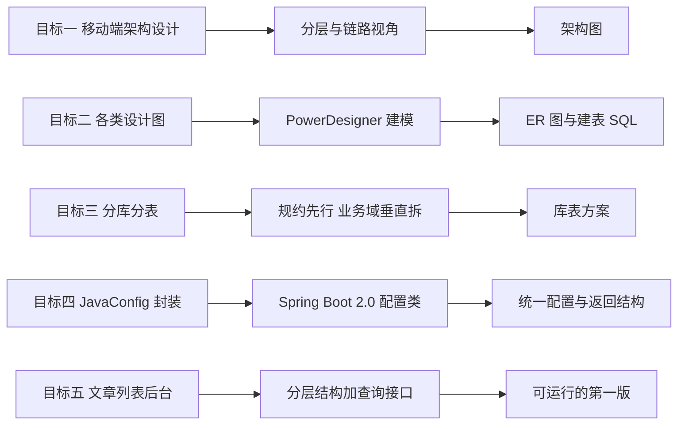

# 第一天要交出什么：头条类项目 day01 学习目标拆解

大纲把 11 天的全景铺开之后，day01 的任务书其实只有五条学习目标。目标清单看着平淡，落点却很明确：前两条练「懂」，中间两条练「配」，最后一条练「做」，合起来就是搭好环境、理解整体架构、跑通第一版后台应用。这一课把五条目标逐条拆开，说清每条对应哪些技术动作与产出物，开工前先知道「做完长什么样」。

## 先给结论

- 五条目标：熟悉移动端应用系统的架构设计、熟悉大型软件系统设计中的各种图、熟悉数据库分库分表设计技巧、熟悉 Spring Boot 2.0 加 JavaConfig 的封装配置方式、完成文章列表的后台开发。
- 前三条是认知产出：一张架构图、一套 ER 图与建表 SQL、一套库表规约；后两条是代码产出：统一封装的工程骨架、能返回数据的文章列表接口。
- 画图的落地工具是 PowerDesigner，从概念模型画到物理模型再生成建表语句；分库分表先立规约再谈拆分，MyCat 的落地排在 day02。
- JavaConfig 的核心是「配置即代码」，工程把数据访问这类通用配置做成统一的配置类，各业务模块直接复用。
- 验收标准很朴素：工程能启动，文章列表接口能返回 JSON 数据，页面原型上的列表块有数据可对。

## 五条目标逐条拆

**第一条，熟悉移动端应用系统的架构设计。** 这是一条移动端项目，用户端是 App，后台是多服务协作。架构视角要从「端」看到「库」：请求从移动端出发，经服务层分发到各个业务模块，落到 MySQL、Redis 等存储上。day01 要做的是建立这套分层视角，把项目背景（碎片时间获取资讯、按用户喜好精准推送）翻译成「哪些模块、什么链路」，产出物是一张自己能画出来的架构图。

**第二条，熟悉大型软件系统设计中的各种图。** 大型系统的沟通靠图：ER 图定数据模型，用例图定功能边界，时序图定接口调用次序。这些图不是装饰，是团队契约，画错了实现跟着错。落地工具是 PowerDesigner，资料里的使用手册覆盖了它的核心流程：概念数据模型（CDM）描述独立于具体数据库的实体与关系，物理数据模型（PDM）针对目标数据库具体化，最后从模型生成建表 SQL。手册里演示的完整动作链：新建物理模型、创建表、编辑字段、设置主键自增、为用户与订单建立一对多关联。

**第三条，熟悉数据库分库分表设计技巧。** 关键词是「从业务角度考虑怎么分」，不是上来就背中间件。分之前先立规约，day01 的资料里带了一份数据库规范设计说明书，几条强制项值得原文记住：是与否概念的字段用 `is_xxx` 命名、类型 `tinyint(1)`；表名与字段名一律小写加下划线，禁用保留字；小数用 `decimal` 禁用 `float` 与 `double`；主键索引名 `pk_字段名`、唯一索引 `uk_字段名`、普通索引 `idx_字段名`。分表时机也有明确阈值：单表行数超过 500 万行或单表容量超过 2GB 才推荐分库分表，达不到就别提前拆。方向上先按业务域垂直拆库，量到了再按查询维度水平拆表，具体分片由 MyCat 在 day02 承接。

**第四条，熟悉 Spring Boot 2.0 加 JavaConfig 的封装配置方式。** JavaConfig 是注解加配置类的配置风格，`@Configuration` 标出配置类，`@Bean` 声明组件，全程不写 XML。它的价值在「封装」二字：工程把通用配置（数据访问、统一返回结果这一类）收拢成少数几个配置类，业务模块拿来即用，这正是口播里强调的封装数据访问技巧。Spring Boot 2.0 的自动配置本身就是 JavaConfig 风格，day01 把这套写法练熟，后面 10 天的工程结构都在它的地基上。

**第五条，完成文章列表的后台开发。** 唯一的硬编码产出，也是 day01 的收官验收：走通分层结构（Controller、Service、Mapper），做出统一返回结果，文章列表接口能查出数据并按统一结构返回。它同时是前三条的试金石，表建得对不对、模型拆得顺不顺，接口一跑就知道。

五条目标的映射关系一张图说清：



关键路径从上到下是「懂到做」的递进：前三条产出图纸与规范，第四条把它们装进工程，第五条交付第一个能跑的业务接口。

## 规约怎么落到一张建表语句上

规范说明书里的条款落到代码，就是一条 DDL。以文章表为例，把上面提到的强制项串起来（示例按规约与本课写法补全）：

```sql
create table article(
  id bigint not null auto_increment comment '文章id',
  title varchar(100) not null comment '文章标题',
  content text comment '正文，超长文本独立成列',
  is_deleted tinyint(1) not null default 0 comment '1删除 0未删除',
  created_time datetime not null comment '创建时间',
  constraint pk_article_id primary key (id),
  key idx_title (title(20))
) comment '文章表';
```

这条 DDL 里每一处都对应规约：表名小写单数、字段全小写、`is_deleted` 用 `tinyint(1)` 表达逻辑删除、每个字段带 `comment`、主键索引按 `pk_` 命名、`title` 建前缀索引控制索引长度、`content` 用 `text` 且不参与索引。建模阶段在 PowerDesigner 里画出的 PDM，导出后就应该长成这个样子。

## 跑通第一版：统一返回结果与列表接口

第五条目标的最小实现，先定统一返回结构（示例为按本课写法补全）：

```java
package com.study.headline.model;

public class Result {
    private Boolean flag;
    private String message;
    private Object data;

    public static Result ok(Object data) {
        Result r = new Result();
        r.flag = true;
        r.data = data;
        return r;
    }

    public static Result error(String message) {
        Result r = new Result();
        r.flag = false;
        r.message = message;
        return r;
    }
    // getter 与 setter 略
}
```

列表接口挂上这个结构（示例为按本课写法补全）：

```java
package com.study.headline.controller;

import com.study.headline.model.Result;
import org.springframework.beans.factory.annotation.Autowired;
import org.springframework.web.bind.annotation.RequestMapping;
import org.springframework.web.bind.annotation.RequestMethod;
import org.springframework.web.bind.annotation.RestController;

@RestController
@RequestMapping("/article")
public class ArticleController {

    @Autowired
    private ArticleService articleService;

    // 文章列表：第一版只做全量查询，分页留给后续完善
    @RequestMapping(value = "/list", method = RequestMethod.GET)
    public Result list() {
        return Result.ok(articleService.findAll());
    }
}
```

day01 的验收清单随之出来：工程启动无报错；数据库里表结构与种子数据就位；请求 `/article/list` 返回 `flag` 为 true 且 `data` 带文章数组；前台原型 HTML 里的文章列表块与接口字段对得上。四项全过，第一版应用就算跑通，day02 的前端开发与 MyCat 分库分表直接在这份底子上开工。

## 常见误区

- **把目标清单当阅读材料。** 五条里两条是硬代码产出，只看不做等于 day01 白过；「熟悉」的验收方式是能复述、能落地，不是眼熟。
- **跳过建模直接写代码。** 没有规约的表字段命名随意、类型随手，等分库分表要迁移时代价极大；ER 图与规范说明书是团队契约，先画后写。
- **为分而分。** 规约写明单表超 500 万行或 2GB 才推荐分库分表，预计三年到不了量级就别在建表时拆；先垂直按业务域拆，水平分片交给 MyCat 阶段。
- **JavaConfig 与 XML 随手混用。** 项目内统一风格，Spring Boot 2.0 主线是注解驱动的配置类；XML 只在确实需要第三方框架旧配置时引入，且要注明原因。
- **第一版就堆分页、缓存。** day01 的任务是跑通结构，性能环节在 day09 之后；过早优化会把分层结构搅乱，返工成本高于收益。

## 面试可能被问到的问题

1. 面试官追问：「移动端资讯应用的后台架构你会怎么描述？」
   答：分三层讲。端上是有 App 与管理后台两个端；服务层按业务域拆微服务，Spring Boot 2.0 加 Spring Cloud 做骨架；存储层按数据特征分库，MySQL 主存储加 MyCat 分库分表，Redis 承热数据，检索走 Elasticsearch，内容链上有 Kafka 做审核解耦。一条主线是内容从生产、审核、入库、检索到推荐展示的流转。
2. 面试官追问：「分库分表从业务角度怎么拆？」
   答：先垂直后水平。垂直按业务域把用户、文章、评论拆到不同库，边界清晰互不拖累；水平再按高频查询维度（用户 id、文章 id）把大表打散。前提是规约阈值，单表 500 万行或 2GB 量级才值得拆，拆完要评估跨片查询与事务的影响。
3. 面试官追问：「ER 图和时序图在开发里各解决什么问题？」
   答：ER 图解决数据模型，实体、属性与关系定下来，建表 SQL 才有依据；时序图解决行为契约，接口由谁调谁、按什么次序调用、同步还是异步，一张图定死，联调时争议最少。图是团队沟通的低成本载体，比口头约定可靠。
4. 面试官追问：「JavaConfig 相比 XML 配置有什么优势？」
   答：配置即代码，类型安全，写错在编译期就能暴露；IDE 可以直接跳转重构；启动时容器对配置类做完整校验。Spring Boot 2.0 的自动配置本身就是 JavaConfig 风格，工程内统一用它还能把通用配置封装成可复用的配置类，减少每个模块重复贴配置。
5. 面试官追问：「统一返回结果为什么设计成 flag、message、data 三件套？」
   答：前端拿到任何接口的响应都用同一套结构处理：flag 判断成败，message 做提示，data 装数据。配合全局异常处理器，异常也转成统一结构返回，前端不用为每个接口单独约定错误格式。要演进错误码体系时，message 位置可以平滑升级。

## 配套资料

- 代码：`materials/code/05/头条day01/`，内层资料目录含数据库规范设计说明书、PowerDesigner 使用手册与前后台项目原型 HTML；原始目录与文件名冠以项目原名，正文统一以「头条类资讯项目」指代。
- 代码：`materials/code/05/头条day02/`，资料目录下有 mycat 相关配置与 weex 组件示例，与第三条目标的分库分表、第一条目标的前端形态直接衔接。
- 说明：day01 无源码包，`article` 建表 DDL、`Result` 统一返回结构与 `ArticleController` 示例为按本课写法补全；五条目标的口径按课件画面与口播整理。
