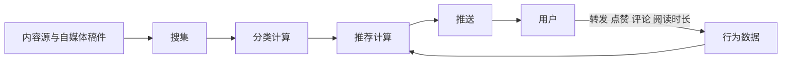

# 资讯流产品是怎么立项的：项目背景、概述与术语体系

同一款资讯 App，两个人打开的首页往往完全不同；有人刷得停不下来，有人却在吐槽内容不合口味。做后台开发的人接手这类项目时，最先要回答的不是「推荐算法怎么写」，而是更靠前的三个问题：产品为什么立项、服务哪些角色、角色之间怎么分工。这三件事看似务虚，却决定了后面每一个技术组件以什么理由出现在项目里。

## 先给结论

- 项目背景：移动端资讯消费成为习惯，碎片时间里按个人喜好刷内容是主流形态，本项目正是在这个背景下立项，对标主流资讯流 App 做资讯的搜集、计算与推送。
- 项目概述：对海量信息搜集、分类计算、推荐计算、推送给用户，用户行为数据再回流参与推荐，形成完整内容闭环；架构定位是微服务加大数据。
- 术语立契约：项目、工程、用户、自媒体人、管理员五个词各有明确指代，三端代号分别为 App、WeMedia、Admin。
- 用电商类比最直观：用户像买家，自媒体人像卖家，管理员像平台运营。
- 三端分工（消费、生产、治理）是后续功能需求、性能需求与架构设计的出发点。

## 项目背景：资讯消费搬进了手机

背景不需要复杂论证：智能手机普及之后，用手机刷新闻成了默认动作，移动端资讯需求日益增多。产品形态也随之定型，内容不再是编辑排好版的一张报纸，而是按人下菜的资讯流，每个人打开 App，看到的都是属于自己的那一份。

推荐为什么让人停不下来，机制其实不神秘。平台会统计用户的行为，包括转发、点赞、评论、阅读时长等；这些行为数据经过大数据的分析计算，算出用户的喜好，然后按喜好推荐内容。刷个不停的原因就在这里：系统比你自己更清楚你想看什么。这个机制同时说明了项目的两个技术底座，行为数据的采集与存储靠工程能力，海量行为上的分析计算靠大数据能力，所以课件把项目架构定位写成微服务加大数据，不是堆名词，是业务机制倒逼出来的组合。

## 项目概述：从搜集到推送的内容链

项目概述一句话可以说清：对海量信息进行搜集，通过系统计算分类，分析用户兴趣进行推送，满足用户碎片化阅读的需求。课件把当代网络行为概括为四个标签：碎片化、短视频、社交化、个性化。资讯流产品正是围绕这四个标签设计的，内容链可以画成一条闭环：



这条链的关键在两头的数据。入口端，内容源与自媒体稿件进入搜集环节，没有持续的内容供给，推荐就是无米之炊；出口端，用户的每一次阅读、点赞、评论都变成行为数据回流到推荐计算，闭环转得越久，画像越准。中间两步计算是大数据组件的主场，这解释了为什么一个资讯 App 的后台要同时带上微服务与大数据两套技术。

## 术语定义：五个词把角色分清

术语部分看着像走流程，实际是把项目里最容易混的几个概念钉死。课件给出五条定义与三个端代号：

| 术语 | 定义 | 电商类比 |
|---|---|---|
| 项目 | 泛指整个项目或某一项目模块 | 平台整体或某个业务子系统 |
| 工程 | 泛指某一项目的源码工程 | 代码仓库 |
| 用户 | App 用户端的用户 | 买家 |
| 自媒体人 | 通过自媒体系统发布文章的用户 | 卖家 |
| 管理员 | 管理系统的使用用户 | 平台运营 |
| App / WeMedia / Admin | 用户端、自媒体端、管理端三端的代号 | 前台、商家后台、平台后台 |

两组词最值得较真。**项目与工程的区别是业务与代码的区别。** 项目是业务概念，可以按模块再切分；工程是源码组织方式，一个项目落地时可能拆成多个工程。评审会上有人说「这个项目要加个表」，有人说「这个工程要加依赖」，指的不是一个层面的东西。**自媒体人是用户的升级态而不是另一类人。** 从术语定义看，自媒体人是「通过自媒体系统发送文章的用户」，底子还是用户，只是多了发文能力，这一点会直接影响账户体系的设计，两端的账号要能对得上。

## 三端组成：一个产品三条业务线

把术语落到产品结构上，系统由三个端组成：App 端负责内容消费，自媒体端负责内容生产，管理端负责内容治理，包括审核与统计。端上形态是自研 App 加 Web 后台，服务端是微服务集群，端与服务之间通过接口通信，也就是前后端分离加自研 App 的组合。开发侧可以配合分域建表，把三端的数据边界先画出来（示例为按本课写法补全，命名与类型规约出自资料里的数据库规范设计说明书）：

```sql
-- App 端用户：所有角色的底座
create table ap_user(
  id bigint not null auto_increment comment '用户id',
  name varchar(32) not null comment '用户名称',
  is_verified tinyint(1) not null default 0 comment '1已实名 0未实名',
  is_deleted tinyint(1) not null default 0 comment '1删除 0未删除',
  created_time datetime not null comment '注册时间',
  constraint pk_ap_user_id primary key (id)
) comment 'App 端用户表';

-- 自媒体端用户：实名升级后获得发文能力
create table wm_user(
  id bigint not null auto_increment comment '自媒体人id',
  ap_user_id bigint not null comment '关联 App 用户id',
  is_deleted tinyint(1) not null default 0 comment '1删除 0未删除',
  constraint pk_wm_user_id primary key (id)
) comment '自媒体端用户表';
```

两张表是「自媒体人是升级态的用户」这句术语的直接翻译：`wm_user` 不重复存一套昵称密码，靠 `ap_user_id` 挂在用户表上；实名状态按规约用 `is_xxx` 命名加 `tinyint(1)` 类型表达。角色语义写进代码，就是给三个端代号一个枚举（示例为按本课写法补全）：

```java
package com.study.headline.enums;

/**
 * 三端角色代号，与课件术语定义一一对应
 */
public enum UserType {
    /** App 端用户 */
    APP,
    /** 自媒体端用户，即自媒体人 */
    WEMEDIA,
    /** 管理端用户，即管理员 */
    ADMIN
}
```

三端分工是后面需求课的骨架：功能需求按端归类，性能需求按端给指标，交互需求讲的是三端之间稿件与数据的流转。背景、概述、术语这三块内容，到需求课就开始逐条兑现。

## 常见误区

- **把「用户」当成一种人。** 系统里至少有三类账户：App 用户、自媒体人、管理员。自媒体人是实名升级后的用户，管理员则是管理端独立的账号体系；混用一套表设计，后面权限与审核都会乱。
- **项目与工程混用。** 项目按业务模块说话，工程按代码仓库说话；把两者混在一个词里，排期与技术评审会互相打架。
- **把推荐当成后期贴上去的功能。** 行为数据从第一天就在产生，表结构、埋点与消息链路都要为它留位；等上线再补采集，历史行为找不回来。
- **跳过原型直接谈技术。** 资料里带着前后台两套原型 HTML，功能清单与页面结构以原型为准；不看原型就定接口，返工是大概率事件。

## 面试可能被问到的问题

1. 面试官追问：「用一句话说清这个项目是做什么的。」
   答：一个对标主流资讯流 App 的社交媒体项目，对海量资讯进行搜集、分类计算与推荐计算，再按用户兴趣推送到移动端；用户行为数据回流参与推荐，形成内容闭环。技术上采用微服务加大数据的组合。
2. 面试官追问：「项目的三个端怎么划分，为什么这样分？」
   答：按职责分三端：App 端面向内容消费，自媒体端面向内容生产，管理端面向内容治理，包括审核与统计。划分依据是角色不同，用户、自媒体人、管理员各自的操作场景差别很大，合在一起会互相拖累；分开后每端的性能指标与发布节奏也可以独立管理。
3. 面试官追问：「自媒体人和用户在账户体系上是什么关系？」
   答：自媒体人是用户的升级态。用户完成实名认证后获得发文能力，进入自媒体端；账户上自媒体端用户关联 App 用户，不重复建一套账号密码。这样登录态可以打通，权限差异集中在一个角色维度上。
4. 面试官追问：「为什么资讯流产品必须做行为采集？」
   答：推荐的原料就是行为数据，转发、点赞、评论、阅读时长共同构成兴趣画像；没有行为回流，推送退化成全站统一排序，产品核心卖点就不存在。所以行为采集在表结构与链路设计上要当作一等公民对待。
5. 面试官追问：「项目和工程的区别是什么？」
   答：项目是业务概念，指整个产品或某个业务模块，讨论范围、排期、需求时用；工程是源码概念，指落地这段业务的代码工程，讨论依赖、构建、部署时用。一个项目可以拆成多个工程，术语混用会在沟通里埋坑。

## 配套资料

- 代码：`materials/code/05/头条day01/`，内层资料目录含数据库规范设计说明书、PowerDesigner 使用手册与前后台项目原型 HTML；原始目录与文件名冠以项目原名，正文统一以「头条类资讯项目」指代。
- 说明：本课为概念与术语讲解，无源码包；`ap_user`、`wm_user` 建表示例与 `UserType` 枚举为按本课写法补全，规约条款引用自资料内数据库规范设计说明书原文。
