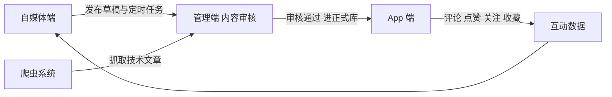

# 功能需求地图：App 端、自媒体端、管理端与爬虫系统各管什么

拿到一个资讯产品的需求评审，最怕两件事：功能清单有漏项，功能归属张冠李戴。这节课把整个项目的功能需求一次铺开：先立四大块的全景，再按端逐个过功能点，最后划清一期的边界。资料里带着两套原型 HTML，每个功能点都有页面可对，对着原型讲需求，讨论时不容易漏。

## 先给结论

- 功能需求分四大块：用户移动 App 端、自媒体端、管理平台、爬虫系统。
- 文章来源有两条通道：自媒体人发布与爬虫抓取，两路内容都必须经过管理端审核，通过后才能进入正式库供 App 查看。
- App 端管消费：登录注册、文章列表、频道、详情、搜索、评论、点赞、关注、收藏、消息。
- 自媒体端管生产：发文与内容管理为核心，另有评论管理、粉丝管理、账号安全；管理端管治理：用户管理、频道管理、内容审核、数据统计、系统管理。
- 广告系统、推荐系统、计算系统与支撑系统属第二阶段，一期把边界留好即可。

## 全景：四大块与一条内容主线

课件把功能需求画在项目模块结构图上，讲解时概括成四大块。App 端是用户登录后进行文章访问的端；自媒体端是自媒体人登录后发布与管理文章的端；管理平台做数据统计与内容审核管理；爬虫系统负责从外部补充内容源。四块之间靠一条内容主线串起来：



主线的关键是文章来源有两块：一块是自媒体人发布的文章，一块是爬虫从公开技术社区抓取的技术类文章。两块内容殊途同归，都要先进审核，通过才能发布到正式库，App 端看到的每篇文章都是过了治理关的。互动数据回流到自媒体端，支撑起作者侧的评论管理与粉丝管理场景。原型 HTML 建议用火狐浏览器打开，无需安装插件；前台一套覆盖 App 与自媒体端页面，后台一套覆盖管理端页面。

## App 端：内容消费的完整闭环

App 端的功能围绕「看」字展开，按使用路径串一遍。**入口是注册登录。** 支持账号密码与手机号两种登录方式，首次使用走注册，启动页承担开屏提示。**首页是文章列表。** 列表卡片有三种形态：不含图片的纯文字卡、包含一张图的单图卡、包含三张图的三图卡；day01 要做的文章列表后台开发，喂的就是这个页面。**频道决定内容范围。** 系统有默认频道（如推荐、最新、北京、娱乐），用户可以按自己的喜好增删频道，添加频道时系统还能依据用户喜好做推荐。**详情页是互动主场。** 点进文章后展示作者信息、是否关注、点赞与不喜欢、分享、评论，这些互动既是产品能力，也是推荐的数据来源。**搜索要留痕。** 获取用户搜索的内容并记录历史搜索信息，搜索历史与联想都依赖这份记录。**个人中心收拢个人资产。** 关注、粉丝、收藏、历史、个人信息、实名认证都在这里，实名认证之后用户即可成为自媒体人。另有消息通知与私信，覆盖站内触达场景。

接口层面，三种卡片形态可以用一个返回结构表达（示例为按本课写法补全）：

```java
package com.study.headline.model;

import java.util.List;

/**
 * App 首页文章卡片：imageList 元素个数决定卡片形态
 * 0 张为纯文字卡，1 张为单图卡，3 张为三图卡
 */
public class ArticleCard {
    private Long articleId;
    private String title;
    /** 卡片配图，元素个数为 0、1、3 */
    private List<String> imageList;
    private Long commentCount;
    private Long userId;
    private String userName;
    // getter 与 setter 略
}
```

## 自媒体端：内容生产的工具箱

自媒体端是给内容生产者用的后台。**发文是核心功能。** 表单包含标题、正文与封面，封面可选单图、三图、五图；支持定时发布与存入草稿。要划重点的是，发布之前必须经过审核，自媒体端只负责提交，不负责放行。**内容管理管稿件生命周期。** 已发布文章与草稿都能查、能改、能撤。**互动侧有配套管理。** 评论管理可以查看并处理文章的评论；粉丝管理提供粉丝列表与粉丝画像，画像靠数据统计能力支撑。**素材与账号不缺位。** 素材管理统一存图，账号管理覆盖账号信息、黑名单与安全中心；原型里还有我的收益、结算中心等创作激励页面，说明产品对创作者链路是有完整规划的。

## 管理端：内容治理与数据大盘

管理端解决「谁都能发内容，平台怎么把关」的问题。**用户管理维护账户秩序。** 对用户信息增删改查，对违规用户可以封禁；用户审核分身份审核与实名审核，身份审核覆盖工作、资质等信息的核验。**频道管理是频道的唯一新建入口。** App 端展示与选择频道，频道本身的创建与维护在管理端完成，避免频道数据出现两套来源。**内容审核是整个系统最重要的一环。** 自媒体人发布的文章与爬虫抓取的文章都先进审核队列，审核对象包括文字、图片与相关数据信息，通过之后才能进入正式的 App 内容库，这道关卡是内容合规的硬约束。**数据统计给平台装仪表盘。** 日活用户、日均访问量、访问 IP 是基础指标，配合 ECharts 出图形报表，还有更细的统计页面可以展开看。**系统管理守住后台自身。** 管理员账号的创建与维护、角色与权限设置都在这里，后台自己不能在权限上裸奔。

文章在两端之间的流转，本质是一个状态机（示例为按本课写法补全）：

```java
package com.study.headline.enums;

/**
 * 文章状态机：自媒体端提交，管理端裁决，App 端只读已通过状态
 */
public enum ArticleStatus {
    DRAFT,      // 草稿：自媒体端可改可删
    REVIEWING,  // 待审核：进入管理端审核队列
    APPROVED,   // 审核通过：入正式库，App 端可见
    REJECTED    // 审核不通过：退回自媒体端整改
}
```

## 爬虫系统与一期边界

爬虫系统的定位要摆正：它是内容供给侧，不是独立业务。系统通过爬虫抓取公开技术社区的技术类文章，与自媒体稿件走同一条审核链，抓取与更新的细节在 day07、day08 落地。另外，功能架构里还挂着广告系统、推荐系统、计算系统与支撑系统，这些属于第二阶段的内容，一期要做的是把内容链走通、把边界留好；把二期功能提前塞进一期，接口与存储会被过早定死，改动成本极高。

## 常见误区

- **把审核当成自媒体端的功能。** 自媒体端只有提交与查看状态，放行动作在管理端；把审核接口挂在自媒体端，等于让运动员兼裁判。
- **在 App 端新建频道。** App 端做的是频道选择与排序，频道的新建与维护在管理端；两端职责颠倒，频道数据会出现两套来源。
- **漏掉爬虫这条内容源。** 只想到自媒体人发文，内容量撑不起资讯流形态；爬虫系统的存在说明文章来源天然是双通道，内容治理要一并覆盖。
- **把二期功能写进一期。** 推荐与广告二期才上，一期要做的只是数据留痕与边界清晰；提前实现换来的往往是返工。

## 面试可能被问到的问题

1. 面试官追问：「项目的功能需求按什么维度组织？」
   答：按端组织成四大块：用户移动 App 端、自媒体端、管理平台与爬虫系统。App 端覆盖登录、列表、频道、详情、搜索、互动与个人中心；自媒体端覆盖发文与内容管理；管理端覆盖用户、频道、内容审核、数据统计与系统管理；爬虫系统作为内容供给侧。再往后才是二期的广告、推荐与计算系统。
2. 面试官追问：「文章从发布到用户可见要经过哪些环节？」
   答：自媒体人在自媒体端提交文章，可以定时发布也可以存草稿，提交后进入审核队列；管理端对文字与图片等内容进行审核，通过后进入正式内容库；App 端从正式库读取展示。爬虫抓取的文章同样走这条审核链，不因来源不同而豁免。
3. 面试官追问：「为什么内容审核要放在管理端而不是自媒体端？」
   答：审核是对内容的治理动作，治理权必须在平台手里；自媒体端是生产工具，只能提交与整改。分离之后审核规则、审核队列与操作记录都集中在一处，自媒体人无法影响裁决，合规链路才立得住。
4. 面试官追问：「App 首页的文章列表接口要考虑哪些形态？」
   答：卡片有纯文字、单图、三图三种形态，一个结构里用图片列表表达，元素个数决定前端渲染哪种卡；同时要带作者信息与评论数，供列表页直接展示。频道维度上，接口要支持默认频道与用户自选频道两种取数范围。
5. 面试官追问：「爬虫抓来的内容和自媒体发布的处理有什么异同？」
   答：相同点是治理标准一致，都要过管理端审核后入正式库；不同点是自媒体内容来自作者主动提交，带完整的作者与账号信息，爬虫内容来自公开页面，需要先做来源确认与清洗，再进入审核流程。

## 配套资料

- 代码：`materials/code/05/头条day01/`，内层资料目录含前后台两套项目原型 HTML（前台覆盖 App 与自媒体端页面，后台覆盖管理端页面，建议用火狐浏览器打开），功能清单可逐页对照；另有数据库规范设计说明书与 PowerDesigner 使用手册；原始目录与文件名冠以项目原名，正文统一以「头条类资讯项目」指代。
- 说明：本课为需求讲解，无源码包；`ArticleCard` 与 `ArticleStatus` 为按本课写法补全的示例，页面功能点以原型 HTML 为准。
