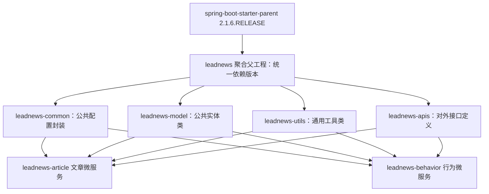

# 后端多模块工程导入：聚合工程的模块分工与环境配置

拿到一个十几个模块的 Maven 工程直接 Import，等 IDEA 索引半天报一片红，多半是仓库没配、编码没设、JDK 不对。这个头条类资讯项目的后端是一个聚合工程，模块之间有清晰的继承与依赖关系，读不懂这层关系，后面写微服务时就会困惑「为什么这里没引 Spring Boot 却能启动」。先把结构看明白，再按步骤导入，环境一次性配到位。

## 先给结论

- 顶级是一个继承 Spring Boot 的聚合工程，只做一件事：统一管理依赖与版本；真正干活的模块挂在它下面。
- 四个通用模块各管一摊：`common` 管公共配置封装、`model` 管公共实体、`utils` 管工具类、`apis` 管对外接口定义。
- 微服务模块按业务划分，day01 会用到文章与行为两个，它们依赖通用模块，间接继承到 Spring Boot。
- 导入要做三件事：Maven 本地仓库指向资料提供的仓库、三处编码统一 UTF-8、JDK 固定 1.8。

## 工程结构：一个父工程加两类模块

整个后端工程的最顶级是一个 Spring Boot 项目，它本身是 POM 聚合工程，不含一行业务代码，职责是继承 Spring Boot 并统一定义依赖信息。往下分两类模块。**一类是通用工程，共四个。** `common` 里放公共配置，要封装 Redis、封装 MySQL、封装 Kafka 都在这里完成；`model` 里放公共实体类，项目中跟数据库表映射的实体都定义在这里；`utils` 放通用工具类；`apis` 是对外接口的定义工程，接口在哪个微服务实现、路径怎么写都在这里声明。另外还有一个 test 测试工程，项目中并没有实际使用，知道存在即可。**另一类是微服务模块。** 按具体业务划分，一个业务一个模块，day01 会涉及文章 article 与行为 behavior 两个。它们都会依赖上面的四个通用模块，也就间接继承了顶级工程、用上了 Spring Boot，这是「微服务自己不用再引一遍框架」的关键。



箭头方向就是依赖方向：微服务在上层，通用模块在下层，Spring Boot 沿继承链传下来。每个模块的包结构都以 `com.study.headline` 开头，与模块名对应，比如公共配置在 `com.study.headline.common`。每个模块下还带着三个通用文件，属于请求响应对象、序列化与多环境配置这类通用配置，在通用配置课程里展开。

## 父 pom 要读懂的四块

打开顶级工程的 `pom.xml`，从上往下有四块内容值得停下来看。**坐标与聚合。** groupId、artifactId 定义坐标，`modules` 里列出四个通用模块，聚合工程靠它一次构建全部子模块。**继承 Spring Boot。** `parent` 指向 `spring-boot-starter-parent`，版本是 `2.1.6.RELEASE`，编码属性一并声明：

```xml
<parent>
    <groupId>org.springframework.boot</groupId>
    <artifactId>spring-boot-starter-parent</artifactId>
    <version>2.1.6.RELEASE</version>
    <relativePath/>
</parent>
<properties>
    <project.build.sourceEncoding>UTF-8</project.build.sourceEncoding>
    <project.reporting.outputEncoding>UTF-8</project.reporting.outputEncoding>
    <java.version>1.8</java.version>
</properties>
```

**统一依赖管理。** 聚合工程最大的价值在这里：所有依赖的版本在父 pom 定一次，子模块引依赖不写版本号。项目选了 Spring Boot 加 log4j2 的日志组合，日志、上传下载工具、加密、MySQL 等依赖版本都在这里统一定义：

```xml
<dependencies>
    <dependency>
        <groupId>org.springframework.boot</groupId>
        <artifactId>spring-boot-starter-log4j2</artifactId>
    </dependency>
</dependencies>
```

**编译插件锁定版本。** 用 `maven-compiler-plugin` 把源码与目标版本绑到 `${java.version}`，保证任何机器上编译行为一致：

```xml
<plugin>
    <groupId>org.apache.maven.plugins</groupId>
    <artifactId>maven-compiler-plugin</artifactId>
    <version>3.7.0</version>
    <configuration>
        <source>${java.version}</source>
        <target>${java.version}</target>
    </configuration>
</plugin>
```

还有一块容易漏看：既然强制用 log4j2，就要把 Spring Boot 自带的默认日志排掉，否则两套日志框架同时生效，输出会乱。做法是在 `spring-boot-starter-web` 里显式排除 `spring-boot-starter-logging` 与 `slf4j-api`：

```xml
<dependency>
    <groupId>org.springframework.boot</groupId>
    <artifactId>spring-boot-starter-web</artifactId>
    <exclusions>
        <exclusion>
            <groupId>org.springframework.boot</groupId>
            <artifactId>spring-boot-starter-logging</artifactId>
        </exclusion>
        <exclusion>
            <groupId>org.slf4j</groupId>
            <artifactId>slf4j-api</artifactId>
        </exclusion>
    </exclusions>
</dependency>
```

## model 模块的拆包方式

通用模块里 `model` 最值得单独看一眼：实体不是平铺一个包，而是按业务域拆分，admin、article、media、user、crawler 各一个包，与微服务的划分一一对应。这样安排有两个好处：文章微服务要的实体去 `model.article` 找，行为微服务要的去对应包找，实体归属一目了然；微服务之间不直接共享 Service，只共享实体与工具，边界清晰。`utils` 模块里则已经预置了一批工具类，加密、JWT、日期处理都有，用到哪个到哪一课展开。

## 导入步骤与环境要求

开发环境有明确要求：JDK 必须是 1.8，不要用更高版本，与项目保持一致；IDE 用 IntelliJ IDEA；配套 Tomcat 8.5；Git 装上备用，这个初始工程本身没有用 Git 管理。导入按下面的顺序走：

1. 从资料目录里找到后台初始工程的压缩包，解压，把工程拷贝到一个空目录下。
2. IDEA 选择 Open，直接打开工程根目录，等待 Maven 加载；过程中会有索引动作，不用干预。
3. 配 Maven 本地仓库：Settings 里找到 Build Tools 下的 Maven，把 Maven home、User settings file 配好，本地仓库指向资料提供的仓库目录，这一步决定依赖能不能离线解析成功。
4. 配编码：Settings 里 Editor 下的 File Encodings，全局编码、工程编码、默认属性文件编码三处都设为 UTF-8。

四步做完，工程树展开就是顶级 pom 加四个通用模块加微服务模块的结构，导入就算完成。

## 常见误区

- **JDK 用 11 或 17 编译。** 父 pom 锁的是 1.8，高版本 JDK 编译老依赖（如早期 lombok、asm 相关）会直接报错或出诡异警告，本工程严格用 1.8。
- **在微服务里重写一份实体。** 实体统一放 `model` 按业务域拆包，微服务只做依赖引用；各写一份会造成字段不同步，联调时对不上数据。
- **本地仓库用默认路径重新下载。** 资料提供的是配套仓库，版本号都是对齐过的；换默认仓库远程拉取，可能拉到不兼容的新版本，也可能离线环境直接失败。
- **日志依赖排他忘掉。** 只加 log4j2 不排默认 logging，classpath 里两套日志并存，日志配置文件不生效、输出重复，排查时先查这块。

## 面试可能被问到的问题

1. 面试官追问：「为什么后端要拆成聚合工程加多模块，而不是一个大工程？」
   答：聚合工程把依赖版本统一在父 pom 管理，子模块不重复声明；common、model、utils、apis 四个通用模块把公共配置、实体、工具、接口定义收敛到一处，微服务按业务划分只依赖需要的模块。这样模块职责单一、依赖方向清晰，改公共配置只动一处，各微服务也不会把无关代码带进构建。
2. 面试官追问：「微服务模块自己没有继承 Spring Boot，为什么能写成 Spring Boot 应用？」
   答：微服务依赖四个通用模块，通用模块继承顶级聚合工程，聚合工程的 parent 是 spring-boot-starter-parent，继承关系沿依赖链传递，所以微服务间接拿到了 Spring Boot 的依赖管理，starter 场景下再引入具体的 starter 即可。
3. 面试官追问：「log4j2 替换默认日志时要注意什么？」
   答：Spring Boot 默认日志是 logback，必须在引入 spring-boot-starter-web 时排除 spring-boot-starter-logging 与 slf4j-api，再引入 spring-boot-starter-log4j2，否则两套日志绑定并存，配置文件不生效、日志重复输出。
4. 面试官追问：「maven-compiler-plugin 在父 pom 里配置 source 和 target 的意义是什么？」
   答：把编译级别绑定到 ${java.version} 属性，子模块不需要各自声明，整批模块的编译目标一致，避免不同机器本地 JDK 设置不同导致编译产物级别不一致的问题。
5. 面试官追问：「实体类为什么要按业务域拆包放在公共 model 里？」
   答：一个业务的实体可能被多个微服务读写，例如文章实体在文章微服务与检索、推荐侧都会用到。按 admin、article、media、user、crawler 拆包后，实体归属与业务划分对齐，微服务按需依赖，避免了所有实体混在一个包里带来的耦合与查找成本。

## 配套资料

- 代码：`materials/code/05/头条day01/`，内层资料目录含数据库规范设计说明书、PowerDesigner 使用手册与前后台项目原型 HTML；原始目录与文件名冠以项目原名，正文统一以「头条类资讯项目」指代。
- 说明：后端初始工程压缩包不在本课资料包内，pom 片段与模块结构为按画面线整理补全，包名统一改写为 `com.study.headline`；模块职责口径按口播与课件画面线。
