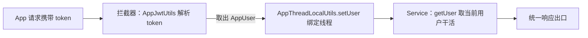

# 常用工具类盘点：日期、AES 混淆、JWT 与 ThreadLocal

> 🔒 安全提示：文中示例的口令/密钥均为课程教学环境演示口径，生产环境的安全要求见《安全与合规须知》。

业务代码还没写几行，utils 工程里已经躺着一排工具类。这些类不是可看可不看的摆设：接口规范里说的 ID 混淆、token 校验、当前用户透传，落地的就是这里几个类。读后续课程代码时卡壳，多半是不知道某个工具类的方法干什么的。这一课把最常用的几个逐个过一遍，说清用途、关键方法与使用边界，其余的用到再查。

## 先给结论

- 工具类集中在 utils 工程，先熟悉四个主力：`DateUtils` 日期格式化、`IdUtils` AES 加解密、`AppJwtUtils` token 生成与解析、`AppThreadLocalUtils` 当前用户绑定线程，`FileUtils`、`DataConvertUtils`、`UrlSignUtils` 认识即可。
- `IdUtils` 用 AES 对连续自增 ID 做混淆，对应接口通用规范里的 ID 混淆条款，加密解密成对存在。
- `AppJwtUtils` 生成的 token 载荷是 JSON 用户信息，有效期一天，每次请求带上来解析出用户。
- `AppThreadLocalUtils` 把解析出的 App 用户绑进当前线程，业务层随取随用，不必层层传参。

## 工具类放在哪、为什么值得单独抽

utils 工程的包结构按用途分了三个包，先看目录再逐个认人：

```text
com.study.headline.utils
├── common        // DateUtils DataConvertUtils FileUtils IdUtils UrlSignUtils
├── jwt           // AppJwtUtils
└── threadlocal   // AppThreadLocalUtils
```

为什么要专门抽工具类，而不是需要时在业务代码里顺手写一段？理由有三条：同类逻辑在业务里重复写，重复率高，改一处漏一处；散落在各处让业务代码又长又乱；抽出来之后职责干净，复用几率立刻上去。工具类的读法也有讲究：不需要背实现，记住每个方法「入参是什么、返回什么、解决什么问题」即可，项目里工具类只会越来越多，会查比会背重要。

## DateUtils：日期格式化的固定出口

日期处理是最高频的工具场景，`DateUtils` 把常用格式定义成常量，再提供格式化方法：

```java
public static String DATE_TIME_FORMAT = "yyyy-MM-dd HH:mm:ss";
// 2019年07月05日 14:00:32
public static String DATE_TIME_FORMAT_CHINESE = "yyyy年M月d日 HH:mm:ss";

/** 日期对象格式化为字符串 */
public static String dateToString(Date date) {
    SimpleDateFormat df = new SimpleDateFormat(DATE_TIME_FORMAT);
    return df.format(date);
}

/** 获取当前日期的字符串形式 */
public static String getCurrentDate() {
    SimpleDateFormat df = new SimpleDateFormat(DATE_TIME_FORMAT);
    return df.format(new Date());
}
```

方法体不长，价值在于格式统一：全项目输出 `yyyy-MM-dd HH:mm:ss` 都走这一个出口，日志与数据里日期样式不再五花八门。配套的 `DataConvertUtils` 更进一步，提供 `convert` 与 `unConvert` 两个方法，按注解把对象里的日期与字符串互转，出入参自动完成日期转换，业务代码不用手工调格式化。

## IdUtils：AES 混淆连续 ID

接口通用规范要求请求与响应中的连续增长 ID 必须混淆加密，实现就在 `IdUtils`：AES 加密，密钥为 32 字节字符串，`encrypt(Long)` 先用 `%016d` 把数字补齐到 16 位再加密，密文转十六进制字符串返回；解密方向提供 `decryptLong`、`decryptInt`。按画面线整理后的可编译版本如下（原屏片段个别行被截断，此处补全）：

```java
private static final String KEY_AES = "AES";
private static final String KEY_SECRET = "12345678901234561234567890123456";

/** 长整型 ID 加密：先补齐 16 位再做 AES */
public static String encrypt(Long number) throws Exception {
    String src = String.format("%016d", number);
    return encrypt(src);
}

public static Long decryptLong(String src) throws Exception {
    return Long.valueOf(decrypt(src));
}

private static String encrypt(String src) throws Exception {
    byte[] raw = KEY_SECRET.getBytes();
    SecretKeySpec skeySpec = new SecretKeySpec(raw, KEY_AES);
    Cipher cipher = Cipher.getInstance(KEY_AES);
    cipher.init(Cipher.ENCRYPT_MODE, skeySpec);
    byte[] encrypted = cipher.doFinal(src.getBytes());
    return bytesToHexString(encrypted);
}

private static String decrypt(String src) throws Exception {
    byte[] raw = KEY_SECRET.getBytes();
    SecretKeySpec skeySpec = new SecretKeySpec(raw, KEY_AES);
    Cipher cipher = Cipher.getInstance(KEY_AES);
    cipher.init(Cipher.DECRYPT_MODE, skeySpec);
    byte[] original = cipher.doFinal(hexToBytes(src));
    return new String(original);
}
```

选择 AES 而不是 MD5 是需求决定的：ID 混淆必须可逆，前端把混淆后的 ID 传回来，服务端要解密还原成真实主键去查库，MD5 不可逆就断了这条路。`UrlSignUtils` 是同类思路的另一处应用，负责 URL 签名校验，知道用途即可。

## AppJwtUtils：token 的生成与解析

JWT 是一个三段式字符串：头部声明算法，载荷放业务数据，尾部是签名。对这个项目来说，token 的载荷就是 JSON 用户信息：登录时用 `getToken` 给用户签发一个 token，之后每次请求把 token 带上来，服务端解析出用户信息。按画面线整理的骨架如下（密钥为课件 Base64 串的缩略示意，JWT 依赖为 jjwt）：

```java
public class AppJwtUtils {
    // TOKEN 有效期一天
    private static final long TOKEN_TIME_OUT = 24 * 3600 * 1000L;
    // 加密密钥（课件为 Base64 串，此处缩略）
    private static final String TOKEN_ENCRY_KEY =
            "MDA4ZjIyY2Q0NjJmZDMzM2M2ZDU0OTg2Nzg0NjI0MjIz";

    /** 生成 token：载荷放用户 id */
    public static String getToken(Integer id) {
        Map<String, Object> claims = new HashMap<>();
        claims.put("id", id);
        return Jwts.builder()
                .setClaims(claims)
                .setId(UUID.randomUUID().toString())
                .setIssuedAt(new Date())
                .setExpiration(new Date(System.currentTimeMillis() + TOKEN_TIME_OUT))
                .signWith(SignatureAlgorithm.HS256, TOKEN_ENCRY_KEY)
                .compact();
    }

    /** 解析 token：过期或签名不符返回 null */
    public static Map<String, Object> parseToken(String token) {
        try {
            return Jwts.parser()
                    .setSigningKey(TOKEN_ENCRY_KEY)
                    .parseClaimsJws(token)
                    .getBody();
        } catch (ExpiredJwtException | SignatureException e) {
            return null;
        }
    }
}
```

解析出用户之后还有一步：把它放进当前线程。整条链路如下图：



关键路径是 token 在拦截器层解析一次，用户对象绑定到线程，Service 层任何位置都能拿到当前用户，参数里不再出现 userId 的层层透传。

## AppThreadLocalUtils：把用户绑到当前线程

ThreadLocal 的作用一句话说清：给每个线程一份私有变量副本，同一个方法在不同线程里取到的值互不干扰。工具类本体非常短：

```java
package com.study.headline.utils.threadlocal;

import com.study.headline.model.user.pojo.AppUser;

public class AppThreadLocalUtils {
    private final static ThreadLocal<AppUser> userThreadLocal = new ThreadLocal<>();

    /** 设置当前线程中的用户 */
    public static void setUser(AppUser user) {
        userThreadLocal.set(user);
    }

    /** 获取线程中的用户 */
    public static AppUser getUser() {
        return userThreadLocal.get();
    }
}
```

`AppUser` 是 model 工程 user 包下的移动端用户实体。拦截器解析 token 得到用户后调 `setUser`，业务代码调 `getUser`，收发两端就这一对方法。用它之前先确认线程是同一个：一次 HTTP 请求从拦截器到 Service 通常在同一 Tomcat 线程内完成，这正是它能透传的前提；一旦中间切换了线程池异步执行，ThreadLocal 里的值就跟不过去，需要显式传参。

## 常见误区

- **把 SimpleDateFormat 当共享静态实例。** 它内部有可变状态，多线程并发 format 会出错或互相污染；要么像工具类这样方法内新建，要么换线程安全的 `DateTimeFormatter`。
- **往 JWT 载荷塞敏感信息。** 载荷只是编码不是加密，拿到 token 就能解出内容；手机号、密码这类数据不能放进 payload，token 里只放 id 这类无敏感性的标识。
- **ThreadLocal 用完不 remove。** Tomcat 线程是复用的，上一次请求 set 的用户不清掉，下一个请求拿到别人的用户数据；请求结束时必须显式清理。
- **演示密钥直接上生产。** `KEY_SECRET` 与 JWT 密钥硬编码在源码里，教学演示可以接受，生产环境密钥应外置到配置中心或环境变量，泄漏即等于加密失效。

## 面试可能被问到的问题

1. 面试官追问：「JWT 的结构是什么，为什么载荷里不能放敏感信息？」
   答：JWT 由头部、载荷、签名三段组成，用点号拼接。头部声明签名算法，载荷放业务数据（这里就是用户 id），签名用来防篡改。载荷部分只是 Base64 编码，不是加密，任何人拿到 token 都能解出内容，所以只能放无敏感性的标识，不能放手机号、密码。
2. 面试官追问：「ThreadLocal 在 Tomcat 这种线程池场景下有什么风险？」
   答：线程会复用，上一个请求 set 的值如果不清除，下一个请求读到的是上一个用户的数据，出现串号；同时 key 是弱引用、值是强引用，不 remove 还可能造成内存泄漏。规范做法是请求结束时在 finally 或拦截器 afterCompletion 里调用 remove。
3. 面试官追问：「ID 混淆为什么用 AES 而不用 MD5？」
   答：因为必须可逆。前端拿到的是混淆后的字符串，传回服务端时要解密还原成数据库主键才能查询，AES 支持加解密成对使用；MD5 不可逆，只能用于校验类场景，无法满足还原需求。
4. 面试官追问：「为什么要把用户放进 ThreadLocal，而不是每次方法传参？」
   答：当前用户是几乎每个业务方法都要用的上下文，层层传参会让 controller 到 service 到工具类的签名都被污染，还容易漏传。拦截器解析 token 后绑定线程，业务代码在同一请求线程内随取随用，代码干净且用户来源唯一。
5. 面试官追问：「token 有效期一天，过期了怎么处理比较合理？」
   答：短有效期配合续期机制。过期后解析失败返回未登录错误码，客户端引导重新登录或携带 refresh token 换新 token；也可以在服务端校验时对临期 token 静默续签。有效期过长的 token 泄漏后风险窗口大，一天是比较常规的取舍。

## 配套资料

- 代码：`materials/code/05/头条day01/`，内层资料目录含数据库规范设计说明书、PowerDesigner 使用手册与前后台项目原型 HTML；原始目录与文件名冠以项目原名，正文统一以「头条类资讯项目」指代。
- 说明：utils 工程与工具类源码不在本课资料包内，文中类为按画面线代码片段整理补全的可运行版本，包名统一改写为 `com.study.headline`；工具类清单与用途口径按口播与画面线（DateUtils、DataConvertUtils、FileUtils、IdUtils、UrlSignUtils、AppJwtUtils、AppThreadLocalUtils）。
