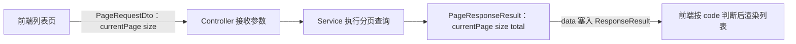

# 通用请求与响应对象：ResponseResult、错误码号段与分页 DTO

接口通用规范把「所有接口统一返回壳」写成了硬性条款，但规矩只是规范的一半，另一半是把这些类真实地建出来。打开 model 工程的 `com.study.headline.model.common.dtos` 包，响应壳、错误码枚举、分页响应三个响应类，加上一个分页请求参数类躺在里面，整个头条类资讯项目的接口出入参全部由它们撑起来。这一课把这几个类逐一打开看实现，看完之后接口层所谓的「通用」二字就有了实体，写任何接口都知道该拿什么接参、拿什么返回。

## 先给结论

- DTO（Data Transfer Object）即数据传输对象，专门负责展现层与服务层之间的数据搬运：前端传来的参数先封装进 DTO 再进 service，响应也以 DTO 形态回传。
- 响应统一用 `ResponseResult`，字段为来源主机、code、错误信息和泛型 data；静态工厂方法覆盖成功、失败、自定义文案三种出口，另有链式 ok 与 error 方法。
- 错误码统一收口在 `AppHttpCodeEnum`，按号段划分：登录段靠前，token 段 50 起，签名段 100 起，参数错误段 500 起，数据错误段 3000 起，见码即知错误类别。
- 分页是最高频的接口形态，两端各有一个参数包：请求端 `PageRequestDto` 只带 currentPage 与 size；响应端 `PageResponseResult` 继承响应壳，扩展当前页、每页条数、总条数三个字段。

## DTO 是什么，为什么放在 model 工程

DTO 的定义一句话说清：数据传输对象，用在展现层与服务层之间传数据。前端想往微服务传一篇文章的标题、频道、内容，不会散着传一堆零散参数，而是封装成一个 DTO 对象整体提交；微服务处理完，把结果放进统一的响应壳回传。传输归传输，业务归业务，DTO 里不写业务逻辑，这就是它与 service 层对象的分界线。

这些类放在 model 工程而不是某个微服务里，理由很直接：请求与响应对象是所有微服务共用的，文章服务、用户服务、行为服务都要用同一套壳；model 工程不依赖任何业务服务，只被别人依赖，恰好适合放这种跨模块共享的类。先看包结构：

```text
com.study.headline.model
├── common
│   ├── dtos        // ResponseResult PageResponseResult PageRequestDto
│   └── enums       // AppHttpCodeEnum
└── article
    └── pojos       // ApArticle 等数据库实体
```

dtos 包管传输，pojos 包管数据库实体，两边的类长相接近但职责不同，后面讲 jackson 序列化时会看到它们被区别对待。dtos 包还会随业务持续扩展：除分页参数外，后台管理员登录、App 端用户登录等场景各有一个请求载荷类，与 model 工程的 AdminUser、AppUser 实体相对应；请求参数走 DTO，身份与落库走实体，各自独立演进互不牵连。

## ResponseResult：一个壳装下所有响应

`ResponseResult` 是全项目接口的统一返回出口，四个成员变量加一组静态工厂方法构成（按画面线整理补全的可编译版本，画面上个别泛型通配与保留字参数名已修正）：

```java
package com.study.headline.model.common.dtos;

import com.study.headline.model.common.enums.AppHttpCodeEnum;
import java.io.Serializable;

public class ResponseResult<T> implements Serializable {
    private static final long serialVersionUID = 1L;

    private String host;         // 来源主机标识，预留字段
    private Integer code;        // 响应码，取值来自 AppHttpCodeEnum
    private String errorMessage; // 提示信息
    private T data;              // 业务数据，泛型

    public ResponseResult() {
        this.code = 200;
    }

    public ResponseResult(Integer code, T data) {
        this.code = code;
        this.data = data;
    }

    public ResponseResult(Integer code, String msg, T data) {
        this.code = code;
        this.errorMessage = msg;
        this.data = data;
    }

    /** 成功且携带数据：data 位置可以放对象也可以放列表 */
    public static ResponseResult okResult(Object data) {
        ResponseResult result = new ResponseResult();
        if (data != null) {
            result.setData(data);
        }
        return result;
    }

    /** 成功：只带码与文案 */
    public static ResponseResult okResult(int code, String msg) {
        ResponseResult result = new ResponseResult();
        return result.ok(code, msg);
    }

    /** 失败：枚举 + 自定义文案 */
    public static ResponseResult errorResult(AppHttpCodeEnum enums) {
        return setAppHttpCodeEnum(enums, enums.getErrorMessage());
    }

    public static ResponseResult errorResult(AppHttpCodeEnum enums, String errorMessage) {
        return setAppHttpCodeEnum(enums, errorMessage);
    }

    private static ResponseResult setAppHttpCodeEnum(AppHttpCodeEnum enums, String errorMessage) {
        return okResult(enums.getCode(), errorMessage);
    }

    /** 链式方法：返回 this 方便连续设置 */
    public ResponseResult<T> ok(Integer code, T data) {
        this.code = code;
        this.data = data;
        return this;
    }

    public ResponseResult<T> error(Integer code, String msg) {
        this.code = code;
        this.errorMessage = msg;
        return this;
    }
    // getter 与 setter 省略，工程内用 lombok 提供
}
```

**泛型 T 是这个类的灵魂。** data 字段声明成 `T`，用的时候才确定类型：查询详情放一个对象，查询列表放一个 List，删除成功什么都不放。调用方拿到壳以后按自己的类型解析，一个类适配全部接口。**静态工厂是日常出口。** 增删改操作成功直接 `ResponseResult.okResult()` 一类的无数据出口；查询成功 `okResult(data)` 带上数据；业务失败 `errorResult(AppHttpCodeEnum.XXX)` 传枚举，code 与提示信息一次填好，出现特殊文案时用双参重载覆盖提示。**默认构造预置 code 为 200。** 这样新建出来的壳天然处于成功状态，配合 setter 或链式方法再补数据，减少一次显式设码。

## AppHttpCodeEnum：错误码按号段划分

错误码如果随手定义，两周后就没人说得清 5002 是什么意思。工程把所有错误码收进 `AppHttpCodeEnum`，并且按号段划分，每一段是一个错误类别：

```java
package com.study.headline.model.common.enums;

import lombok.AllArgsConstructor;
import lombok.Getter;

@Getter
@AllArgsConstructor
public enum AppHttpCodeEnum {
    SUCCESS(200, "操作成功"),
    // 登录段 1 到 49
    NEED_LOGIN(1, "需要登录"),
    // token 段 50 到 99
    TOKEN_INVALID(50, "无效的TOKEN"),
    TOKEN_EXPIRE(51, "TOKEN已过期"),
    TOKEN_REQUIRED(52, "TOKEN是必须的"),
    // 签名段 100 起
    SIGN_INVALID(100, "无效的SIGN"),
    SIGN_TIMEOUT(101, "SIGN已过期"),
    // 数据错误段
    AP_USER_DATA_NOT_EXIST(301, "App 用户数据不存在"),
    DATA_NOT_EXIST(302, "数据不存在"),
    // 参数错误段 500 起
    PARAM_REQUIRE(500, "缺少参数"),
    PARAM_INVALID(501, "无效参数"),
    PARAM_IMAGE_FORMAT_ERROR(502, "图片格式有误"),
    SERVER_ERROR(503, "服务端内部错误"),
    // 权限段
    NO_OPERATOR_AUTH(3000, "无权操作");

    private final int code;
    private final String errorMessage;
}
```

号段式划分的价值在两处。**第一，见码知类。** 联调时前端拿到 51 就知道 token 过期，拿到 500 就知道参数缺失，不用翻文档；排障时日志里一串 code，按号段一眼分层。**第二，扩展只改一处。** 后期觉得号段不够用，直接在枚举里加条目，类的字段结构不动，所有引用处自动生效。每个项目定义的段位起点与取值并不相同，有的项目成功码直接用 200，有的项目从 0 起步，进入任何一个新项目，先读该项目的错误码规范再动手定义。配合响应壳使用只要一行：

```java
// 业务失败：枚举一次给出码与文案
return ResponseResult.errorResult(AppHttpCodeEnum.PARAM_INVALID);
```

## 分页两端：PageResponseResult 与 PageRequestDto

列表类接口是资讯类项目里数量最多的一类接口，规范对它的两端都做了参数包封装。

响应端 `PageResponseResult` 继承响应壳并扩展三个分页字段，普通响应的 code、错误信息、data 全部继承下来：

```java
package com.study.headline.model.common.dtos;

public class PageResponseResult extends ResponseResult {
    private Integer currentPage; // 当前页
    private Integer size;        // 每页条数
    private Integer total;       // 总条数

    public PageResponseResult(Integer currentPage, Integer size, Integer total) {
        this.currentPage = currentPage;
        this.size = size;
        this.total = total;
    }
    // getter 与 setter 省略
}
```

请求端 `PageRequestDto` 与之呼应，只带两个参数：

```java
package com.study.headline.model.common.dtos;

public class PageRequestDto {
    private Integer currentPage; // 当前页码
    private Integer size;        // 每页条数

    // getter 与 setter 省略
}
```

两个字段够用就先用两个，后期场景复杂（比如加排序字段、加时间范围过滤）时再扩展，这是类设计上的克制。继承的好处也在这里：分页响应在前端拿到的结构里，既能按普通响应解析 code 与 data，又能直接取 currentPage、size、total 算出总页数，前台处理分页逻辑非常方便。一张图看分页接口的完整数据流：



请求只带两个参数进服务，响应带三个分页字段加业务数据出来，前后端对分页的理解完全一致，联调时不再出现「总数你传没传」「页码从几开始」这类口角。

## 常见误区

- **接口各自造返回结构。** 绕开 `ResponseResult` 直接返回实体或 Map，前端每个接口写一套解析逻辑；正解是所有接口统一返回壳，业务数据放 data。
- **把提示信息塞进 data。** 失败文案要走 errorMessage，`errorResult(enums, 自定义文案)` 双参重载就是干这个的；data 里只放业务数据，前端按 code 分支后取 errorMessage 展示。
- **分页响应漏传 total。** currentPage 与 size 只能描述这一页，没有 total 前端算不出总页数与是否还有下一页，三个字段缺一不可。
- **DTO 与 pojo 混用。** 拿数据库实体直接接收前端参数，表结构一改接口就跟着动，还会把不该暴露的字段带出去；请求与响应走 dtos 包，落库查询走 pojos 包，边界从类所在的位置就划清。

## 面试可能被问到的问题

1. 面试官追问：「ResponseResult 的泛型 T 有什么作用，为什么不直接用 Object？」
   答：T 让 data 字段在使用时确定类型，查询详情就放详情对象，查询列表就放集合，编译期有类型约束。用 Object 会让调用方到处强转，类型错误要到运行时才暴露；泛型把这类问题提前到编译期，同时接口签名一眼可见返回的是什么形态的数据。
2. 面试官追问：「错误码为什么按号段划分，而不是连续编号？」
   答：号段是给错误码分层的约定，token 类 50 起、签名类 100 起、参数类 500 起，见码就能判断错误的大类，排障与前端分支处理都快；连续编号做不到这个效果。号段内部再追加新错误码也不影响既有含义，扩展成本低。
3. 面试官追问：「PageResponseResult 为什么继承 ResponseResult，而不是单独定义一个类？」
   答：分页响应本质上就是普通响应多了三个分页字段，继承后 code、errorMessage、data 的结构与序列化行为全部复用，前端对普通响应的解析代码对分页响应同样适用。单独定义会复制一套壳逻辑，两处维护还容易不一致。
4. 面试官追问：「DTO 和数据库实体类有什么区别，为什么不直接用实体接收参数？」
   答：DTO 面向接口传输，字段按前后端约定裁剪；实体面向数据库表，字段跟表结构走。直接用实体接参会把表结构变化传导到接口层，敏感字段也会意外暴露，序列化行为还可能与持久层冲突。两边分开，各自的变更互不牵连。
5. 面试官追问：「默认构造方法里预置 code 为 200，这种写法你怎么评价？」
   答：它让 new 出来的响应壳默认处于成功状态，配合链式方法补数据即可，少一次显式设码；代价是状态隐式化，读代码的人要进构造器才知道默认值。工程里更推荐静态工厂显式表达意图，okResult 与 errorResult 正是把这个默认行为包装成了有名字的方法。

## 配套资料

- 代码：`materials/code/05/头条day01/`，内层资料目录含数据库规范设计说明书、PowerDesigner 使用手册与前后台项目原型 HTML；原始目录与文件名冠以项目原名，正文统一以「头条类资讯项目」指代。
- 说明：`ResponseResult`、`PageResponseResult`、`PageRequestDto` 与 `AppHttpCodeEnum` 的完整源码不在本课资料包内，文中类为按画面线代码整理补全的可运行版本（画面上泛型通配显示为问号、`enum` 作参数名等编译问题已修正），包名统一改写为 `com.study.headline`；错误码段位与字段清单按课件画面线与口播口径整理。
