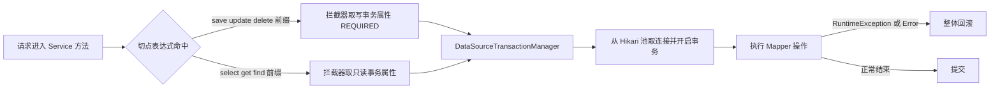

# 事务管理配置：把提交与回滚收口在 common 一处

数据源与 MyBatis 装配完成，环境配置还剩一块硬骨头：事务。Service 层一次业务操作常常连着多个 Mapper 调用，文章落库、统计更新、行为记录必须同生共死，任何一环失败都要整体撤销。靠每个 Service 自己写 begin、commit、rollback 既啰嗦又容易漏，工程的做法是在 common 工程的 mysql core 包里放一个 `TransactionConfig`，用三个 Bean 把事务管理器、事务拦截器与切面串成一条链。这一课只要求把这条链看明白，不要求背写法：事务在项目里只配置这一次，之后所有微服务共享。

## 先给结论

- `TransactionConfig` 三个 Bean 各管一段：`DataSourceTransactionManager` 负责事务的开启、提交与回滚，`TransactionInterceptor` 负责定义每个方法的事务属性，`DefaultPointcutAdvisor` 负责把拦截器挂到切点命中的方法上。
- 事务管理器按持久层选型：MyBatis 走 JDBC 连接，配 `DataSourceTransactionManager`；Hibernate 与 JPA 要换各自的实现，不能混用。
- 事务属性按方法名前缀区分：增删改方法用 `PROPAGATION_REQUIRED`，保证方法始终运行在事务里；查询方法设 `readOnly` 声明只读。
- 切点表达式来自构建期注入的 `mysql.core.tx.scan.package`，即 `execution(* com.study.headline.service.**.*(..))`，Service 层全部类的全部方法都被增强。
- 注解式事务 `@Transactional` 默认只回滚 `RuntimeException` 与 `Error`，受检异常默认照常提交，需要回滚必须显式 `rollbackFor`。

## 事务管理器：选型跟持久层走

事务管理器就是事务的总开关：谁在数据库连接上执行 begin，谁在方法结束时决定 commit 还是 rollback，都由它指挥。不同持久层技术操作数据库的方式不同，所以每种技术配了对应实现：MyBatis 的 SqlSession 底层就是 JDBC 连接，事务边界落在 Connection 上，配 `DataSourceTransactionManager`；Hibernate 走 Session，JPA 走 EntityManager，资源模型不同，各自配 `HibernateTransactionManager` 与 `JpaTransactionManager`。项目用的是 MyBatis，选型就此定死。

这套工程不走 starter 的自动装配路线，数据源与 SqlSessionFactory 都是手写的 Bean，事务管理器没有任何人会替你创建，缺了它，后面的事务拦截器拿到的就是空引用。`TransactionConfig` 的骨架与第一个 Bean 如下（类不在资料包内，按口播口径与主流写法补全的可运行版本）：

```java
package com.study.headline.common.mysql.core;

import org.aspectj.lang.annotation.Aspect;
import org.springframework.beans.factory.annotation.Value;
import org.springframework.context.annotation.Bean;
import org.springframework.context.annotation.Configuration;
import org.springframework.context.annotation.EnableAspectJAutoProxy;
import org.springframework.context.annotation.PropertySource;
import org.springframework.jdbc.datasource.DataSourceTransactionManager;
import org.springframework.transaction.PlatformTransactionManager;
import org.springframework.transaction.TransactionDefinition;
import org.springframework.transaction.annotation.EnableTransactionManagement;
import org.springframework.transaction.interceptor.DefaultTransactionAttribute;
import org.springframework.transaction.interceptor.NameMatchTransactionAttributeSource;
import org.springframework.transaction.interceptor.TransactionInterceptor;
import org.springframework.aop.aspectj.AspectJExpressionPointcut;
import org.springframework.aop.support.DefaultPointcutAdvisor;

import javax.sql.DataSource;

@Configuration
@Aspect                                  // 声明当前类是一个切面
@EnableAspectJAutoProxy                  // 开启自动代理，Spring Boot 2.x 默认走 cglib
@EnableTransactionManagement             // 开启事务管理
@PropertySource("classpath:mysql-core-jdbc.properties")
public class TransactionConfig {

    /** 构建期注入的切点表达式 */
    @Value("${mysql.core.tx.scan.package}")
    private String txScanPackage;

    /** 一、事务管理器：MyBatis 体系下选 DataSourceTransactionManager */
    @Bean
    public PlatformTransactionManager transactionManager(DataSource dataSource) {
        return new DataSourceTransactionManager(dataSource);
    }
    // 事务拦截器与切面通知两个 Bean 见下文
}
```

方法参数上的 `DataSource` 是上一课装配好的 Hikari 数据源。IDE 可能在参数上标红，编译器认不出跨配置类的 Bean 引用，但容器里那个数据源确实存在，启动时 Spring 按类型注入即可，标红不影响运行。类上三个开关注解要认清：`@Aspect` 声明这是一个切面配置，`@EnableAspectJAutoProxy` 打开 AOP 自动代理，`@EnableTransactionManagement` 打开事务能力，缺一个链路都启动不了。

## 事务拦截器：增删改与查询各走各的属性

第二个 Bean 定义「什么样的方法走什么样的事务」。拦截器按方法名前缀匹配事务属性，增删改与查询的区别就在这里展开：

```java
    /** 二、事务拦截器：按方法名前缀匹配事务属性 */
    @Bean
    public TransactionInterceptor txAdvice(DataSource dataSource) {
        TransactionInterceptor interceptor = new TransactionInterceptor();
        interceptor.setTransactionManager(transactionManager(dataSource));

        NameMatchTransactionAttributeSource source = new NameMatchTransactionAttributeSource();
        // 写方法：REQUIRED，当前有事务就加入，没有就新建，保证始终运行在事务里
        DefaultTransactionAttribute write = new DefaultTransactionAttribute();
        write.setPropagationBehavior(TransactionDefinition.PROPAGATION_REQUIRED);
        // 查询方法：同样 REQUIRED，但声明只读
        DefaultTransactionAttribute read = new DefaultTransactionAttribute();
        read.setPropagationBehavior(TransactionDefinition.PROPAGATION_REQUIRED);
        read.setReadOnly(true);

        // 写方法前缀
        source.addTransactionalMethod("save*", write);
        source.addTransactionalMethod("insert*", write);
        source.addTransactionalMethod("update*", write);
        source.addTransactionalMethod("delete*", write);
        source.addTransactionalMethod("remove*", write);
        // 查询方法前缀
        source.addTransactionalMethod("select*", read);
        source.addTransactionalMethod("get*", read);
        source.addTransactionalMethod("find*", read);
        source.addTransactionalMethod("list*", read);

        interceptor.setTransactionAttributeSource(source);
        return interceptor;
    }
```

`PROPAGATION_REQUIRED` 是默认传播行为，一句话概括：当前有事务就加入当前事务，没有事务就新开一个，保证方法始终运行在事务里。它覆盖 save、update、delete 这类写方法；查询方法同样用 REQUIRED 但多设了 `readOnly`，告诉驱动与数据库这是纯读操作，数据库可以省掉一部分维护开销。阅读这段配置记一句口诀就够：写方法必须可回滚，查询方法只要只读。

## 切面：把拦截器钉到 Service 上

拦截器有了，属性有了，还差一个问题：它该拦谁。答案由切面给出，切面是「切点 + 通知」的组合：

```java
    /** 三、切面通知：切点表达式 + 拦截器，组装成一个 Advisor */
    @Bean
    public DefaultPointcutAdvisor txPointcutAdvisor(TransactionInterceptor txAdvice) {
        DefaultPointcutAdvisor advisor = new DefaultPointcutAdvisor();
        AspectJExpressionPointcut pointcut = new AspectJExpressionPointcut();
        // 表达式来自配置文件：拦截 service 层所有类的所有方法
        pointcut.setExpression(txScanPackage);
        advisor.setPointcut(pointcut);
        advisor.setAdvice(txAdvice);
        return advisor;
    }
```

切点表达式不是手写的，从配置文件读进来。多环境配置课预留的 `mysql.core.tx.scan.package` 在这里消费，值为 `execution(* com.study.headline.service.**.*(..))`，含义是 Service 层所有类的所有方法；构建时表达式随环境文件注入，包结构调整只改环境文件一处。三个 Bean 组合出的完整链路如下：



关键路径是从左到右的一条主线：方法进入先过切点，命中后由拦截器取事务属性，事务管理器开事务，方法体跑完按结果提交或回滚。Service 代码里没有一行事务语句，这就是声明式事务的全部含义。

## @Transactional：注解式事务与回滚条件

切面方案是项目的主线，业务代码里还有一条并行的路：在方法上打 `@Transactional` 注解。两种方式最终走的是同一个 `DataSourceTransactionManager`，区别只在事务属性声明在何处。写一个发布文章的可运行示例，两步操作必须同进同退：

```java
package com.study.headline.article.service.impl;

import com.study.headline.model.article.pojos.ApArticle;
import org.springframework.beans.factory.annotation.Autowired;
import org.springframework.stereotype.Service;
import org.springframework.transaction.annotation.Transactional;

@Service
public class ArticleServiceImpl {

    @Autowired
    private ApArticleMapper apArticleMapper;    // model 工程 mappers 包的代理对象
    @Autowired
    private AuthorStatMapper authorStatMapper;  // 作者统计表对应的 Mapper

    /** 发布文章：主表落库与作者计数必须同进同退 */
    @Transactional
    public void publish(ApArticle article) {
        apArticleMapper.insert(article);                       // 第一步：文章落库
        authorStatMapper.increaseCount(article.getAuthorId()); // 第二步：作者计数
        // 任一步抛出 RuntimeException，两步一起回滚
    }

    /** 方法声明了受检异常，要回滚必须显式 rollbackFor */
    @Transactional(rollbackFor = Exception.class)
    public void publishChecked(ApArticle article) throws Exception {
        apArticleMapper.insert(article);
        checkContent(article);      // 可能抛出受检异常的环节
    }

    private void checkContent(ApArticle article) throws Exception {
        // 示意：敏感词校验等场景
    }
}
```

回滚条件是最容易被绊住的点。默认规则只有两条：`RuntimeException` 与 `Error` 抛出时回滚，受检异常抛出时照常提交。机制在属性类的判断里：异常发生后走到 `DefaultTransactionAttribute` 的 `rollbackOn` 方法，运行时异常与 Error 返回 true 走回滚，受检异常返回 false 走提交。所以方法签名带受检异常又希望回滚时，必须写 `@Transactional(rollbackFor = Exception.class)`。传播行为在注解式下同样可用，`propagation` 属性指定即可，绝大多数业务场景保持默认 REQUIRED 就够。

## 环境收尾：实体与 mapper 的存放约定

事务配置落定，day01 的环境准备全部完成。资源存放按约定固定：实体类放 model 工程，按业务分子包，文章相关的类稍后会落在 article 包下；Mapper 接口统一放 model 工程的 mappers 包，`@MapperScan` 在那里等着扫描；Mapper 的 xml 映射文件放 resources 下的 mappers 目录，构建时由 `classpath*:mappers/**/*Mapper.xml` 通配扫进工厂。业务开发按这个约定往对应位置放文件，装配链路自动接管。

## 常见误区

- **同类自调用让事务失效。** `@Transactional` 依赖代理对象拦截方法调用，`this.methodB()` 这种类内部调用不经过代理，事务属性直接失效；正解是把方法拆到另一个 Bean，或从容器中取自身代理再调用。
- **受检异常默认不回滚。** 方法抛出 `IOException` 一类受检异常时默认提交，业务上却以为已经回滚；需要回滚就写 `rollbackFor = Exception.class`，或者把异常包装成 `RuntimeException` 再抛。
- **事务管理器与持久层不匹配。** 持久层换成 JPA 后仍沿用 `DataSourceTransactionManager`，事务形同虚设；选型必须跟持久层走，MyBatis 用 DataSource 系列，JPA 用 JpaTransactionManager。
- **查询误开写事务。** 查询不加 `readOnly` 也能跑，但每个查询都会付出一次完整事务开启提交的开销；按前缀把查询标成只读，长列表接口的差别肉眼可见。

## 面试可能被问到的问题

1. 面试官追问：「Spring 事务在什么情况下会失效？」
   答：高频场景四类：同类自调用绕过代理；方法或类不是 public，代理拦截不到；异常在方法内部被 catch 吞掉，事务感知不到；抛出的是受检异常且未配置 rollbackFor。排查思路是先确认事务有没有被代理接管，再看异常有没有真正传到拦截器。
2. 面试官追问：「REQUIRED 与 REQUIRES_NEW 的区别是什么？」
   答：REQUIRED 是默认传播行为，当前有事务就加入，没有就新建，多个方法共享一次提交与回滚；REQUIRES_NEW 无论有没有事务都新开独立事务，内部事务的回滚不影响外部。适合「日志记录必须落库，业务回滚也要保留记录」这类场景。
3. 面试官追问：「为什么 MyBatis 的事务管理器是 DataSourceTransactionManager？」
   答：MyBatis 的 SqlSession 底层就是 JDBC 连接，事务边界直接落在 Connection 的 setAutoCommit、commit、rollback 上，DataSourceTransactionManager 正是按连接管理事务的。Hibernate 走 Session 与 flush，JPA 走 EntityManager，资源模型不同所以要配对应实现。
4. 面试官追问：「readOnly 设置了有什么实际效果，是安全开关吗？」
   答：readOnly 是给驱动与数据库的优化提示，只读事务里执行写 SQL 并不会因此被拦截，不能当权限控制用。把它当性能标记更准确，长查询链路里能省掉部分事务维护开销。
5. 面试官追问：「切面方案和 @Transactional 注解方案是什么关系？」
   答：底层同一套：事务拦截器加事务管理器。切面方案用 NameMatchTransactionAttributeSource 按方法名前缀批量定属性，一个 Advisor 全局生效，适合统一规范；注解方案把属性写在方法上，粒度细、可读性强。两者可以并存，注解声明优先于切面的默认值。

## 配套资料

- 代码：`materials/code/05/头条day01/`，内层资料目录含数据库规范设计说明书、PowerDesigner 使用手册与前后台项目原型 HTML；原始目录与文件名冠以项目原名，正文统一以「头条类资讯项目」指代。
- 说明：`TransactionConfig` 与示例 Service 不在本课资料包内，文中类为按口播口径（三段式配置、REQUIRED 与只读属性、切点表达式来自配置）与主流写法补全的可运行版本，包名统一改写为 `com.study.headline`；切点表达式取自多环境配置课的 `mysql.core.tx.scan.package` 口径。
