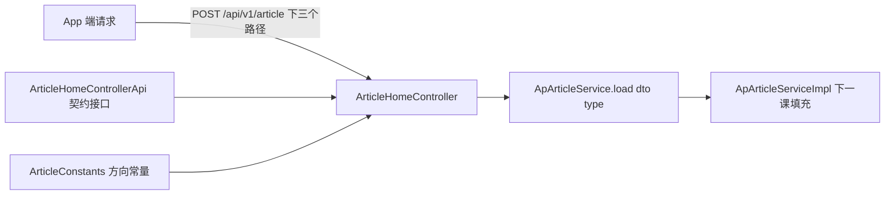

# 文章列表接口编码：Controller 三入口与 Service 的第一次转调

工程立住了，占位接口也验证过整条启动链路，接下来把真正的文章列表接口填进去。动手前环境还差最后一颗螺丝：微服务启动时要能连上数据库，否则 Service 注入 Mapper 时连可用的 SqlSessionFactory 都没有。补上这颗螺丝，再把契约从文档升级成代码：apis 工程定义接口，article 微服务的 Controller 落地实现，服务层只留一个带方向参数的入口。

## 先给结论

- 启动即查库的最后一步：config 包放一个 MysqlConfig，显式扫 common 的 mysql.core 包，数据源与 Mapper 代理启动时一并装配。
- 契约升级为 apis 接口 ArticleHomeControllerApi，三个方法 load、loadMore、loadNew，ArticleHomeController 实现它并补上 HTTP 注解。
- 服务层合并为一个方法 `load(ArticleHomeDto dto, Short type)`，方向用 common 常量 `LOADTYPE_LOAD_MORE`、`LOADTYPE_LOAD_NEW` 区分，不写魔法值。
- DTO 落在 model 工程，契约层的三个核心字段之外还有 minTime 与省市区预留字段；参数校验不挂注解，统一放到服务层手工做。
- Controller 保持极薄：注入 ApArticleService，每个入口一行转调。

## 补上启动即查库的最后一环

article 工程自己不写数据源装配，全部复用 common 的那一套。config 包里放一个空配置类，任务只有一个：把 common 的 mysql.core 包整体扫进来：

```java
package com.study.headline.article.config;

@Configuration
@ComponentScan("com.study.headline.common.mysql.core")
public class MysqlConfig {
}
```

引导类默认只扫 ArticleApplication 所在包及其子包，common 模块的配置类不在覆盖范围内，不显式引入，Mapper 代理一个都不会注册。工程搭建课已把数据源、SqlSessionFactory 与事务三件套的装配链展开过，这里只确认结果：加上 MysqlConfig 后，启动日志出现 Hikari 池初始化与 Mapper 注册输出，Service 注入 Mapper 的前提条件就齐了。

## 契约先行：apis 工程里的接口定义

接口开发规范课立过规矩：对外接口的定义进 apis 工程，统一以 Api 结尾命名。文章列表的三个入口对应一个接口三个方法：

```java
package com.study.headline.article.apis;

import com.study.headline.model.article.dtos.ArticleHomeDto;
import com.study.headline.model.common.dtos.ResponseResult;

public interface ArticleHomeControllerApi {

    /**
     * 加载首页文章
     * @param dto 查询参数
     * @return 文章列表
     */
    ResponseResult load(ArticleHomeDto dto);

    /** 加载更多 */
    ResponseResult loadMore(ArticleHomeDto dto);

    /** 加载最新的文章信息 */
    ResponseResult loadNew(ArticleHomeDto dto);
}
```

接口只管方法签名，HTTP 映射注解留给实现方补，契约因此不与 Spring 绑定，将来给前端或其它服务引用时拿到的就是一份纯 Java 契约。Controller 类名与接口同名去掉 Api 后缀，一眼能对上谁实现了谁。

## DTO 的完整形态与校验的位置

DTO 已经在 model 工程里备好，路径在 model 的 article 包 dtos 目录下。接口定义分析课立契约时抽了三个核心字段，落到 model 工程的完整定义还带下拉方向的锚点与一组地域预留字段：

```java
package com.study.headline.model.article.dtos;

import lombok.Data;
import java.util.Date;

@Data
public class ArticleHomeDto {
    // 频道 ID：为空代表「推荐」频道
    private Integer channelId;
    // 时间锚点：上拉方向，取已加载列表最早一条的时间
    private Date maxTime;
    // 时间锚点：下拉方向，取已加载列表最新一条的时间
    private Date minTime;
    // 单次加载条数
    private Integer size;
    // 省市区预留：未登录时按地域加载用，本课列表链路不参与过滤
    private Integer provinceId;
    private Integer cityId;
    private Integer countyId;
}
```

契约层的「一个时间锚点」落地成两个槽位：前端把已加载列表的最新时间放进 minTime、最早时间放进 maxTime，晚于锚点是刷新、早于锚点是续读的语义不变，只是两个方向各占一个字段，互不干扰。校验这件事不在 DTO 上挂注解、也不在 Controller 里写一堆 if，统一放服务层入口手工做：三个入口共用同一套兜底逻辑（dto 空对象、锚点缺省、条数上限），散到注解和控制器里就得各写一遍。参数校验的四连细节留到下一课业务实现里展开。

## 方向开关：常量类与一个服务方法

三个入口的差异只剩方向：load 与 load_more 都查「早于锚点」，load_new 查「晚于锚点」。接口契约示意里写了三个服务方法，真正落地时合并成一个，方向交给 type 参数。type 不写字面量，common 工程的常量类统一收口：

```java
package com.study.headline.common.constants;

public class ArticleConstants {
    /** 加载更多，含首次加载 */
    public static final Short LOADTYPE_LOAD_MORE = 1;
    /** 加载最新 */
    public static final Short LOADTYPE_LOAD_NEW = 2;
}
```

服务接口建在 article 微服务的 service 包下，命名为 ApArticleService，对齐 ap_article 表的命名；实现类放 service.impl 子包，下一课填充：

```java
package com.study.headline.article.service;

import com.study.headline.model.article.dtos.ArticleHomeDto;
import com.study.headline.model.common.dtos.ResponseResult;

public interface ApArticleService {

    /**
     * 加载文章列表
     * @param dto  查询参数
     * @param type 加载类型 1 加载更多 2 加载最新
     */
    ResponseResult load(ArticleHomeDto dto, Short type);
}
```

首次加载走 LOADTYPE_LOAD_MORE 并不是笔误：load 与 load_more 本就是同一个查询方向，区别只在锚点有没有值。首次进入时前端没有任何历史数据，锚点由服务层兜底为当前时间，效果就是取最新一批；上拉时前端把最早一条的时间带上来，方向不变，锚点换成了数据里的值。

## Controller 实现：只做转调

article 微服务的 controller.v1 包下，ArticleHomeController 实现 apis 接口并补齐三个注解：

```java
package com.study.headline.article.controller.v1;

import com.study.headline.article.service.ApArticleService;
import com.study.headline.common.constants.ArticleConstants;
import com.study.headline.model.article.dtos.ArticleHomeDto;
import com.study.headline.model.common.dtos.ResponseResult;
import org.springframework.beans.factory.annotation.Autowired;
import org.springframework.web.bind.annotation.PostMapping;
import org.springframework.web.bind.annotation.RequestBody;
import org.springframework.web.bind.annotation.RequestMapping;
import org.springframework.web.bind.annotation.RestController;

@RestController
@RequestMapping("/api/v1/article")
public class ArticleHomeController implements ArticleHomeControllerApi {

    @Autowired
    private ApArticleService apArticleService;

    /** 首次加载：与上拉同方向，锚点由服务层兜底 */
    @PostMapping("/load")
    @Override
    public ResponseResult load(@RequestBody ArticleHomeDto dto) {
        return apArticleService.load(dto, ArticleConstants.LOADTYPE_LOAD_MORE);
    }

    /** 上拉加载更多 */
    @PostMapping("/load_more")
    @Override
    public ResponseResult loadMore(@RequestBody ArticleHomeDto dto) {
        return apArticleService.load(dto, ArticleConstants.LOADTYPE_LOAD_MORE);
    }

    /** 下拉刷新 */
    @PostMapping("/load_new")
    @Override
    public ResponseResult loadNew(@RequestBody ArticleHomeDto dto) {
        return apArticleService.load(dto, ArticleConstants.LOADTYPE_LOAD_NEW);
    }
}
```

URL 按接口规范全小写、单词下划线分隔：`/load`、`/load_more`、`/load_new`，与包名 controller.v1 形成双重版本标注。`@RestController` 等于 `@Controller` 加 `@ResponseBody`，方法返回的 ResponseResult 直接由 jackson 序列化进响应体。三个方法体各一行：接住请求体反序列化出的 DTO，选好方向常量，转调服务层。整条调用链如下：



关键路径看两头：契约接口约束了方法签名，常量类约束了方向取值，Controller 在两者之间只剩转调，业务复杂度全部下沉到服务层。行为接口 behavior 也按同样的套路实现，保存用户操作行为，与列表接口职责分离。

## 常见误区

- **把方向逻辑写进 Controller。** 三个入口各自拼查询条件，锚点语义一改要改三处；方向差异收敛成 type 参数，Controller 只留一行转调。
- **type 用魔法字面量。** `load(dto, "1")` 这类硬编码既与 Short 参数对不上，也让调用点失去语义；常量类统一收口，含义集中在一处。
- **契约接口只存在于注释里。** Controller 不实现 ArticleHomeControllerApi，方法签名一改契约就漂移；实现接口后，签名改动在编译期直接报错。
- **URL 风格随手写。** /loadnew、/loadMore 混用违背接口规范的全小写下划线口径；三个路径定完不再动，前端按路径对接后联调才不会各说各话。

## 面试可能被问到的问题

1. 面试官追问：「为什么把 Controller 的契约抽成 apis 里的接口？」
   答：接口定义与实现分离后，方法签名受契约约束，改动会在编译期暴露；apis 工程是纯 Java 契约，前端联调文档与后续远程调用都能直接引用它，规范课的「明确类定义」一步就落在这里。
2. 面试官追问：「type 为什么用 Short 常量而不用枚举？」
   答：Short 与数据库侧 tinyint 的量级一致，常量类跨模块共享成本最低；枚举也可行，关键是绝对不能出现裸字面量。工程里两个常量 LOADTYPE_LOAD_MORE 与 LOADTYPE_LOAD_NEW 收口了全部取值。
3. 面试官追问：「Controller 里写业务逻辑有什么问题？」
   答：业务逻辑没法被其它入口复用，行为接口将来也要判断用户身份，逻辑写在 Controller 就得复制一份；Controller 只做参数接收与结果包装，业务进 Service，单元测试也只需面向 Service。
4. 面试官追问：「首次加载为什么传 LOADTYPE_LOAD_MORE？」
   答：load 与 load_more 查询方向相同，都是取锚点之前的内容；首次加载没有历史数据，锚点由服务层兜底为当前时间，效果就是取最新一批。只有下拉刷新传 LOADTYPE_LOAD_NEW，查锚点之后的新文章。
5. 面试官追问：「@RequestBody 什么时候能省？」
   答：参数是简单类型且走查询串时可以省；本接口入参是结构化 DTO，统一走请求体反序列化，POST 方式下必须有 @RequestBody，否则 Spring 会尝试按表单或查询串解析，DTO 各字段拿不到值。

## 配套资料

- 代码：`materials/code/05/头条day01/`，内层资料目录含数据库规范设计说明书、PowerDesigner 使用手册与前后台项目原型 HTML；原始目录与文件名冠以项目原名，正文统一以「头条类资讯项目」指代。
- 说明：leadnews-article 的 Controller、apis 接口、ApArticleService、ArticleConstants 与 ArticleHomeDto 完整源码不在本课资料包内，文中类为按画面线与主流写法补全的可运行版本，包名统一改写为 `com.study.headline`；接口清单、常量取值与 URL 规范按口播与画面线整理。
