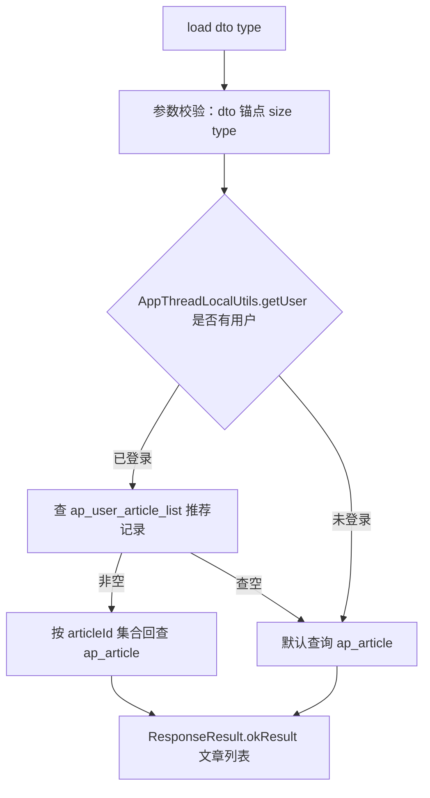

# 文章列表业务层落地：两条取数路径与三段动态 SQL

契约与壳都齐了，往 ApArticleServiceImpl 里填真逻辑。这一课是把整个文章列表功能写活的关键：服务层要兜住前端传来的所有参数，要按登录态分流两条取数路径，还要配齐两个 Mapper 接口和三段 XML 动态查询。写完这一课，POST /api/v1/article/load 就能吐出真实的文章列表，逻辑测试与行为接口都在它的地基上展开。

## 先给结论

- 服务层一个 load 方法吃下三个入口的全部逻辑：参数兜底（dto 空对象、两个锚点缺省当前时间、size 默认 20 上限 50、type 归一），再取用户分路径。
- 已登录先查推荐表 ap_user_article_list，查空自动回落默认查询；未登录直接默认查询 ap_article，两条路径共用一套锚点语义。
- Mapper 接口与 XML 都放 model 工程：接口在 mappers.app 包，XML 在 resources 的 mapper 目录，namespace 绑接口全限定名，多参数一律加 @Param。
- 主查询用 <where> 加 <if> 动态拼条件：频道与省市区按需拼，type 决定时间方向（1 早于 maxTime，2 晚于 minTime），order by publish_time desc 加 limit #{dto.size}。
- 推荐链路两段查询接力：先按用户查推荐记录拿到 articleId 集合，再按 id 集合回查文章表。

## 服务层骨架：先兜住参数

需求分析课的流程图把加载诉求画成了三条线：未登录加载默认的文章列表，登录加载推荐的文章列表，用户点了频道标签就按用户设置的频道加载；流程图底部还压着一条隐藏需求，加载的同时要记录当前用户的行为，那是行为功能课的主题。落到方法内部，执行顺序是固定的：参数校验、获取用户信息、判断用户是否存在、按身份取数。

参数校验放在最前面，源于一条朴素的原则：服务端不信任任何入参。前端传来的三个参数全都可能缺席，dto 本身也可能是 null，服务层要保证任何入参进来都能查出一个合理的列表，而不是抛一个空指针把用户挡在门外。校验一共四步，代码不长，每一句都有明确语义：

```java
package com.study.headline.article.service.impl;

import com.study.headline.article.service.ApArticleService;
import com.study.headline.common.constants.ArticleConstants;
import com.study.headline.model.article.dtos.ArticleHomeDto;
import com.study.headline.model.common.dtos.ResponseResult;
import com.study.headline.model.user.pojos.AppUser;
import com.study.headline.utils.threadlocal.AppThreadLocalUtils;
import org.springframework.beans.factory.annotation.Autowired;
import org.springframework.stereotype.Service;
import java.util.Date;

@Service
public class ApArticleServiceImpl implements ApArticleService {

    /** 单次加载条数上限 */
    private static final Short MAX_PAGE_SIZE = 50;

    @Autowired
    private ApArticleMapper apArticleMapper;
    @Autowired
    private ApUserArticleListMapper apUserArticleListMapper;

    @Override
    public ResponseResult load(ArticleHomeDto dto, Short type) {
        // 1. 参数校验：dto 为空时 new 一个空对象，保证后续取值不报错
        if (dto == null) {
            dto = new ArticleHomeDto();
        }
        // 时间锚点兜底：缺省即当前时间
        if (dto.getMaxTime() == null) {
            dto.setMaxTime(new Date());
        }
        if (dto.getMinTime() == null) {
            dto.setMinTime(new Date());
        }
        // 分页参数：空或非法给默认值 20，超上限用 Math.min 收口
        Integer size = dto.getSize();
        if (size == null || size <= 0) {
            size = 20;
        }
        dto.setSize(Math.min(size, MAX_PAGE_SIZE));
        // 频道为空即「推荐」频道，交给 SQL 的 <if> 跳过频道过滤
        // 类型参数：非 1 非 2 归一为加载更多
        if (!ArticleConstants.LOADTYPE_LOAD_MORE.equals(type)
                && !ArticleConstants.LOADTYPE_LOAD_NEW.equals(type)) {
            type = ArticleConstants.LOADTYPE_LOAD_MORE;
        }
        // 2. 获取用户信息并分流：登录走推荐，未登录走默认
        AppUser user = AppThreadLocalUtils.getUser();
        if (user != null) {
            return ResponseResult.okResult(getUserArticle(user, dto, type));
        }
        return ResponseResult.okResult(getDefaultArticle(dto, type));
    }
}
```

几个细节值得展开。**dto 兜底成空对象。** 与其到处判空防御，不如入口处统一换成一个字段全空的 ArticleHomeDto，后续每个参数的独立兜底接着处理，链路越往下越干净。**锚点兜底取当前时间。** 首次进入页面时前端没有任何历史数据，maxTime 为空就置当前时间，查「早于当前时间」的最新一批正好是首屏语义；minTime 同样兜底，下拉方向在前端没带锚点时不至于查出全量。**size 用 Math.min 收口。** 默认 20、上限 50，前端就算传一个一万，服务端也只吐 50 条，页面渲染与接口压力都在可控范围。**常量的可见范围跟着使用范围走。** 方向常量放 common 的 ArticleConstants，因为 Controller 与服务层都要用，属跨模块共享；上限 50 只有本实现类用，就定义为类的私有常量 `MAX_PAGE_SIZE = 50`，不该共享的东西进公共类只会稀释常量类的语义。**频道参数不做特殊加工。** 为空就代表「推荐」频道，服务层不塞占位值，交给 XML 的 `<if>` 自动跳过频道条件；课程原版把频道设计成字符串 tag，空值时置一个 `__all__` 默认标识再由 XML 排除，改用 Integer 的 channelId 之后，判空即可达到同样效果。**type 归一要两个条件都不等。** 这行判断在课件画面上出现过手误，同一个条件写了两次，编译器不报错但逻辑失效；正确语义是既不是 1 也不是 2 时归一为 1，写这类多条件判断要逐个核对操作数。

用户信息来自 AppThreadLocalUtils，工具类课已经把机制讲透：拦截器解析 token 后把 AppUser 绑进当前线程，业务层随取随用。请求链路上有拦截器时 getUser 拿到登录用户，拿不到就是未登录，两个分支由此天然分开，服务层不需要再传身份参数。

## 两条取数路径：推荐查空就回落

分流之后是两个私有方法，一个走默认文章，一个走用户推荐：

```java
/** 默认文章列表：按频道与时间方向查 ap_article */
private List<ApArticle> getDefaultArticle(ArticleHomeDto dto, Short type) {
    return apArticleMapper.loadArticleListByLocation(dto, type);
}

/** 用户文章列表：先查推荐，查不到回落默认 */
private List<ApArticle> getUserArticle(AppUser user, ArticleHomeDto dto, Short type) {
    List<ApUserArticleList> list = apUserArticleListMapper.loadArticleListByUser(user, dto, type);
    if (list == null || list.isEmpty()) {
        return getDefaultArticle(dto, type);
    }
    return apArticleMapper.loadArticleListByIdList(list);
}
```

方法名 loadArticleListByLocation 是课程原本的命名，语义其实是「按条件定位默认列表」，沿用原名只为与画面一致，理解时不必被 Location 带偏。getUserArticle 的回落逻辑是这条链路上的容错关键：ap_user_article_list 是推荐系统的输出落地表，存「把哪篇文章推荐给了哪个用户」，新注册用户、长时间未活跃的用户在这张表里可能根本没有数据，绝不能返回空列表让用户面对白屏，而是退回默认查询；推荐命中时，先拿到推荐记录集合，再把集合里的 articleId 回查 ap_article 换成完整文章。strategy_id 字段记着这条推荐来自哪一路算法，本期查询用不到，但它就是未来接推荐策略时最要紧的伏笔。整条判定路径如下：



三条路殊途同归：无论推荐命中、推荐查空还是从未登录，最终都吐出一个 ResponseResult 包着的文章列表，前端拿到的结构完全一致，解析代码只有一份。

## Mapper 接口：放在 model 工程

Mapper 的归属地是 model 工程而不是 article 微服务：接口定义进 model 的 mappers.app 包，XML 放 model 的 resources 下 mapper 目录。这样安排与搭建课的口径一致，common 的 MysqlCoreConfig 上有 @MapperScan 指向 model 工程的 mappers 包，后续自媒体端等服务要查 ap_article 时，同一份 Mapper 定义直接复用，不必各服务抄一份。接口一共有两个，第一个 ApArticleMapper：

```java
package com.study.headline.model.mappers.app;

import com.study.headline.model.article.dtos.ArticleHomeDto;
import com.study.headline.model.article.pojos.ApArticle;
import com.study.headline.model.user.pojos.ApUserArticleList;
import org.apache.ibatis.annotations.Param;
import java.util.List;

public interface ApArticleMapper {

    List<ApArticle> loadArticleListByLocation(@Param("dto") ArticleHomeDto dto,
                                              @Param("type") Short type);

    List<ApArticle> loadArticleListByIdList(@Param("list") List<ApUserArticleList> list);
}
```

第二个 ApUserArticleListMapper，参数更多，@Param 一个都不能少：

```java
package com.study.headline.model.mappers.app;

import com.study.headline.model.article.dtos.ArticleHomeDto;
import com.study.headline.model.user.pojos.AppUser;
import com.study.headline.model.user.pojos.ApUserArticleList;
import org.apache.ibatis.annotations.Param;
import java.util.List;

public interface ApUserArticleListMapper {

    List<ApUserArticleList> loadArticleListByUser(@Param("user") AppUser user,
                                                  @Param("dto") ArticleHomeDto dto,
                                                  @Param("type") Short type);
}
```

方法超过一个参数时，MyBatis 默认用 param1、arg0 这类名字引用参数，XML 里写 `#{dto.size}` 会直接报参数找不到；@Param 给每个参数起了名字，XML 里的 dto、user、type 才有据可查。接口上再加 `@SuppressWarnings("all")` 可以压制泛型相关的未检查警告，编辑器里的红色告警消失，真实的编译错误仍然照常报出。

XML 文件与接口同名放在 mapper 目录，头部信息把 namespace 指向接口的全限定名，绑定关系由此建立：

```xml
<?xml version="1.0" encoding="UTF-8"?>
<!DOCTYPE mapper PUBLIC "-//mybatis.org//DTD Mapper 3.0//EN"
        "http://mybatis.org/dtd/mybatis-3-mapper.dtd">
<mapper namespace="com.study.headline.model.mappers.app.ApArticleMapper">
</mapper>
```

MyBatis 靠这两根线把接口方法和 SQL 语句缝在一起：namespace 必须等于接口全限定名，select 的 id 必须等于方法名，调用接口方法时代理对象拿「全限定名 + 方法名」去映射文件里找同 id 的语句。名字对不上，启动时注册 Mapper 代理或许不报错，方法一调用就抛出找不到语句的异常。

## 主查询 XML：resultMap、动态条件与方向

ApArticleMapper.xml 里先立两个公共件：resultMap 做列名到属性的逐列映射，Base_Column_List 把列清单抽成可复用的片段：

```xml
<resultMap id="resultMap" type="com.study.headline.model.article.pojos.ApArticle">
    <id column="id" property="id"/>
    <result column="title" property="title"/>
    <result column="author_id" property="authorId"/>
    <result column="author_name" property="authorName"/>
    <result column="channel_id" property="channelId"/>
    <result column="channel_name" property="channelName"/>
    <result column="layout" property="layout"/>
    <result column="flag" property="flag"/>
    <result column="images" property="images"/>
    <result column="labels" property="labels"/>
    <result column="likes" property="likes"/>
    <result column="collection" property="collection"/>
    <result column="comment" property="comment"/>
    <result column="views" property="views"/>
    <result column="province_id" property="provinceId"/>
    <result column="city_id" property="cityId"/>
    <result column="county_id" property="countyId"/>
    <result column="created_time" property="createdTime"/>
    <result column="publish_time" property="publishTime"/>
    <result column="sync_status" property="syncStatus"/>
</resultMap>

<sql id="Base_Column_List">
    id, title, author_id, author_name, channel_id, channel_name, layout, flag, images,
    labels, likes, collection, comment, views, province_id, city_id, county_id,
    created_time, publish_time, sync_status
</sql>
```

逐列写 resultMap 看着啰嗦，好处是映射不依赖任何全局开关：驼峰自动转换依赖 mapUnderscoreToCamelCase 配置，换一个工程没开这个开关，channel_id 这类列就悄悄映射成 null；显式 resultMap 与配置无关，列名与属性名不同名也能对上。`<sql>` 片段配 `<include refid="Base_Column_List"/>` 引用，两个 select 共用一份列清单，加列只改一处。主查询一个 select 吃下三个入口：

```xml
<select id="loadArticleListByLocation" resultMap="resultMap">
    <include refid="Base_Column_List"/>
    from ap_article aa
    <where>
        <if test="dto.channelId != null">
            and aa.channel_id = #{dto.channelId}
        </if>
        <if test="dto.provinceId != null">
            and aa.province_id = #{dto.provinceId}
        </if>
        <if test="dto.cityId != null">
            and aa.city_id = #{dto.cityId}
        </if>
        <if test="dto.countyId != null">
            and aa.county_id = #{dto.countyId}
        </if>
        <if test="type != null and type == 1">
            and aa.publish_time <![CDATA[<]]> #{dto.maxTime}
        </if>
        <if test="type != null and type == 2">
            and aa.publish_time <![CDATA[>]]> #{dto.minTime}
        </if>
    </where>
    order by aa.publish_time desc
    limit #{dto.size}
</select>
```

动态条件的骨架是 `<where>` 加 `<if>`：`<where>` 只在至少有一个条件成立时才输出 WHERE 关键字，并顺手剥掉条件开头多余的 and；每个 `<if>` 的 test 里写的是 OGNL 表达式，判断的就是 @Param 标注的参数。type 等于 1 时拼「早于 maxTime」，服务上拉与首次加载都落在这条分支；type 等于 2 时拼「晚于 minTime」，服务下拉刷新。比较符 `<` 是 XML 的特殊字符，直接写会被解析器当成标签开头，启动解析映射文件就报错，所以用 CDATA 包起来，`<![CDATA[<]]>` 与转义写法 `&lt;` 等价，前者可读性更好。把两个方向的渲染结果摆在一起，方向差异一目了然（列清单以 Base_Column_List 为准，此处示意）：

```sql
-- type 为 1：首次加载或上拉，锚点缺省时 maxTime 即当前时间
SELECT id, title, channel_id, publish_time
FROM ap_article aa
WHERE aa.channel_id = 1
  AND aa.publish_time < '2025-01-01 12:00:00'
ORDER BY aa.publish_time DESC
LIMIT 20;

-- type 为 2：下拉刷新，minTime 为已加载列表最新一条的时间
SELECT id, title, channel_id, publish_time
FROM ap_article aa
WHERE aa.channel_id = 1
  AND aa.publish_time > '2025-01-01 11:00:00'
ORDER BY aa.publish_time DESC
LIMIT 20;
```

排序与条数写在动态条件之外，两个方向共用。order by 的字段能这样放心用，靠的是需求分析课在 ap_article 上建的 `idx_channel_publish(channel_id, publish_time)` 联合索引：频道等值条件落在索引最左列，publish_time 的范围条件与排序沿索引的有序性推进，避免 filesort；资料包里的数据库规范设计说明书在索引规约里恰好把「order by 场景注意利用索引有序性，order by 字段放在组合索引最后」列为推荐项，这条查询就是按规约长出来的。省市区三个条件平时不生效，前端在未登录场景按地域加载时才会传值，属于预留开关。

## 参数怎么进 SQL：OGNL 导航与条件组合

XML 里的占位符看似简单，背后有一条固定的取值链。`#{dto.maxTime}` 先按 @Param 的名字 dto 找到参数对象，再用 OGNL 表达式导航到它的 maxTime 属性；嵌套对象同理，`#{user.id}` 沿 user 导航到 AppUser 的 id。导航按属性名走，不按列名走，属性写错编译期不会有任何提示。与 `#{}` 相对的 `${}` 是另一条路线：前者生成预编译占位符，值以参数形式传给数据库，天然免疫 SQL 注入；后者做字符串替换，替换结果直接拼进 SQL 文本。取值场景一律用 `#{}`，只有列名、排序字段这类无法参数化的标识符才考虑 `${}`，而且必须白名单校验。

动态条件的价值在组合数上看得最清楚。频道、省、市、区四个条件各自可空，加上一个方向条件，理论组合有几十种；写成静态 SQL 就得为每种组合准备一条语句，维护成本失控。`<if>` 把组合的决定权交给参数本身，一个 select 覆盖全部场景，条件多一个少一个都不用改方法签名，这正是动态 SQL 存在的理由。顺带把实体的归位也交代清楚：ApArticle 与 ApUserArticleList 都落在 model 工程的 pojos 包，Mapper 接口、XML、实体三件套同在一个工程里，引用关系闭环，别的服务引 model 依赖就一并带走。

## 推荐链路 XML：两段查询接力

推荐路径的时间轴锚在 recommend_time 上，不是文章的 publish_time：一条推荐记录何时进入用户的列表，由推荐时间决定。ApUserArticleListMapper.xml 同样配一个 resultMap 与列清单，然后是按用户查推荐记录的查询：

```xml
<select id="loadArticleListByUser" resultMap="BaseResultMap">
    <include refid="Base_Column_List"/>
    from ap_user_article_list
    <where>
        user_id = #{user.id}
        and is_show = 0
        and is_read = 0
        <if test="type != null and type == 1">
            and recommend_time <![CDATA[<]]> #{dto.maxTime}
        </if>
        <if test="type != null and type == 2">
            and recommend_time <![CDATA[>]]> #{dto.minTime}
        </if>
        <if test="dto.channelId != null">
            and channel_id = #{dto.channelId}
        </if>
    </where>
    limit #{dto.size}
</select>
```

`#{user.id}` 取的是 AppUser 对象的 id 属性，OGNL 沿属性名一级级往下找。is_show 与 is_read 两个条件写死取 0，口径来自课程的数据约定：0 即通过，还没读过的、允许展示的记录才有资格出现在列表里，插入侧与查询侧必须遵守同一份约定，否则推荐列表会莫名查空。这个查询没有 order by，默认信任推荐侧写入时已经排好序，工程上更稳妥的做法是显式加 `order by recommend_time desc`，把顺序的主动权留在查询里。

查到的推荐记录只是 articleId 的载体，第二段查询把它换成完整文章：

```xml
<select id="loadArticleListByIdList" resultMap="resultMap">
    <include refid="Base_Column_List"/>
    from ap_article aa
    where aa.id in
    <foreach collection="list" item="item" open="(" close=")" separator=",">
        #{item.articleId}
    </foreach>
    order by aa.publish_time desc
</select>
```

foreach 是这里的主角：collection 指向 @Param 标注的集合名 list，item 是每次迭代的元素，open 与 close 负责括住整个列表，separator 在元素之间补逗号，拼出来的形态就是 `where aa.id in (10120, 10098, 10087)`。课程画面里用的是 `<trim suffixOverrides=",">` 包住 foreach 再手写括号的写法，靠 trim 剥掉拼串后多余尾逗号，效果等价；主流写法让 foreach 自己带 open 与 close，少一层标签也更直观。`#{item.articleId}` 取的是推荐记录对象的 articleId 属性，这里写成列名 article_id 是常见手误，编译期没有任何提示，运行期 OGNL 找不到属性才炸，逻辑测试课会在调试现场撞上它。结果集再按 publish_time 倒序排一次，是因为推荐侧给出的顺序并不保证与发布时间轴一致，信息流的展示口径始终以发布时间为准。

为什么拆成两段查询而不是一句 join 直接关联 ap_user_article_list 与 ap_article，值得停下来想一下。limit 必须先作用在推荐记录上：先按用户与锚点把本页要展示的 articleId 圈出来，再回文章表取详情，limit 的语义才准确；join 之后再 limit，一旦关联导致行数变化，截断的位置就会偏移。资料包里的数据库规范设计说明书对 join 的态度也很明确，超过三个表禁止 join，关联查询要保证被关联字段有索引，两段查询的克制写法正好落在规约允许的范围里，ap_article 主键回查走的还是最快的主键访问路径。

## 常见误区

- **依赖驼峰开关不写 resultMap。** 列名 channel_id 到属性 channelId 的映射若全靠 mapUnderscoreToCamelCase，换环境开关一关就悄悄变 null；显式 resultMap 与配置解耦，多写几行换稳定。
- **XML 的字面细节没有编译期兜底。** 比较符 `<` 裸写会让映射文件解析失败，namespace 或 select 的 id 与接口对不上会在调用时抛找不到语句，条件列名拷错要等执行才报列不存在；三类错误都要靠逐字核对与运行前验证来拦。
- **多参数不加 @Param。** 参数一到两个以上，MyBatis 只认 param1、arg0 这类默认名，XML 里的 dto.size 无从解析；每个参数显式 @Param 是硬规矩。
- **推荐查空不回落。** 新用户推荐表里没有数据，直接返回空列表等于首屏白屏；命中与否都要有产出，回落默认查询是必写的容错。

## 面试可能被问到的问题

1. 面试官追问：「动态 SQL 的 <where> 标签和手写 where 1=1 有什么区别？」
   答：where 1=1 靠恒真条件凑语法，脏条件会混进执行计划；<where> 在没有任何条件成立时整个 WHERE 都不输出，有条件时自动剥掉开头的 and，SQL 语义干净，也不会出现 where and 这种拼接错误。
2. 面试官追问：「CDATA 在 MyBatis XML 里解决什么问题？」
   答：XML 里 `<` 与 `&` 是保留字符，裸写会导致映射文件解析失败；CDATA 段内的内容按纯文本处理，比较符 `<`、`>`、`<=` 都能安全写入，与 &lt; 这类转义实体等价，CDATA 胜在可读性。
3. 面试官追问：「foreach 的 collection 属性名是怎么确定的？」
   答：集合参数用 @Param 标注后，collection 就写标注里的名字；未标注的 List 默认叫 list 或 collection，数组叫 array，但依赖默认名不可靠，显式 @Param 让接口与 XML 的对应关系一眼可见。
4. 面试官追问：「in 里的集合特别大会有什么问题？」
   答：SQL 文本膨胀、解析变慢，还可能撞上 max_allowed_packet 与优化器对 in 列表的限制；大集合要分批查询后在内存合并，或干脆把推荐结果落在宽表里按用户直查，本课的推荐集合有 limit 收口，规模可控。
5. 面试官追问：「参数校验放在服务层手工做，和用 validation 注解比怎么选？」
   答：注解校验适合字段级规则，声明在 DTO 上一次定义处处生效；手工校验适合带业务语义的兜底，比如锚点缺省取当前时间、size 超上限收口。两者不冲突，关键是兜底逻辑集中在一处，别散到每个 Controller 里各写一遍。
6. 面试官追问：「为什么 Mapper 接口放在公共 model 工程而不是各业务服务里？」
   答：ap_article 这类核心表会被多个服务查询，Mapper 定义与实体、XML 同放 model，配合 @MapperScan 统一扫描，一份定义处处复用；放业务服务里则每个服务抄一份，列名一改要同步多处。

## 配套资料

- 代码：`materials/code/05/头条day01/`，内层资料目录含数据库规范设计说明书（其索引规约对 order by 与组合索引的要求是主查询设计的依据）、PowerDesigner 使用手册与前后台项目原型 HTML；原始目录与文件名冠以项目原名，正文统一以「头条类资讯项目」指代。
- 说明：ApArticleServiceImpl、两个 Mapper 接口与三段 XML 的完整源码不在本课资料包内，文中代码为按画面线与主流写法补全的可运行版本，包名统一改写为 `com.study.headline`；参数校验清单、is_show 与 is_read 的取值口径、trim 与 foreach 两种写法均按口播与画面线整理。
