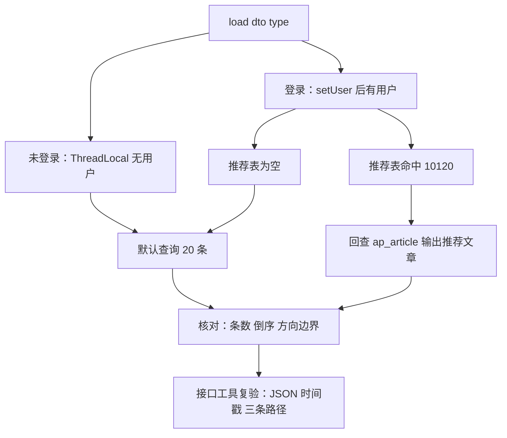

# 文章列表逻辑测试：两条路径、两处翻车与三路对数

代码编译通过只说明语法没错，逻辑对不对要拿数据走一遍。文章列表的验证分两层：单元测试直接打 Service，绕开网关与前端，专门盯业务分支；接口工具按契约打真实 HTTP，补上序列化与 URL 映射这一层。未登录与登录两条路径都要覆盖，调试过程中还会撞上两个只有运行期才暴露的问题，翻车现场本身就是最好的教材。

## 先给结论

- 测试类挂 Spring Boot 测试骨架：`@SpringBootTest(classes = ArticleApplication.class)` 加 `@RunWith(SpringRunner.class)`，注入 ApArticleService 直接调 load。
- 未登录路径传 null 与 LOADTYPE_LOAD_MORE，靠服务层兜底拿到默认 20 条；断点逐行核对校验链每一站。
- 登录路径往 ThreadLocal 里塞一个测试用户，配合推荐表预置的一条数据，验证推荐命中、回查文章的完整接力。
- 调试抓出两个运行期问题：foreach 里把对象属性写成列名，以及一处漏配的返回映射。
- HTTP 层三条路径用 13 位毫秒时间戳构造锚点，按返回列表的边界核对方向与排序。

## 单元测试骨架

测试类放在工程的 test 目录，包结构与业务代码隔开。挂上 Spring Boot 测试注解后，容器会把 article 微服务完整装配一遍，Mapper 代理与数据源都可用：

```java
package com.study.headline.test;

import com.study.headline.article.service.ApArticleService;
import com.study.headline.common.constants.ArticleConstants;
import com.study.headline.model.common.dtos.ResponseResult;
import com.study.headline.article.ArticleApplication;
import org.junit.Test;
import org.junit.runner.RunWith;
import org.springframework.beans.factory.annotation.Autowired;
import org.springframework.boot.test.context.SpringBootTest;
import org.springframework.test.context.junit4.SpringRunner;

@RunWith(SpringRunner.class)
@SpringBootTest(classes = ArticleApplication.class)
public class ArticleTest {

    @Autowired
    private ApArticleService apArticleService;

    /** 未登录路径：参数全空，验证兜底与默认查询 */
    @Test
    public void testLoad() {
        ResponseResult result = apArticleService.load(null, ArticleConstants.LOADTYPE_LOAD_MORE);
        System.out.println(result.getData());
    }
}
```

两个注解各司其职。`@SpringBootTest` 的 classes 属性指向引导类 ArticleApplication，测试包与引导类不在同一包下时必须显式指定，否则容器找不到装配入口；`@RunWith(SpringRunner.class)` 让测试运行在 Spring 测试框架里，@Autowired 才能注入成功。第一次跑会明显偏慢，容器要全量装配数据源、Mapper 与日志体系，属正常现象，越到后期模块越多启动越慢，耐心等它结束。

## 未登录路径：断点核对校验链

testLoad 的入参是 null 加 LOADTYPE_LOAD_MORE，专门把服务的容错链逼出来。在 load 方法第一行打断点，用 debug 模式逐行走：

- dto 传的是 null，第一步兜底 new 出一个空对象；
- 两个时间锚点全空，先后被置为当前时间；
- size 为空，置默认值 20，不大于上限 50，Math.min 原样放行；
- type 传的是常量 1，归一判断直接通过；
- AppThreadLocalUtils 里没有用户，测试没走拦截器，线程里自然没有登录态，进入未登录分支，走默认查询。

放行到末尾，控制台打印出 20 条文章。这一遍走完，四个兜底全部得到实证，未登录路径的产出与预期一致：有数据、条数等于 size、publish_time 倒序。

## 登录路径：把用户塞进 ThreadLocal

登录态的模拟不需要造 token 走拦截器，AppThreadLocalUtils 提供 setUser 入口，测试里直接塞用户即可。为了能让推荐链路命中，先在库里给用户 2104 预置一条 ap_user_article_list 记录，article_id 指向 10120：

```java
@Test
public void testLoadByUser() {
    AppUser user = new AppUser();
    user.setId(2104L);
    AppThreadLocalUtils.setUser(user);
    ResponseResult result = apArticleService.load(null, ArticleConstants.LOADTYPE_LOAD_MORE);
    System.out.println(result.getData());
}
```

断点打在 getUserArticle 里，debug 放行后逐站核对：getUser 拿到 id 为 2104 的用户，非空进入推荐分支；loadArticleListByUser 查 ap_user_article_list 命中一条，articleId 为 10120；集合非空，接着按这个集合回查 ap_article，拿到 10120 对应的完整文章；控制台最终打印出这一条。把测试数据删掉再跑一遍，推荐查空自动回落默认查询，回落分支同样有产出，这是登录路径的第二处回归点。

## 调试现场：两处运行期才炸的问题

登录路径第一次跑并没有这么顺利。回查文章时直接报错，异常信息大意是 ApUserArticleList 里没有 article_id 属性的 getter。问题出在 loadArticleListByIdList 的 foreach 里：`#{item.article_id}` 写成了数据库列名，而 item 是 ApUserArticleList 对象，OGNL 按 Java 属性名取值，正确写法是驼峰的 `#{item.articleId}`。把下划线改成驼峰，错误消失。这条经验值得记牢：动态 SQL 的 `#{}` 里写的是参数对象的属性，不是表的列名，两套命名只在 resultMap 里对接。

第二处问题更隐蔽：SQL 能跑通，结果却拿不到实体，排查发现是映射文件里少配了返回映射，补上 resultMap 后输出正常。两个问题的共同点是 Mapper XML 没有编译期检查，属性名、列名、映射配置的错全都攒到运行期才炸，改完 XML 必须重跑用例，不能想当然认为编译绿了就没问题。

## 接口工具三路径对数

单元测试绕过了 HTTP 层，序列化与 URL 映射要靠接口工具补验。课程用单元测试演示到收尾，HTTP 层的验证按接口契约补一段操作口径：POST 工具对 article 微服务已启动的端口发三条请求，请求体是同一份 JSON，路径换 load、load_more、load_new 轮着打。时间锚点用 13 位毫秒时间戳构造，取值来自上一次响应里列表首尾两条的 publishTime，前端在真实链路上就是这么回传的：

```json
{
  "channelId": 1,
  "maxTime": 1735689600000,
  "minTime": 1735693200000,
  "size": 10
}
```

三条路径的核对点各有侧重。load 与 load_more 核对同一件事：返回列表按 publish_time 倒序，且最大发布时间早于 maxTime；把 maxTime 换成上一批列表里最早一条的时间再打一次，两批之间不重复也不跳号，锚点翻页就闭环了。load_new 核对方向反过来：每条的发布时间都晚于 minTime。对数还有第三条路，把接口参数抄成 SQL 在库里直接跑一遍，毫秒时间戳换算成秒再交给 FROM_UNIXTIME，核对条数与排序是否与接口一致：

```sql
SELECT id, title, publish_time
FROM ap_article
WHERE channel_id = 1
  AND publish_time < FROM_UNIXTIME(1735689600)
ORDER BY publish_time DESC
LIMIT 10;
```

三条路径、两个维度、两种工具，覆盖关系如下：



## 常见误区

- **测完只看有没有数据。** 条数、排序、边界三个维度都要核：20 条里混进一条乱序，就是锚点条件写反；两批数据之间出现重复或跳号，就是前端锚点取错了首尾。
- **ThreadLocal 用完不清理。** 测试里 setUser 之后不清理，同一 JVM 里后续用例会继承这个用户，登录与未登录路径互相污染，用例的执行顺序开始影响结果。
- **把单元测试当接口测试。** 单元测试绕过了 HTTP 序列化，13 位时间戳反序列化、URL 映射、请求头协商这类问题只有接口工具打真实请求才能暴露，两层缺一不可。
- **XML 改完不重跑。** Mapper 没有编译期校验，属性名、resultMap 的错都攒在运行期；每次改映射文件都要重跑对应用例，别信「编译绿了就没事」。

## 面试可能被问到的问题

1. 面试官追问：「Spring Boot 集成测试和普通单元测试的区别？」
   答：普通单元测试不启动容器，靠 Mockito 模拟依赖，快但覆盖不了装配；@SpringBootTest 会启动完整容器，数据源、Mapper、拦截器都是真的，慢但能验证装配与真实查询。业务分支先用集成测试验通，再考虑下沉为普通单测提速。
2. 面试官追问：「测试里怎么模拟登录用户？」
   答：两条路，一是直接调 AppThreadLocalUtils.setUser 塞用户，最快，适合纯业务分支测试；二是构造带 token 的请求走完整拦截器链，能顺带验证解析与绑定。本课选第一条，因为要测的是 Service 的分流逻辑，不是拦截器。
3. 面试官追问：「时间锚点分页的回归用例怎么设计？」
   答：固定一批测试数据，按 publish_time 打上间隔刻度；先调 load 拿首屏，再把首屏最早一条的时间作为 maxTime 调 load_more，断言两批无交集、无遗漏、总量等于库内条数；load_new 用最早时间反向断言，边界刻度上专门放一条恰好等于锚点的数据验证严格小于。
4. 面试官追问：「foreach 拼 in 大集合有什么风险，怎么防？」
   答：SQL 文本膨胀、解析变慢，极端情况撞包大小限制；防法是集合入口先限流分批，每批几百条以内，分批查完在内存合并。本课集合来自推荐查询且带 limit，规模可控。
5. 面试官追问：「为什么 XML 的错误都在运行期才暴露，有什么办法提前？」
   答：映射文件是运行时解析的文本，没有编译期约束；提前暴露的办法有启动时开启 MyBatis 的语句校验、把关键查询放进启动即执行的冒烟用例、以及 CI 里跑一轮集成测试。兜底思路是让第一次运行发生在开发机而不是生产。

## 配套资料

- 代码：`materials/code/05/头条day01/`，内层资料目录含数据库规范设计说明书、PowerDesigner 使用手册与前后台项目原型 HTML；原始目录与文件名冠以项目原名，正文统一以「头条类资讯项目」指代。
- 说明：ArticleTest 测试类与接口工具的操作口径不在本课资料包内，单元测试为按画面线与主流写法补全的可运行版本，包名统一改写为 `com.study.headline`；断点走查顺序、预置数据（用户 2104 与文章 10120）与两处调试问题按口播与画面线整理，HTTP 层三路径验证为按接口契约补全的示例。
