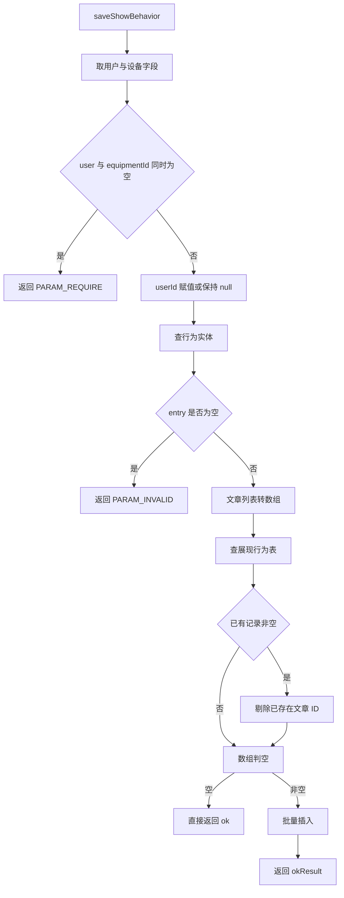

# 行为保存的实现：判空兜底、数组转换与批量落库

五个步骤注释挂在方法体里，这一课逐条翻译成代码。链路不长，坑的密度却不低：参数拦截是「且」不是「或」，实体查不到必须截断，List 与数组来回转换，过滤集合上还埋着 Arrays.asList 的经典陷阱。写完之后，展现行为的保存链路从入口到落库全部接通。

## 先给结论

- 参数拦截用「且」：user 与 `equipmentId` 同时缺席才返回 PARAM_REQUIRE，只带设备号的未登录用户必须放行。
- `userId` 用 Long 变量承接，user 为空保持 null，查实体时「用户或设备」两路靠 null 自然分流。
- 行为实体查不到直接返回 PARAM_INVALID，链路截断，不能拿 null 去取 ID。
- Mapper 传参统一数组：List 循环拷贝成 `Integer[]`，过滤时转回 List 剔除已存在，再 toArray 转回数组，插入前还要防空。
- 阅读展现是纯插入链路，天然幂等，不需要事务；显式行为的更新分支与计数回写才是事务的用武之地。

## 两个 Mapper 进场

实现开始前先注入两个 Mapper，都在 model 工程的 mappers.app 包，行为实体一个，展现行为一个：

```java
@Autowired
private ApBehaviorEntryMapper apBehaviorEntryMapper;
@Autowired
private ApShowBehaviorMapper apShowBehaviorMapper;
```

接口与映射文件下一课编写，这一课只认方法名与参数，服务层的调用从方法签名出发，倒逼 Mapper 的接口定义与 XML 对齐。

## 参数拦截：两个主体同时缺席才算缺参

第一步的代码看起来只有两个判断，语义却要掰清。user 来自线程上下文，`equipmentId` 来自 dto，两个主体字段的关系是「或」：任何一个在场都能定位主体，两个同时缺席才算参数缺失，返回 PARAM_REQUIRE：

```java
@Override
public ResponseResult saveShowBehavior(ShowBehaviorDto dto) {
    // 1. 获取用户信息，获取设备 id
    AppUser user = AppThreadLocalUtils.getUser();
    // 两个主体字段同时缺席才算缺参，只带设备号的未登录用户必须放行
    if (user == null && dto.getEquipmentId() == null) {
        return ResponseResult.errorResult(AppHttpCodeEnum.PARAM_REQUIRE);
    }
    // user 为空时保持 null，交给主体查询按设备维度分流
    Long userId = null;
    if (user != null) {
        userId = user.getId().longValue();
    }
}
```

写成「或」的版本错在哪？未登录用户在系统里是合法主体，user 为 null、`equipmentId` 在场，按「或」判断会被直接拦下，设备维度的行为采集整条报废。user 判断完为什么还要单独立变量？上一个拦截只挡「两个都空」，user 单独为空时代码继续往下走，直接调 `user.getId()` 就是空指针，所以 `userId` 用 Long 承接，user 在场才赋值，不在场保持 null，后续查询按 null 分流到设备维度。

## 查行为实体：一个方法管两路主体

主体查询按「用户或设备」语义命名方法，两个参数照传，null 值交给 XML 的动态分支处理：

```java
// 2. 根据当前的用户信息或设备 id 查询行为实体
ApBehaviorEntry entry = apBehaviorEntryMapper
        .selectByUserIdOrEquipment(userId, dto.getEquipmentId());
if (entry == null) {
    // 主体不存在，链路截断
    return ResponseResult.errorResult(AppHttpCodeEnum.PARAM_INVALID);
}
```

实体为空的分支是第二次兜底。ap_behavior_entry 里没有匹配主体时（全新设备、从未登记），继续往下取 `entry.getId()` 就是空指针，所以查完立刻校验，空主体按无效参数返回，链路在第二步截断。空主体截断还是补建一条 entry 再继续，两种设计都成立：截断实现最简，坏数据进不来，前提是入口参数可信；补建让首次上报就能落库，代价是每次多一步插入判断。课程选截断，理由在于阅读展现是高频链路，请求侧的设备号由端上保证，入口数据可信。

## 文章列表：从集合到数组的一次拷贝

第三步取文章列表，dto 的 `articleIds` 是集合，工程口径把它转成数组再往后传。转换就是一次循环拷贝，长度用列表尺寸初始化：

```java
// 3. 获取前台传递过来的文章列表 id，转成数组作为查询条件
List<Integer> articleIdList = dto.getArticleIds();
if (articleIdList == null || articleIdList.isEmpty()) {
    return ResponseResult.okResult(null);
}
Integer[] articleIds = new Integer[articleIdList.size()];
for (int i = 0; i < articleIdList.size(); i++) {
    articleIds[i] = articleIdList.get(i);
}
```

开头的空列表判断是防御性兜底：列表为空时后面的 in 查询与批量插入都没有意义，直接返回成功即可。集合转数组本身不是 MyBatis 的硬性要求，foreach 对 List 同样支持；统一数组的好处是 Mapper 方法签名明确，不依赖 MyBatis 对 List 的默认参数名（list、collection）这类隐式规则，配合显式 @Param 之后哪一种都安全，工程保持同一种传参风格是为了让 XML 的写法可预期。

## 过滤已存在：Arrays.asList 的陷阱就埋在这里

第四步查展现表，把实体 ID 与文章 ID 数组一起传给 `ApShowBehaviorMapper`，查回该主体下这些文章已有的展现记录。第五步的过滤方向是从待保存列表剔除库里已有的文章 ID：

```java
// 4. 根据行为实体 id 和文章列表 id 查询展现行为表
List<ApShowBehavior> showBehaviors = apShowBehaviorMapper
        .selectListByEntryIdAndArticleIds(entry.getId(), articleIds);

// 5. 数据的过滤，剔除表中已经存在的文章 id，剩余数据批量保存
if (showBehaviors != null && !showBehaviors.isEmpty()) {
    List<Integer> remainIds = new ArrayList<>(Arrays.asList(articleIds));
    showBehaviors.forEach(item -> remainIds.remove(item.getArticleId()));
    articleIds = remainIds.toArray(new Integer[0]);
}
// 过滤后可能为空，空数组不能进 insert 的 foreach
if (articleIds.length == 0) {
    return ResponseResult.okResult(null);
}
```

Arrays.asList 这一步值得展开。数组能查不能删，删除操作要在集合上做，转集合就想到 Arrays.asList；但它的返回值是定长视图，底层数组与原数组共享，remove 直接抛 UnsupportedOperationException，而且运行期才炸，编译与代码评审都不容易发现。稳妥写法是包一层 `new ArrayList` 拷贝成可变集合再删。删除用 forEach 遍历查回的展现记录，记录里的 `articleId` 就是要剔除的目标；删完 toArray 转回数组，长度参数传 `new Integer[0]` 让 JVM 自动分配精确容量，比先取 size 再传更不容易出偏差。

过滤后的数组还有一个隐蔽的空态：这一批文章全部展现过时，剔除完一个不剩，空数组传进 insert 的 foreach 会拼出 values 空括号的非法 SQL。插入前判空返回，是这条链路的最后一个兜底。

## 保存与返回

```java
// 保存操作：批量插入剩余数据
apShowBehaviorMapper.saveShowBehavior(articleIds, entry.getId());
// 保存动作无数据返回，统一响应壳给一个 ok 即可
return ResponseResult.okResult(null);
```

saveShowBehavior 的第二个参数又出现 ID 之争：传的是 `entry.getId()`，行为实体 ID，不是设备号，与前一步查询的口径保持一致。方法返回 void，服务层不需要拿到自增主键，保存成功直接给统一响应壳。Mapper 接口与 XML 下一课编写，方法名与参数从这一刻起就是契约。整条链路的控制流如下：



三次判空兜底串起整条链路：入口拦缺参、主体查不到拦空实体、落库前拦空数组，每个出口都返回统一响应壳，前端拿到的失败原因始终可解析。

## 事务这道题为什么不在这条链路出现

阅读展现的保存是单表批量插入，一条 insert 语句本身就是原子操作，没有第二张表要同步改，事务加与不加结果一致。更值得说的是幂等：过滤逻辑先查后存，同批文章重复上报时，上一次落库的记录会被这一次的查询命中并剔除，天然不会重复插入；即使插入后响应丢失、前端重试，链路重跑一遍的结果也与第一次一致。显式行为（点赞、收藏）是另一种形态：行为记录存在则更新、不存在则新增，还要按操作方向把 likes 这类计数列加一减一地冗余回文章表，跨表写入必须圈在一个事务里，失败一起回滚；那些分支逻辑属于显式行为的课程，这里的纯插入链路先享受无事务的轻快。

## 常见误区

- **参数拦截写成「或」。** user 为空就被拦截，未登录用户的行为采集整条报废；两个主体字段同时缺席才返回 PARAM_REQUIRE。
- **entry 为空继续取 ID。** 主体查不到时 `getId()` 直接空指针，查完立刻校验并截断是第二次兜底。
- **Arrays.asList 的返回值直接 remove。** 定长视图删除抛 UnsupportedOperationException；包一层 `new ArrayList` 拷成可变集合再删。
- **过滤后的空数组直接进插入。** 空数组让 foreach 拼出非法 SQL；插入前判空，为空直接返回成功。

## 面试可能被问到的问题

1. 面试官追问：「判断 user 与 equipmentId 时为什么必须两者同时为空才报缺参？」
   答：两个主体字段的关系是「或」，任何一个在场即可定位行为主体，未登录用户靠设备号、登录用户靠用户 ID；只有两者同时缺席才说明请求连主体都带不出来，返回缺参错误才不会误伤设备维度的合法采集。
2. 面试官追问：「查不到行为实体为什么报错而不是补建一条？」
   答：截断与补建都成立，取舍在链路定位。阅读展现是高频隐式链路，入口参数由端上保证，截断实现最简且坏数据进不来；补建让首次上报即可落库，但每次多一步插入判断，更适合低频显式行为链路。
3. 面试官追问：「List 转数组传给 MyBatis 是必须的吗？」
   答：不是，foreach 对 List 与数组都支持。统一数组是工程口径，方法签名明确、参数名由 @Param 显式指定，避免依赖 MyBatis 对 List 的默认名（list、collection）这类隐式规则；风格统一比能力边界更重要。
4. 面试官追问：「这条链路为什么不需要事务？」
   答：单表批量插入，一条 insert 语句天然原子，没有跨表写；先查后存的过滤让重复上报被剔除，链路天然幂等。跨表一致性（行为记录加计数回写）出现在显式行为里，那才是事务的必要性来源。
5. 面试官追问：「Arrays.asList 返回的集合有什么特性，会踩什么坑？」
   答：它是 Arrays 的内部定长视图，底层数组与原数组共享，add、remove 都抛 UnsupportedOperationException，set 可以但会改原数组。要可变集合就用 new ArrayList 包装拷贝，要只读就声明成 List 接口并明确文档化。
6. 面试官追问：「批量插入一次写多少行合适？」
   答：values 行数受 SQL 文本长度与 max_allowed_packet 约束，还会占用语句解析缓存；一次插入几十到几百行通常安全，超过这个量级分批提交。本课一批文章列表最多几十条，一次插入足够。

## 配套资料

- 代码：`materials/code/05/头条day01/`，内层资料目录含数据库规范设计说明书（事务与冗余一致性的取舍可对照其规范条目）、PowerDesigner 使用手册与前后台项目原型 HTML；原始目录与文件名冠以项目原名，正文统一以「头条类资讯项目」指代。
- 说明：day01 资料包不含工程 Java 源码，文中实现代码为按画面线与主流写法补全的可运行版本，包名统一改写为 `com.study.headline`；参数拦截的「且」语义、Arrays.asList 的修正写法、空列表与空数组兜底为补全要点，均已注明；显式行为的事务与计数分支按课程口径预告。
