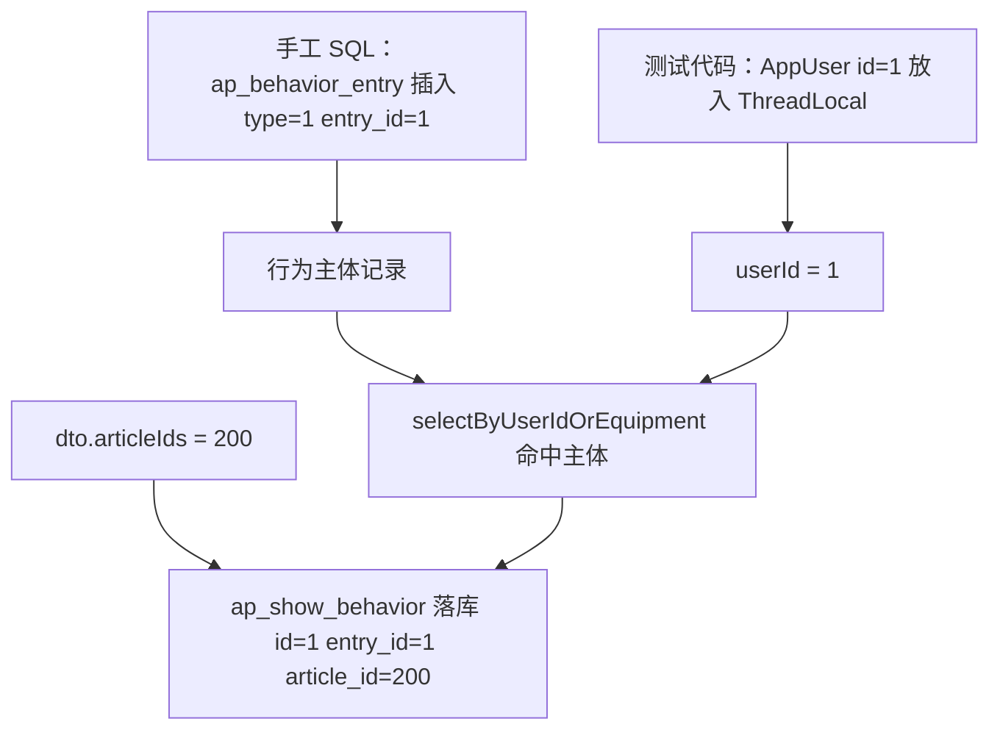

# 让行为数据真正落库：测试类造数据、一次调试与查库核对

服务层与两份 Mapper XML 逐个补齐之后，链路只剩最后一环：跑一次，看数据有没有真的写进表。拿 postman 直接打接口并不是最快的验收路径，这条链路的用户上下文由网关解析 token 后放进 ThreadLocal，网关、注册中心没起全时，报错会一层层混在一起。更直接的做法是把服务层拉进 JUnit 集成测试，上下文手动塞、参数手动造，先验收落库正确，再谈端到端联调。

## 先给结论

- 测试前要补两处：behavior 工程加一份 MybatisConfig，把 common 工程的 MyBatis 整合组件扫进容器，否则一调 Mapper 就报找不到 Bean；insert 语句补上 id 列，值暂用 `#{entryId}` 写死。
- 写死主键的根因是 ap_show_behavior 的 id 不是自增列；MyCat 集成后由全局序列接管主键生成，这段写死代码到时候整体替换。
- 测试类用 JUnit 4 风格：`@RunWith(SpringRunner.class)` 把执行流程接到 Spring 测试框架，`@SpringBootTest(classes = 引导类.class)` 指定装配来源。
- 造数据讲究三处对齐：ap_behavior_entry 手工插入的主体记录、ThreadLocal 里的用户 id、dto 里的文章 id，错一处链路就在对应位置截断。
- 报错是本课的一部分：XML 把 type 拼成 gype 这类错编译器看不见，跑起来才炸；刷新数据库核对字段是最终验收动作。

## 测试前的两处补丁

**第一处补丁在 behavior 工程。** Mapper 接口在 model 工程，@MapperScan 与 MyBatis 的整合配置在 common 工程，引导类的默认扫描范围只有 behavior 自己的起始包，common 的组件默认不进容器。补一份配置类，把 common 的 MyBatis 核心包整体扫进来：

```java
package com.study.headline.behavior.config;

import org.springframework.context.annotation.ComponentScan;
import org.springframework.context.annotation.Configuration;

@Configuration
@ComponentScan("com.study.headline.common.mybatis.core")
public class MybatisConfig {
}
```

这份配置类没有一行业务代码，作用只有一个：把 common.mybatis.core 里的组件拉进容器。SqlSessionFactory、@MapperScan 扫描 model 工程 mappers.app 包的声明、MyBatis 的插件，全部注册在那个包的配置类里；少了这份扫描，应用能正常启动，第一次调 Mapper 就抛找不到 Bean 的异常，「跑不到数据库」说的就是这种现象。

**第二处补丁在上一课的 insert 语句上。** ap_show_behavior 的 id 不是自增列，插入时不给值，MySQL 会报字段没有默认值。正式方案在 day02：集成 MyCat 后由全局序列生成主键，写死的写法到时候整体替换。今天的过渡做法是给 insert 补上 id 列，值先复用 `#{entryId}`：

```xml
<insert id="saveShowBehavior">
    insert into ap_show_behavior (id, entry_id, article_id, is_click, show_time, created_time)
    values
    <foreach collection="articleIds" item="item" separator=",">
        (#{entryId}, #{entryId}, #{item}, 0, now(), now())
    </foreach>
</insert>
```

values 里 `#{entryId}` 出现两次，第一个占位的是 id 列，第二个才是 entry_id。用 entryId 当占位主键，是因为它此刻随手可得、类型也匹配；这是明确的临时方案，库里会出现 id 与 entry_id 同值的多行数据，MyCat 接管主键后要清掉这批测试数据。

## 测试类：JUnit 把 Spring 上下文缝进来

测试类放 behavior 工程的 test 包，两个注解各管一段：

```java
@RunWith(SpringRunner.class)
@SpringBootTest(classes = BehaviorJarApplication.class)
public class BehaviorTest {

    @Autowired
    private AppShowBehaviorService appShowBehaviorService;

    @Test
    public void testSaveShowBehavior() {
        // 模拟登录用户：正式链路由网关解析 token 后调用 setUser，测试环境手动放入
        AppUser user = new AppUser();
        user.setId(1);
        AppThreadLocalUtils.setUser(user);

        // 组装 dto：文章 id 列表，equipmentId 不传，走用户维度
        ShowBehaviorDto dto = new ShowBehaviorDto();
        List<Integer> articleIds = new ArrayList<>();
        articleIds.add(200);
        dto.setArticleIds(articleIds);

        appShowBehaviorService.saveShowBehavior(dto);
    }
}
```

@RunWith 是 JUnit 4 的测试执行器入口，SpringRunner 负责把 JUnit 的执行流程接到 Spring 测试框架上；@SpringBootTest 的 classes 指明以哪个配置类装配容器，写引导类 `BehaviorJarApplication.class`，容器里就有这个微服务的全部 Bean。两个注解缺一不可：不指定 classes，测试类与引导类不在同一包层级时装配不上；没有 @RunWith，@SpringBootTest 根本不会被解析。注入 AppShowBehaviorService 之后，测试方法里调用的就是真实的服务实现，链路从服务层一路走到数据库。

## 造数据：三处对齐

测试能不能过，取决于造的数据与库里的现状是否咬合。ap_behavior_entry 此刻只有一条手工插入的主体记录：

```sql
insert into ap_behavior_entry (type, entry_id, created_time) values (1, 1, now());
```

type = 1 表示用户主体，entry_id 存用户 id。测试代码里 ThreadLocal 放的用户 id 是 1，查主体时 userId = 1 正好命中这条记录；文章 id 随手给了 200，落到第二段链路的 in 查询与批量插入里。三处数据的关系如下图：



手工记录、用户 id、文章 id 三个值里只要有一个对不上，链路就在对应位置截断：用户 id 对不上主体记录，第二步返回 PARAM_INVALID；文章列表不传，第三步空列表直接返回成功，库里什么都不会多。集成测试先设计数据再写代码，原因就在这里：测试验收的其实是「数据之间的对齐关系」。

postman 为什么不在此刻登场？接口在网关后面，token 解析、注册中心、前端登录页任何一个环节没就绪，报错都不在行为功能本身。先在服务层验收落库正确，环境问题被隔离在测试之外，postman 与前端联调放到前端工程跑起来之后。

## 一次真实的调试：gype 与 type

跑第一次，控制台报错，错误信息落在 ap_behavior_entry 那条查询上，提示里带着 a.type 字样。回到 XML 排查，两处 if 分支里的 type 都被拼成了 gype，逐处改回 type 再跑，控制台安静下来，数据库里多出一行。这个错误值得记一笔：XML 没有编译期检查，拼错的列名、拼错的属性名在 IDE 里只是一段普通文本，只有跑起来、被 MyBatis 解析、被数据库执行时才炸出来。上一课强调的「拷贝改名后逐字核对」，在这一刻兑现成了一次真实排错。

## 查库核对与二次上报

插入成功后刷新 ap_show_behavior，验收三个字段：id 有值（暂为 1，写死方案的表现）、entry_id 是 1、article_id 是 200；顺带确认 is_click 是 0，show_time 与 created_time 是插入那一刻的时间。库里多了一行，行为功能的落库链路就算通了。

同一批文章再上报一次会发生什么？答案在上一课的过滤链路里：查询命中刚才那行记录，剔除后剩余数组为空，插入前判空直接返回 ok，库里不会多出重复行。「先查后存」的设计在二次路径上兑现了幂等，这也是展现行为流水不需要事务的原因之一。

## day01 收官

从搭建 behavior 工程到一条记录落库，day01 的链条是：接口定义立契约，服务实现写清五步判空与过滤，Mapper 接口加 XML 落地动态 SQL，测试类造数据验收落库。行为主体的双维度（用户与设备）与展现行为的流水定位贯穿始终；显式行为（点赞、收藏、评论）的更新分支与计数回写、MyCat 分库分表与主键序列，都排在 day02。库里留着的写死 id 测试数据，到时候一并清理。

## 常见误区

- **以为引入了依赖就能调 Mapper。** 依赖只是让类出现在 classpath，@MapperScan 与整合配置类不进容器照样找不到 Bean；MybatisConfig 的 @ComponentScan 是把 common 组件挂进容器的通道。
- **测试用户 id 与库里主体记录不一致。** ThreadLocal 放的用户 id 在 ap_behavior_entry 查不到主体，链路第二步返回 PARAM_INVALID，表象是「测试报参数无效」，根因是数据没对齐。
- **写死 id 后反复重跑还手工删数据。** 同一批插入的 id 全是 entryId 同值，按 id 清理测试数据容易误删；按 article_id 或 created_time 定位更稳。
- **报错没看完就改代码。** 先读完整异常栈，定位到哪条语句哪个字段，再回 XML 逐字核对；本课的 gype 就是靠错误信息锁定位置的。

## 面试可能被问到的问题

1. 面试官追问：「为什么行为功能先写集成测试验收，而不是直接 postman 打接口？」
   答：行为链路的用户上下文由网关解析 token 后放进 ThreadLocal，端到端联调依赖网关与注册中心全部就绪，报错混在多层环境里。@SpringBootTest 把服务层直接拉进容器，上下文手动造，先隔离验收数据落库，环境问题留到联调阶段。
2. 面试官追问：「@SpringBootTest 的 classes 属性什么时候必须写？」
   答：默认行为是向上搜索 @SpringBootConfiguration 注解的类作为装配来源；测试类与启动类不在同一包层级，或工程里有多个启动类时，必须用 classes 显式指定，否则容器装配失败。
3. 面试官追问：「主键暂用 entryId 写死，这个方案有什么隐患？」
   答：同一批插入的多行 id 同值，与已有数据可能冲突，后续按 id 更新删除会误伤；它只服务于过渡期验证，MyCat 全局序列接管主键后必须替换，并清理这批测试数据。
4. 面试官追问：「MyBatis 的 XML 写错了为什么 IDE 不标红？」
   答：XML 是运行期资源，没有编译期类型检查，namespace、id、属性拼写对 IDE 只是文本；错误要到语句被解析、SQL 被执行时才暴露，所以拷贝改名后的逐字核对与控制台异常栈是主要排错手段。
5. 面试官追问：「怎么避免测试数据污染数据库？」
   答：常用手段有测试方法加 @Transactional 让事务自动回滚、@Sql 执行清理脚本、给测试数据划专用区段按规则清理。本课的展现行为是纯插入且主键写死，采取人工清理，属于过渡期的取舍。

## 配套资料

- 代码：`materials/code/05/头条day01/`，内层资料目录含数据库规范设计说明书（主键生成策略与 MyCat 序列的设计依据可对照其规范条目）、PowerDesigner 使用手册与前后台项目原型 HTML；原始目录与文件名冠以项目原名，正文统一以「头条类资讯项目」指代。
- 说明：day01 资料包不含工程 Java 源码，文中配置类、测试类与 insert 语句为按画面线与主流写法补全的可运行版本，包名统一改写为 `com.study.headline`；服务接口名 AppShowBehaviorService、测试注解与主键写死的写法来自画面线，dto 的文章列表沿用前两课 List&lt;Integer&gt; 口径（画面以含 id 字段的文章对象演示，语义等价）。
