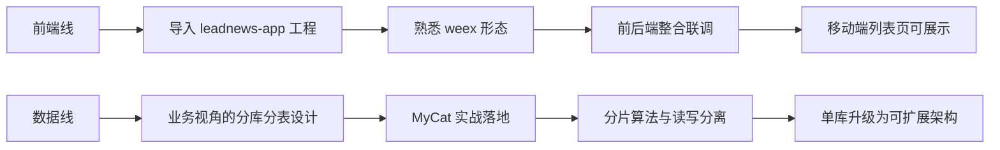

# 第二天任务书：前端整合出移动端列表页，MyCat 接手分库分表

day01 收官时留下了两个明确的尾巴：行为数据落库的主键是临时写死的，等一个正式的发号方案；后端接口一条条通了，读者手里却没有一个能点能滑的移动端页面。day02 的任务书就冲着这两个尾巴来，分成两条战线：前端线把 App 工程跑起来并与后端整合，数据线把单体数据库改造成 MyCat 管理的分库分表。

## 先给结论

- day02 分两大块：前端负责「看得见」，目标是把移动端列表页真实展示出来；数据库负责「扛得住」，核心是 MyCat 分库分表改造。
- 前端线三步走：导入 App 前端工程，熟悉 weex 移动端框架，重点做前后端整合，最终把移动端列表页展示出来。
- 数据线层层递进：先从业务视角决定怎么分库分表，再进 MyCat 实战，然后落到分库分表算法与读写分离（对应「熟悉生产与测试环境的数据差异」这条目标）。
- day01 写死的主键在数据线里收口：MyCat 的全局序列按表发号，`ap_show_behavior` 这类流水表的 id 生成正式交接。
- 验收标准朴素：浏览器预览页与手机真机都能看到资讯列表界面，后端接口的数据出现在列表里。

## 两条战线怎么分工

前端线的终点是一个「能看的 App」：页面壳子由前端工程提供，数据来自 day01 写好的文章列表与行为接口，两边在 day02 结束前接通。这条线里导入工程与熟悉 weex 都是铺垫，整合才是重点，因为列表页有没有数据、接口地址对不对、跨域怎么处理，全在整合这一步暴露。

数据线的起点是 day01 的规约阈值：单表行数超过 500 万行或容量超过 2GB 才推荐分库分表。头条类资讯项目的文章表、行为表都是典型的流水型大表，增长曲线注定会撞线，所以第二天的后端任务不是写新接口，而是给数据库动手术。MyCat 在中间当门面：应用连的还是「一个库」，底下已经拆成多个数据节点，分片规则、全局序列、读写分离都由它调度。

两条战线的目标到技术点的映射如下图：



关键路径在两条线的交汇处：前端列表页要渲染数据，必须打通到后端接口的请求链路；后端接口要扛住量，必须踩在 MyCat 重排过的存储架构上。day02 学完，整套系统的「端到服务到存储」三层就都有了雏形。

## weex 是个什么形态

用一句大白话说：weex 让你写 Vue 语法，渲染出来的却是原生组件，不是浏览器里的 DOM。它与 uni-app 属于同一类跨端方案，一份代码跑 Android、iOS 与 Web 多端；区别在生态与工程链路，本课按资料口径采用 weex。资讯流这种高频滚动场景对流畅度敏感，原生渲染比 WebView 套壳少一层开销，这是 App 端选它的现实理由。

资料代码目录里的组件示例把常用组件过了一遍（原文件中的站点文案与链接已替换为占位）：

```vue
<template>
    <div class="wrapper">
        <text class="title">资讯头条</text>
        <list>
            <refresh @refresh="onrefresh" :display="refreshing ? 'show' : 'hide'">
                <text>Refreshing ...</text>
                <loading-indicator></loading-indicator>
            </refresh>
            <cell v-for="num in lists">
                <text>{{num}}</text>
            </cell>
            <loading @loading="onloading" :display="loadinging ? 'show' : 'hide'">
                <text>Loading ...</text>
                <loading-indicator></loading-indicator>
            </loading>
        </list>
    </div>
</template>
<script>
    export default {
        data: () => ({
            lists: ['A', 'B', 'C', 'D', 'E'],
            loadinging: false,
            refreshing: false
        }),
        methods: {
            onloading: function () {
                this.lists = ['1', '2', '3'];
            },
            onrefresh: function () {
                this.lists = ['A', 'B', 'C', 'D', 'E'];
            }
        }
    }
</script>
```

示例里藏着 weex 的两条规矩。第一条，没有「浏览器标签」一说：`text`、`image`、`list`、`cell`、`refresh`、`loading` 全是组件，文字必须包在 `text` 里才渲染，裸写文本不显示。第二条，长列表是一等公民：`list` 加 `cell` 就是列表本体，`refresh` 与 `loading` 挂在列表内部实现下拉刷新与上拉加载，移动端资讯流的交互模式直接内置在组件体系里，不需要手写触摸事件。

## MyCat 收口 day01 的尾巴

主键问题是上一天明说的过渡方案：`ap_show_behavior` 的 id 不是自增列，插入前临时写死，等 MyCat 集成后由全局序列接管。资料里 `sequence_db_conf.properties` 就是发号清单，每张表一行，指向存序列记录的数据节点：

```properties
#sequence stored in datanode
AP_ARTICLE=DNSQ
AP_USER=DNSQ
AP_SHOW_BEHAVIOR=DNSQ
AP_COMMENT=DNSQ
AP_EQUIPMENT=DNSQ
```

插入语句经过 MyCat 时，它先按表名到对应节点取一个全局唯一的号，再把完整的 insert 发往分片，写死 id 的代码到那天整体删除。分库分表的规则声明在 `schema.xml` 里，逻辑库、逻辑表、数据节点、分片算法在其中逐层挂钩，rule 文件里已经能看到按 `user_id` 取模这类规则的定义，具体配置与算法在 MyCat 实战的课程里逐条展开。读写分离是数据线的另一件配套：主库承担写，从库承担读，开发与生产环境的数据差异由此而来，配置方式同样留给实战篇。

## 常见误区

- **把 weex 当成「移动端网页」。** 它的渲染目标是原生组件，WebView 方案里好使的 CSS 全家桶在这里未必生效；排查样式问题要按组件约束想，不是浏览器里那一套。
- **分库分表从中间件开始背。** 拆法来自业务：按业务域垂直拆库，再按查询维度水平拆表，MyCat 只是执行者；先背配置不画拆分方案，实战时字段一变全部返工。
- **以为全局序列可有可无。** 单库时代自增主键顺手，分片后自增会在多个节点上撞号；主键方案必须在分库分表落地时一起定，day01 的写死 id 只是给测试期续命。
- **把读写分离当成纯配置活。** 主从延迟、读写冲突、生产与测试数据不一致都会在配置之后出现，目标清单里「熟悉生产与测试环境的数据差异」指的就是这一层。

## 面试可能被问到的问题

1. 面试官追问：「App 端为什么选 weex 这类原生渲染方案，而不是直接 H5？」
   答：资讯流是高频滚动场景，H5 走 WebView 渲染多一层开销，长列表滚动与手势体验打折；weex 用 Vue 语法开发、渲染成原生组件，开发效率与运行流畅度兼得，还支持热更新式的发包调试。同类方案还有 uni-app，选型看团队生态与多端诉求。
2. 面试官追问：「什么时候该分库分表，怎么拆？」
   答：按规约阈值，单表超 500 万行或 2GB 再拆，不为拆而拆。方向上先垂直按业务域把文章、用户、行为拆到不同库，边界清楚互不拖累；量再涨就水平拆表，按高频查询维度（文章 id、用户 id）做分片键，分片算法按数据倾斜程度选。
3. 面试官追问：「分库分表之后主键怎么生成？」
   答：自增主键在多节点下会重复，常见方案有数据库号段、UUID、雪花算法与中间件全局序列。本项目的做法是 MyCat 按表维护序列，插入前先取号再分发；选型要权衡有序性、长度与性能，流水表尤其在意主键趋势递增，避免页分裂。
4. 面试官追问：「上了读写分离，最要防什么？」
   答：主从延迟。写后立刻读的场景可能读到旧数据，敏感链路要强制走主库，或用缓存与重试兜底；同时区分生产与测试环境的数据源配置，避免测试流量打到生产从库。
5. 面试官追问：「前端页面调不通后端接口，开发期跨域一般怎么解？」
   答：开发期用 dev server 的代理表，请求先打到同源的前端服务，由它转发给后端并重写路径，浏览器感知不到跨域；生产期在网关或后端统一开 CORS。前后端约定统一的前缀与响应结构，两边各自独立演进。

## 配套资料

- 代码：`materials/code/05/头条day02/`，资料目录含 mycat 相关配置（`schema.xml`、`rule.xml`、`server.xml`、`sequence_db_conf.properties`），代码目录含 weex 组件示例；原始目录与文件名冠以项目原名，正文统一以「头条类资讯项目」指代。
- 说明：目标口径按课件画面与口播整理；weex 组件示例取自资料真实文件并精简，站点文案、链接已替换为占位内容；发号清单为资料原文节选，分片规则与读写分离配置在后续 MyCat 实战篇展开。
