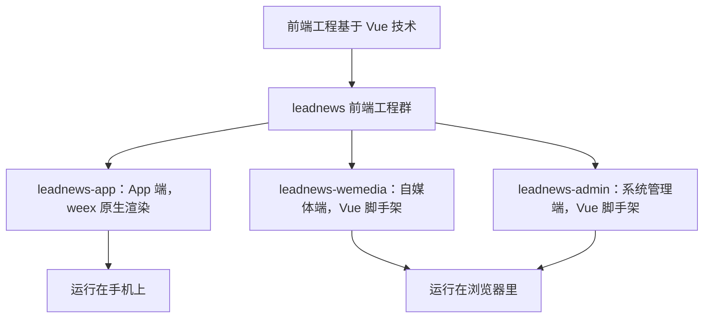

# 三个前端各走各的路：工程结构拆解与 Node 环境准备

后端的微服务一个接一个立起来，前端从 day02 正式进场。进场第一课不讲页面怎么写，讲的是一个容易被忽略的事实：这套项目的前端不是一个工程，而是三个。App 端跑在用户手机上，自媒体端服务内容创作者，系统管理端服务平台运营，三端技术同源却形态不同，开发环境也要分别备齐。环境装错版本、镜像没配，后面的导入与启动全会在编译期报一些看上去毫不相干的错。

## 先给结论

- 前端工程基于 Vue 技术，分为 3 个独立项目：App 端、自媒体端、系统管理端。
- App 端用 weex 开发，自媒体端与系统管理端基于 Vue 脚手架（vue-cli）；day02 先导入并跑起来的是 App 端。
- 环境准备五件事：Node.js、npm、cnpm（淘宝镜像）、webpack 全局安装、weex-toolkit；IDE 用 WebStorm，课程资料里提供。
- npm 随 Node.js 自带；npm 默认镜像在国外，装 cnpm 走国内镜像源；weex 工具链用 `npm i -g weex-toolkit` 安装，`weex -v` 验证。
- 前后端分离意味着前端自己起服务：Node.js 是前端服务的运行底座，不是可选件。

## 三个前端：一套技术，两种形态

为什么拆成三个独立项目？因为三端的使用者、发布节奏、运行环境完全不同。App 端面向海量 C 端用户，装在手机上，对滚动流畅度与原生体验敏感，所以选 weex 这种原生渲染框架；自媒体端与系统管理端是典型的 B 端后台，跑在浏览器里，Vue 脚手架就是标准答案，组件库、路由、构建链路一应俱全。拆开之后三端各自独立迭代，管理端改一个表单不必连带 App 重新构建发版。

三端的关系与各自的形态如下图：



图里值得停留的是「同源不同命」：三端写的都是 Vue 语法的代码，但 App 端的代码经 weex 工具链编译后交给原生渲染器，另两端经 webpack 打包后在浏览器里跑。day02 只导入 App 端，自媒体端与系统管理端等到对应课程再进场。

## 环境清单：从 Node.js 到 weex 工具链

**第一件，Node.js。** 前后端分离后，前端工程自带开发服务器，靠 Node 启动与热更新，没有它前端工程就是一堆静态文件。安装直接用资料文件夹下提供的 Node 版本，不要追新：老工程对 Node 版本有要求，装最新的反而跑不起来。**第二件，npm。** 安装完 Node.js 会自动带上，`npm -v` 能出版本号就算就位。**第三件，cnpm。** npm 的默认镜像源在国外，国内网络装包经常超时假死；cnpm 是走淘宝镜像的命令行工具，需要单独安装，装完下载速度换一个量级。**第四件，webpack。** 全局安装，三端的构建都建立在它上面。**第五件，weex-toolkit。** App 端的工具链，负责编译与预览。安装与验证动作集中在一串命令里：

```bash
# npm 随 Node.js 自带，验证即可
npm -v
# cnpm 走淘宝镜像，需单独安装，装完同样验证
cnpm -v
# webpack 全局安装
npm i -g webpack
# weex 工具链安装与版本验证
npm i -g weex-toolkit
weex -v
```

每条 `-v` 命令都值得认真看一眼输出：版本号打得出来，说明命令在环境变量里、安装真的生效了。环境验收的标准就是这一列版本号全部有输出，缺哪一环，问题会推迟到构建报错时才暴露，而且报错信息往往指向别处，排查绕远路。

## weex 组件长什么样

工具链装完可以先看一眼 weex 代码的样子。资料代码目录里的组件示例把常用组件串了一遍（原文件中的站点文案与链接已替换为占位）：

```vue
<template>
    <div class="wrapper">
        <text class="title">资讯头条</text>
        <list>
            <refresh @refresh="onrefresh" :display="refreshing ? 'show' : 'hide'">
                <text>Refreshing ...</text>
                <loading-indicator></loading-indicator>
            </refresh>
            <cell v-for="num in lists">
                <text>{{num}}</text>
            </cell>
            <loading @loading="onloading" :display="loadinging ? 'show' : 'hide'">
                <text>Loading ...</text>
                <loading-indicator></loading-indicator>
            </loading>
        </list>
    </div>
</template>
<script>
    export default {
        data: () => ({
            lists: ['A', 'B', 'C', 'D', 'E'],
            loadinging: false,
            refreshing: false
        }),
        methods: {
            onloading: function () {
                this.lists = ['1', '2', '3'];
            },
            onrefresh: function () {
                this.lists = ['A', 'B', 'C', 'D', 'E'];
            }
        }
    }
</script>
```

从示例能总结出 weex 的两条规矩。第一条，没有「浏览器标签」一说：`text`、`list`、`cell`、`refresh`、`loading` 全是组件，文字必须包在 `text` 里，直接裸写文本不会渲染；图片用 `image` 组件，链接用 `a` 组件。第二条，长列表是一等公民：`list` 加 `cell` 就是列表本体，`refresh` 与 `loading` 挂在列表内部实现下拉刷新与上拉加载，资讯流的交互模式内置在组件体系里，写资讯类 App 恰好对口。语法层还是 Vue 的 `data` 与 `methods`，会 Vue 就能上手 weex，成本主要在组件习惯的转换。

## 常见误区

- **把 weex 当「移动端网页」。** 它渲染的是原生组件，不是 WebView 里的 DOM；CSS 只在组件支持的范围内生效，按浏览器习惯随手写样式会大面积失效。
- **npm 装包超时只会反复重试。** 默认镜像源在国外，网络原因重试没有意义；装 cnpm 或把 npm 的 registry 指到国内镜像源才是解法。
- **Node 版本追新。** 老前端工程依赖特定版本的构建工具链，Node 升级后 webpack 旧版本可能直接跑不起来；按资料给定的版本安装，多版本共存用 nvm 之类的版本管理器。
- **三端混用一套启动方式。** App 端走 weex 工具链，另两端走 Vue 脚手架，命令与配置各是各的；拿管理端的启动命令去跑 App 工程只会收获一屏报错。

## 面试可能被问到的问题

1. 面试官追问：「一套项目为什么拆三个前端工程？」
   答：三端的使用者与运行环境不同，C 端 App 追求原生体验走 weex，B 端后台在浏览器里走 Vue 脚手架；拆开后各自独立构建发版，改管理端不必连带 App 重新发布，团队也能按端分工并行。
2. 面试官追问：「weex 和纯 H5 加 WebView 的方案差别在哪？」
   答：渲染层不同，H5 方案页面由浏览器内核渲染，滚动与手势多一层封装；weex 把 Vue 语法的模板编译成原生组件指令，由原生渲染器绘制，性能接近原生。代价是组件与样式受框架约束，复杂 CSS 特效不如 H5 自由。
3. 面试官追问：「Node.js 在前端工程里扮演什么角色？」
   答：开发期是 dev server 的运行环境，提供本地服务、热更新与代理转发；构建期是 webpack 等工具的执行环境，把源码编译成可发布的产物。前后端分离后前端工程是一个独立的应用，Node 就是它的运行时。
4. 面试官追问：「npm 与 cnpm 是什么关系？镜像源怎么配？」
   答：npm 是 Node 自带的包管理器，cnpm 是使用淘宝镜像源的命令行工具，装包走的仓库不同、命令兼容。也可以不装 cnpm，直接用 `npm config set registry` 把默认源指到国内镜像，两种方式二选一即可。
5. 面试官追问：「全局安装和项目内安装的包有什么区别？」
   答：全局安装的包注册为命令行工具，任何目录都能执行，webpack、weex-toolkit 这类构建入口适合全局装；项目内安装的包进入 `node_modules` 与依赖清单，跟着工程走，保证团队成员版本一致。版本敏感的构建工具建议项目内固定版本，全局只留入口。

## 配套资料

- 代码：`materials/code/05/头条day02/`，代码目录含 weex 组件示例（`list`、`cell`、`refresh`、`loading`、`text` 等组件的用法演示），资料目录含 mycat 相关配置（后续分库分表课程使用）；原始目录与文件名冠以项目原名，正文统一以「头条类资讯项目」指代。
- 说明：三端结构图、环境清单与安装命令按课件画面与口播整理；weex 组件示例取自资料真实文件并精简，站点文案与链接已替换为占位内容。
