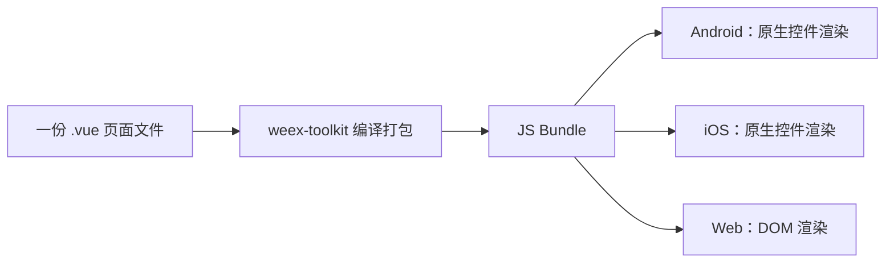

# Weex：用 Vue 语法同时产出 Android、iOS 与 Web 页面的跨端框架

资讯类 App 有两个绕不开的现实：Android 与 iOS 各写一套原生页面，人力翻倍、版本迭代永远对不齐；全部退回 H5，长列表滚动与手势交互的体验又明显掉队。头条类资讯项目的移动端文章列表要的是原生页面的流畅感，前端团队掌握的却是 Vue，这两条约束共同指向的答案就是 Weex。这一课把 Weex 的定位、环境搭建、工程结构与官方文档的阅读路线一次讲清，为后面的组件与网络请求铺路。

## 先给结论

- Weex 是阿里巴巴开源、已捐赠给 Apache 基金会的移动端跨端框架，用一套代码构建 Android、iOS 与 Web 三端应用。
- 写法基于 Vue：template、script、style 三段式与指令、数据绑定全部通用，学 Weex 的前提是先有 Vue 基础。
- 渲染目标不是浏览器 DOM 而是原生控件，这是它与 H5 方案最本质的区别，也是内置组件自成一套的根因。
- 环境两步走：npm 安装 weex-toolkit 脚手架，weex create 创建工程；真机调试用官方 Playground，手机与电脑必须处于同一局域网。
- 官方文档重点读三块：内置组件、内置模块（网络请求的 stream 是必会项）与 Weex 实例变量。

## Weex 的定位：Vue 语法进，原生控件出

一句话定义：Weex 是一个使用 Vue 语法、以原生控件为渲染目标的移动端跨端框架。写的是 .vue 风格的页面文件，最终跑在手机上的却是 Android 的 View 体系与 iOS 的 UIKit 控件，Web 端则退化为 DOM 渲染。

跨端方案目前是三条路线，同一份页面需求放到三条路线上对比，各自的取舍就清楚了：

| 方案 | 语法栈 | 渲染方式 | 特点 |
|---|---|---|---|
| H5 | HTML、CSS、JS | WebView 里的浏览器内核 | 无需发版随时更新，长列表与复杂手势性能吃紧 |
| React Native | React 语法 | 原生控件 | 体验接近原生，Vue 团队需要转 React |
| Weex | Vue 语法 | 原生控件 | Vue 团队零成本迁移，阿里系产品大规模验证 |

渲染路径用一张图看更直白：



同一份 bundle 在三个平台各走各的渲染器，Android 与 iOS 侧把组件映射成原生控件，Web 侧直接走 DOM。语法只有一套、渲染目标按端分发，这是 Weex 的架构核心，也解释了后面为什么它的组件集合与 HTML 对不上号。

关于成熟度，官方社区页面「他们都在使用 Weex」列出淘宝、天猫、闲鱼、飞猪、UC 浏览器等一批应用，大头来自阿里系，同时也有不少新产品陆续接入。资讯流应用以列表高频滚动为主，原生渲染的滚动体验正是 Weex 的长项。

## 环境搭建与工程创建

文档「设置开发环境」一节给出了各操作系统的安装命令，核心是装好 Node.js 之后安装全局脚手架：

```bash
$ sudo chmod -R 777 /usr/local/lib/node_modules/
$ npm i -g weex-toolkit     # 安装时不需要 sudo 命令
$ weex -v                    # 查看当前 weex 工具版本
```

创建工程一条命令完成：

```bash
$ weex create news-app      # 项目名称可自定义
```

两个现场经验值得提前交代。**其一，构建过程很长。** 首次创建要拉取大量依赖，网络不好会更慢；课程直接导入的前端工程就是用这条命令构建出来的成品，目录结构与手创的完全一致，不必重复折腾。**其二，真机调试靠局域网。** 在手机上安装官方 Playground 应用，让手机与电脑处于同一局域网，扫码即可真机预览与热刷新，改完代码立刻在手机上看到效果。

## 工程结构：从生成的目录读起

weex create 生成的工程顶层目录分七块：

```text
├── config        # 项目配置
├── dist          # 构建产物，最终生成的目标文件
├── node_modules  # npm 依赖包目录，相当于 Maven 的本地仓库
├── platforms     # 跨平台源码，可容纳 Android、iOS 与插件
├── src           # 源码，开发的重点全在这里
├── test          # 测试
└── web           # Web 端相关
```

node_modules 可以和 Java 后端的直觉接上：npm 管理的依赖都装在这里，地位等同于 Maven 的本地仓库，工程里不应手工改动它的内容。src 之下再拆一层，课程项目的每个目录都有明确职责：

```text
src
├── apis         # 按页面存放各个页面的 api 文件
├── common       # 存放公共配置和 api
├── components   # 存放公用组件
├── langs        # 存放国际化语言包
├── mock         # 存放单元测试数据
├── pages        # 存放页面代码
├── routers      # 存放路由配置
├── stores       # 存放本地缓存数据
├── styles       # 存放样式代码
└── utils        # 存放通用工具类
```

这套分层与后端 controller、service 的划分是同一种思路：职责单一、按层归位。调用后端接口的 api 集中在 apis，页面在 pages，路由在 routers。后面写文章列表页时，api 文件、页面文件与路由配置要分别落到对应目录，找代码也按这个约定找。

## 官方文档的阅读路线

Weex 文档托管在 apache.org 域名下，导航分简介、指南、文档、第三方工具、下载与社区几块，三块内容按优先级读。

**第一块是 Weex 实例变量。** 每个页面上下文里有一个全局的 weex 变量，类型定义在文档「属性和方法」一节：

```typescript
declare type Weex = {
  config: WeexConfigAPI;
  document: WeexDocument;
  requireModule: (name: string) => Object | void;
  supports: (condition: string) => boolean | void;
}
```

`config` 保存当前页面的环境信息，`requireModule` 按名字取用内置模块，网络请求的 stream 就是靠它取出来的，这个方法在网络请求一课里会反复出现。**第二块是内置组件。** div、text、image、list 等组件的属性、事件、样式约束都在组件文档里，下一课会挑项目中常用的几个逐个过。**第三块是内置模块。** 模块是组件之外的能力补充，其中 stream 提供网络请求能力，是本项目移动端调用后端微服务的唯一通道，后面单独开一篇讲透。

## Weex 在资讯项目里的角色

头条类资讯项目的前台有两个客户端：运营与自媒体用的管理端由 Vue 承担，移动端用户刷文章的 App 页面由 Weex 承担，两者调用同一套后端微服务接口。day02 的前半段讲框架定位与导入前端工程，后半段用 Weex 完成文章列表页的页面初始化、HTTP 请求后台数据、数据展示与用户行为保存，本课的框架认知是那几步的地基：分清 api、pages、routers 的归属，知道组件与模块文档去哪查，后面的页面开发才不会迷路。

## 常见误区

- **把 Weex 说成 Vue 的移动端别名。** 两者语法一致，渲染目标完全不同：Vue 页面渲染成 DOM，Weex 页面渲染成原生控件。简历与面试里这是两个考点。
- **手工修改 node_modules 里的依赖文件。** 这个目录由 npm 接管，地位相当于 Maven 本地仓库，手工改动会在下次安装时被覆盖，要改的是 src 里的代码与 package.json 的依赖声明。
- **跳过 Vue 基础直接学 Weex。** data 定义、methods、v-for、事件绑定全是 Vue 的既有知识，Weex 只换了组件与模块集合，没有 Vue 基础时每一步都在还债。
- **把 weex create 的构建时长当成卡死。** 依赖下载量大，网络差时构建明显变慢，等它跑完即可，产物目录与课程导入的工程一致。

## 面试可能被问到的问题

1. 面试官追问：「Weex 和 Vue 是什么关系？」
   答：Weex 基于 Vue 实现，页面文件沿用 Vue 的三段式写法，data、methods、指令全部通用。差别在渲染层：Vue 渲染到浏览器 DOM，Weex 把模板编译后交给原生渲染器，映射成 Android 与 iOS 的原生控件，Web 端退回 DOM。学 Weex 必须先有 Vue 基础，但会 Vue 不等于理解 Weex 的原生渲染约束。
2. 面试官追问：「Weex 与 React Native 有什么异同？」
   答：相同点是架构思路，JS bundle 描述页面结构与逻辑，最终都渲染为原生控件，都是为了解决 H5 性能与原生开发成本而生。不同点在语法栈：React Native 用 React 语法，Weex 用 Vue 语法，对 Vue 技术栈的团队来说 Weex 迁移成本更低，本项目的移动端页面正是因此选择 Weex。
3. 面试官追问：「为什么不直接用 H5 做移动端页面？」
   答：H5 的优势是无需发版、更新即时，但渲染依赖 WebView，长列表滚动与复杂手势的性能和原生差距明显。资讯流应用的核心交互恰是大列表高频滚动，所以正文页面选原生渲染的 Weex，浏览器入口页面仍可以走 H5，两者按场景分工。
4. 面试官追问：「node_modules 目录相当于 Java 生态里的什么？」
   答：相当于 Maven 的本地仓库，npm 按项目依赖声明把包安装到该目录。区别在于 Maven 仓库按机器全局共享，node_modules 默认按工程独立存在。工程实践中不手工修改该目录，依赖变更通过 package.json 与 npm 命令完成。
5. 面试官追问：「Weex 实例变量里 requireModule 是干什么的？」
   答：内置模块不能直接 import，要靠页面上下文里的 weex.requireModule 按名字取用，例如 stream 取网络请求、modal 取弹窗提示。它返回模块对象后即可调用模块方法，这是 Weex 扩展原生能力的统一入口。

## 配套资料

- 代码：`materials/code/05/头条day02/`，资料目录下有 weex 组件综合示例（`weex组件介绍.vue`，覆盖 a、text、image、list、loading、refresh 组件与 stream 模块）与 mycat 相关配置（`schema.xml`、`rule.xml`、`server.xml`、`sequence_db_conf.properties`）；资料包内层目录名冠以项目原名，正文统一以「头条类资讯项目」指代。
- 说明：本课无配套讲义文档，Java 后端亦无对应源码；环境命令与目录说明按画面线与官方文档整理，示例为按本课写法补全。
