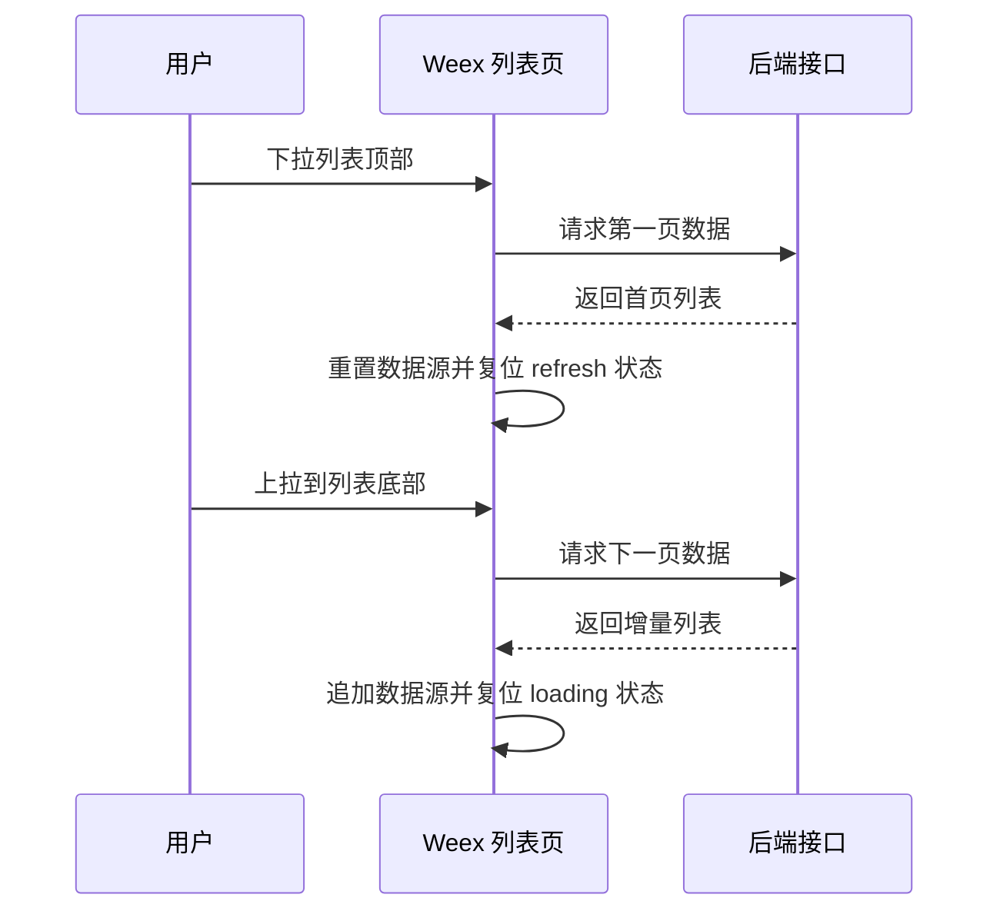

# Weex 列表的上拉与下拉：loading、refresh 与分页对接

资讯流 App 有两个肌肉记忆级的交互：手指下拉，列表顶部拉出新内容；滚到底部继续上拉，自动加载下一页。文章动辄几千条，一次性全量渲染既拖垮内存也浪费流量，分页加载是唯一正解。Weex 的 list 体系为此准备了两条实现路径，这一课把项目里选用的那条讲透，顺手把示例代码里埋着的坑点出来。

## 先给结论

- list 自带 loadmore 事件：滚动到底部立即触发，配合 loadmoreoffset 设置触发提前量，适合做滚动到底自动翻页。
- 本课项目采用子组件方案：loading 承担上拉加载，refresh 承担下拉刷新，两者只能作为 list、scroller、waterfall 的子组件。
- 事件绑定沿用 Vue 风格：@loading 与 @refresh 指向 methods 里的处理函数，display 属性用三元表达式控制指示器 show 与 hide。
- 处理结束必须把状态变量复位为 false，否则转圈动画不消失，后续事件也不再触发。
- 数据量特别大的列表升级为 recycle-list，普通 list 也可以靠控制每页条数缓解压力。

## 两条实现路径：loadmore 事件与子组件

**路径一是 list 自身的 loadmore 事件。** 文档原话是「如果列表滚动到底部将立即触发这个事件，可以在这个事件的处理函数中加载下一页的列表项」，触发时机用 loadmoreoffset 属性调节，值代表距离底部的提前量。这条路径代码量小，但「正在加载」的提示要自己安排。

**路径二是 list 的子组件方案，项目选了它。** loading 组件挂在列表承担上拉加载，refresh 组件承担下拉刷新，两者自带展示区与转圈指示器，配合 display 属性能精确控制显隐。资讯流场景两种手势都要有，子组件方案的交互完整度更高。

一次完整的手势与数据流转：



两条路径共用同一套骨架：手势触发事件，事件回调里请求接口，数据回来后更新列表并复位状态。差别只在数据语义：下拉是重置，上拉是追加。

## 把两种刷新写进列表

资料里的组件示例把 loading、cell、refresh 串在一个 list 里，结构与官方文档的注意条款一致（loading 与 refresh 只能作为 list、scroller、waterfall 的子组件）：

```html
<list>
  <loading @loading="onloading" :display="loadinging ? 'show' : 'hide'">
    <text>Loading ...</text>
    <loading-indicator></loading-indicator>
  </loading>
  <cell v-for="num in lists">
    <div v-if="num != 'A'">
      <text>{{num}}</text>
    </div>
  </cell>
  <refresh @refresh="onrefresh" :display="refreshing ? 'show' : 'hide'">
    <text>Refreshing ...</text>
    <loading-indicator></loading-indicator>
  </refresh>
</list>
```

对应的脚本部分只有 data 与 methods 两块：

```javascript
const demoData = ['A', 'B', 'C', 'D', 'E', 'A'];

export default {
  data: () => ({
    lists: demoData,
    loadinging: false,
    refreshing: false
  }),
  methods: {
    onloading: function () {
      this.lists = ['1', '2', '3'];
    },
    onrefresh: function () {
      this.lists = demoData;
    }
  }
}
```

四个绑定关系要读明白。**第一，@loading 与 @refresh 指向处理函数。** 上拉触发 onloading，下拉触发 onrefresh，与 Vue 的 @click 是同一套事件语法。**第二，:display 控制指示器显隐。** `loadinging ? 'show' : 'hide'` 表示状态变量为 true 时展示加载区，false 时隐藏。**第三，loading-indicator 是自带的转圈动画**，放进 loading 或 refresh 内部即可，不必自己画动画。**第四，示例用替换数据源来验证事件。** 上拉把列表换成 1、2、3，下拉换回 A 到 E，变化肉眼可见，说明事件确实触发了。

## 示例代码埋的坑：display 没有复位

示例为了聚焦事件本身，处理函数里没有把 loadinging 与 refreshing 置回 false。直接抄进项目会出两个问题：加载区的转圈动画一直挂着不消失；部分平台上组件认为上一次加载还没结束，不再触发新事件。生产写法要在数据更新完成后复位状态，对接真实接口的思路如下（接口在后面的文章列表前端章节实现，此处为按本课写法补全的示例）：

```javascript
const stream = weex.requireModule('stream');

export default {
  data: () => ({
    articleList: [],
    page: 1,
    loadinging: false,
    refreshing: false
  }),
  methods: {
    // 上拉加载：请求下一页，结果追加
    onloading: function () {
      const self = this;
      const nextPage = self.page + 1;
      stream.fetch({
        method: 'GET',
        url: 'http://api.example.com/articles?page=' + nextPage,
        type: 'json'
      }, function (ret) {
        if (ret.ok) {
          self.articleList = self.articleList.concat(ret.data);
          self.page = nextPage;
        }
        self.loadinging = false;   // 复位，否则指示器不消失
      }, function () {});
    },
    // 下拉刷新：回到第一页，结果重置
    onrefresh: function () {
      const self = this;
      stream.fetch({
        method: 'GET',
        url: 'http://api.example.com/articles?page=1',
        type: 'json'
      }, function (ret) {
        if (ret.ok) {
          self.articleList = ret.data;
          self.page = 1;
        }
        self.refreshing = false;
      }, function () {});
    }
  }
}
```

stream 模块的参数细节下一课展开，这里看清两件事就够：上拉用 concat 把新页拼到旧列表后面，页码推进；下拉直接替换列表并回到第一页。追加与重置的语义分清了，两种手势才不会互相踩。

## 其余值得知道的组件

**recycle-list 解决长列表的性能瓶颈。** 普通 list 的 cell 数量过大时渲染层压力明显，recycle-list 按需回收复用子项，数据量特别大时升级用它；不升级也可以靠控制每页显示条数缓解。**表单与多媒体组件按需查阅。** textarea 是文本域，input 是输入框，video 播放视频，web 在页面里嵌套另一个网页，一行 `<web src="...">` 就能把外部站点嵌进页面，资讯详情页内嵌活动页时会用到。

## 常见误区

- **照抄示例不复位 display。** onloading 与 onrefresh 结束前必须把状态变量置回 false，这是示例简化留下的坑，抄代码前先补上复位逻辑。
- **上拉加载用替换而不是追加。** 直接给列表赋新数组会丢掉前几页数据，分页的正确语义是 concat 拼接旧数据与新数据。
- **把 refresh 或 loading 放在 list 外面。** 两者只能作为 list、scroller、waterfall 的子组件，脱离容器后既不响应手势也没有滚动坐标可用。
- **在 loading 里塞复杂内容。** 加载区就是提示位，text 提示语加 loading-indicator 转圈即可，塞进复杂组件会拖慢手势响应。

## 面试可能被问到的问题

1. 面试官追问：「list 的 loadmore 事件和 loading 组件怎么选？」
   答：loadmore 事件是 list 自带的滚动到底回调，配合 loadmoreoffset 控制触发提前量，代码量小但没有现成的加载提示；loading 组件自带展示区与转圈指示器，配合 display 控制显隐，交互完整度更高。资讯流场景两种手势都要，项目里选了 loading 加 refresh 的子组件方案。
2. 面试官追问：「display 的 show 与 hide 控制什么？不复位会怎样？」
   答：display 控制 loading 或 refresh 组件的展示状态，页面通过状态变量的三元表达式驱动它。处理函数结束前不复位，转圈动画会一直挂着不消失，部分平台上组件认为上次加载未结束，后续事件不再触发。
3. 面试官追问：「下拉刷新和上拉加载的数据处理逻辑差别在哪？」
   答：语义不同。下拉刷新回到第一页，数据源整体替换，页码重置为 1；上拉加载请求下一页，数据源用 concat 追加，页码递增。复位逻辑两者相同，都要在回调结束处把各自的显示状态置回 false。
4. 面试官追问：「列表数据量特别大怎么办？」
   答：普通 list 先控制每页条数，把单屏渲染量压住；数据量继续增长时升级 recycle-list，它按需回收复用子项，渲染压力与内存占用明显下降。换组件前先用分页压住数据量，是更稳妥的顺序。
5. 面试官追问：「refresh 和 loading 能放在哪些容器里？」
   答：官方文档明确它们只能作为 list、scroller、waterfall 的子组件，脱离滚动容器既拿不到手势也没有滚动位置可用。位置上 loading 在列表尾部、refresh 在列表头部最常见，组件内部放提示文本与 loading-indicator。

## 配套资料

- 代码：`materials/code/05/头条day02/`，资料目录下的 weex 组件综合示例（`weex组件介绍.vue`）含 list、loading、cell、refresh 的完整串联写法，与本课结构一一对应；资料包内层目录名冠以项目原名，正文统一以「头条类资讯项目」指代。
- 说明：day02 无 Java 后端源码；分页接口对接示例为按本课写法补全，真实的前后端联调在文章列表前端章节完成。
