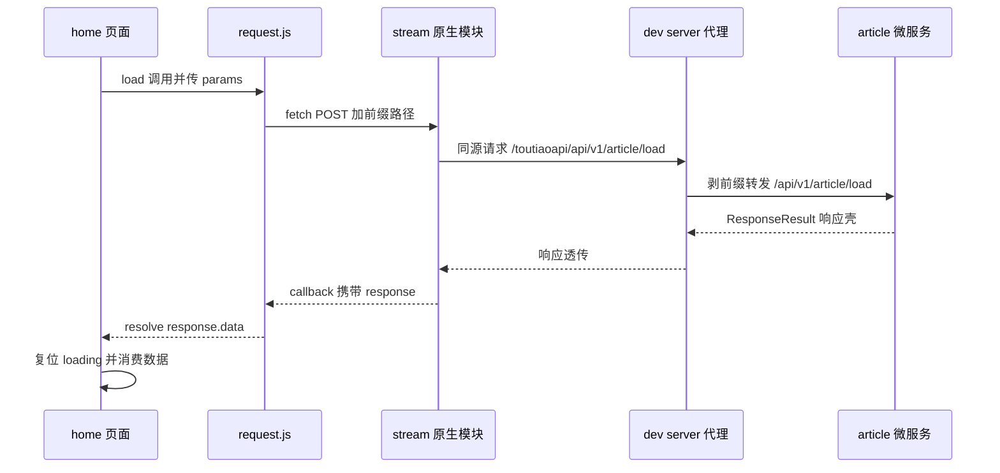

# 文章列表接通后台：请求封装、跨域代理与第一次真实请求

页面骨架立住了，频道栏能切，列表区却还是空槽。数据在 article 微服务里，接口契约在接口定义与接口编码两课已经定死：POST /api/v1/article 系列路径，入参 channelId、maxTime、minTime、size。浏览器里习惯的 axios 在 Weex 原生环境失效，stream 一课讲过原生 fetch 的写法，但项目里不让页面直接碰 stream，统一走 src/common/request.js 封装。这一课把参数、封装、跨域代理与第一次请求全部打通，响应壳里的数据下一课再画上屏幕。

## 先给结论

- 页面不直接调 stream.fetch，统一走 src/common/request.js：post 走请求体返回 promise，get 拼查询串，模块内部惰性持有 stream 实例。
- 列表接口按契约 POST /api/v1/article/load，入参 channelId、maxTime、minTime、size，body 必须是 JSON 字符串，Content-Type 统一 application/json。
- 前端 dev server 与后端微服务端口不同源，开发期在 config/config.js 的 proxyTable 里配同源代理：请求带自定义前缀，转发时把前缀剥掉。
- resolve 回来的 res 是统一响应壳 ResponseResult，文章数组在 res.data 里，先用 JSON.stringify 打印确认结构再动手。
- loading 与错误兜底收在页面调用处：请求前开指示器，then 与 catch 里都复位，失败走 toast 提示。

## 参数先行：跟后端契约对齐

动手发请求之前先把参数想清楚，这是接口定义课立过的规矩。后端 ArticleHomeDto 收四个业务字段：channelId 决定查哪个频道，为空代表默认「推荐」；maxTime 与 minTime 是两个方向的分页锚点；size 限制单页条数。前端对应准备一个 params 对象，另加两个前端自用的状态：

```javascript
data () {
  return {
    loading: false,
    // 加载方向：load 首次与切频道，load_new 下拉刷新，load_more 上拉加载
    // 它只用来在前端选接口地址，不进请求体
    loadType: 'load',
    params: {
      channelId: null,   // 频道 ID，空代表默认「推荐」频道
      size: 20,          // 单页条数
      maxTime: null,     // 上拉锚点：已加载里最早一条的发布时间
      minTime: null      // 下拉锚点：已加载里最新一条的发布时间
    }
  };
}
```

方向语义与后端口径一致：晚于锚点是刷新，早于锚点是续读。首次加载不依赖锚点，两个字段留空即可；三个方向对应三个接口地址，前端拿 loadType 选路：

```javascript
const API = {
  load: '/api/v1/article/load',
  load_new: '/api/v1/article/load_new',
  load_more: '/api/v1/article/load_more'
};
```

## request.js：把 stream.fetch 包成 promise

stream 一课讲过，原生 fetch 是回调风格，body 只收字符串，错误处理散在各处。项目的封装层把这些脏活一次做完，位置在 src/common/request.js：

```javascript
// src/common/request.js：统一请求层
export default {
  stream: null,
  // 惰性获取 stream 模块，整个工程共用一个实例
  _check () {
    if (!this.stream) {
      this.stream = weex.requireModule('stream');
    }
    return this.stream;
  },
  // POST：参数走请求体，统一 JSON 编码
  post (path, body) {
    const stream = this._check();
    return new Promise((resolve, reject) => {
      stream.fetch({
        method: 'POST',
        url: path,
        headers: { 'Content-Type': 'application/json' },
        type: 'json',
        body: JSON.stringify(body || {})
      }, (response) => {
        if (response.status == 200) {
          resolve(response.data);
        } else {
          reject(response);
        }
      }, () => {});
    });
  },
  // GET：参数拼查询串
  get (path, params) {
    const stream = this._check();
    if (params) {
      const qs = Object.keys(params)
        .map(k => k + '=' + encodeURIComponent(params[k]))
        .join('&');
      path += (path.indexOf('?') == -1 ? '?' : '&') + qs;
    }
    return new Promise((resolve, reject) => {
      stream.fetch({ method: 'GET', url: path, type: 'json' }, (response) => {
        if (response.status == 200) {
          resolve(response.data);
        } else {
          reject(response);
        }
      }, () => {});
    });
  }
};
```

三个设计点与 stream 一课的结论一一对应。惰性单例：_check 只在第一次请求时 requireModule('stream')，之后复用，避免每处调用重复取模块。请求体处理：post 把对象 JSON.stringify 成字符串，并手动设置 application/json，正好绕开默认表单编码的坑。调用风格：两个方法都返回 promise，页面侧写 then 与 catch 即可；resolve 的是 response.data，也就是后端返回的统一响应壳。

## 跨域：dev server 代理把端口差抹平

封装写好、页面调用写好，刷新一看，请求发了，response 里却没有数据。F12 打开网络面板确认：请求确实发出去了，响应是空的。原因是前后端分离的两套进程不同源，前端项目由 node 起 dev server，后端是 Spring Boot 起的 article 微服务，端口不同，浏览器直接拦截跨域。

解法沿用工程里已有的代理机制：请求先打到同源的 dev server，由 proxyTable 转发给后端。给后端接口约定一个自定义前缀，转发时剥掉，config/config.js 里加一段：

```javascript
proxyTable: {
  // 命中前缀的请求由 dev server 转发到 article 微服务
  '/toutiaoapi': {
    target: 'http://localhost:9001',  // 端口以 article 微服务 application.properties 为准
    changeOrigin: true,               // 转发时改写 host
    pathRewrite: {
      '^/toutiaoapi': ''              // 转发前剥掉前缀
    }
  }
}
```

完整链路如下图，前缀只是给代理层的匹配标识，与后端接口路径无关：



上了生产，这份代理职责移交给网关或 Nginx，前端代码一行不改，与导入前端工程那课讲新闻站点代理是同一套机制。

## 页面里第一次 load

import 封装时还有一个编译报错现场：路径写成 'common/request' 直接报 Module not found，模块解析从当前文件出发，少写路径层级就找不到。用 @ 别名指向 src 根目录最稳：

```javascript
import request from '@/common/request';

methods: {
  load () {
    const self = this;
    self.loading = true;
    request.post('/toutiaoapi' + API[self.loadType], self.params)
      .then((res) => {
        self.loading = false;
        // 先看清响应壳长什么样，再决定怎么取数
        console.log(JSON.stringify(res));
      })
      .catch((ret) => {
        self.loading = false;
        // 失败兜底：toast 提示，数据保持上一页状态
        const modal = weex.requireModule('modal');
        modal.toast({ message: '加载失败：' + ret.status, duration: 2 });
      });
  }
}
```

调用时机挂在 mounted 里，接在 setPage(1) 之后：

```javascript
mounted () {
  // 默认选中「推荐」页签，会连带触发页签切换事件
  this.$refs['wxc-tab-page'].setPage(1);
  // 首屏数据
  this.load();
}
```

刷新页面，控制台打印出响应壳的真身：外层是 code、message、data 三件套，message 是「操作成功」这类描述，data 里才是文章数组。这一步的确认很重要，直接决定下一课取数怎么写：消费数据永远从 res.data 开始，不能拿响应壳当数组循环。

## 常见误区

- **import 路径写错。** 'common/request' 这类少层级的相对路径编译期就报 Module not found，用 '@/common/request' 以 src 为基准解析最稳。
- **body 直接传对象。** stream.fetch 的 body 只收字符串，对象必须 JSON.stringify；封装层已统一处理，绕过封装直调 fetch 时最容易踩。
- **不配代理直连后端。** 前端端口与后端端口不同源，请求会被浏览器跨域拦截，表现为请求发出但响应为空；开发期必须走 proxyTable。
- **把响应壳当数组消费。** resolve 回来的 res 外层还有 code 与 message，文章数组在 res.data；不打印确认结构就循环，拿到的是 undefined。
- **loading 状态不复位。** then 与 catch 两个分支都要把指示器关掉，只写在成功分支里，一次失败页面就永远转圈。

## 面试可能被问到的问题

1. 面试官追问：「开发期跨域为什么用 dev server 代理，而不是后端直接开 CORS？」
   答：代理把跨域收敛在基础设施层，前端请求始终同源，后端代码保持纯净，不用为开发环境单独开响应头；生产环境再把代理职责移交给网关或 Nginx，前端代码零改动。开 CORS 也可行，但鉴权头、凭证等细节容易在环境间漂移，代理方案与部署形态更贴合。
2. 面试官追问：「request.js 封装层做了哪些事？」
   答：惰性获取并复用 stream 模块；把回调风格包成 promise；post 统一 JSON.stringify 请求体并设置 application/json；get 负责把参数对象拼成查询串；按状态码 resolve 或 reject，resolve 的是响应数据本身。页面侧只写业务逻辑，请求细节全部收口。
3. 面试官追问：「列表请求的参数怎么与后端 DTO 对齐？锚点传什么？」
   答：入参四个字段与 ArticleHomeDto 一一对应，channelId 为空代表默认推荐频道，size 控制单页条数。maxTime 传已加载列表里最早一条的发布时间，供上拉方向查更早的一批；minTime 传最新一条的时间，供下拉方向查更新的一批；时间按全局序列化口径用 13 位毫秒时间戳。
4. 面试官追问：「resolve 回来的数据是什么结构？」
   答：response.data 是后端的统一响应壳 ResponseResult，外层含 code、message 与 data 三个字段，code 表状态，message 是描述，data 才是业务数据。前端拿到后先判断 code，再从 data 里取文章数组，解析逻辑全工程统一。
5. 面试官追问：「get 与 post 两个封装的差异在哪？」
   答：传参方式不同，get 把参数对象序列化成查询串拼在 URL 上，post 把对象 JSON 字符串化放进请求体；post 需要显式设置 Content-Type 为 application/json，get 不涉及请求体。本项目的列表接口入参是结构化 DTO，按契约走 post，get 留给简单查询场景。

## 配套资料

- 代码：`materials/code/05/头条day02/`，资料目录下的 weex 组件综合示例（`weex组件介绍.vue`）以 weex.requireModule('stream') 取模块，可对照封装层与原生 fetch 的关系；资料包内层目录名冠以项目原名，正文统一以「头条类资讯项目」指代。
- 说明：day02 无 Java 后端源码；request.js、params 与 proxyTable 配置不在资料包内，文中代码为按画面线与主流写法补全的可运行版本；接口路径与入参字段与接口定义、接口编码两课的口径保持一致，微服务端口以实际 application.properties 为准。
