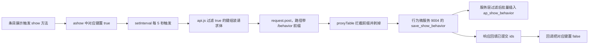

# 文章列表页的行为埋点：曝光标记、定时上报与代理转发

文章列表的数据展示跑通之后，需求清单里还压着一条隐藏项：day01 讲需求时明确说过，列表除了展示，还要记录用户的浏览行为。后端那条链路早已就位，ap_show_behavior 表在 day01 建好，save_show_behavior 接口连同服务与 Mapper 一起通过了集成测试。前端要补的是一段埋点逻辑，回答三个问题：用户看过哪些文章怎么记、什么时候上报、请求怎么穿过代理到达行为微服务。

## 先给结论

- 埋点载体是一个 ashow 对象：键为文章 ID，值为保存标记。条目展示时置 true，保存成功后置 false，一个对象同时承担待上报集合与去重标记两个职责。
- 上报时机不挂在展示或滚动事件上，页面 created 里用 setInterval 每 5 秒批量提交一次，隐式高频行为攒批上报，请求量可控。
- API 收敛到 src/apis/home/api.js：过滤出标记为 true 的文章 ID 组装请求体 POST 给行为接口，并把提交的 ID 回填进响应 data，调用方据此逐个置 false。
- 请求路径必须走代理：URL 带 /behavior 前缀由 proxyTable 拦截，转发到行为微服务 9004 并剥掉前缀；前缀缺失或与代理规则对不上，Network 面板直接 404。
- 失败静默处理：单次上报失败不弹错、不打断列表主流程，未保存的标记保持 true，由下一轮定时器自然补报。

## 要上报什么：一张表定住三要素

ap_show_behavior 的六列在 Mapper 课逐列写过：id、entry_id、article_id、is_click、show_time、created_time。其中主体与两个时间戳都由后端补齐，前端真正要带上的只有两样：设备号与文章 ID 列表。参数契约沿用行为功能的定义课：

```java
package com.study.headline.model.behavior.dtos;

import com.study.headline.model.common.dtos.IdEncrypt;
import lombok.Data;
import java.util.List;

@Data
public class ShowBehaviorDto {
    /** 设备 ID：未登录用户的主体标识，对外传输走混淆 */
    @IdEncrypt
    private Integer equipmentId;
    /** 本次浏览的文章 ID 列表 */
    private List<Integer> articleIds;
}
```

登录用户的主体由网关解析 token 后放进线程上下文，前端不需要传用户 ID；未登录时设备维度是唯一抓手。列表页此刻没有登录态，请求头里没有 token，走的就是设备维度上报。至于 entry_id、show_time 这些列的值，全部出自后端的主体查询与数据库时钟，前端一概不操心。

## 埋点标记：ashow 对象与 show 方法

列表页 data 里加一个空对象，文章条目出现在可视位置时把当前文章 ID 记进去：

```javascript
// index.vue：条目展示位置触发，把当前文章 id 传进来
show (id) {
  // 没有进行存储的 id 赋值为 true，保存之后的 id 为 false
  if (this.ashow[id] === undefined) {
    this.ashow[id] = true;
  }
}
```

模板侧的绑定挂在文章条目的展示事件上，weex 的 cell 出现在屏幕里即触发（画面线在条目展示位置触发该方法，模板绑定按组件事件口径补全）。选对象而不是数组，是三个状态的表达需求：键不存在（undefined）表示该文章从未展示过；true 表示展示过但尚未上报；false 表示已经保存成功。展示事件会被反复触发，同一篇文章第二次出现在屏幕里时键已存在，判断直接跳过，天然去重；键值判断与标记都是一次哈希访问，比数组的 indexOf 逐项查重便宜得多。

## 定时批量上报：created 里的 5 秒循环

什么时候把攒下的 ID 发出去？逐条即时上报不可取。曝光是信息流里最高频的动作，滑动一次触发几十次展示事件，请求量与滑动次数同量级，后端会被无意义的碎请求打满。工程的方案是定时攒批：页面 created 里挂一个每 5 秒执行一次的循环，把未保存的 ID 一次带走。

```javascript
created () {
  this.tabPageHeight = Utils.getPageSize();
  this.tablist = [...Array(this.tabTitles.length).keys()].map(i => {});
  // 每 5 秒把未保存的浏览记录批量提交一次
  let _this = this;
  setInterval(function () {
    let result = Api.saveShowBehavior(_this.ashow);
    result.then((d) => {
      // 保存成功：把已上报的文章 id 标记为 false
      let ids = d.data;
      for (let i = 0; i < ids.length; i++) {
        _this.ashow[ids[i].id] = false;
      }
    });
  }, 5000);
}
```

两处细节按画面线订正过：画面抄录的回调里写的是 let this = this，this 是 JavaScript 保留字不能赋值，正解是换名承接（_this）或直接改用箭头函数；画面另处写作 setTimeout 只执行一次，口播与语义都是循环提交，以 setInterval 为准。

5 秒这个粒度是取舍的结果。行为数据服务于推荐，秒级延迟完全够用；间隔太短请求密度上去了，攒批的意义减半；间隔太长，用户滑出页面时未保存的记录跟着丢。失败路径也不需要额外写重试逻辑：请求失败时标记仍是 true，5 秒后下一轮循环自然把这笔补上。

## api.js：请求体组装与响应回填

请求封装统一进 src 下的 apis 目录，home 模块一个 api.js，后续文章、视频等模块照此各自建文件。页面侧只留一行导入：

```javascript
import Api from '@/apis/home/api.js'
```

保存方法做三件事：过滤、组装、回填。

```javascript
// src/apis/home/api.js
import request from '@/common/request'

// 上报展现行为：只收集标记为 true 的文章 id
export function saveShowBehavior (ashow) {
  let ids = [];
  for (let k in ashow) {
    if (ashow[k]) {
      ids.push({ id: k });
    }
  }
  if (ids.length > 0) {
    return request.post('/behavior/api/v1/behavior/save_show_behavior',
      JSON.stringify({ equipmentId: 1, articleIds: ids })).then(d => {
        // 把提交的 ids 回填到响应 data，调用方据此置 false
        d.data = ids;
        return d;
      });
  }
}
```

过滤循环里 `if (ashow[k])` 只放行值为 true 的键，已保存的 false 与从未展示的键都被挡在外面，请求体里永远是增量。equipmentId 联调期写死为 1，正式实现由设备模块生成并持久化，联调阶段先固定值打通链路。响应回填是这段封装最巧的一笔：后端保存成功后并无逐条回执，前端把本次提交的 ids 直接挂到响应 data 上返回，index.vue 的回调拿到它就知道该把哪些键置 false，两个循环各司其职，谁也不认识谁。

## 代理前缀：404 的第一现场

代码写完按 F12 打开 Network 面板刷新页面，列表照常加载，行为请求却躺在 404 里。原因不在路径拼写，而在代理：工程 proxyTable 里原本只有 /toutiao 一条规则服务列表数据，行为接口走的是独立微服务，必须给它单开一条转发规则：

```javascript
proxyTable: {
  '/toutiao': {
    // 列表数据：转发到文章微服务
    target: 'http://192.168.25.3:9001/',
    changeOrigin: true,
    pathRewrite: { '^/toutiao': '' }
  },
  '/behavior': {
    // 行为数据：转发到行为微服务
    target: 'http://192.168.25.3:9004/',
    changeOrigin: true,
    pathRewrite: { '^/behavior': '' }
  }
}
```

行为请求的完整路径是 /behavior/api/v1/behavior/save_show_behavior：dev server 按前缀 /behavior 拦截，pathRewrite 剥掉这一段，把剩余的 /api/v1/behavior/save_show_behavior 转发到 9004 的行为微服务。对浏览器来说请求始终同源，跨域检查不会触发；对后端来说收到的就是契约课定义的标准路径。路径后半段不用凭记忆写，打开行为微服务的控制器照抄映射：类上是 /api/v1/behavior，端点是契约课定的 save_show_behavior（画面线为短写 save_behavior，以契约口径为准）。画面抄录里的端口号是课程环境的另一套数值，正文按工程既定端口口径书写（article 9001、behavior 9004），联调以各自环境实际启动的端口为准。整条链路如下图：



图上从埋点标记到落库的闭环里，置 false 这一步是防重复的关键：它让下一次 5 秒循环提交的永远是增量，前端半边的幂等由这个标记完成，后端半边则靠服务层先查后存的过滤兜底，两道防线在联调课会各验证一次。

## 常见误区

- **把上报挂在展示事件里即时发送。** 滑动一次触发几十次展示，请求被拆成碎单，行为接口的压力与用户手速挂钩；正确姿势是标记攒批、定时提交。
- **用数组存已展示的文章 ID。** 判重靠 indexOf 遍历，条目越多越慢，还容易重复 push；对象键天然去重，三种状态一个值域表达。
- **请求 URL 忘加 /behavior 前缀。** 代理按前缀匹配，前缀缺失请求落不进任何转发规则，表现为 404；URL 前缀与 proxyTable 规则名必须逐字一致。
- **定时回调里直接用 this。** 普通函数的 this 在回调里指向全局，ashow 取不到；换名承接或改箭头函数，画面的 let this = this 属笔误，this 是保留字。
- **把上报失败弹窗提示。** 隐式行为对用户不可感知，失败弹窗纯属打扰；静默保持标记，下一轮补报即可。

## 面试可能被问到的问题

1. 面试官追问：「隐式行为埋点为什么用定时攒批上报，而不是事件触发即时上报？」
   答：曝光是信息流里频率最高的动作，即时上报会把请求量放大到与滑动次数同量级，服务端与客户端双输；定时攒批把一个窗口内的曝光合并成一次请求，失败还天然由下一轮重试。对推荐场景，秒级延迟完全够用。
2. 面试官追问：「ashow 对象的 undefined、true、false 三个状态分别表达什么？」
   答：undefined 是从未展示，true 是展示过未保存，false 是已保存。三态设计让展示事件的重复触发自动去重，让定时器只收集增量，让保存回执可以逐条关账。
3. 面试官追问：「行为上报怎么保证不丢也不重？」
   答：不丢靠前端对未保存项持续补报，5 秒一轮直到成功；不重靠两层，前端置 false 不再收集增量，后端先查后存把库里已有的文章 ID 剔除，即使前端标记丢失也不会插重。
4. 面试官追问：「前端请求为什么 404，代理在这里起什么作用？」
   答：开发期页面与微服务不同源，工程让请求先打到同源的 dev server，proxyTable 按前缀匹配后转发并重写路径，浏览器始终认为请求同源；URL 没带对前缀就落不进转发规则，直接 404。
5. 面试官追问：「设备号从哪来，登录用户怎么办？」
   答：设备号由端上生成并持久化，联调期可写死；后端主体定位是双维度的，登录用户由网关解析 token 放进线程上下文按用户查主体，未登录按设备号查，两个主体字段同时缺席才报缺参。

## 配套资料

- 代码：`materials/code/05/头条day02/`，资料目录含 mycat 相关配置（schema.xml、rule.xml、server.xml、sequence_db_conf.properties）与 weex 内置组件示例；day02 资料包不含前端 app 工程与后端 Java 源码。
- 说明：文中 index.vue 埋点、api.js 封装与 ShowBehaviorDto 为按画面线与主流写法补全的可运行版本，包名统一改写为 `com.study.headline`；接口路径沿用 0023～0027 契约口径 `save_show_behavior`（画面为短写 `save_behavior`，以契约为准），端口按工程口径 9001/9004 书写并注明画面差异；setInterval 与 _this 写法按口播语义订正画面笔误。
