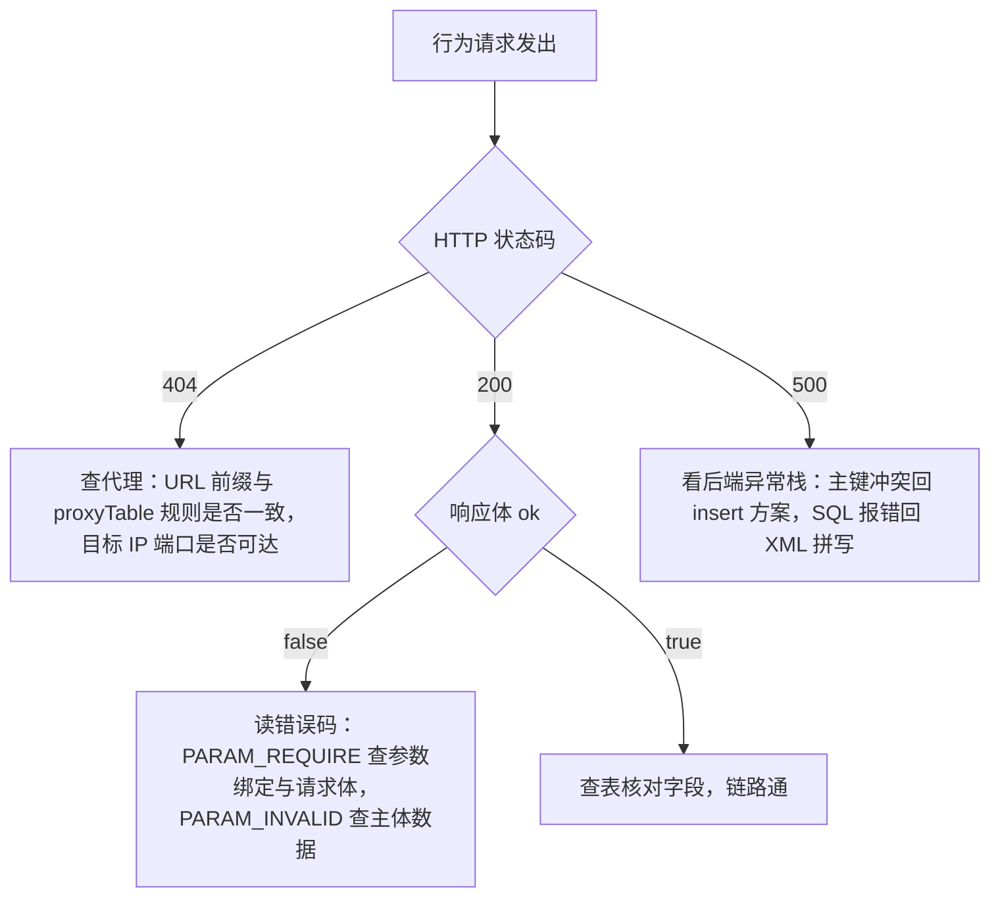

# 行为功能联调实录：从 200 缺参到 500 主键冲突

埋点与接口两端各自就位后，联调是把两条链路拧在一起的动作：前端 dev server 与行为微服务同时在线，刷新页面、滑动列表、等 5 秒定时器触发，Network 面板里那条 POST 请求就是整条链路的体检单。这一课的两次翻车都很典型，一次状态码 200 却是业务失败，一次状态码 500 藏在数据库里，两类错误的排查路径完全不同，把这两条路走通，以后前后端联调的大部分问题都有章可循。

## 先给结论

- 联调前提三件事：前端 dev server 与行为微服务同时在跑、proxyTable 的 /behavior 转发生效、ap_behavior_entry 里造好设备主体的记录。
- 200 不代表成功：统一响应壳里 ok 为 false 才是业务失败，缺参 PARAM_REQUIRE 的表象就是 200。
- 缺参的根因在参数绑定：POST 的 JSON 体必须靠 @RequestBody 反序列化进 DTO，注解缺失时字段全为 null，user 与 equipmentId 双空走进 PARAM_REQUIRE。
- 主键冲突的根因在过渡方案：ap_show_behavior 的 id 不是自增列，暂绑主体主键写死，一批上报的多行挤同一个 id，重复插入直接 Duplicate entry 500。
- 过渡修复是把 insert 的 id 暂改绑文章 ID；正式方案等 MyCat 全局序列接管主键后整体替换写死代码，这批过渡数据届时一并清理。

## 第一次请求：200 里的缺参

复现动作照埋点课的链路走：刷新页面，Network 面板清空，往下滚动让文章条目逐个展示触发 show 方法，5 秒定时器到点，save_show_behavior 的请求发出。响应状态码 200，展开响应体却是错误信息：缺少参数，PARAM_REQUIRE。

这就是统一响应壳的分层设计：HTTP 层的传输成功与业务层的处理成功是两回事，传输层只保证请求到达并被处理，业务校验不过时照样回 200，把失败原因装进响应体的错误码里。所以联调的第一课是「看响应体而不只看状态码」。

## 断点定位：两个字段的 null 与有值

缺参的直接原因是参数拦截：user 与 equipmentId 同时为空才返回 PARAM_REQUIRE。user 为空此刻是正常的，列表页没登录态，请求头没有 token，线程上下文自然为空，设计上就走设备维度；equipmentId 也空就不正常了，前端明明把它装进了请求体。

在行为微服务的控制器入口打断点，重新滚动触发请求，断点停下后观察 dto：equipmentId 与 articleIds 全是 null。请求发到了，字段却没绑上，问题锁定在参数绑定环节。POST 请求体是 JSON 字符串，Spring MVC 不会自动把它拆进 DTO，必须由 @RequestBody 注解驱动反序列化；画面上的控制器方法参数恰好缺了这个注解：

```java
// 问题现场：缺 @RequestBody，JSON 体进不了 DTO，字段全 null
@PostMapping("/save_show_behavior")
public ResponseResult saveShowBehavior(ShowBehaviorDto dto) {
    return appShowBehaviorService.saveShowBehavior(dto);
}

// 修复：注解挂上，请求体反序列化为 DTO
@PostMapping("/save_show_behavior")
public ResponseResult saveShowBehavior(@RequestBody ShowBehaviorDto dto) {
    return appShowBehaviorService.saveShowBehavior(dto);
}
```

按 0024 实现课的口径这个注解本应在位，课程现场是缺失版本，正好把这类故障的机理演示了一遍。补上注解重启服务再测，断点里 equipmentId 是 1、articleIds 是一组文章 ID，参数绑定恢复。这类问题最难排查的点在于它不报错：注解缺失时 Spring MVC 回退到查询参数与表单参数的绑定方式，请求体里的 JSON 被原样忽略，所有字段安静地保持 null，表象与「前端没传」一模一样。

## 造数据：设备主体先入座

参数有值后放行，链路走到主体查询。ap_behavior_entry 里 day01 只造过用户主体（type 为 1，entry_id 为 1），而本次请求没有 token，查询条件走设备分支：type 为 0 且 entry_id 等于设备号 1。库里没有这条记录，主体查询返回空，服务层直接按 PARAM_INVALID 截断，后面什么都执行不到。联调前把设备主体补进表：

```sql
insert into ap_behavior_entry (type, entry_id, created_time)
values (0, 1, now());
```

type 为 0 表示终端设备主体，entry_id 存设备标识。这条记录的主键值稍后会成为展现行为里的 entry_id 来源，服务层传入的是主体记录的主键 `entry.getId()`，不是设备号本身，两条 id 的含义别混。

## 第二次请求：500 与主键冲突

再次放行，这次响应变成了 500。看后端异常栈，关键字是 Duplicate entry 与 PRIMARY：主键重复。根因要回到 Mapper 的过渡方案上。ap_show_behavior 的 id 不是自增列，day02 集成 MyCat 之前主键必须由应用自己维护，day01 测试时的过渡做法是把 insert 的 id 列暂绑 `#{entryId}`，也就是主体记录的主键。单条插入时碰巧不冲突，联调一批上报 9 篇文章，foreach 把 values 展开成 9 行，每行的 id 都是同一个主体主键，MySQL 只放行第一行，第二行起全部撞在主键约束上。

修复是过渡方案内部的换绑：id 暂用文章 ID，一篇文章一条展现记录，天然不重复。

```xml
<insert id="saveShowBehavior">
    insert into ap_show_behavior (id, entry_id, article_id, is_click, show_time, created_time)
    values
    <foreach collection="articleIds" item="item" separator=",">
        <!-- id 列暂绑文章 id 过渡，MyCat 全局序列接管后此列整体删除 -->
        (#{item}, #{entryId}, #{item}, 0, now(), now())
    </foreach>
</insert>
```

values 里 `#{item}` 出现两次，第一个占位的是 id 列，第二个才是 article_id；entry_id 用 `#{entryId}`，is_click 写死 0，时间交给数据库函数 now()，与 day01 的口径完全一致。改完重启再测，响应 200，响应体是「操作成功」。XML 是运行期资源没有热加载，改完不重启等于没改。

## 查库核对与幂等复盘

保存成功后刷新 ap_show_behavior 逐列核对：id 与 article_id 同值（过渡方案的表现）、entry_id 是设备主体记录的主键、is_click 为 0、show_time 与 created_time 是插入那一刻的时间。表里多出的这一批记录，就是前端 5 秒攒批上报的全部内容。

幂等在联调里能直接验证。同批文章再滚一遍：ashow 里对应的键在上一轮成功后已被置 false，api.js 的过滤循环不再收集，请求体里根本没有它们；假设换台设备或标记丢失导致重复上报，后端先查后存的过滤链路也会把库里已存在的文章 ID 剔除，剩余数组为空时直接返回成功，一行都不会多插。前端标记与后端过滤构成双保险，这条链路的幂等从 day01 的设计一路贯通到联调现场。

三类状态码的排查路径收进一张图：



图上的三条分支覆盖了联调期绝大多数现场：404 先查代理与路径，200 加 ok 为 false 先读错误码再看数据，500 直奔后端异常栈。先分层再定位，比在前后端之间来回猜快得多。

## 样式与组件的小插曲

联调通过后把笔记里调好样式的整段列表代码整体替换手写版，刷新页面报「组件找不到」：新代码引用的某个 weex 组件当前阶段用不上，把对应的 import 与 components 注册注释掉即可恢复。样式是前端同学的领地，后端工程师的目标是看懂结构、认得出数据流，不需要逐行手写。下拉刷新与上拉加载更多跑起来后，新展示的条目同样进埋点，行为链路对增量数据照常工作。

## 常见误区

- **只看状态码判成败。** 200 也可能装着 PARAM_REQUIRE；统一响应壳的体系里，ok 字段与错误码才是业务结论。
- **缺参先怀疑前端没发。** @RequestBody 缺失时后端收到了请求体也不绑定，字段安静地保持 null；断点看 DTO 字段，再核对注解。
- **造数据只造文章不造主体。** 主体查询查不到就截断，表象是参数无效；ap_behavior_entry 的设备主体与用户主体按维度分别备好。
- **改 XML 不重启。** MyBatis 映射文件在启动时加载，改完不重启跑的还是旧语句。
- **过渡方案的主键反复重测不清理。** id 与 article_id 同值的数据只服务联调，MyCat 接管主键后要整体替换写死写法并清理这批测试数据。

## 面试可能被问到的问题

1. 面试官追问：「HTTP 200 但业务失败，为什么这样设计？」
   答：传输与业务分层，200 表示请求到达且被正常处理，业务结论由统一响应壳的 ok 与错误码表达。这样网络层异常、参数校验失败、业务失败各有清晰的判定位，前端解析逻辑也统一成一种。
2. 面试官追问：「@RequestBody 缺失时 Spring MVC 会怎么处理？」
   答：回退到查询参数与表单参数的绑定方式，请求体里的 JSON 被忽略，DTO 字段全为 null 且不报任何错。它是最难排查的一类问题，表象与前端漏传完全一致，靠断点观察入参再核对注解定位。
3. 面试官追问：「为什么不直接用数据库自增主键，要留给 MyCat 全局序列？」
   答：分库分表后同一张表分布在多个物理库，各库独立自增必然撞号；应用侧写死或用 UUID 都有各自的代价。MyCat 的全局序列由中间件统一发号，insert 里不再手填 id，主键天然全局唯一。
4. 面试官追问：「行为上报的幂等由哪几层保证？」
   答：前端 ashow 标记保存成功即置 false，不再收集增量；后端先查后存，把库里已有的文章 ID 从待插列表剔除；两层叠加后重复请求到达也只是空操作。流水表纯插入的形态让这套设计无需事务兜底。
5. 面试官追问：「设备主体与用户主体在表里怎么并存？」
   答：ap_behavior_entry 用 type 区分，0 为终端设备 1 为用户，entry_id 按维度存设备标识或用户 ID；服务层按「用户或设备」双分支查询，任何请求都能落到唯一主体，未登录行为采集靠设备维度支撑。

## 配套资料

- 代码：`materials/code/05/头条day02/`，资料目录含 mycat 相关配置（主键全局序列的配置载体在 day03 接入时展开）与 weex 内置组件示例；day02 资料包不含后端 Java 源码。
- 说明：day02 资料包无工程 Java 源码，文中控制器片段、insert 语句与造数据 SQL 为按画面线与主流写法补全的可运行版本，包名统一改写为 `com.study.headline`；@RequestBody 缺失与主键冲突两次翻车按口播与画面线还原，端点路径沿用 0023～0027 契约口径 `save_show_behavior`；画面抄录的代理端口为课程环境另一套数值，正文按工程口径 9001/9004 书写并注明。
