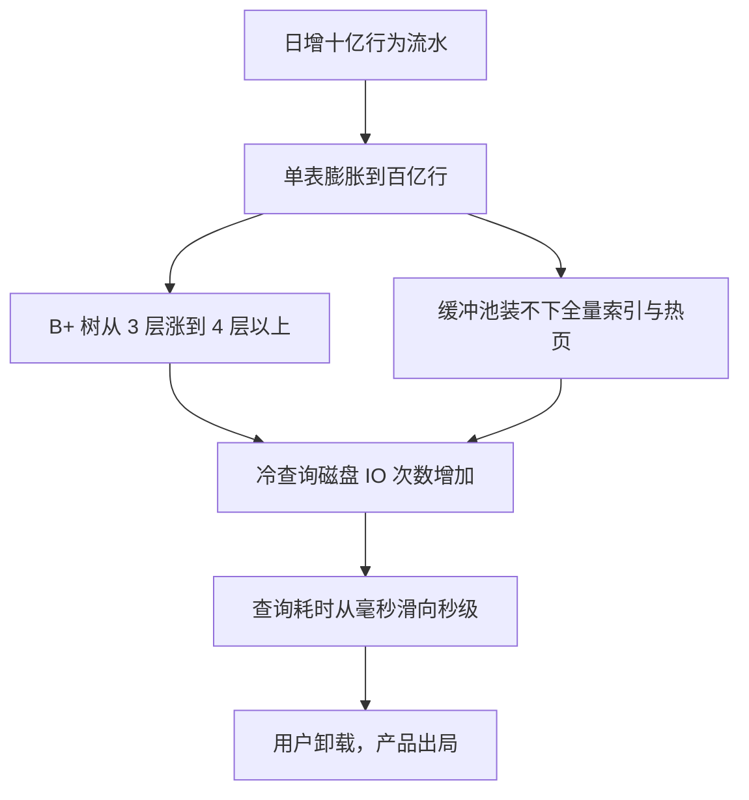

# 为什么分库分表：单表一千万是一道硬坎

文章列表与行为上报两条链路在功能层面已经闭环，数据库却还是单一实例。day01 的需求页给过一组量级：百万级注册用户，文章日增百万，行为日增十亿，且性能要求一条没打折。把数字换算成行数，单库单表的结局从第一天就写好了。这一课把「为什么要拆」从经验值讲到 B+ 树原理，再讲拆分本身带出来的新问题；概念与配置的落点，留给下一课的 MyCat。

## 先给结论

- MySQL 单表的经验红线在 500 万行附近，SQL 与索引优化到极致可以撑到 1000 万；越过这条线，查询耗时从毫秒级滑向秒级甚至几十秒，再怎么优化都拉不回来。
- 根子在 B+ 树的高度：数据量决定树高，树高决定一次查询要读多少个数据页，冷数据的磁盘 IO 成本无法被缓冲池掩盖。
- 单库的瓶颈不止单表体量：连接数上限与写入吞吐同样有顶；垂直拆分按业务分摊压力，水平拆分解决单表过大，两个方向各管一种病。
- 拆分不是免费午餐：跨库 join、跨库分页、分布式事务、全局唯一主键，都是拆完才冒出来的新问题。
- 项目的落点是引入 MyCat 数据库中间件做分片路由：对应用伪装成一个 MySQL，改造对业务代码近乎透明。

## 一笔量级账

需求页的四个量级标签里，真正压垮单表的是行为数据。日增十亿行为流水，一年就是三千多亿行；文章日增百万，一年 3.65 亿行；用户量百万级听着不大，但用户相关的关注、粉丝、私信、行为明细全是随时间线性生长的表。任何一张表单独拿出来，都远超单表的承受范围。资料里项目实际的 mycat 配置给出了拆分规模，文章组拆 40 片、行为组拆 50 片：

```xml
<!-- 文章组：40 个分片节点，按 id 取模 -->
<table name="ap_article" dataNode="DNAP_$0-39" autoIncrement="true" primaryKey="id" rule="mod-long40"/>
<!-- 行为组：50 个分片节点，展现行为同样按 id 取模 -->
<table name="ap_show_behavior" dataNode="DNBE_$0-49" rule="mod-long50" autoIncrement="true" primaryKey="id"/>
```

配置取自课程资料 `materials/code/05/头条day02/` 的 mycat 相关目录。50 片不是拍脑袋：日增十亿摊到 50 片，单片日增两千万行，正好压在单表能撑的量级之内，留有一年以上的余量。

## 单表为什么会慢：B+ 树的高度账

InnoDB 的主键索引是 B+ 树，数据全部挂在叶节点上，非叶节点只放路标。每个数据页 16KB，粗算一笔账：行宽按 1KB 估，叶子页放 16 行；非叶页每条路标占十几字节，一页能放约 1200 个。两层树容量约 2 万行，三层树约 1200 × 1200 × 16，正好在两千万行这个量级；再多就进四层，容量涨到百亿级，代价是每次冷查询多一跳页读取。

**第一，树高决定 IO 次数。** 三层树的一次点查最多读 3 个数据页，根节点通常常驻缓冲池，实际磁盘 IO 一两次；进四层后每次冷查询多读一跳，延迟直接翻在磁盘访问上。数据量再大，这个账只会越算越难看。

**第二，缓冲池掩盖不了范围扫描。** 热点查询命中内存，树高的影响被隐藏；行为流水这类写入后只读一两次的数据天然是冷的，范围扫描要从叶层逐页读，磁盘 IO 随数据量线性上涨。缓存救得了首页推荐，救不了历史明细查询。

**第三，写入与维护同步恶化。** 自增主键尚能顺序追加，一旦出现随机写就是页分裂；二级索引本身也是一棵棵 B+ 树，表越大每棵索引的维护成本越高，大表的 DDL、备份窗口同样按数据量收费。



图上两条路径殊途同归：树高增加与缓存失效率都在把 IO 成本推给每一次真实查询。所谓单表红线，本质是这套成本曲线越过用户忍耐点的位置，500 万到 1000 万只是经验上的估算区间。

## 两个拆分方向

**垂直拆分先动手。** 按业务域把表拆到不同库：文章与用户一组、行为一组、自媒体一组、爬虫一组、管理后台一组。项目配置里的五组 dataNode 前缀正是这个划分：文章组 DNAP、行为组 DNBE、自媒体组 DNWM、爬虫组 DNCL、管理组 DNAD。垂直分表是它的表内版本，把大字段、冷字段从主表剥出去。垂直拆分的价值在解耦：写入互不影响、连接分摊、故障隔离，且业务边界与微服务的拆分天然对齐。

**水平拆分解决单表体量。** 同一张表按分片键路由到多个库里的同名表，mod-long 按主键取模是项目主力：id 对 40 取模决定落在哪个片，写入均匀，点查一步定位。垂直拆完后单表还是大，真正的十亿级流水要靠水平拆分除以片数。

次序上先垂直后水平。垂直拆分不动数据分布的语义，跨库的表之间业务上本来就少有关联；水平拆分把同构数据打散，查询语义的变化最大，留给真正的大表。连接数瓶颈也在这里顺带解决：每个业务组占独立实例后，单实例的连接压力被分摊，中间件再统一收敛连接池。

## 拆完才出现的新问题

**跨库 join。** 用户表与文章表分属两库后，SQL 层的 join 不再可用。解法按场景选：强关联的父子表按分片键绑定同库，字典类小表做成全局表在每个库全量冗余，统计类需求移到服务层聚合或离线计算。

**跨库分页。** 按时间排序取第 100 页，每个分片都要取前 N 条再归并排序，页越深归并成本越高。深分页要么游标化（用时间锚点续读，列表接口的 maxTime 就是这个思路），要么限制页深。

**分布式事务。** 显式行为要「行为记录加文章计数」一起改，day01 提过这事：单库时一个事务搞定，拆库后两笔写不在一个实例，本地事务失效。要么引入分布式事务框架，要么按最终一致走消息补偿，行为流水与计数的强一致要求本来就低，后者是常见选择。

**全局唯一主键。** 各分片独立自增必然撞号，联调课 insert 里写死 id 的过渡方案正是在等这一课的答案：MyCat 全局序列统一发号，应用侧不再手填主键。

## MyCat 在架构里的位置

MyCat 对上实现 MySQL 协议，应用像连一个普通 MySQL 一样连它；对下管理 N 个真实实例，解析 SQL、按规则路由、聚合结果再返回。应用侧的改动近乎只有连接串：地址从真实库换成 MyCat，库名换成逻辑库名。路由规则、分片规模、读写分离全收敛在中间件的配置里，业务代码不感知数据分布，这正是数据库中间件相对应用侧分库组件的核心优势。

## 常见误区

- **把 500 万当精确阈值。** 行宽、索引数量、硬件与查询模式都影响表现，它是经验参考不是硬性开关；判断依据是查询耗时与 IO 曲线，不是行数本身。
- **一上来就水平拆。** 索引优化、读写分离、缓存、冷数据归档先做完，压不住再拆；拆分带来的复杂度是一次性的运维负债，能晚付就晚付。
- **分表不分库。** 表拆得再细，单实例的连接数与磁盘 IO 照样顶不住，两个瓶颈要分开处理、一起解决。
- **以为拆分能治所有慢查询。** 无分片键的全表扫描进任何分片方案都是全片扫描，慢 SQL 该优化还得优化；分片解决的是体量，不是写法。

## 面试可能被问到的问题

1. 面试官追问：「单表多大要拆？依据是什么？」
   答：经验值 500 万到 1000 万行，前提是索引与 SQL 已经优化到位。依据不是行数本身，而是 B+ 树层级带来的 IO 增长与查询耗时曲线；行宽大、索引多、冷查询多的表要提前拆。
2. 面试官追问：「为什么两千万行是个坎？」
   答：InnoDB 页 16KB，按常见行宽与扇出估算，三层 B+ 树容量正好在两千万量级；超过后树进四层，每次冷查询多一跳磁盘 IO，缓冲池又装不下全量索引，性能断崖由此而来。
3. 面试官追问：「垂直拆分和水平拆分怎么选？」
   答：垂直按业务域解耦，先做，收益是故障隔离与连接分摊且语义不变；水平解决单表体量，针对真正的大表，按分片键路由。次序先垂直后水平，代价从小到大。
4. 面试官追问：「分库分表后最先出问题的是哪些功能？」
   答：跨库 join、跨库分页排序、跨库事务、全局唯一主键四件套；它们在单库时代免费，拆完都要重新设计，所以分片方案要连同查询模式一起评审。
5. 面试官追问：「为什么选数据库中间件而不是应用侧的分库组件？」
   答：中间件在协议层伪装成 MySQL，应用与语言无关、代码零改造；路由规则收敛在一处配置，扩容与运维不牵连业务发布。应用侧组件省一次部署，但每个使用方都要感知分片，跨语言团队维护成本高。

## 配套资料

- 代码：`materials/code/05/头条day02/`，mycat 相关配置四件套（schema.xml、rule.xml、server.xml、sequence_db_conf.properties），文中分片规模与规则名即出自其中。
- 说明：量级数字（百万级用户、日增百万文章、日增十亿行为）与四个量级标签来自项目需求页口径；B+ 树容量估算、拆分问题清单与次序建议按主流原理补写，结合项目真实配置的分片数佐证。
