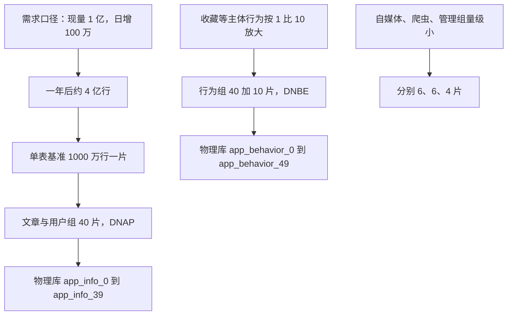

# 数据节点需求分析：把量级账换算成一张分片规划表

概念课把 MyCat 的三层映射立清了，动手的第一步不是改配置，而是回答一个问题：项目里上百张表，哪些要拆、各拆多少片、落到哪些节点上。片数拍脑袋定下，后面每一步都在还债：拆少了两年后扩容迁移，拆多了几十个空库白占连接池。课程资料里有一份按业务组整理的分库分表设计文档与路由设计表格，这一课把它的推导过程走一遍，每个片数都能倒推出算式，最后对到 schema.xml 里一行行 dataNode 上。

## 先给结论

- 单片容量锚定单表 1000 万行这条经验红线：目标量级除以 1000 万就是片数，用户表现量 1 亿、日增 100 万，一年后约 4 亿，正好 40 片。
- 五个业务组各拆各的：文章与用户组 40 片、行为组 50 片、自媒体组 6 片、爬虫组 6 片、管理组 4 片，另留一个节点专门存全局序列。
- 行为组在文章组的基础上加 10 片：用户收藏文章的行为按 1 比 10 的比例放大，组容量 5 亿；片数不够时后期有扩容方案，设计阶段不必焦虑。
- 分片设计要回答五个问题：表是否扩容、扩容存量怎么办、分表字段怎么选、主键怎么生成、分表数量按增量怎么算、数据存放位置定在哪。
- 节点要做成活的：40 片不是终身制，扩到 80 片的路子由自定义分片算法预留，路由开发的后续课程展开。

## 以用户表为例：从 4 亿行推到 40 个节点

设计文档的例题是用户表 `ap_user`：现存量约 1 亿条，每日新增按 100 万估算，一年之后总量约 4 亿。这道题只有一个算式：

```text
片数 = 目标总量 ÷ 单片容量 = 4 亿 ÷ 1000 万 = 40 片
```

1000 万不是随手填的数，它是单表经验红线的中间值：SQL 与索引优化到极致可以撑到千万级，再往上 B+ 树变高、缓冲池失效率上升，查询耗时从毫秒滑向秒级。按 1000 万一片切，每一片都留在安全区；按 4 亿算出 40 片，等于给这张表未来一年上了保险。

日增 100 万这个口径也要摊进每片里算一遍：一年 365 天，每天新写入的 100 万行被取模打散到 40 个库，单片日增约 2.5 万行，写入压力被均匀稀释。反过来说，如果只拆了 10 片，单片日增 10 万行，看似不多，但叠在 1000 万的存量上，两年就顶穿单片容量，扩容返工从那时开始。

## 五个业务组的分片规划表

例题推出的是一组节点的规模，实际设计按业务组分别做账。分组依据是业务域：文章与用户一组、行为一组、自媒体一组、爬虫一组、管理后台一组，全局序列单独一个节点。课程资料的设计表格按五个标签页逐组列了表名、主键方式、日增与总量、分表量、存放 DN、最大满足量、分表字段与分表策略，汇总成一张总表如下：

| 业务组 | 节点前缀 | 物理库 | 分片数 | 可承载总量 | 代表表 | 分片策略 |
|---|---|---|---|---|---|---|
| 文章与用户组 | DNAP | `app_info_0` 到 `app_info_39` | 40 | 4 亿 | `ap_article`、`ap_user`、`ap_comment` | `mod-long40`，按 id 取模 |
| 行为组 | DNBE | `app_behavior_0` 到 `app_behavior_49` | 50 | 5 亿 | `ap_show_behavior`、`ap_read_behavior`、`ap_collection` | `mod-long50` 与 `burst5050` |
| 自媒体组 | DNWM | `wemedia_0` 到 `wemedia_5` | 6 | 6000 万 | `wm_user`、`wm_news` | `mod-long6` 与 `burst66` |
| 爬虫组 | DNCL | `crawlers_0` 到 `crawlers_5` | 6 | 6000 万 | `cl_news`、`cl_task` | 取模与自定义规则 |
| 管理组 | DNAD | `admin_0` 到 `admin_3` | 4 | 4000 万 | `ad_user`、`ad_channel` | `mod-long4` |
| 全局序列 | DNSQ | `app_seq` | 1 | 不分片 | `mycat_sequence` | 序列存放 |

行为组是唯一比文章组还大的一组，加片的账这么算：用户收藏文章按 1 比 10 的比例估，一个用户一年收藏 10 篇，收藏、点赞、阅读这类主体行为的流水比文章本体多一个量级。设计上在 40 片的底子上加 10 片凑成 50，组容量 5 亿；如果哪天还是不够，后期的扩容方案接得住，不必一开始就往 60 片、70 片上堆。自媒体、爬虫、管理三组的量级小得多，6 片、6 片、4 片已留出充分余量。

这张规划表落到 schema.xml 里，就是一行行 dataNode 的具名声明：

```xml
<!-- 每个分片节点 = 某台数据主机上的一个物理库，DNAP 组共 40 行，此处节选首尾 -->
<dataNode name="DNAP_0"  dataHost="HOST0" database="app_info_0" />
<dataNode name="DNAP_39" dataHost="HOST0" database="app_info_39" />
<!-- 行为组 DNBE_0 到 DNBE_49 共 50 行，物理库 app_behavior_0 到 app_behavior_49 -->
<dataNode name="DNBE_0"  dataHost="HOST0" database="app_behavior_0" />
<dataNode name="DNBE_49" dataHost="HOST0" database="app_behavior_49" />
<!-- 量级小的三组与全局序列 -->
<dataNode name="DNWM_0" dataHost="HOST0" database="wemedia_0" />
<dataNode name="DNCL_0" dataHost="HOST0" database="crawlers_0" />
<dataNode name="DNAD_0" dataHost="HOST0" database="admin_0" />
<dataNode name="DNSQ"   dataHost="HOST0" database="app_seq" />
```

逻辑表的 dataNode 属性用 `DNAP_$0-39` 的区间写法引用一整组，与 40 行手写等价。课程环境里所有组都挂在 HOST0 一台主机下，每个分片是同一 MySQL 实例里的一个 database；生产环境把 dataHost 指向不同机器即可，节点与机器本就是两个层级，规划表里已经分开算账。整条推导链如下图：



读表先看量级与日增，再看单片基准，两者相除得片数；加片的地方一定有一个业务放大系数兜着，自媒体三组的片数则直接按小量级封顶。

## 分片设计要回答的五个问题

片数只是结果，设计过程要过五道题。第一道，表是否扩容：今天定的 40 片，两年后数据越过 4 亿怎么办，扩容时存量怎么迁移、增量怎么切流，这一问决定了算法选型，后面的 burst 规则就是为它准备的。第二道，分表字段怎么选：分片列要贴着查询模式走，点查按 id 取模一次定位；垂直方向把大字段、冷字段剥出去的列拆分，本项目不在这一课展开。

第三道，主键怎么生成：拆成 40 片后任何单一实例的自增都管不到全局，主键交给 MyCat 全局序列统一发号，server.xml 的 `sequnceHandlerType` 开关与序列登记配置在配置课落成。第四道，分表数量：按数据增量算，现量除以基准再加增长余量，五组片数全是这道算式的产物。第五道，存放位置：片落在哪台主机哪个库，连接池与容量的预算跟着 dataHost 走，单机演示与多机生产的差别只在 dataHost 一层。

五道题里最容易被跳过的是第一道和第二道，因为它们不影响今天能不能跑通，只影响两年后要不要返工。设计文档把它们列在推导之前，正是把返工成本前置到纸面上。

## 把节点做成活的：给扩容留后门

40 片做死容易，做活要靠算法配合。设计文档明确一点：分组之后组是活的，40 片不够可以扩到 80 片，前提是路由算法能理解「组」的概念，让新增节点只接新数据、老数据原地不动。项目为这类表准备了自定义的 burst 规则，rule.xml 里已经登记：

```xml
<!-- 自定义 burst 规则：按组建组扩容，算法类名按项目口径做了中性化改写 -->
<function name="burst5050" class="com.study.headline.BurstRuleAlgorithm">
    <property name="volume">500000000</property><!-- 单组容量 5 亿 -->
    <property name="step">50</property><!-- 单组节点量 50 -->
    <property name="mod">50</property><!-- 单组数据取模基数 -->
</function>
```

三个参数把扩容语义写死在配置里：volume 是一组的容量上限，写满即溢到下一组；step 是一组的节点数，扩容以组为单位增减；mod 是组内定位的分母。数据按主体标识聚簇落组，同一主体的数据收在同一片，组满之后新主体自然落到新扩的片上。取模规则与 burst 规则在项目里是分工而不是替代：点查为主、写入均匀的表走 mod-long，关注、粉丝、收藏这类按主体聚合的表走 burst，扩容压力最大的地方恰恰是后者。

## 常见误区

- **把片数当整数游戏。** 40 片的依据是 4 亿除以 1000 万，50 片的依据是行为放大系数；脱离量级账谈片数，要么两年内顶穿，要么建一堆空库常年空转。
- **所有表一刀切同一个片数。** 五个业务组的日增差着量级，统一 40 片对管理组是巨大的浪费，对行为组又不够；分组分账是分片设计的第一步。
- **只算存量不算日增。** 现量决定今天撑不撑得住，日增决定撑多久；单片日增叠上存量红线一起算，才能得出余量年限。
- **把扩容留给未来却选了锁死分布的规则。** 取模规则的扩容等于按新基数全量重分布，一旦确定走组式扩容，路由规则从第一天就要选对，规则上线后再换就是数据迁移。

## 面试可能被问到的问题

1. 面试官追问：「分片数是怎么定出来的？给一个估算过程。」
   答：先锚定单片容量，按单表 1000 万行经验基准；再算目标量级，现量加一年的日增；两者相除得片数。行为类表叠业务放大系数，比如收藏按 1 比 10 放大，在基准片数上加片，并对每个片做日增摊薄复核。
2. 面试官追问：「为什么行为组比文章组片数还多？」
   答：文章是单主体产出，行为是多主体消费产生的流水，一个用户收藏、点赞、阅读的条目远多于他发布的文章；按 1 比 10 的比例放大后行为组在 40 片上加到 50 片，组容量 5 亿，流水型数据天然比内容型数据更吃分片。
3. 面试官追问：「分片列为什么常用主键 id 取模？」
   答：id 分布均匀，取模后写入与存储都均匀，点查一步定位到片，路由计算零成本。代价是范围查询要扫全片、扩容改模数会全量重分布，所以点查为主的表用它，按主体聚簇的表另配 burst 类规则。
4. 面试官追问：「分片设计里哪些决策最难回退？」
   答：分片列与分片规则。列定下后数据分布语义锁死，换列或换规则都意味着按新逻辑重新分布存量数据，代价与一次数据迁移相当；片数反而可以做成活的，按组建组扩容即可。
5. 面试官追问：「全局序列为什么要单独留一个节点？」
   答：分片后各片独立自增必然撞号，主键必须集中发号。单独一个库存序列表，发号与业务数据写入分离，互抢锁的概率低，也避免业务分片扩容时牵连序列服务；项目里它对应 DNSQ 节点与 app_seq 物理库。

## 配套资料

- 代码：`materials/code/05/头条day02/`，mycat 相关目录收录配置四件套：schema.xml、rule.xml、server.xml、sequence_db_conf.properties，文中 dataNode 节选与 burst 函数定义出自其中。
- 说明：分库分表设计文档（数据节点需求、分库分表设计章节）与数据表路由设计表格随课程资料提供，本资料目录未收录，各业务组片数、1 比 10 放大系数与五道设计问题按画面线整理；rule.xml 中自研算法类的原始类名冠有机构前缀，正文按项目口径改写为 `com.study.headline.BurstRuleAlgorithm`，参数原值照录。
