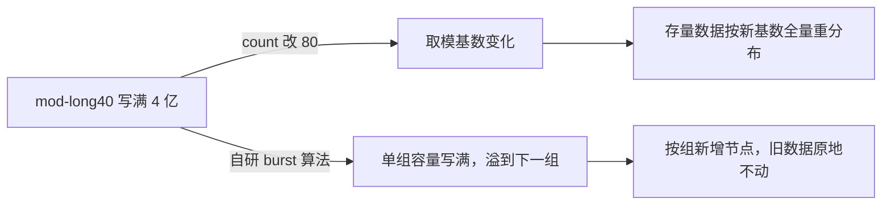
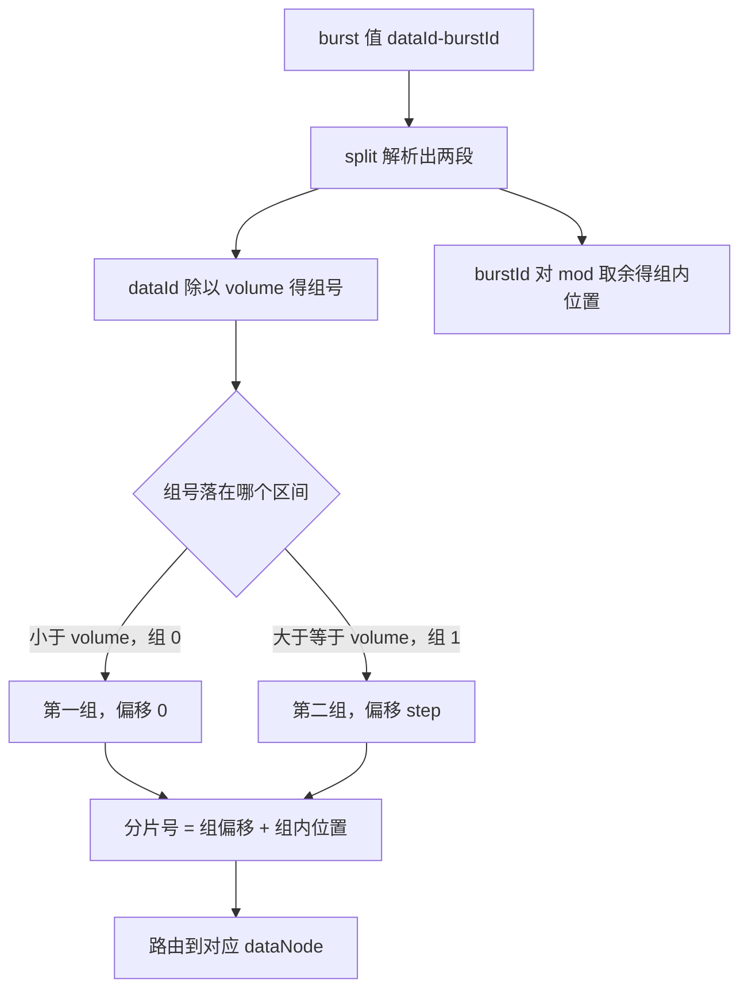
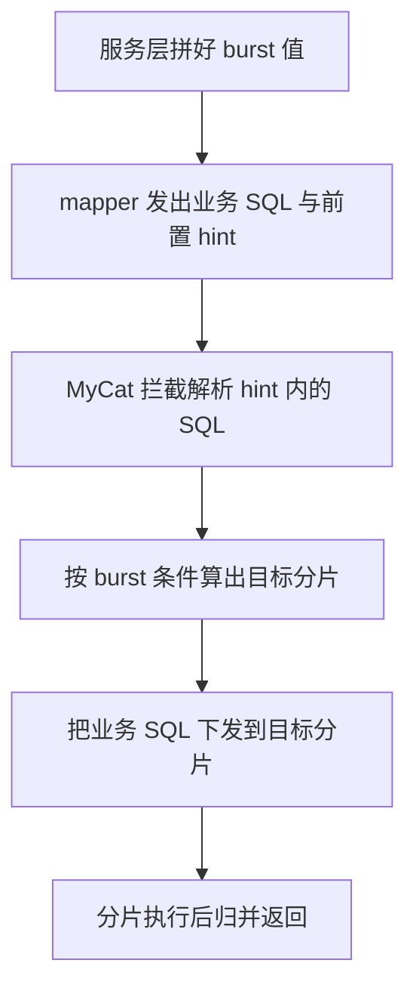

# MyCat 路由开发实战：自定义 burst 分片算法从环境搭建到增删改查验证

> 🔒 安全提示：文中示例的口令/密钥均为课程教学环境演示口径，生产环境的安全要求见《安全与合规须知》。

## 先给结论

- 五篇内容走完一条自定义分片算法的完整落地线：环境搭建、算法代码实现、注册与部署、数据库环境切换及路由测试、增删改查解决方案。
- mod-long 的硬伤在扩容：取模基数一变存量数据全部重排；burst 规则按组管理节点，单组写满溢到下一组，扩容整组加减不动存量。
- burst 是写进数据本身的分片信息：两段式 dataId-burstId，分片号等于 `(dataId / volume) * step + burstId % mod`，dataId 定组、burstId 定组内位置。
- 算法类继承 AbstractPartitionAlgorithm 并实现 RuleAlgorithm：calculate 管等值路由、calculateRange 管范围路由，volume、step、mod 从 rule.xml 注入。
- 部署链路固定：Maven 打 jar 进 MyCat 的 lib 重启生效，rule.xml 注册 function 与 tableRule，schema.xml 挂接表，三处名称必须一致。
- 验证路由首选 explain：DATA_NODE 列直接标出语句会落在哪些分片，in 条件的每个值各占一行。
- 业务侧最棘手的是拿不到主键拼不出完整 burst：查询假定 dataId 为 0 取默认组，路由条件用 hint 注解 `/*!mycat: sql=... */` 隔离，hint 里只能用 `${}` 拼接。
- 插入侧主键交给全局序列，update 与 delete 沿用同一思路；不带分片键的查询会扫全部分片再归并，能传 burst 的场景务必传。

## 第1部分：MyCat 路由开发环境：为自定义分片算法搭一个模块

rule.xml 里的 mod-long40 已经能让项目跑起来，但它有一个写死的上限：40 片乘单片 1000 万，4 亿封顶。数据一旦逼近这个量，取模规则既没有缓冲也没有退路，扩容的唯一手段是改模数，而改模数等于全量重分布。项目因此决定自己写一个分片算法，按组建组扩容。这一课先把开发环境搭出来：在聚合工程里开一个独立模块，收拢 MyCat 的配置，挂上 MyCat 的 jar，算法代码下一课往里填。

### mod-long 的扩容困局

把问题摆回账面。40 片的容量是 4 亿，设计时按一年的量留的余量，设计文档里同时留了第二个问题：40 节点不够了怎么办。mod-long 的算式 `id % count` 决定了它的两个软肋。

**第一，写满之后无处可去。** 数据越过 4 亿，id 继续对 40 取模，新数据只会继续塞进已经顶到红线的旧片，每片的存量越过 1000 万基准，查询耗时开始爬坡，规则本身帮不上忙。

**第二，扩容即重分布。** 想从 40 片扩到 80 片，count 必须改 80，取模基数一变，落点整体重排：id 41 原来余 1 落 DNAP_1，改完余 41 落 DNAP_41，几乎每一条存量数据都要搬家。线上做这件事要有迁移窗口、双写切换与回滚预案，成本比一开始多建 40 个空库高得多。

自研 burst 规则把「组」作为扩容单元。rule.xml 里已经登记的三参数写清了语义：volume 是单组容量，写满自动溢到下一组；step 是单组节点量，扩容按整组加减；mod 是组内定位基数。分片列按命名规范叫 burst，类型为 String，值承载主体标识，同一主体的数据聚簇落组，组满之后新数据自然落到新扩的片上。数据在旧组里原地不动，扩容只发生在组的边界上，这就是要把算法拿过来自己写的原因。

### 新建 service-mycat 模块

算法是一个纯粹的 Java 类，放业务模块里不合适，独立开一个模块专门承载。在聚合工程 leadnews 下新建 Maven 模块 `service-mycat`，打包方式 jar，模块的 pom 只需声明父子关系：

```xml
<parent>
    <artifactId>leadnews</artifactId>
    <groupId>com.study</groupId>
    <version>1.0-SNAPSHOT</version>
</parent>
<artifactId>service-mycat</artifactId>
```

父 pom 的 modules 清单里补上这个模块，与 common、model、utils、apis、article、behavior 并列：

```xml
<modules>
    <module>leadnews-common</module>
    <module>leadnews-model</module>
    <module>leadnews-utils</module>
    <module>leadnews-apis</module>
    <!-- article、behavior 等业务模块照常，此处省略 -->
    <module>service-mycat</module>
</modules>
```

模块创建后 IDE 偶尔不变色，Maven 面板 reimport 一次即可，父子关系识别正常后 dependencyManagement 与构建插件都会继承下来。

### 三份环境文件与配置四件套进场

工程的多环境约定是模块根目录放三份 properties，开发、生产、测试各一份，构建时按 profile 过滤注入。从既有工程把 `maven_dev.properties`、`maven_prod.properties`、`maven_test.properties` 拷过来即可；service-mycat 不连业务库，三份文件保留骨架或空着都可以，带上的意义是让模块纳入同一套多环境机制，打包流程不用区别对待。

随后在模块根目录建 config 目录，把 MyCat 安装目录 conf 下的四件套拷进来：schema.xml、rule.xml、server.xml、sequence_db_conf.properties。拷贝的理由很实际：算法落地后要在 rule.xml 里注册 function，class 属性填算法类的全限定名；改算法与改配置经常是同一个动作，把配置收进工程里，版本管理与改动留痕都跟着 Git 走，也方便下一步整目录同步到 MyCat 的 conf。原件里自研算法类名冠有机构前缀包名，工程内按项目口径统一改写为 `com.study.headline.BurstRuleAlgorithm`，rule.xml 的 function 标签同步指向改写后的类名。

### 挂上 MyCat 的 jar

算法类不是白手起家：MyCat 规定了分片算法的接入接口，类要实现 `io.mycat.route.function` 包下的分片算法接口（常用 AbstractPartitionAlgorithm 抽象基类落地），rule.xml 的 function 标签才能按 class 属性反射实例化它。这套接口在 MyCat 服务端的 jar 里，资料的 mycat 相关目录提供了两个 jar，选用 `Mycat-server-1.6.7.1-release.jar`，另一个不用。

在模块下新建 libs 目录，把 jar 拷进去，pom 里以本地文件方式声明依赖：

```xml
<dependencies>
    <dependency>
        <groupId>com.mycat</groupId>
        <artifactId>mycat-server</artifactId>
        <version>1.0.0</version>
        <scope>system</scope>
        <systemPath>${basedir}/libs/Mycat-server-1.6.7.1-release.jar</systemPath>
    </dependency>
</dependencies>
```

scope 取 system 的含义是「依赖不走仓库，直接指向文件系统上的这个路径」，systemPath 用 `${basedir}` 相对模块根目录拼出来，工程换了机器、换了盘符都不用改路径。IDE 识别后，算法类里 import MyCat 的接口与基类就有了编译期支持。system scope 有一条特性要记住：它不会被打进模块自己的 jar，模块 `mvn package` 出的产物只有自研算法类，这个干净的小 jar 正是部署物，后续放入 MyCat 安装目录的 lib 下生效，两边互不掺和。

模块的完整结构如下：

```text
service-mycat
├── pom.xml                      // system scope 引本地 jar
├── maven_dev.properties         // 三份环境参数，机制与工程统一
├── maven_prod.properties
├── maven_test.properties
├── config                       // MyCat 配置四件套，改算法时同步改
│   ├── schema.xml
│   ├── rule.xml
│   ├── server.xml
│   └── sequence_db_conf.properties
├── libs
│   └── Mycat-server-1.6.7.1-release.jar
└── src/main/java
    └── com/study/headline       // 算法实现类下一课落在这里
```

环境至此搭完，依赖、配置、打包三条线都已就位。两种扩容路径的差异是本模块存在的理由，对照如下：



下一课在这个包里实现算法类：入口方法接收分片列的值，按 volume 算组号、按 step 定组内偏移，返回节点下标，再跑一轮编译与打包，环境的价值就兑现了。

## 第2部分：自定义分片算法落地：burst 字段规范与 Java 实现

mod-long 这类内置取模规则有一个先天限制：节点数在配置里写死。40 个分片、单表容量按 1000 万预留，总上限就是 4 亿，数据涨过这条线，取模规则没有给出任何退路，剩下的选择只有全量迁移。MyCat 留了另一个口子：rule.xml 里 function 的 class 属性可以指向自己写的类，分片逻辑完全由代码决定。头条类资讯项目按这个口子实现了 burst 组式分片算法，代码放在 service-mycat 模块里，这是路由开发环节中唯一需要动 Java 代码的部分。

### burst：把分片信息写进数据本身

**burst 是一个约定字段。** 内置规则的分片键往往是现成的业务列，比如 ap_article 按 id 取模；自定义算法则需要一张表专门腾出一列来承载分片信息，项目把这一列统一命名为 burst。它不承载业务含义，是给路由算法看的标注列，类型是字符串，值的格式固定为 dataId-burstId 两段，中间用短横线连接。

拿 ap_behavior_entry（行为实体表）看最直观。演示数据里有四行，id 为 1、2、3、4，burst 值分别是 1-1、2-1、3-2、4-2。按口径，短横线前面是 dataId，即这行数据的主键；后面是 burstId，决定组内的落点。于是 id 1、2 落在第 1 片，id 3、4 落在第 2 片。到本地 MySQL 里核对：app_behavior_1 库里有 id 1 和 2 两行，app_behavior_2 库里有 id 3 和 4，app_behavior_0 是空的，三处观察互相咬合。数据落点不是猜出来的，是 burst 值算出来的，这个核对动作也是后面所有验证手段的基准。

**两段各有分工。** dataId 是主键，只承担一件事：除以单组容量 volume 得到组号。组是容量单位，第一组装满换第二组，组号乘上单组节点数 step 就是这组的分片偏移。burstId 决定组内的具体落点，同一主体的数据让 burstId 相近，就能聚在同一片上。把「容量扩展」与「数据聚簇」拆到两段值里，是这个设计的核心意图：主键增长把组推开，主体关联把片聚拢。

计算链路一张图看全：



以行为组的 burst5050 为例，volume 5 亿、step 50、mod 50：burst 值 3-2，dataId 3 远小于 5 亿，组 0，偏移 0；burstId 2 对 50 取余得 2；分片号 2，路由到 DNBE_2。若某天 dataId 涨到 6 亿，6 亿除以 5 亿得组 1，偏移 50，同样的 burstId 2 落在 52 号分片，也就是第二组的第 2 片，存量数据一个字节都不用挪。

### 算法骨架：一个继承加一个接口

MyCat 对自定义算法的结构有硬性要求：继承 AbstractPartitionAlgorithm，同时实现 RuleAlgorithm 接口。前者是算法基类，提供公共逻辑与参数处理的落点；后者是路由识别的契约，路由引擎只认这个接口类型。需要重写的方法有两个：calculate 处理等值条件，收到一个 burst 值返回一个分片号；calculateRange 处理范围条件，收到起止两个值返回一组分片号。

三个成员变量对应 rule.xml 里将要配置的三个 property：volume 是单组容量，量级到亿，必须用 Long 才装得下；step 是单组节点数，mod 是单组数据的取模基数，用 Integer 就够。每个变量配一个 setter，方法名与 property 名一一对应，MyCat 启动时反射实例化算法类，按名注入配置值。骨架代码如下（资料包未含算法源文件，代码按画面线与课程运行口径补全，包名与类名做了中性化处理）：

```java
package com.study.headline;

import io.mycat.route.function.AbstractPartitionAlgorithm;
import io.mycat.route.function.RuleAlgorithm;

/**
 * burst 组式分片算法：分片号 = (dataId / volume) * step + burstId % mod
 */
public class BurstRuleAlgorithm extends AbstractPartitionAlgorithm implements RuleAlgorithm {

    private Long volume;    // 单组容量
    private Integer step;   // 单组节点数
    private Integer mod;    // 单组数据 mod

    public void setVolume(Long volume) {
        this.volume = volume;
    }

    public void setStep(Integer step) {
        this.step = step;
    }

    public void setMod(Integer mod) {
        this.mod = mod;
    }
}
```

对比内置规则更有体会：mod-long 在 rule.xml 里只暴露一个 count，分片逻辑固定在 MyCat 源码里；burst 算法把三个参数全部外置成 property，逻辑放进项目自己的类，扩容策略因此可以贴着业务设计。

### calculate：从两段值算出一个分片号

calculate 是主路径。入参就是 burst 列的原始字符串，处理分四步：判空、按短横线拆分、校验段数、计算分片号。完整实现如下：

```java
@Override
public Integer calculate(String columnValue) {
    try {
        if (columnValue == null) {
            return null;
        }
        String[] temp = columnValue.split("-");
        if (temp.length == 2) {
            long dataId = Long.valueOf(temp[0]);
            long burstId = Long.valueOf(temp[1]);
            // 组偏移：主键除以单组容量得组号，乘以单组节点数
            int group = (int) (dataId / volume) * step;
            // 组内位置：burstId 对 mod 取余
            int pos = group + (int) (burstId % mod);
            System.out.println("BURST RULE INFO [" + columnValue + "]-[[" + pos + "]]");
            return pos;
        }
    } catch (Exception e) {
        e.printStackTrace();
    }
    // 解析失败兜底返回第 0 片
    return 0;
}
```

几个细节值得停下来看。段数校验必须是等于 2：burst 值格式错了（少一段、多一段、没带短横线）都不该参与路由，直接落进兜底。转 Long 而不是 Integer，是因为 dataId 与 burstId 都可能很大，Integer 装不下 5 亿级别的量。组偏移先整除再乘，整数除法天然向下取整，0 到 5 亿之间的任何主键除以 5 亿都得 0，这正是分组语义想要的。打印一行路由日志是刻意保留的：算法跑在 MyCat 进程里，出了问题没有断点可打，这行输出就是排障时唯一的现场。异常捕获兜住 NumberFormatException 这类解析错误；兜底返回 0 意味着坏数据全部压到第 0 片，课程环境里取简，生产环境更稳妥的做法是打告警甚至抛异常。

### calculateRange：范围查询返回一组分片号

范围条件（between、大于小于）不能只算一个点，MyCat 需要知道这段范围覆盖的所有分片。做法基于 calculate 复用：起止两个值各算一次分片号得到首尾，再把中间的分片号补全成数组：

```java
@Override
public Integer[] calculateRange(String beginValue, String endValue) {
    if (beginValue != null && endValue != null) {
        Integer begin = calculate(beginValue);
        Integer end = calculate(endValue);
        // 任一端算不出分片，返回空数组
        if (begin == null || end == null) {
            return new Integer[0];
        }
        if (end >= begin) {
            int len = end - begin + 1;
            Integer[] re = new Integer[len];
            for (int i = 0; i < len; i++) {
                re[i] = begin + i;
            }
            return re;
        }
    }
    return new Integer[0];
}
```

burst 值 1-5 到 1-9 的范围，两次 calculate 得到 5 和 9，方法返回 [5, 6, 7, 8, 9]，MyCat 拿数组把 SQL 下发到每个相关分片，各片本地过滤后归并。不重写这个方法，范围查询就拿不到精确的分片集合，只能退化为扫全部分片，自定义算法省下的 IO 又全赔进去。

## 第3部分：让 MyCat 用上你的算法：注册、打包与部署

算法类写完只是半成品，MyCat 进程里还没有它，路由不会因为本地多了几个类文件就自动生效。让自定义算法真正接管路由，要走一条固定的链路：代码打成 jar 放进 MyCat 的 lib，rule.xml 里注册 function 并把算法类挂上去，schema.xml 里让具体的表引用这条规则，最后重启 MyCat。链路上任何一环断了，表现都一样：要么启动报错，要么数据落错分片。这一课把四个环节逐个过掉。

### 打包：先扫清插件的障碍

service-mycat 是个普通 Maven 工程，打包用 IDEA 的 Maven 面板双击 package，或命令行执行：

```bash
mvn clean package
```

产物落在工程的 target 目录下，名字是 service-mycat-1.0-SNAPSHOT.jar，里面封装的就是 burst 算法类。打包过程里最容易踩的坑不是依赖缺失，而是一个与算法毫无关系的插件：git-commit-id-plugin。它会在打包阶段读取工程的 .git 目录生成版本信息，而这个工程没有做版本控制，插件直接报错终止构建。处理方式是把 pom.xml 里这段插件配置注释掉：

```xml
<plugin>
    <groupId>pl.project13.maven</groupId>
    <artifactId>git-commit-id-plugin</artifactId>
    <configuration>
        <dotGitDirectory>../../.git</dotGitDirectory>
        <dateFormat>yyyy-MM-dd HH:mm:ss</dateFormat>
        <useNativeGit>true</useNativeGit>
        <abbrevLength>8</abbrevLength>
        <generateGitPropertiesFile>true</generateGitPropertiesFile>
    </configuration>
</plugin>
```

注释后再打，BUILD SUCCESS，jar 出现在 target 目录。这类「与业务无关却卡死构建」的插件是接手老工程时的常见障碍，思路都是一样的：先让它闭嘴，把产物打出来。

### 安装：jar 进 lib，重启生效

MyCat 安装目录下有一个 lib 目录，里面是 MyCat 运行所需的全部依赖 jar，启动时统一加载。把 service-mycat-1.0-SNAPSHOT.jar 拷进这个目录，算法类就进入了 MyCat 的类路径。


**必须重启，没有热加载。** 算法对象是在 MyCat 启动阶段按 rule.xml 实例化的，property 注入也发生在那一刻；运行中的 MyCat 既不知道 lib 里多了新 jar，也不会重新读配置。改完算法、换完 jar、动过配置，统一以重启收尾。Windows 版 MyCat 在 bin 目录下有启动脚本，Linux 版用 mycat 命令，动作都一样：先停后启。

### 注册：rule.xml 的 function 与 tableRule

rule.xml 里要写两段配置。function 声明算法类与参数，tableRule 把分片列和 function 绑成一条可用规则。真实配置里注册了三个实例，对应三组不同的容量规划（class 指向的类名按中性口径改写，原值含机构前缀包名）：

```xml
<function name="burst66" class="com.study.headline.BurstRuleAlgorithm">
    <property name="volume">60000000</property><!-- 单组容量 -->
    <property name="step">6</property><!-- 单组节点量 -->
    <property name="mod">6</property><!-- 单组数据mod -->
</function>

<function name="burst4040" class="com.study.headline.BurstRuleAlgorithm">
    <property name="volume">400000000</property><!-- 单组容量 -->
    <property name="step">40</property><!-- 单组节点量 -->
    <property name="mod">40</property><!-- 单组数据mod -->
</function>

<function name="burst5050" class="com.study.headline.BurstRuleAlgorithm">
    <property name="volume">500000000</property><!-- 单组容量 -->
    <property name="step">50</property><!-- 单组节点量 -->
    <property name="mod">50</property><!-- 单组数据mod -->
</function>

<tableRule name="burst5050">
    <rule>
        <columns>burst</columns>
        <algorithm>burst5050</algorithm>
    </rule>
</tableRule>

<tableRule name="burst4040">
    <rule>
        <columns>burst</columns>
        <algorithm>burst4040</algorithm>
    </rule>
</tableRule>

<tableRule name="burst66">
    <rule>
        <columns>burst</columns>
        <algorithm>burst66</algorithm>
    </rule>
</tableRule>
```

**property 名是注入的钥匙。** volume、step、mod 三个名字必须与算法类里的 setter 严格对应，一个 function 三个参数都要配全，少一个对应的成员变量就是 null，路由时抛空指针。这套机制与内置算法是同一套：hash-int 这类内置 function 用 mapFile 属性指向 partition-hash-int.txt 这样的映射文件，自定义算法用 property 注入计算参数，MyCat 都是通过属性名反射注入，只是参数的用途由算法类自己解释。

三个实例的参数差异值得注意：单组容量除以单组节点数都是 1000 万，即单表容量恒定，变的只是组里挂多少节点。burst66 给自媒体统计类小表用，6 片装 6000 万；burst4040 给关注、粉丝这类用户关系表用，40 片装 4 亿；burst5050 给行为明细表用，50 片装 5 亿。同一个类，靠参数表达不同的容量档位，这正是参数外置的价值。

### 挂接：schema.xml 里让表用上规则

tableRule 只是注册，哪张表用它要在 schema.xml 的 table 标签上声明。项目里引用 burst 规则的表如下：

```xml
<!-- 用户关系组：40 片，burst4040 -->
<table name="ap_user_follow" dataNode="DNAP_$0-39" rule="burst4040"/>
<table name="ap_user_fan" dataNode="DNAP_$0-39" rule="burst4040"/>

<!-- 行为组：50 片，burst5050 -->
<table name="ap_behavior_entry" dataNode="DNBE_$0-49" rule="burst5050"/>
<table name="ap_collection" dataNode="DNBE_$0-49" rule="burst5050"/>
<table name="ap_likes_behavior" dataNode="DNBE_$0-49" rule="burst5050"/>
<table name="ap_read_behavior" dataNode="DNBE_$0-49" rule="burst5050"/>

<!-- 自媒体组：6 片，burst66 -->
<table name="wm_news_statistics" dataNode="DNWM_$0-5" rule="burst66"/>
<table name="wm_fans_statistics" dataNode="DNWM_$0-5" rule="burst66"/>
```

名称对应链要一处不差：table 的 rule 属性指向 tableRule 的 name，tableRule 的 algorithm 指向 function 的 name，function 的 class 指向算法类。任何一处拼写不一致，MyCat 启动时就找不到算法定义，直接报配置错误。

还有一个容易被忽略的差异：这批 burst 表的 table 标签上没有 autoIncrement 与 primaryKey 属性，对照 mod-long40 的表（都带 `autoIncrement="true" primaryKey="id"`）区别明显。含义是这些表不接入 MyCat 的全局序列，sequence_db_conf.properties 里也不为它们登记表名，主键由应用侧自己生成。原因在于 burst 表的主键要参与算法计算（dataId 段），发号必须与分片策略配合，全局序列只管发号不管分片语义。项目后续用 ZooKeeper 序列生成分布式主键，写入侧怎么拼 burst 值在增删改查方案里展开。

## 第4部分：切换数据库环境再用 explain 验分片

算法写完、装进 MyCat 之后，得先保证环境是真的：MyCat 后面连的库、库里的表、客户端连的地址，任何一处不对，测试结果都不可信。之前的课程环境里 MyCat 接的是本地一个 5.5 版本的 MySQL，版本偏旧，后期容易出兼容问题；这一课先把后端统一换成 Docker 部署的 MySQL 5.7，再让 MyCat、客户端各自连对新地址，然后用 explain 与工具类两种手段验证 burst 算法的路由结果。

### 后端库切换：5.5 换 5.7

新库用 Docker 装，镜像拉下来起容器，映射 33306 端口，账号密码用课程环境的 root/123456。Docker 的好处是干净、可弃可重建，装坏了删容器重来，不污染虚拟机本身；这个安装过程与之前环境搭建里装其他中间件的方式一致。

库就位后改 MyCat 的连接指向。schema.xml 最下方 dataHost 的 writeHost 节点声明后端地址，把 url 指到新库（改完重启 MyCat）：

```xml
<dataHost name="HOST0" maxCon="600" minCon="200" balance="0"
          writeType="0" dbType="mysql" dbDriver="native" switchType="1" slaveThreshold="100">
    <heartbeat>select user()</heartbeat>
    <writeHost host="HOST0_M" url="192.168.220.145:33306" user="root" password="123456"/>
</dataHost>
```

dbDriver 用 native 表示 MyCat 以原生 MySQL 协议直连后端，对后端版本没有额外要求，5.7 及以上都可以。url 里的 IP 就是装了 Docker 的那台虚拟机（node 环境里的一台），端口 33306 是容器映射出来的。

### 建库与连库：一次把链路拉通

**新库是空的，先跑建库脚本。** 项目的数据按库后缀切开，app_info_0 到 app_info_39、app_behavior_0 到 app_behavior_49、wemedia_0 到 wemedia_5 等几十个物理库都要先存在，MyCat 的 dataNode 才有落点。课程资料里的 bak.sql 就是干这件事的，把它在新装的 5.7 上完整执行一遍，库与表结构全部建出，部分演示数据也一并导入。

**客户端按连 MySQL 的方式连 MyCat。** Navicat 新建连接：连接名随意（比如 mycat-145），主机填 MyCat 所在机器的 IP，端口 8066，用户名 root、密码 123456。这组账号不是后端 MySQL 的账号，而是 server.xml 里 user 标签定义的 MyCat 账号，它通过 schemas 属性限定了可见的逻辑库。课程环境里两边恰好都是 root/123456，容易让人误以为是同一套账号体系，实际是两个独立的认证层。命令行等价写法是：

```bash
mysql -h 192.168.220.145 -P 8066 -uroot -p123456
```

连上后 use 逻辑库，能看到 117 张逻辑表，抽查 ap_article 能查出数据，说明「客户端到 MyCat 到后端分片」整条链路是通的。应用侧（后端服务）的数据源切换是同一个动作：JDBC 连接串指向 MyCat 的 8066 端口、库名写 server.xml 授权的逻辑库 study-news，按前面环境搭建时整理数据源的步骤调整即可，例如：

```yaml
spring:
  datasource:
    url: jdbc:mysql://192.168.220.145:8066/study-news?useUnicode=true&characterEncoding=utf8
    username: root
    password: 123456
```

环境切换的完整链路如下：


### explain：路由分析的标配工具

环境通了，开始测算法。第一种手段是 explain，在连接 MyCat 的客户端里直接执行：

```sql
explain select id from ap_collection where burst in ('1-5','6-9');
```

返回结果里最关键的一列是 DATA_NODE，标出这条语句会在哪些分片上执行。in 里的每个 burst 值各算一个分片，所以会看到两行：1-5 算出第 5 片，对应 DNBE_5；6-9 算出第 9 片，对应 DNBE_9。课程演示里对 ap_behavior_entry 用 1-1 与 3-2 两个值做过同样的验证，结果分别是 DNBE_1 与 DNBE_2，与 burst 值的语义完全一致：短横线后段的 burstId 就是组内落点。

explain 的价值在于把「路由」从黑盒变成一行输出：写 SQL 的人不需要知道算法内部怎么算，发一条 explain 就能确认 MyCat 打算把语句送到哪。排查「数据为什么没查到」「为什么落错片」时，第一步都应该是 explain，先看路由对不对，再看数据在不在。

第二种验证方式是直接开物理库核对。用后端 MySQL 的连接（33306 端口）打开 app_behavior_1、app_behavior_2 这些物理库，数一数行数、对一对主键，与 explain 的结论互相印证。两种手段一个看「将要去哪」，一个看「实际在哪」，配合使用能覆盖绝大多数分片问题。

### BurstUtils：写入侧的 burst 值拼接工具

测算法之外，还有一件配套的事：burst 值是两段式字符串，应用写入时总不能手工拼。工程 common 模块里有一个工具类 BurstUtils，专门负责拼接，核心两个方法如下（资料包未含该类源文件，按画面线抄录并补上常量定义）：

```java
public class BurstUtils {

    private static final String SPLIT_CHAR = "-";

    /** 按传入顺序把字段接到短横线链上，配合主键拼出完整 burst 值 */
    public static String split(Object... fields) {
        StringBuffer sb = new StringBuffer();
        if (fields != null && fields.length > 0) {
            for (int i = 0; i < fields.length; i++) {
                sb.append(SPLIT_CHAR).append(fields[i]);
            }
        }
        return sb.toString();
    }

    /** 固定以组号 0 打头，即默认落在第一组，查询场景用它拼探测值 */
    public static String groupOne(Object... fields) {
        StringBuffer sb = new StringBuffer();
        if (fields != null && fields.length > 0) {
            sb.append("0");
            for (int i = 0; i < fields.length; i++) {
                sb.append(SPLIT_CHAR).append(fields[i]);
            }
        }
        return sb.toString();
    }
}
```

split 按顺序拼接字段，写入场景由它在主键之外拼出 burst 的第二段；groupOne 固定以 0 打头，生成 0-burstId 形式的值，为什么查询时敢把第一段写死为 0，涉及算法的分组计算，放到增删改查方案里展开。这里先记住分工：写入拼真实值，查询拼默认值。

## 第5部分：分片键不在手上：burst 路由下的增删改查方案

分片规则上线后，最先撞墙的往往不是配置，而是业务代码：insert 必须让 MyCat 知道往哪个片写，update、delete、select 又经常发生在主键还没生成的时刻。burst 算法把这件事变得更具体，因为它的分片键是两段式的 burst 值，第一段 dataId 是行主键，查询的时候这行数据还不存在，主键根本无从谈起。这一课把增删改查在分片下的四个痛点与项目里的对应解法一次讲清。

### 问题一：查的时候不知道主键

典型场景是「查上次是否点过赞」：请求进来时，点赞记录这行数据可能还没插入，行主键不存在，burst 值的第一段 dataId 拼不出来，分片键残缺，路由无从谈起。

解法是把 dataId 假定为 0。原理在算法的分组计算里：组号等于 dataId 除以单组容量 volume，0 到 volume 之间的任何主键除以 volume，整数除法的结果都是 0，也就是都落在第一组。只要被查数据确实在第一组（主键小于单组容量），用 0 顶替真实主键，组号一致、组内位置由 burstId 决定，路由结果与拿真实主键算完全相同。工具类 groupOne 就是为此准备的：固定以 0 打头，拼出 0-burstId 形式的探测值。

```java
public static String groupOne(Object... fields) {
    StringBuffer sb = new StringBuffer();
    if (fields != null && fields.length > 0) {
        sb.append("0");
        for (int i = 0; i < fields.length; i++) {
            sb.append(SPLIT_CHAR).append(fields[i]);
        }
    }
    return sb.toString();
}
```

服务的业务代码里先调 groupOne 拼好 burst 值传给 mapper，mapper 只负责把值放进条件。0 这个假定不是永远成立：数据量进入第二组后（主键超过单组容量），0 与真实主键算出的组号就分叉了，届时探测值要按组号补齐。项目当前的容量规划里，行为数据离第二组还很远，第一组假定够用，但边界要写进注释与团队约定里。

### 问题二：burst 条件混进业务 SQL 不优雅

burst 值承担的是分片职责，不是业务语义。直接把它写进业务 SQL，等于让每个开发者都在业务条件旁边手工维护一段路由提示，业务条件一多、SQL 一长，burst 条件既碍眼又容易拼错。

MyCat 的解法是「注解」：一条形似注释的提示，放在业务 SQL 前面，MyCat 解析它里面的 SQL 来算路由，真正下发给分片的仍然是业务 SQL。项目里按上次行为查询的写法如下（mapper 源码资料包未含，按画面线与课程口径补全，包名做了中性化处理）：

```xml
<select id="selectLastLike" resultMap="baseResultMap">
    <if test="burst != null and burst != ''">
        /*!mycat: sql=select * from ap_likes_behavior where burst = ${burst} */
        select * from ap_likes_behavior
        where behavior_entry_id = #{behaviorEntryId}
          and entry_id = #{entryId}
          and type = #{type}
        order by created_time desc limit 1
    </if>
</select>
```

三个要点藏在细节里。写法上是 `/*!mycat: sql=` 开头的注释体，感叹号让它区别于普通注释：普通注释会被数据库忽略，这个会被 MyCat 拦截解析。条件值必须用 `${burst}` 拼接而不是 `#{burst}`，因为预编译参数的占位符是在语句执行阶段才替换的，进不了注释体，MyCat 解析 hint 时拿到的是原始文本，只有 `${}` 在拼 mapper 语句时就已经展开。一次想探测多个分片时可以用 in：`where burst in (${bursts})`，逗号分隔的多个值会让 MyCat 计算出一组目标分片。

`<if>` 包住整条语句也有讲究：burst 没传时这条 SQL 直接不发，避免无分片键的查询退化成扫全部 50 个分片。

### 更新与删除：沿用同一条思路

update 与 delete 的路由机制和 select 一致，分片键在条件里就走精确路由，不在就扫全片。方案也照搬：拿得到行主键就用真实 burst 值，拿不到就用 groupOne 拼 0 打头的探测值，然后统一用 hint 把路由条件从业务语句里挪出去。以取消点赞为例（示例按本课写法补全）：

```xml
<update id="cancelLike">
    /*!mycat: sql=update ap_likes_behavior set operation = 3 where burst = ${burst} */
    update ap_likes_behavior
    set operation = #{operation}
    where behavior_entry_id = #{behaviorEntryId}
      and entry_id = #{entryId}
      and type = #{type}
</update>
```

业务侧的约定可以总结成一句：凡是走 burst 规则的表的增删改查，mapper 里都要带上 hint，服务层负责把 burst 值算好传下来。约定一旦立住，分片细节就收敛在服务层一处，业务 SQL 与路由逻辑互不污染。

### 插入侧：主键交给全局序列

插入的改造点不同，焦点在主键。burst 表没有接入全局序列（schema.xml 里不配 autoIncrement，sequence_db_conf.properties 里不登记），主键原本要应用自己维护。而展示行为功能要批量插入文章展示记录，改造后写法如下（示例按本课写法补全）：

```xml
<insert id="saveShowBehavior">
    /*!mycat: sql=insert into ap_show_behavior(entry_id, article_id, is_click, show_time, created_time)
    values (1, 1, 0, now(), now()) */
    insert into ap_show_behavior (entry_id, article_id, is_click, show_time, created_time)
    values
    <foreach collection="articleIds" item="item" separator=",">
        (#{item.entryId}, #{item.articleId}, 0, now(), now())
    </foreach>
</insert>
```

对照改造前的写法，变化有两处。一是 insert 里不再有 id 列，服务代码里手动 setId 的行也删掉：ap_show_behavior 是 mod-long50 规则的分片表，schema.xml 里配了 `autoIncrement="true"` 与 `primaryKey="id"`，MyCat 会在路由前按全局序列发号，取号走数据库方式（server.xml 的 sequnceHandlerType 为 1，sequence_db_conf.properties 里 AP_SHOW_BEHAVIOR=DNSQ），id 与分片路由由中间件一条龙完成。二是语句前加了 hint，为路由提供明确的语句模板，后续新增功能凡涉及 burst 表的插入都照此办理。项目后续会用 ZooKeeper 序列给 burst 表生成分布式主键，那套方案落地前，先把自维护 id 从代码里清干净是第一步。

改造后的验证在 behavior 模块的测试类里完成：构造用户上下文、传入文章 id 集合调用 saveShowBehavior，测试直连 MyCat 的 8066 端口，HikariPool 初始化后保存成功、无报错，说明 mapper 改造与 MyCat 的发号路由链路都是通的。接入 MyCat 后启动与执行会比直连时略慢，多出的开销主要在 SQL 解析与路由计算，属于预期内的代价。

查询侧还有一类「不改造」的案例值得对照：查文章列表信息时按 entry_id 查展示行为，没有分片键，MyCat 把语句下发到全部 50 个分片各查一遍再归并。功能不用改，代码一行不动，但代价要心里有数：全分片扫描是分片架构里最贵的查询形态，能用 burst 或其他分片键缩小范围的场景，务必把值传进来。

hint 路由的完整链路如下：



## 常见误区

- **配置改两处，一处忘了同步。** 四件套进了工程 config，MyCat 安装目录 conf 里还有一份，两份并存必然漂移；约定工程 config 为唯一改动源，改完整目录覆盖到 conf 再重启 MyCat。
- **systemPath 写死盘符。** `D:\libs\xxx.jar` 这类绝对路径在换机器或挪目录后立刻断链，构建报找不到依赖；用 `${basedir}` 相对拼路径，libs 跟着模块走。
- **以为 system scope 的依赖会进包。** system 依赖只参与编译与 IDE 运行，不随模块 jar 打包，也不随 deploy 发布；模块产物里没有 MyCat 类反而是预期行为，部署时由 MyCat 的 lib 提供它们。
- **rule.xml 的 class 与实际类名对不上。** function 标签按全限定名反射实例化，包名改写后两处必须同步；对不上时 MyCat 启动直接抛 ClassNotFound，报错信息里会带着那个类名，定位不难，怕的是只改了代码没改配置。
- **把 burst 当数字列。** 两段式字符串靠 split 解析，建成数字列存不进短横线，要么插入报错，要么算法解析失败走兜底，数据全堆到第 0 片。
- **setter 名与 property 名对不上。** MyCat 按名注入，配置写 volume、setter 写 volumes，注入会静默失败，计算时 volume 为 null 直接空指针，而且报错点在 MyCat 内部，不容易第一眼定位。
- **忽略段数校验。** 算法不能默认入参格式合法，脏值进 Long.valueOf 会抛异常打断路由；先校验 temp.length == 2 再解析是防御底线。
- **兜底返回 0 无告警。** 解析失败静默落第 0 片，等于把所有坏数据集中到一片，数据倾斜与写冲突都会在那一片爆发，至少要有日志留痕。
- **换 jar 不重启。** MyCat 启动时一次性加载 lib 与配置，运行中替换 jar 或修改 rule.xml 都不会生效，验证算法改动前先确认进程是新的。
- **property 名与 setter 对不上。** 注入按名反射调用，配置写 mod、setter 写 mode，静默失败到路由时才炸；上线前用一行日志把三个参数值打出来核对最保险。
- **三处规则名不一致。** table 引用名、tableRule 名、function 名三者必须完全一致，rule.xml 里同名规则还容易被誊抄时多打一个数字（burst50 与 burst5050）埋雷。
- **给 burst 表配了自增。** autoIncrement 与 sequence 登记是配套的，burst 表配了自增却不在 sequence_db_conf.properties 登记，或者登记了却让应用同时维护主键，两套发号来源并存迟早撞号。
- **只改 writeHost 不跑 bak.sql。** 新库上没有建出 app_info_0 这类物理库，MyCat 的 dataNode 全部落空，查询直接报表不存在；换后端的两步（改地址、建库）缺一不可。
- **把两套账号当成一套。** 8066 的账号来自 server.xml 的 user 定义，33306 的账号是后端 MySQL 的账号体系，课程环境里值恰好相同，排查连接问题时必须先分清连的是哪一层。
- **在后端库上执行 explain 期待路由结果。** explain 要通过 MyCat 连接执行才有 DATA_NODE 路由列；直连后端库执行的 explain 只是普通执行计划，看不到分片走向。
- **换库后沿用旧连接。** 客户端与服务端的连接池都可能缓存旧地址，改完配置要重启对应进程，否则流量仍打到退役的 5.5 上，测试结论全部失真。
- **hint 里用 `#{}` 传参。** 预编译占位符进不了注释体，MyCat 解析 hint 时拿到的是未经替换的占位符文本，条件失效后路由退化为全分片扫描；hint 内一律用 `${}`，并保证拼接值来自内部生成而非用户输入。
- **0 打头的探测值跨组使用。** groupOne 的 0 假定只在第一组成立，数据进入第二组后探测路由会落错片；组边界一旦临近，探测值的组号段要跟着换。
- **插入还留着手动 setId。** 接入全局序列的表配了 autoIncrement，应用再手动填 id 就是两套发号来源并存，早晚撞号；改造时把 id 列与 setId 一并移除。
- **无分片键查询随手写。** 全分片扫描功能上总能出结果，掩盖了性能问题；review 时对走 burst 规则的表保持敏感，没有分片键条件的查询要单独说明理由。

## 面试可能被问到的问题

1. 面试官追问：「为什么不用内置的取模规则，要自己写算法？」
   答：内置 mod-long 的扩容语义是改 count，模数一变全部存量按新基数重分布，代价是全量迁移。自研 burst 规则把节点按组建组，单组容量写满溢到下一组，扩容按组加减节点，存量数据不动；同一主体的数据还能借 burst 列聚簇落组，兼顾查询局部性。

2. 面试官追问：「自定义分片算法在 MyCat 里怎么接入？」
   答：实现 MyCat 提供的分片算法接口，通常继承 AbstractPartitionAlgorithm 基类，实现按分片列值计算节点下标的方法；把编译出的算法 jar 放入 MyCat 的 lib，rule.xml 里 function 标签的 class 填全限定名，schema.xml 的 table 引用对应规则名即可。

3. 面试官追问：「system scope 依赖有什么限制？」
   答：不走仓库、直指本地文件，靠 systemPath 定位；不参与传递依赖，也不会打进模块产物或随 deploy 发布。适合编译期借用、运行期由部署环境提供的场景，本项目借它拿 MyCat 的接口做编译，运行期由 MyCat lib 提供实现。

4. 面试官追问：「mod-long40 扩到 80 片线上要做什么？」
   答：改 rule.xml 的 count 只是第一步，真正的工作是按新模数重排存量：停写或双写窗口、全量数据按 id 对 80 取模搬迁、校验各片行数、切流回滚预案一个不能少。正因为成本高，扩容敏感的表一开始就该选组式扩容的规则。

5. 面试官追问：「分片列 burst 为什么设计成 String？」
   答：burst 列承载主体标识，值里可以同时编码主体与预留的分组信息，字符串留出扩展余地；算法内部按数值解析算组号与偏移。命名规范统一叫 burst，是为了让所有走自研规则的表在配置与代码里保持同一套语义。

6. 面试官追问：「算法模块为什么放在聚合工程里而不是 MyCat 源码里改？」
   答：独立模块让算法与业务解耦：依赖只有 MyCat 的 jar，编译打包独立进行，产物就是部署物；版本管理、构建流水线、回归测试都按工程规范走，不动中间件源码就不用维护自己的 MyCat 发行版，升级中间件版本时算法照常可用。

7. 面试官追问：「内置取模规则够用，为什么还要自定义算法？」
   答：mod-long 的 count 写死节点数，容量到顶后改配置等于数据全量重分布。自定义算法可以把「组」的概念做进去：第一组装满后，新数据按组号路由到新挂的分片组，存量不动，扩容只加机器。burst 算法的 volume、step、mod 三个参数就是这个意图的参数化。

8. 面试官追问：「MyCat 怎么把 rule.xml 里的配置传给你的算法类？」
   答：启动时反射实例化 function 的 class 属性指定的类，然后按 property 的 name 反射调用对应 setter 注入值。setter 名必须与 property 名完全一致，类型也要匹配，亿级容量的 volume 要用 Long 接。

9. 面试官追问：「calculate 和 calculateRange 分别在什么时候被调用？」
   答：分片键条件是等值（等于、in 逐个展开）时走 calculate，返回单个分片号；条件是范围（between、大于小于）时走 calculateRange，返回分片号数组，MyCat 把 SQL 下发到数组里的每个分片再归并结果。

10. 面试官追问：「burst 字段为什么设计成两段式字符串？」
   答：两段各管一个维度。dataId 是主键，除以单组容量定组，解决容量扩展；burstId 定组内位置，同一主体的数据 burstId 相近就聚在同一片，解决按主体聚簇查询的效率。合在一列里，路由时一次解析就能拿到两个维度。

11. 面试官追问：「算法解析失败返回 0 有什么隐患？」
   答：所有解析失败的行都会被路由到第 0 片，形成数据与写入热点，而且错误被吞掉、上游无感知。更稳妥的做法是记录告警日志并接入监控，必要时直接抛异常让写入方感知。

12. 面试官追问：「自定义分片算法从写完代码到生效，要经过哪些步骤？」
   答：Maven 打成 jar，拷进 MyCat 安装目录的 lib；rule.xml 里用 function 声明算法类全名并通过 property 传参，tableRule 把分片列绑到算法上；schema.xml 的 table 标签用 rule 属性引用 tableRule 名；重启 MyCat，启动阶段实例化算法并注入参数。

13. 面试官追问：「rule.xml 的 property 是怎么传进算法对象的？」
   答：与内置算法同一套机制。MyCat 启动时反射实例化 function 的 class 指定类，按 property 的 name 反射调用对应 setter 注入值。所以 setter 命名必须与 property 名一致，类型要匹配。内置算法的 mapFile 参数也是这样进到算法类里的。

14. 面试官追问：「为什么 burst 表不配自增主键？」
   答：burst 表的主键参与分片计算，是算法里 dataId 段的来源，发号策略必须与分片策略配合。全局序列只负责发号，不理解分片语义；这类表的主键由应用侧生成，项目里后续用 ZooKeeper 序列做分布式主键。

15. 面试官追问：「同一个算法类怎么服务不同规模的表？」
   答：靠 function 多实例。一个类可以注册多个 function，每个实例配一组 volume、step、mod，等于同一逻辑的不同容量档位。项目里 burst66、burst4040、burst5050 三个实例分别对应 6 片 6000 万、40 片 4 亿、50 片 5 亿的规划。

16. 面试官追问：「打包时 git-commit-id-plugin 报错怎么处理？」
   答：该插件在构建期读取工程的 .git 目录生成版本信息，工程没有做版本控制就会失败。不影响运行时行为，注释掉插件配置重新打包即可；规范做法是给工程补上版本控制或者把插件挪到有仓库的父工程里。

17. 面试官追问：「应用从直连 MySQL 切到 MyCat，连接信息要改哪些？」
   答：JDBC 连接串的主机与端口换成 MyCat 地址与 8066，库名换成 server.xml 里授权的逻辑库，账号密码换成 MyCat 侧 user 的定义。SQL 与 ORM 层基本不动，但要留意跨分片查询的语义与性能变化。

18. 面试官追问：「explain 在 MyCat 场景下返回什么？」
   答：返回这条 SQL 的路由计划，关键列是 DATA_NODE，列出语句会在哪些分片执行。in 条件的每个分片键值各占一行，范围条件会展开成一片区间。它是验证分片规则、排查数据落点问题的第一手段。

19. 面试官追问：「更换后端 MySQL 实例，要动哪些地方？」
   答：schema.xml 的 dataHost 里 writeHost 的 url 与账号，改完重启 MyCat；新实例上要先执行建库脚本把全部分库与表结构建出来；客户端与应用的连接串按需跟着切。dbDriver 用 native 时对后端协议版本有要求，5.7 及以上较稳。

20. 面试官追问：「BurstUtils 的 groupOne 为什么固定以 0 开头？」
   答：burst 值的第一段是 dataId，参与组号计算，dataId 除以单组容量，0 到容量之间的任何值组号都是 0。查询时往往拿不到行主键，用 0 打头等价于声明「默认在第一组里找」，只要数据确实在第一组，路由结果与真实主键算出来的一致。

21. 面试官追问：「怎么确认一条数据真的落在算法算出的那个分片？」
   答：两个手段互相印证：连 MyCat 执行 explain 看语句的目标 DATA_NODE；再用后端连接打开对应的物理库核对行数与主键。前者验证路由逻辑，后者验证存储事实，结论一致才算闭环。

22. 面试官追问：「分片键不在查询条件里会发生什么？」
   答：MyCat 无法定位目标分片，只能把语句广播到该表的全部分片，各自执行后归并结果。功能不受影响，但每次查询的 IO 与归并成本随分片数线性增长，高频接口会把全分片扫描放大成集群瓶颈。

23. 面试官追问：「MyCat 的 hint 注解原理是什么，使用时注意什么？」
   答：`/*!mycat: sql=... */` 是带感叹号的特殊注释，MyCat 在 SQL 解析阶段拦截并解析其中的语句来计算路由，真正执行的是后面的业务 SQL。注意 hint 内的参数用 `${}` 拼接、条件值由内部生成、语句保持与业务 SQL 同表同条件，避免路由与实际数据错位。

24. 面试官追问：「查询时假定主键为 0 为什么是安全的？」
   答：组号由主键除以单组容量的整数除法得出，容量内任何主键与 0 的组号都是 0，组内位置由 burstId 决定不受影响。它只在数据处于第一组时成立，容量吃紧进入第二组后，探测值的组号段必须与数据所在组一致，否则路由落错片。

25. 面试官追问：「分片后插入数据，主键怎么处理？」
   答：接入全局序列的分片表在 schema.xml 配 autoIncrement 与 primaryKey，应用侧不填 id，MyCat 按 server.xml 选定的发号方式取号、回填并完成路由；未接入序列的 burst 表主键由应用生成，且发号逻辑要与服务侧分片约定配合，不能两套来源并存。

26. 面试官追问：「update 与 delete 在分片下的路由和 select 有区别吗？」
   答：路由机制完全一致：条件里带分片键走精确路由，不带就广播全片。区别在风险面，写操作的广播会让同一批数据在多个分片上反复加锁与匹配，性能与锁冲突代价更高，因此写语句必须养成带分片键的习惯。

## 配套资料

- 代码：`materials/code/05/头条day02/`，mycat 相关目录收录配置四件套：schema.xml、rule.xml、server.xml、sequence_db_conf.properties；自研算法的 rule.xml 注册（volume、step、mod 三参数）出自其中。
- 说明：service-mycat 模块的 pom、三份 properties 与工程结构不在本资料包内，按画面线与讲义步骤（依赖导入、算法设计章节）补全；Mycat-server jar 随课程资料提供，本资料目录未收录；算法类原始类名冠有机构前缀，正文统一改写为 `com.study.headline.BurstRuleAlgorithm`，MyCat 分片算法接口与基类按 MyCat 官方实现口径标注。
- 代码：`materials/code/05/头条day02/`，mycat 配置四件套（schema.xml、rule.xml、server.xml、sequence_db_conf.properties）。rule.xml 里 burst66、burst4040、burst5050 三个 function 就是本课算法在真实配置中的注册形态，volume、step、mod 取值分别为 6000 万/6/6、4 亿/40/40、5 亿/50/50，正文演算即以此为准。
- 说明：算法 Java 源文件资料包未含，正文代码按画面线与课程运行口径补全；类名、包名与日志前缀做了品牌中性化改写（原类名含机构前缀），逻辑库统一按 study-news 中性口径。课程环境：node01~node03，MySQL root/123456。
- 代码：`materials/code/05/头条day02/`，mycat 配置四件套（schema.xml、rule.xml、server.xml、sequence_db_conf.properties）。正文的 function、tableRule、table 节选均出自真实配置；rule.xml 里还保留着 hash-int、rang-long 等内置 function（mapFile 指向 partition-hash-int.txt 等映射文件），可与自定义算法的参数注入机制对照。
- 说明：service-mycat 工程源码与 pom.xml 资料包未含，插件配置为画面线抄录；function 的 class 属性原值含机构前缀包名，按 com.study.headline.BurstRuleAlgorithm 中性口径改写；逻辑库统一按 study-news 中性口径。课程环境：node01~node03，MySQL root/123456。
- 代码：`materials/code/05/头条day02/`，mycat 配置四件套（schema.xml、rule.xml、server.xml、sequence_db_conf.properties）。正文 writeHost、user 节选与 burst 规则定义均出自其中。
- 说明：bak.sql 建库脚本与 BurstUtils 类源文件资料包未收录，前者属课程资料随堂发放，后者按画面线抄录并补全常量定义；数据源 yml 为按课程环境整理的示例；逻辑库统一按 study-news 中性口径。课程环境：node01~node03，MySQL root/123456。
- 代码：`materials/code/05/头条day02/`，mycat 配置四件套（schema.xml、rule.xml、server.xml、sequence_db_conf.properties）。ap_show_behavior、ap_likes_behavior 等表的规则定义、sequnceHandlerType 配置与 AP_SHOW_BEHAVIOR=DNSQ 的序列登记均可在其中核对。
- 说明：mapper.xml 与测试类源码资料包未收录，正文 mapper 与 SQL 为按画面线与课程口径补全的示例；类名、包名做了品牌中性化改写，逻辑库统一按 study-news 中性口径。课程环境：node01~node03，MySQL root/123456。
