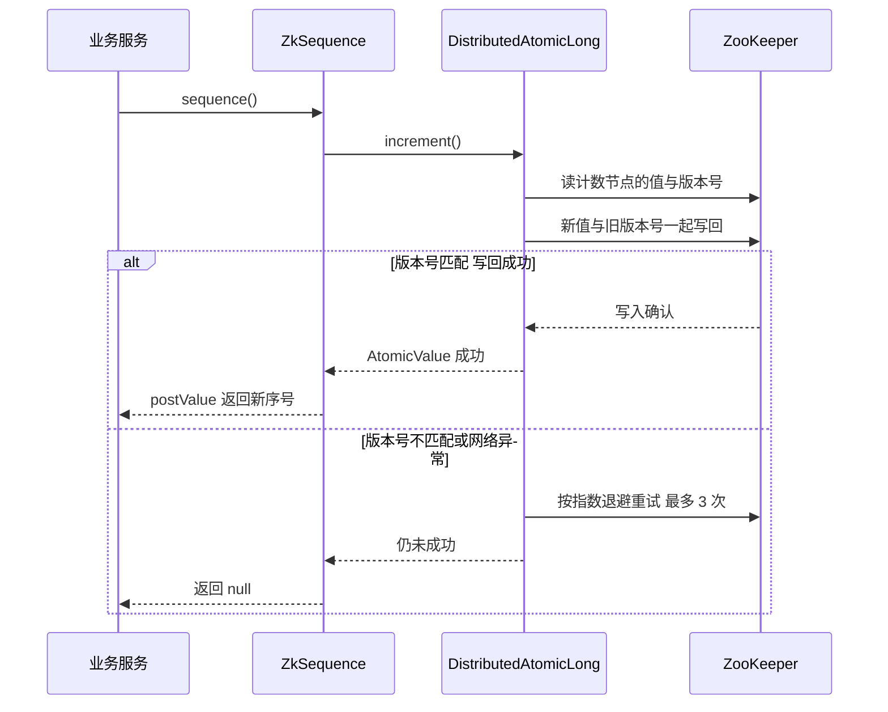

# 行为表主键换 ZooKeeper 自增：枚举与 ZkSequence 序列封装

头条类资讯项目里，点赞、阅读、收藏、关注、粉丝这批行为表走的是 burst 分片：路由条件是「行主键-分片字段值」的两段式，第二段来自业务字段，MyCat 的全局序列只认 id 列，第二段它既不认识也不会算。这批表的主键只能由应用自己生成，而且要求跨服务实例唯一、严格自增。解法是把按课程环境装好的 ZooKeeper 包装成一个发号器，这一课先打地基：登记哪些表要发号，再把「一张表的计数器」封装成 ZkSequence。

## 先给结论

- 五张行为表（文章点赞、阅读行为、收藏、用户关注、用户粉丝）走 burst 规则，主键由应用侧用 ZooKeeper 生成，底层是 Curator 提供的 `DistributedAtomicLong`。
- 枚举 `ZkSequenceEnum` 与表一一对应，一个枚举值就是一张要发号的表，新增表先加枚举值。
- `ZkSequence` 封装「一张表的计数器」：持有一个客户端、一个计数节点路径和一个重试策略，`sequence()` 返回下一个自增值。
- 重试策略显式设为 `new ExponentialBackoffRetry(500, 3)`：指数退避，三次重试耗尽仍失败就返回 null，让调用方快速感知而不是无限等待。
- 原子性由 ZooKeeper 保证：计数值存在节点 data 里，`increment()` 用版本号做乐观锁写回，多实例并发取号也不会重号。

## MyCat 为什么发不了这个号

burst 分片把路由条件做成了两段式：第一段是行主键，第二段是某个业务字段的值，两者拼在一起才是一条数据在分片集群里的完整定位。接入了 MyCat 全局序列的表，insert 时 id 由中间件自动回填，路由自己就完成了；但 burst 表的分片依据还包括第二段业务字段，这个值 MyCat 不可能替业务生成，发号与拼 burst 值这两件事必须都发生在应用侧。

课件里那张主键规划表把现状列得很清楚，走 burst 规则的行为表，主键生成方式一栏都标成了 zk_sequence：

| 表 | 业务 | 主键生成方式 |
|---|---|---|
| ap_likes | 文章点赞 | zk_sequence |
| ap_read_behavior | 阅读行为 | zk_sequence |
| ap_collection | 收藏 | zk_sequence |
| ap_user_follow | 用户关注 | zk_sequence |
| ap_user_fan | 用户粉丝 | zk_sequence |

这几张表数据量大、增长快，是 mod-long50 规则分五十片的对象。应用侧要一个「跨实例唯一、单调自增」的取号来源，数据库表计数、Redis 自增都能做，项目选了 ZooKeeper：课程集群里它本来就装好了，而且 Curator 直接提供了现成的分布式原子自增实现，并发细节不用自己处理。

## 枚举封装：一张表一个枚举值

发号器要按表区分，每张表有自己独立的计数，互不干扰。项目里的约定是建一个枚举，枚举值与表一一对应：

```java
package com.study.headline.common.zookeeper.sequence;

public enum ZkSequenceEnum {
    AP_LIKES, AP_READ_BEHAVIOR, AP_COLLECTION, AP_USER_FOLLOW, AP_USER_FAN
}
```

枚举放在 common 公共模块的 `zookeeper.sequence` 包下，五个值对应上表五张表。这样设计的好处是把「哪些表走 ZooKeeper 发号」收口在一个文件里：业务代码只能通过枚举取号，给不存在的表取号这件事在编译期就写不出来；后续有新表接入，先加枚举值再补绑定，规范上不允许绕过枚举直接拼表名。

## DistributedAtomicLong：Curator 给的原子自增

取号的底层是 Curator 的 `DistributedAtomicLong`，位于 `org.apache.curator.framework.recipes.atomic` 包，是 ZooKeeper 客户端提供的分布式原子自增类。它的 `increment()` 做三件事：读出计数节点的当前值与版本号，把「旧值加一」连同旧版本号一起写回 ZooKeeper，写回时版本号不匹配说明有别的实例抢先写过了，自动重读重写。整个「读改写」在 ZooKeeper 侧是原子的，保证一个号只发一次。

计数节点的 data 里存的就是当前计数值。节点不存在时首次 `increment()` 会连父目录一起创建，从 1 开始发号。`increment()` 返回 `AtomicValue<Long>`，`succeeded()` 表示这次自增是否成功，`postValue()` 拿自增后的新值。

## ZkSequence：一张表一个计数器

有了原子自增，封装就是把「一张表」和「一个 DistributedAtomicLong 实例」绑在一起：

```java
package com.study.headline.common.zookeeper.sequence;

import org.apache.curator.RetryPolicy;
import org.apache.curator.framework.CuratorFramework;
import org.apache.curator.framework.recipes.atomic.AtomicValue;
import org.apache.curator.framework.recipes.atomic.DistributedAtomicLong;
import org.apache.curator.retry.ExponentialBackoffRetry;

public class ZkSequence {
    RetryPolicy retryPolicy = new ExponentialBackoffRetry(500, 3);
    DistributedAtomicLong distAtomicLong;

    public ZkSequence(CuratorFramework client, String counterPath) {
        this.distAtomicLong = new DistributedAtomicLong(client, counterPath, retryPolicy);
    }

    public Long sequence() throws Exception {
        AtomicValue<Long> increment = distAtomicLong.increment();
        if (increment.succeeded()) {
            return increment.postValue();
        }
        return null;
    }
}
```

构造参数有两个：`client` 是连接 ZooKeeper 的客户端，`counterPath` 是这张表的计数节点路径，一张表一个地址，互不干扰。第三个输入 `retryPolicy` 没走构造参数，直接作为成员变量初始化，类的使用方连重试策略都不用关心。

`ExponentialBackoffRetry` 的两个参数是 baseSleepTimeMs 与 maxRetries：第一次重试前等 500 毫秒，之后每次翻倍（指数退避），最多重试 3 次。Curator 源码里对重试次数有硬上限 `MAX_RETRIES_LIMIT = 20`，这里取 3 是业务取舍：取号是同步调用，重试是给网络抖动一次补救机会，三次还不行就返回 null，把决定权交回上层，让业务选择报错或降级，而不是让请求线程在后台无限重试。这正是课程口径「每 500 毫秒重试 3 次后仍生成失败返回 null」的出处；不显式给策略的话，默认行为会把等待时间拖得很长，主键生成这种链路拖不起。

`sequence()` 是取号入口：`increment()` 成功就返回新值，失败返回 null。方法签名上的 `throws Exception` 是把 ZooKeeper 不可达这类环境异常抛给调用方，由上层统一处理。

一张图看取号的完整链路：



关键路径在写回那一跳：版本号是这次操作原子性的全部来源，冲突就重试、重试耗尽就放弃。业务侧拿到的要么是一个没人用过的号，要么是明确的 null，不会出现「拿到了但不确定是否唯一」的中间态。

## 常见误区

- **拿到返回值不判 null。** 重试耗尽返回 null 是设计内行为，业务里不判空直接当主键落库，数据库会给出一条无法定位的失败。取号结果判空，并区分「环境故障」与「数据问题」两类错误分别处理。
- **重试策略照抄默认。** 不传策略或把 maxRetries 放大，网络故障时每个取号请求都在后台退避等待，线程池被拖满。取号链路要快失败，重试上限与业务容忍度对齐。
- **多张表共用一个计数节点。** 一表一路径是绑定关系的根基，两张表共用一个 `DistributedAtomicLong` 会让主键交错增长，分片定位与排障全乱。
- **枚举加了值，绑定没人做。** 枚举只是登记，真正让新表可取号的是客户端封装里的绑定动作（initZkSequence），登记与绑定缺一不可，漏了绑定要到运行时才暴露。

## 面试可能被问到的问题

1. 面试官追问：「这批行为表为什么不用 MyCat 的全局序列？」
   答：MyCat 全局序列解决的是 id 列的自增回填，而 burst 分片的路由条件是「主键加业务字段」的两段式，第二段业务字段的值必须由应用生成并拼进路由条件，发号因此整体前移到应用侧。MyCat 接管不了这一段，应用需要一个跨实例唯一的自增来源，项目选了 ZooKeeper。
2. 面试官追问：「DistributedAtomicLong 的原子性是怎么保证的？」
   答：它把计数值存在 ZooKeeper 节点的 data 里，自增时读出当前值与版本号，写回时把旧版本号带上。ZooKeeper 的写操作带版本校验，版本不匹配说明有并发写入，就重读重写重试。整个读改写序列由 ZooKeeper 串行化，保证全局只发一次。
3. 面试官追问：「ExponentialBackoffRetry(500, 3) 是什么含义，为什么重试次数选这么小？」
   答：第一次重试等待约 500 毫秒，之后按指数退避翻倍，最多重试 3 次，耗尽后本次自增失败。取号在业务主链路上是同步调用，重试只是给瞬时抖动补救，次数太多会让故障被长时间掩盖并把线程拖住；快速失败返回 null，让上层按明确的错误处理。
4. 面试官追问：「increment() 返回的 AtomicValue 要怎么用？」
   答：先调 succeeded() 判断这次自增是否生效，生效才用 postValue() 取新值；不生效时不能拿返回对象里的旧值凑数。AtomicValue 把「成功与否」和「值」打包返回，就是为了逼调用方显式处理失败分支。
5. 面试官追问：「枚举在这里起什么作用，去掉行不行？」
   答：枚举是表与发号器之间的登记表，把允许取号的表收口在一个文件里，业务代码只能通过枚举引用，拼错表名或给未登记的表取号在编译期就会被拦住。去掉枚举就要用裸字符串传路径，拼写错误只能在运行时发现。

## 配套资料

- 代码：`materials/code/05/头条day03/`，本课资料包提取清单为空，ZooKeeper 封装源码未随包提供，文中代码为按视频画面线与课程写法补全的示例，包名统一改写为 com.study.headline。
- 代码：`materials/code/05/头条day02/`，mycat 配置四件套（schema.xml、rule.xml、server.xml、sequence_db_conf.properties），可对照 burst 表未接入全局序列、主键需应用维护的现状。
- 说明：课程环境 ZooKeeper 为单机 node01，连接地址与路径在配置文件中维护；主键规划表按课件画面整理。
