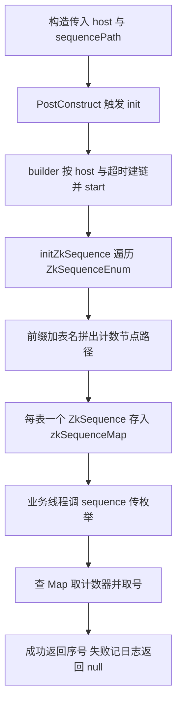

# ZookeeperClient 封装：一条连接、一个绑定、一个取号入口

ZkSequence 只解决「一张表一个计数器」，它开工前还差两样东西：一个真正连上 ZooKeeper 的客户端，和一张「表名到计数器」的对照关系。这两个职责被放进 `ZookeeperClient`：负责连接的创建与启动，负责把五张表的序列一次性绑定好，再对外暴露一个唯一的取号方法。业务侧从头到尾只需要认识这个类。

## 先给结论

- 客户端封装成 `ZookeeperClient`，一个服务进程一个实例，连接在 bean 初始化时建好并 start，不随取号请求反复建连。
- 连接参数全部提为常量：连接超时 3 秒、会话超时 30 秒、重试间隔 1000 毫秒、最多重试 1000 次，量级与取号侧的 500 毫秒 3 次是两回事。
- `initZkSequence()` 遍历 `ZkSequenceEnum`，把每张表的名字拼上 sequencePath 前缀，new 出对应的 ZkSequence 存进线程安全的 Map。
- 对外取号走 `sequence(枚举)`：查 Map 拿到表的序列对象再取号，取不到或抛异常都记 error 日志并返回 null。
- Map 用 Guava 的 `Maps.newConcurrentMap()` 创建，取号调用可能来自多个业务线程，容器必须线程安全。

## 为什么不直接用 CuratorFramework

Curator 的 `CuratorFrameworkFactory.builder()` 链式配置可以一行建出客户端，但裸用有两个问题。连接是重资源：TCP 握手、会话协商、心跳维护，每个取号点都 new 一个，连接数与 GC 压力都会放大；更重要的是连接生命周期没人管，谁来 start、谁来 close 全看调用者自觉。封装一层之后，连接的创建时机固定在 bean 初始化，服务进程的整个生命周期里只有这一条连接。

## 字段与四个常量

```java
@Setter
public class ZookeeperClient {
    private static Logger logger = LoggerFactory.getLogger(ZookeeperClient.class);
    private String host;
    private String sequencePath;

    // 重试间隔时间
    private final int SLEEP_TIME_MS = 1000;
    // 最大重试 1000 次
    private final int MAX_RETRIES = 1000;
    // 会话超时时间
    private final int SESSION_TIMEOUT = 30 * 1000;
    // 连接超时时间
    private final int CONNECTION_TIMEOUT = 3 * 1000;

    // 连接实例
    private CuratorFramework client = null;

    // 表名与序列对象的绑定
    private Map<String, ZkSequence> zkSequenceMap = Maps.newConcurrentMap();

    public ZookeeperClient(String host, String sequencePath) {
        this.host = host;
        this.sequencePath = sequencePath;
    }
}
```

四个常量分成两组看。`CONNECTION_TIMEOUT` 是建连超时，TCP 连接加协商在 3 秒内没完成就直接报错，防的是「连不上还一直挂着」；`SESSION_TIMEOUT` 是会话超时，客户端连上后会持续心跳，30 秒窗口内心跳续不上，ZooKeeper 才认定这个会话死亡。`SLEEP_TIME_MS` 与 `MAX_RETRIES` 是给连接级重试策略用的：网络抖一下，Curator 按 1 秒间隔自动重试，最多试 1000 次，量级是「撑过抖动」而不是「无限卡住」。这组参数与 ZkSequence 里 500 毫秒 3 次的取号重试职责不同，一个守连接，一个管单次取号，不要互相挪用。

`host` 是 ZooKeeper 连接串，单机环境就是 `node01:2181` 这种形态，集群环境用逗号分隔多个地址；`sequencePath` 是所有计数节点的公共路径前缀。

## init()：建链并启动

```java
@PostConstruct
public void init() {
    client = CuratorFrameworkFactory.builder()
            .connectString(host)
            .connectionTimeoutMs(CONNECTION_TIMEOUT)
            .sessionTimeoutMs(SESSION_TIMEOUT)
            .retryPolicy(new ExponentialBackoffRetry(SLEEP_TIME_MS, MAX_RETRIES))
            .build();
    client.start();
    initZkSequence();
}
```

builder 链上依次给连接串、两个超时和重试策略，`build()` 生成实例，`start()` 真正发起连接。`@PostConstruct` 让这一切发生在 bean 构造与依赖注入完成之后：`ZookeeperClient` 被创建进容器的那一刻，连接已经建立、绑定已经完成，业务代码拿到的永远是可用状态。

## initZkSequence()：表和序列绑在一起

```java
public void initZkSequence() {
    ZkSequenceEnum[] list = ZkSequenceEnum.values();
    for (int i = 0; i < list.length; i++) {
        String name = list[i].name();
        String path = this.sequencePath + name;
        ZkSequence zkSequence = new ZkSequence(this.client, path);
        zkSequenceMap.put(name, zkSequence);
    }
}
```

遍历枚举拿到每个表名，路径规则是公共前缀直接拼表名，sequencePath 以「/」结尾时拼出来的节点路径形如 `/zk-sequence/AP_LIKES`。每张表 new 一个 ZkSequence，以表名为键放进 Map。序列封装那一课说「枚举只是登记」，这一步才是真正的绑定：枚举里多一个值，这里就多一个计数器，绑定逻辑一行不用改。

Map 的创建用的是 Guava 的 `Maps.newConcurrentMap()`：取号会被多个业务线程并发调用，HashMap 在并发读写下行为未定义，ConcurrentMap 把这类风险挡掉。键用 String 类型的表名，值的类型就是序列封装课里的 ZkSequence。

## sequence()：对外唯一的取号入口

```java
public Long sequence(ZkSequenceEnum name) {
    ZkSequence seq = zkSequenceMap.get(name.name());
    if (seq != null) {
        try {
            return seq.sequence();
        } catch (Exception e) {
            logger.error("获取[{}]Sequence错误: {}", name, e);
        }
    }
    return null;
}
```

三个动作：按枚举的名字从 Map 里查序列对象，查到就调它的 `sequence()` 取号，查不到或抛异常就记一条带表名的 error 日志后返回 null。日志内容「获取[{}]Sequence错误」把出问题的表名与异常一起打出来，线上排障时一眼定位是哪张表的发号链路出了状况。

整个类的协作关系如下：



从图上能看到两类状态：连接与会话是「长状态」，服务进程活着就一直维持；Map 里的绑定是「启动时算好」的静态关系，取号时只剩一次查表加一次自增。把绑定前置到启动期，正是为了让取号路径短到只剩关键动作。

## 常见误区

- **连接超时与会话超时混为一谈。** 连接超时管建连阶段，3 秒连不上就该报错；会话超时管心跳保活，30 秒内续不上会话才失效。把会话超时也压成 3 秒，网络稍有波动会话就被反复重建，挂在会话上的状态全部丢失。
- **把 zkSequenceMap 换成 HashMap。** 取号在业务线程里并发调用，非线程安全的 Map 在并发读写下的行为不可预期。绑定在启动期完成后理论上只读，但保持 ConcurrentMap 的成本几乎为零，没必要赌。
- **两套重试策略互相抄参数。** 连接级 1000 毫秒 1000 次是给会话抖动兜底，取号级 500 毫秒 3 次是给单次请求快速失败，把任何一组参数挪到另一处都会放大问题。
- **客户端每次取号现建。** builder 加 start 放进取号方法里，意味着每次发号都伴随一次 TCP 握手与会话协商，吞吐全耗在建连上；连接必须随 bean 生命周期复用。

## 面试可能被问到的问题

1. 面试官追问：「CuratorFramework 实例为什么要全局复用，能多建几个吗？」
   答：能，但不该。每个实例对应一条 ZooKeeper 会话，持有独立的 TCP 连接与心跳线程，多建会成倍消耗服务端会话资源，还会让连接治理失控。一个服务进程一个实例、启动时 start、关闭时 close，是标准用法。
2. 面试官追问：「connectionTimeoutMs 和 sessionTimeoutMs 分别管什么？」
   答：前者限制建立连接与协商的阶段，超时直接失败，暴露的是「连不上」；后者是会话保活窗口，客户端靠心跳续期，窗口内心跳全部失败 ZooKeeper 才关闭会话，暴露的是「连上了但失联」。一个管开头，一个管全程。
3. 面试官追问：「表与序列的绑定为什么放在启动期遍历枚举，而不是取号时现查现建？」
   答：绑定前置后，取号路径只剩查 Map 加自增，没有建对象与校验的成本；缺登记的表在服务启动阶段就会暴露成明确的初始化问题，而不是散落在业务请求里的运行时错误。枚举即清单，遍历即全量绑定，新增表不需要改绑定代码。
4. 面试官追问：「Map 的键为什么存表名字符串而不是枚举对象？」
   答：两种都能做对，前提是查询键与存储键类型一致。用字符串键时查询要传枚举的 name() 结果，如果直接把枚举对象当键传给 get，Map.get 的参数是 Object，编译器不报错，运行期只会安静地返回 null，这类错误靠肉眼很难发现。
5. 面试官追问：「取号失败返回 null，为什么不改成抛异常？」
   答：课程口径是返回 null 并记 error 日志，让上层自己决定重试、降级还是报错；抛异常则把失败处理强绑在调用链上。两种都成立，关键是失败必须显式暴露，绝不能静默返回一个可能重复的值。

## 配套资料

- 代码：`materials/code/05/头条day03/`，本课资料包提取清单为空，ZookeeperClient 源码未随包提供，文中代码为按视频画面线与课程写法补全的示例，包名统一改写为 com.study.headline，Map 变量名按代码内一致性写作 zkSequenceMap。
- 说明：课程环境 ZooKeeper 为单机 node01，连接地址走配置文件维护；重试与超时常量取值按画面线整理。
