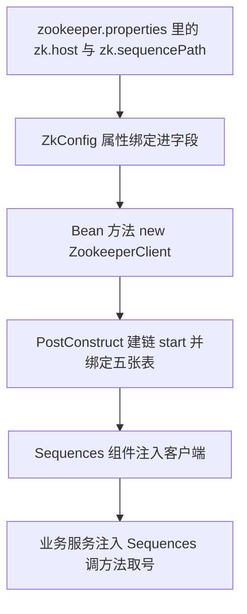

# 把 ZooKeeper 客户端交给 Spring：ZkConfig 与 Sequences 两层装配

ZookeeperClient 已经能把连接与绑定都管好，但它还停在工具类的位置上：host 与路径是构造参数，谁用谁 new，换个环境就要满工程找硬编码。这一课把它注册进 Spring 容器：配置外置到 `zookeeper.properties`，一个 `ZkConfig` 负责装配，再包一层 `Sequences` 让业务只面对方法。装配做完，取号就变成一次注入加一次方法调用。

## 先给结论

- `ZkConfig` 用 `@Configuration` 声明，`@Bean` 方法 new 出 ZookeeperClient，host 与 sequencePath 来自配置文件。
- 配置通过 `@PropertySource` 加载 classpath 下的 `zookeeper.properties`，`@ConfigurationProperties(prefix = "zk")` 把 zk.host、zk.sequencePath 绑定到字段，绑定依赖 setter。
- 直接注入 ZookeeperClient 已经可用，但取号还要自己传枚举，项目再包一层 `@Component` 的 `Sequences`，每张要发号的表对应一个方法，内部固定传对应的枚举。
- 装配链路是：properties 文件进 ZkConfig 字段，字段进 bean 构造，bean 就绪触发 `@PostConstruct` 建链绑定，Sequences 注入客户端，业务注入 Sequences。
- ZkConfig 在 common 模块里，业务服务的引导类默认扫不到它，联调时要补一次包扫描，这是主键生成测试课里第一个撞上的坑。

## 配置外置：zookeeper.properties

发号器要跨环境工作：开发连单机 node01，测试与生产连各自的集群。地址写死在代码里，换环境就是一次全局替换事故。项目把两个参数外置到 resources 下的 `zookeeper.properties`：

```properties
zk.host=node01:2181
zk.sequencePath=/zk-sequence/
```

host 是 ZooKeeper 连接串，sequencePath 是计数节点的公共路径前缀，结尾的「/」不能省，绑定时的路径拼接就是前缀直接加表名。配置类上两个注解配合完成加载与绑定：

- `@PropertySource("classpath:zookeeper.properties")`：把这个文件纳入 Spring 的配置源；
- `@ConfigurationProperties(prefix = "zk")`：按前缀 zk 加字段名把属性值绑到同名字段上，zk.host 进 host，zk.sequencePath 进 sequencePath。

绑定靠 setter 完成，字段必须有可写的 setter。漏了的话字段永远是 null，而且启动阶段不报错，问题会推迟到第一次取号才炸出来。

## ZkConfig：注册客户端 bean

```java
@Configuration
@PropertySource("classpath:zookeeper.properties")
@ConfigurationProperties(prefix = "zk")
public class ZkConfig {

    private String host;
    private String sequencePath;

    @Bean
    public ZookeeperClient zookeeperClient() {
        return new ZookeeperClient(host, sequencePath);
    }

    public void setHost(String host) {
        this.host = host;
    }

    public void setSequencePath(String sequencePath) {
        this.sequencePath = sequencePath;
    }
}
```

`@Configuration` 把类标记成配置类，`@Bean` 方法返回的 ZookeeperClient 进入容器，默认单例，整个服务就这一个客户端实例。bean 方法体里只有一行 new，配置绑定发生在 bean 方法执行之前，host 与 sequencePath 已经拿到了文件里的值。ZookeeperClient 上的 `@PostConstruct` 会在 bean 就绪时自动触发，建链、start、绑定五张表一气呵成，ZkConfig 本身不用关心这些。

这套写法与项目里封装其他中间件客户端是同一个套路：配置进 properties，配置类读值并装配 bean，业务只管注入。

## Sequences：把查表取号再收一层

到这一步，业务模块已经可以注入 ZookeeperClient、调 `sequence(ZkSequenceEnum)` 取号了。但每个调用点都要自己选枚举，「哪张表用哪个枚举值」的对应关系散落在各处。项目再包一层 Sequences：

```java
@Component
public class Sequences {

    @Autowired
    private ZookeeperClient zookeeperClient;

    // 文章点赞表取号
    public Long sequenceApLikes() {
        return zookeeperClient.sequence(ZkSequenceEnum.AP_LIKES);
    }

    // 阅读行为表取号
    public Long sequenceReadBehavior() {
        return zookeeperClient.sequence(ZkSequenceEnum.AP_READ_BEHAVIOR);
    }
    // AP_COLLECTION、AP_USER_FOLLOW、AP_USER_FAN 同型方法，按枚举逐个补齐
}
```

`@Component` 让 Spring 管理它，注入 ZookeeperClient，然后每张表一个方法，方法体固定传对应的枚举值。业务侧从此只 import Sequences 一个类，调 `sequenceReadBehavior()` 就拿到阅读行为表的下一个主键，枚举名、节点路径、客户端这些细节全部退到装配层。五个枚举值对应五个同型方法，写法完全一致，新表接入就是加一个方法。

## 装配链路



读图从上往下：配置文件是唯一的事实来源，改地址只动 properties；ZkConfig 与 Sequences 是两层无状态的装配与代理；真正持有连接的只有 ZookeeperClient 一个 bean。业务代码离 ZooKeeper 的距离被拉到两个注入之外，发号实现将来要替换，改动也收敛在装配层，业务无感。

## 常见误区

- **`@ConfigurationProperties` 绑定不生效，字段是 null。** 十有八九是没写 setter，或者前缀与属性名对不上。绑定失败不报错，问题会推迟到第一次取号才暴露。
- **`@PropertySource` 指到了 yml 上。** 这个注解默认只解析 properties 格式，直接指 yml 读不到值；要用 yml 得配对应的 PropertySourceFactory，本项目直接用 properties 文件，省事且够用。
- **在业务代码里 new ZookeeperClient。** 装配的意义在于单例与生命周期托管，绕过容器自己 new，`@PostConstruct` 不会触发，连接和绑定都没做，取号必然失败。
- **以为运行中改 properties 会生效。** `@PropertySource` 是启动期一次性加载，运行中改文件不生效，改配置必须重启服务。

## 面试可能被问到的问题

1. 面试官追问：「@ConfigurationProperties 和 @Value 在这里怎么选？」
   答：只有两个参数，`@Value("${zk.host}")` 逐个注入也能用。@ConfigurationProperties 的优势是按前缀整组绑定，字段增减只动配置类，配合 @Validated 做校验也更顺手；参数一多，前缀绑定的可维护性明显更好。本项目参数少，两种都成立，课程选了前缀绑定。
2. 面试官追问：「@Bean 方法里 new 出来的对象，@PostConstruct 会被执行吗？」
   答：会。@PostConstruct 是 bean 生命周期的初始化回调，不管对象来自组件扫描还是 @Bean 方法，只要进了容器就会触发。ZookeeperClient 的建链与绑定正是靠这个机制在 bean 就绪时自动完成，配置类不需要额外调用。
3. 面试官追问：「为什么还要包一层 Sequences，直接注入 ZookeeperClient 不行吗？」
   答：功能上可行，代价是每个业务点都要自己选枚举、自己处理返回值，表与枚举的映射知识散落全工程。Sequences 把映射固化成方法名，业务只依赖方法签名，取号协议变更时只改装配层，符合基础设施与业务解耦的分层习惯。
4. 面试官追问：「common 模块里的配置类，业务服务的引导类为什么扫不到？」
   答：组件扫描默认只覆盖引导类所在包及子包。ZkConfig 在 com.study.headline.common.zookeeper 下，业务引导类在 com.study.headline.behavior 下，二者是兄弟分支，默认扫描覆盖不到，需要额外声明 @ComponentScan 指向 common 的包，这是跨模块装配最常见的坑。
5. 面试官追问：「sequencePath 前缀结尾的「/」漏了会怎样？」
   答：路径拼接是前缀直接加表名，漏了斜杠拼出来的就是 /zk-sequenceAP_LIKES 这种畸形路径，取号看似正常，实际在错误的节点上计数，多表还会共用同一个错误节点，主键交错增长。路径规则要写进配置注释与团队约定。

## 配套资料

- 代码：`materials/code/05/头条day03/`，本课资料包提取清单为空，ZkConfig 与 Sequences 源码未随包提供，文中代码为按视频画面线与课程写法补全的示例，包名统一改写为 com.study.headline，配置值按课程环境示例。
- 说明：课程环境 ZooKeeper 为单机 node01；@ConfigurationProperties 与 @PropertySource 的组合、每表一个方法的两层封装均按画面线与口播整理。
