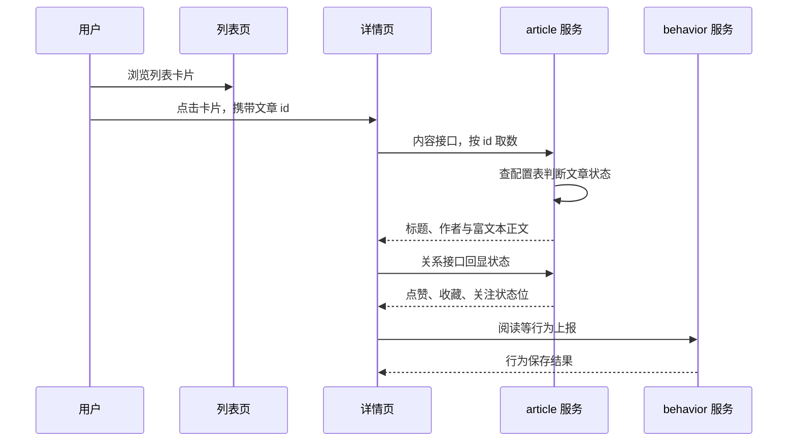

# 点开文章卡片之后：详情页的需求构成与加载链路

> 🔒 安全提示：文中示例的口令/密钥均为课程教学环境演示口径，生产环境的安全要求见《安全与合规须知》。

列表页已经能刷，用户点开一张卡片，接下来发生什么全在详情页。这一课做 App 文章详情的需求分析：页面由什么组成、哪些功能做哪些不做、状态怎么回显、从列表点进来的加载链路有多长。需求分析课不写一行实现代码，但边界在这里画不清楚，后面的接口就会越写越散。

## 先给结论

- 详情页四栏加一排按钮：导航栏（返回、收藏、更多）、标题栏、作者栏（头像、名称、发布时间、关注按钮）、内容栏；下方是点赞、不喜欢、微信、朋友圈、评论、收藏、转发等行为按钮，再往下还有猜你喜欢等内容区。
- 功能边界六条：关注、收藏、喜欢、不喜欢按登录态演示；分享转发只记行为不做跳转；阅读完全实现；富文本展示（文字样式与图片高度）；后台文章状态检查（已删除不返回正文）；评论暂不实现。
- 状态回显独立成文章关系接口：是否点赞、是否收藏、是否关注，随详情一起返回，不能等用户点了才查。
- 详情是读多写少的典型场景，每次现查正文大字段与多张行为表，高频访问下必然吃紧，静态化是这条链路的提速方向。

## 详情页长什么样：四栏与一排按钮

页面构成按 UI 原型图拆。原型图的入口交代得很清楚：列表页点某一条文章，跳转到文章详情。这句话决定了详情接口的入参形态：一切从文章 id 开始。

进到详情页，从上到下分四栏。导航栏放返回按钮、收藏与更多的功能按钮；标题栏放文章的标题；作者栏放作者头像、名称、发布时间，以及是否关注，关注按钮可以高亮也可以不高亮，高亮表示已关注，不高亮表示未关注；内容栏放文章正文，正文下缘是一排行为按钮：点赞、不喜欢、分享到微信、分享到朋友圈、评论、收藏、转发。再往下是猜你喜欢这类延伸内容区。

每栏的数据来源不同，页面区域与存储的对应关系如下：

| 页面区域 | 展示内容 | 数据来源 |
|---|---|---|
| 导航栏 | 返回、收藏、更多按钮 | 收藏状态来自收藏行为表 |
| 标题栏 | 文章标题 | 文章主表 |
| 作者栏 | 头像、名称、发布时间、关注按钮 | 用户信息与关注行为表 |
| 内容栏 | 富文本正文 | 文章内容表 |
| 行为按钮区 | 点赞、评论、收藏、转发等 | 各行为表与文章配置表开关 |

这张对应表解释了为什么详情功能涉及那么多张表：页面看着简单，数据散在文章域、用户域、行为域三处，接口设计的核心工作就是把它们按场景归集。

## 功能边界：做哪些，不做哪些

需求清单把功能切成六块，每块的深浅都不一样，边界感是这个清单里最值钱的部分。

**关注、收藏、喜欢、不喜欢，按登录态演示。** 未登录的场景本期不做；登录用户可以关注作者、可以点赞也可以取消点赞、可以表态喜欢或不喜欢。

**分享、转发只记行为。** 微信与朋友圈两个分享按钮不会真的拉起分享平台选择，只把「用户产生了分享动作」记录下来。记录的目的在数据：行为是后面课程做推荐的铺垫，收集的就是这批参考数据。

**阅读功能完全实现。** 文章信息与图片信息都真实展示出来，不做阉割。

**文章内富文本展示。** 正文不只是纯文本：文字支持字体颜色、字号、加粗等常规样式，图片支持设置高度。内容以结构化数据存储，前端按结构渲染，而不是把 HTML 字符串原样直出：

```json
{
  "content": [
    { "type": "text", "value": "分片键选错，索引就白建了", "style": { "bold": true, "color": "#333333", "font_size": 18 } },
    { "type": "image", "value": "http://files.study-headline.com/a/cover.jpg", "height": 220 }
  ]
}
```

文本元素带样式属性、图片元素带高度，这是按画面线描述的样式能力补全的示例，具体结构以内容表实现课为准。

**后台文章状态检查。** 详情返回正文之前先查文章配置表的状态，文章已被删除的，返回「当前文章已被删除」的提示，不再返回正文内容。检查动作前置在查询链路最前面。

**评论暂不实现。** 评论按钮在页面上占位，功能本期不做；核心目标先把文章完整展现出来。

## 行为回显：关系接口为什么单独存在

用户进入详情页的第一眼，页面就要告诉他状态：当前文章我是不是点过赞、收没收藏、关没关注作者。这些状态必须随详情数据一起回来，不能等用户点了按钮再去查询。回显的数据不在一张表里：点赞状态在点赞行为表，收藏状态在收藏表，关注状态在关注表，查询的共同前提是「行为实体加文章 id」这组定位条件，行为实体决定了当前是谁（登录用户或设备）在看。

回显走独立的文章关系接口，与文章内容接口分开。分开的理由有三条：两者读的表不同；变动频率不同，正文几乎不变而关系状态随时变；分开之后前端也能并行请求。关系回显的出参按状态位组织（示例按本课写法补全）：

```java
package com.study.headline.model.article.dtos;

/**
 * 文章关系回显出参：当前行为实体与文章的关系状态
 * 状态位取值 0 否 1 是，示例按本课写法补全
 */
public class ArticleRelationDto {
    private Long articleId;       // 文章 id
    private Integer islike;       // 是否已点赞
    private Integer isunlike;     // 是否已表态不喜欢
    private Integer iscollection; // 是否已收藏
    private Integer isfollow;     // 是否已关注作者
}
```

回显与提交也分了工：查询走关系接口，写入走各行为接口，读写模型不同，互不复用。

## 加载链路与性能诉求：静态化为什么被提上日程

把从点卡片到状态落库的整条链路画出来：



链路走完一遍的成本要算清楚：内容接口要查配置表做状态检查、查内容表取正文大字段；关系接口要按行为实体扫多张行为表；行为接口再把阅读、展示动作写回去。一次详情等于多次读加至少一次写。而详情页是典型的读多写少：正文发布之后基本不变，访问量却随推荐持续放大，每次请求都现查现组装，数据库的负担全压在最热的读路径上。

这正是静态化要解决的问题：把「模板加数据」提前渲染成静态页面，发布时渲染一次，之后所有请求直接返回静态文件，数据库不再站在详情读路径上。静态化属于后续课程的提速改造，需求分析阶段先把性能诉求立住：链路里哪些读是每次重复的、哪些数据是不变的，改造空间就在哪里。

## 与列表页的衔接

详情不是孤岛。列表卡片返回的字段里已经带了文章 id，且按 jackson 全局序列化规则把长整型 id 混淆成字符串传输，避开前端 JavaScript 的数值精度上限；点卡片时 id 传给详情页，详情接口按 id 取数。列表侧重快刷，字段裁剪到信息流卡片够用；详情侧读取透，正文、状态、行为一次归集，两页共用一套文章主表数据、接口各自裁剪。行为链也在两页之间连续：展示行为在列表页就已落库，进详情后阅读行为接续上报，推荐侧拿到的才是完整的浏览轨迹。

## 常见误区

- **把评论按钮做成必须实现。** 需求明确评论暂不实现，按钮占位即可；把范围外的功能拉进本期，详情主线的接口开发会被拖住。
- **未登录用户也放行点赞收藏。** 本期行为功能按登录态演示，未登录给提示或引导登录；接口做隐式降级，状态语义就说不清了。
- **正文用 HTML 字符串直出。** 富文本以结构化数据存储，样式由前端按约定渲染；直出 HTML 既不可控样式，也把脚本注入的口子开在了正文里。
- **删除文章只改状态不拦详情。** 状态检查必须在返回正文之前查配置表，已删除的返回提示而不带正文；先把正文吐出去再提示，等于白传一遍大字段。

## 面试可能被问到的问题

1. 面试官追问：「详情页为什么要有一个单独的关系回显接口？」
   答：回显状态读的是行为表族，与正文内容的表、变动频率、失效特征都不同；分开后内容可以缓存得更激进，关系状态实时查，前端还能并行请求，两端互不拖累。
2. 面试官追问：「已删除的文章在详情链路里怎么拦截？」
   答：内容接口返回正文之前先查文章配置表的状态位，已删除的直接返回提示、不带正文。检查前置在查询链路最前面，避免无谓的大字段查询与带宽浪费。
3. 面试官追问：「分享转发只记行为不做功能，值得做吗？」
   答：值得，目的在数据。转发分享是用户对内容认可度的高权重信号，推荐侧需要这批特征；功能完整度可以后补，行为数据漏了就补不回来。
4. 面试官追问：「详情页的性能瓶颈在哪，怎么解？」
   答：瓶颈在每次请求都现查正文大字段加多张行为表，读多写少让重复查询被无限放大。方向是静态化：模板与内容在发布时渲染成静态页，请求直接返回静态资源，把数据库从热点读路径上摘下来；行为状态仍走实时接口。
5. 面试官追问：「列表页到详情页，文章 id 传输有什么要注意的？」
   答：主键是长整型，超出 JavaScript 安全整数范围会精度丢失，返回端要把 id 按全局序列化规则混淆成字符串，列表传详情时按字符串承载，详情接口再还原成数值查询。

## 配套资料

- 代码：`materials/code/05/头条day03/`。该日资料包解压结果为空（未含源码文件），正文 DTO 与内容结构示例按本课写法补全，页面构成与功能边界取自画面线讲义与原型描述。
- 代码：`materials/code/05/头条day02/`，mycat 配置四件套（schema.xml、rule.xml、server.xml、sequence_db_conf.properties）。详情链路涉及的文章表与行为表的分片口径可在 schema.xml 中核对。
- 环境：课程集群 node01~node03，MySQL root/123456。
