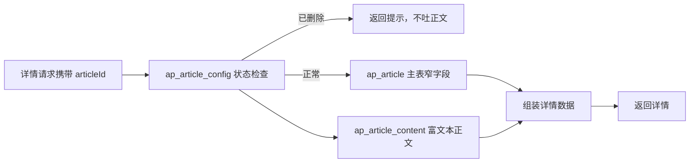

# 详情开工前的图纸：术语对齐、三表分工与接口契约

> 🔒 安全提示：文中示例的口令/密钥均为课程教学环境演示口径，生产环境的安全要求见《安全与合规须知》。

需求边界清楚之后，动手前还有一页图纸要过：本天反复出现的术语是什么意思、涉及的 12 张表怎么路由、四个工程谁干什么、六个接口怎么分组。这一课把定义一次对齐，后面写代码时不再回头解释概念。看着不复杂的一页，信息密度却是 day03 里最高的一课，值得课后反复翻。

## 先给结论

- 三个术语先钉牢：行为实体（产生行为的对象，登录用户或设备二选一，落 `ap_behavior_entry` 表）、ZKSEQUENCE（由 ZooKeeper 生成分布式自增主键）、DN（数据存储节点）。
- 文章三表分工：`ap_article` 存窄字段主数据，`ap_article_config` 存状态开关，`ap_article_content` 存富文本正文；三表同走 mod-long40 规则、40 个分片。
- 路由清单 12 张表：高频行为表主键走 zk_sequence 加 burst 分片，低频行为表主键走 mycat 加单库存放。
- 工程四件：article 与 behavior 已有，user 个人中心本天新建，service-mycat 已完成。
- 接口共六个：article 两个（内容、关系）、user 一个（关注）、behavior 三个（点赞、不喜欢、阅读）；收藏、转发、分享只记行为。

## 三个术语：行为实体、ZKSEQUENCE、DN

**行为实体。** 产生行为的对象，包括两部分：APP 的登录用户，或未登录时的设备信息。两类统一存在 `ap_behavior_entry` 表里，type 字段区分类型（0 终端设备、1 用户），entry_id 承载设备标识或用户 id，两者必须有一个有值。day01 做展示行为时这张表已经进场，详情页的所有行为（点赞、阅读、关注）都要先定位行为实体，再落到具体行为表。

**ZKSEQUENCE。** 让 ZooKeeper 帮项目生成分布式自增主键。为什么 burst 表需要它：burst 值由两段拼成，第一段是主键、第二段是行为维度的分片字段，主键必须先于数据存在且全局唯一，ZooKeeper 的顺序节点恰好提供这个保证。课程口径同样交代了备选方案：Redis、MyCat 也都能实现，选 ZK 出于负载均衡思想与实战演示的目的。

**DN。** data node 的缩写，数据的存储节点。同一个词在不同技术里指的东西不同：MyCat 语境里一个 DN 对应一个具体的物理库，比如 DNAP_0 到 DNAP_39 对应文章域的 40 个库，DNBE 系列对应行为域。路由表里「存放 DN」一列说的就是数据最终落在哪些库上。

术语里还有一组与页面形态相关：模板与静态化。模板是带占位符的页面骨架，静态化是用数据填充模板、提前渲染成静态页面的过程；详情页这种读多写少的场景是静态化的典型受益者，这组词在后续的性能改造课里会反复出现。

## 三表分工：一个文章为什么拆三张表

**`ap_article` 是主表**，装标题、作者、频道、发布时间这类窄字段，列表与详情共用，查询频率最高。**`ap_article_config` 是配置表**，装是否可评论、是否可转发、是否下架删除这些状态开关，字段少但决策重：详情入口的「文章已删除」检查，数据源就是它。**`ap_article_content` 是内容表**，装富文本正文，是典型的大字段宽表，只有详情场景才需要。

拆表的动机是读写特征不同：主表被列表高频扫，行越窄，一页能缓存的行越多；列表页完全用不到正文大字段，混进主表等于让每次列表查询都背着正文跑；配置状态的更新节奏与正文、主数据都不同步，独立成表互不干扰。三表同走 mod-long40 规则、40 个分片，主键由 MyCat 全局序列发放（schema.xml 中 autoIncrement 为 true），口径与 day02 一致。三表的关键字段节选（示例按本课写法补全）：

```sql
create table ap_article (          -- 主表：窄字段，列表与详情共用
    id           bigint primary key,
    title        varchar(100),     -- 标题
    author_id    bigint,           -- 作者 id
    channel_id   bigint,           -- 频道 id
    publish_time datetime          -- 发布时间
);
create table ap_article_config (   -- 配置表：状态开关
    id          bigint primary key,
    article_id  bigint,
    is_comment  tinyint,           -- 是否可评论
    is_forward  tinyint,           -- 是否可转发
    is_down     tinyint            -- 是否下架删除，详情入口检查它
);
create table ap_article_content (  -- 内容表：富文本正文
    id          bigint primary key,
    article_id  bigint,
    content     longtext           -- 富文本，按结构化数据存储
);
```

三张表与详情读路径的关系如下：



关键路径在配置表这一站：状态检查不过关，后面两张表根本不用查。

## 路由定义：12 张表的分片与主键口径

详情功能涉及 12 张表，其中 10 张的路由定义如下（取自讲义路由表）：

| 表 | 用途 | 主键方式 | 量级 | 分表量 | 存放 DN | 分表字段 |
|---|---|---|---|---|---|---|
| ap_user_fan | 用户粉丝 | zk_sequence | 1 亿 | 40 | DN[0-39] | burst=(id_behav) |
| ap_collection | 收藏行为 | zk_sequence | 100 万 | 50 | DN[0-49] | burst=(id_behav) |
| ap_likes_behavior | 点赞行为 | zk_sequence | 500 万 | 50 | DN[0-49] | burst=(id_behav) |
| ap_behavior_entry | 行为实体 | zk_sequence | 200 万 | 50 | DN[0-49] | burst=(id_behav) |
| ap_read_behavior | 阅读行为 | zk_sequence | 2000 万 | 50 | DN[0-49] | burst=(id_behav) |
| ap_unlikes_behavior | 不喜欢行为 | mycat | 100 万 | 1 | DN[0] | entry_id |
| ap_follow_behavior | 关注行为 | mycat | 200 万 | 1 | DN[1] | entry_id |
| ap_share_behavior | 分享行为 | mycat | 100 万 | 1 | DN[2] | entry_id |
| ap_forward_behavior | 转发行为 | mycat | 100 万 | 1 | DN[7] | entry_id |
| ap_article_config | 已发布文章配置 | mycat | - | 40 | DN[0-39] | id |

其余两张：`ap_article_content` 与主表同规则同分片；`ap_user_follow` 按 burst4040 规则分片，表配置未接入 MyCat 自动序列，主键由应用侧发放。口径归纳成两条。**第一，高频行为表用 zk_sequence 主键加 burst 分片。** 点赞、阅读这类写入洪峰表，主键来自 ZooKeeper 序列，burst 值由主键与行为维度字段拼出，把同一实体的行为路由到同一批片。**第二，低频行为表用 mycat 主键加单库。** 不喜欢、分享、转发的量级单个库装得下，不必分片，主键由 MyCat 全局序列发放。`burst=(id_behav)` 的记法沿用讲义原样：burst 值两段式，第一段是行主键，第二段是业务维度的分片字段，与 day02 的 burst 约定一致。

## 工程定义：四个工程各司其职

**leadnews-article，文章微服务，已有。** 详情的内容接口与关系接口落在这里。**leadnews-behavior，行为采集微服务，已有。** 点赞、不喜欢、阅读等行为保存落在它身上。**leadnews-user，个人中心微服务，本天新建。** 关注与取消关注动作属于用户域，这个工程此前不存在，本天按既有工程模板创建。**service-mycat，MyCat 配置管理工程，已完成。** 维护路由与序列配置，本次开发不用再管。

前三个是本次功能的主力，工程边界即依赖边界：行为不进文章服务，关注不进行为服务，跨域调用走契约。

## 接口定义：六个接口与契约先行

后端要开发的接口共六个，按域分三组。文章服务两个：加载文章内容（查配置表判断状态、查内容表取正文）与加载文章关系（行为实体与文章的关系回显）；个人中心服务一个：提交关注或取消关注；行为服务三个：点赞、不喜欢、阅读的收集。收藏、转发、分享只记行为，并入行为采集的范围，为后续推荐攒特征数据。

契约先行，契约接口按域命名：ArticleClient、UserClient、BehaviorClient，挂 apis 层，由对应微服务落地实现，与列表功能时期 BehaviorControllerApi 的契约惯例一脉相承。文章域契约的骨架（示例按本课写法补全）：

```java
package com.study.headline.article.apis;

import com.study.headline.model.article.dtos.ArticleContentDto;
import com.study.headline.model.article.dtos.ArticleRelationDto;
import com.study.headline.model.common.dtos.ResponseResult;

/**
 * 文章域接口契约：详情页的两个读接口
 * 契约先行，实现落在 leadnews-article 的控制器层
 */
public interface ArticleClient {

    /** 加载文章内容：先查配置表状态，已删除不返回正文 */
    ResponseResult<ArticleContentDto> loadArticleContent(Long articleId);

    /** 加载文章关系：回显点赞、不喜欢、收藏、关注状态 */
    ResponseResult<ArticleRelationDto> loadArticleRelation(ArticleRelationDto dto);
}
```

契约定了，前端与调用方就能并行开工，mapper、service 的实现属于后面的步骤。

## 常见误区

- **正文混进主表。** content 是大字段，塞进 `ap_article` 会让列表查询背着正文跑，带宽与缓存全被拖垮；正文必须独立成内容表，按需查询。
- **状态开关散落主表。** 是否可评论、是否删除这些决策字段混在主表字段堆里，状态检查每次都要扫主表；独立配置表让检查一个索引查询完成，也让运营操作与内容数据解耦。
- **行为实体不分设备与用户。** 未登录设备的行为也是数据，`ap_behavior_entry` 用 type 区分、entry_id 统一承载；丢了设备维度，等于丢掉一大半行为画像。
- **先写实现再补契约。** 接口先立契约再落地，前端与调用方按契约并行开工；实现先行，联调期两边对不上字段就要返工。

## 面试可能被问到的问题

1. 面试官追问：「一个文章为什么要拆成三张表？」
   答：读写特征不同。主表窄字段服务列表高频扫描，内容表大字段只有详情需要，配置表状态独立变化；拆开后列表不用背正文、详情按需取大字段、状态检查走一张小表，缓存效率与更新互不干扰。
2. 面试官追问：「行为实体是什么，为什么要单独一张表？」
   答：行为实体是产生行为的对象，登录用户或未登录设备二选一，type 区分类型、entry_id 承载标识。单独成表是为了把「谁」与「做了什么」解耦：所有行为表都通过行为实体定位主体，设备与用户两套身份统一成一个维度。
3. 面试官追问：「路由表里 zk_sequence 与 mycat 两种主键方式怎么选？」
   答：按写入量级与分片需求。点赞、阅读、收藏这类高频且按 burst 分片的表，主键必须先于路由存在且全局唯一，走 ZooKeeper 序列；不喜欢、分享、转发量级小、单库可容，直接用 MyCat 全局序列，少一个中间件依赖。
4. 面试官追问：「DN 在 MyCat 里指什么，和分片是什么关系？」
   答：DN 即 data node，一个 DN 对应一个具体物理库，如 DNAP_0 到 DNAP_39 是文章域的 40 个库；分片规则决定一行数据路由到哪个 DN，DN 是路由的落点，分片是路由的算法。
5. 面试官追问：「为什么 user 微服务要单独新建？」
   答：关注与取消关注属于用户域能力，文章与行为两个服务承接不了粉丝关系的领域逻辑；独立成服务才能让用户数据独立演进与伸缩，跨域只通过契约接口交互，避免服务间直接摸库。

## 配套资料

- 代码：`materials/code/05/头条day03/`。该日资料包解压结果为空（未含源码文件），路由表数据取自画面线讲义表格，契约与 DDL 示例按本课写法补全。
- 代码：`materials/code/05/头条day02/`，mycat 配置四件套（schema.xml、rule.xml、server.xml、sequence_db_conf.properties）。文章三表的 mod-long40 分片、autoIncrement 配置与行为表的 burst 规则均可在其中核对。
- 环境：课程集群 node01~node03，MySQL root/123456。
