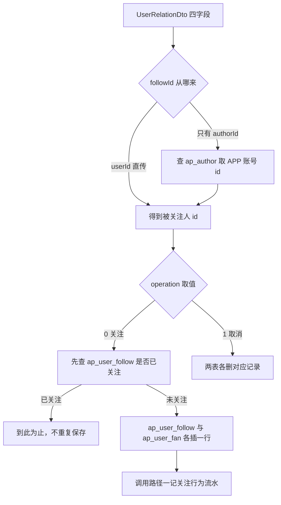
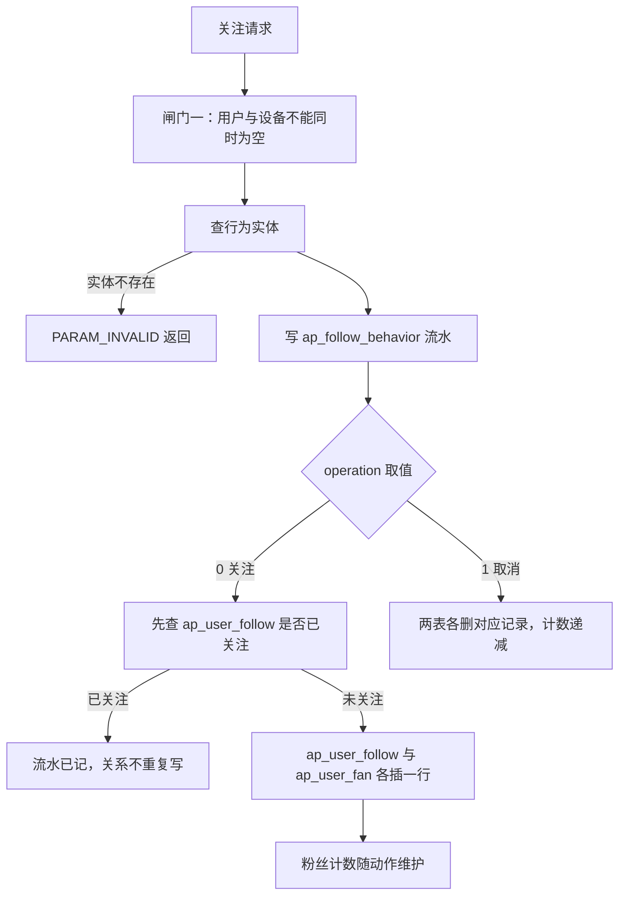
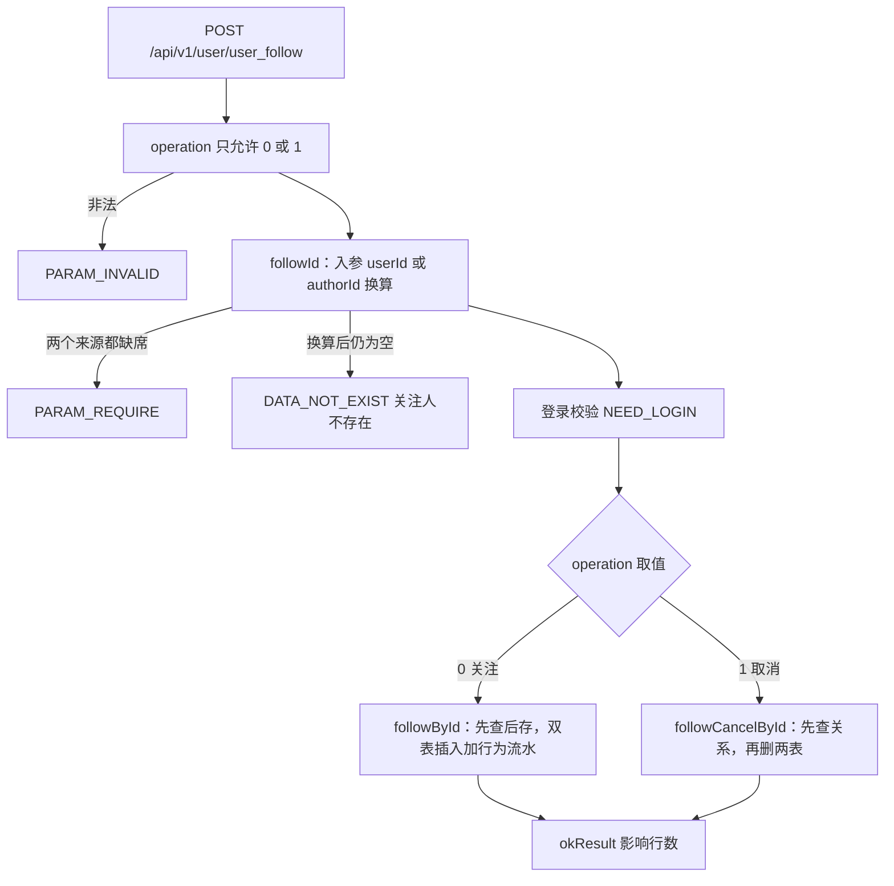

# app 文章详情之关注接口：user 模块搭建、行为流水保存与关注操作全链路

> 🔒 安全提示：文中示例的口令/密钥均为课程教学环境演示口径，生产环境的安全要求见《安全与合规须知》。

## 先给结论

- 三篇内容完成关注接口：user 工程创建及接口思路分析、关注行为保存代码、关注操作与 mapper 接口编写。
- 关注落在新建的 leadnews-user 微服务（端口 9005），工程从既有微服务整体复制，依赖 model、common、apis 三个共享模块。
- 一个接口两条数据路径：记行为是往 `ap_follow_behavior` 插一条流水，变更关系是 `ap_user_follow` 与 `ap_user_fan` 两表联动。
- 两张关系表互为镜像、user_id 语义相反：关注表装登录人、粉丝表装被关注人，都按 burst4040 路由，探测值按各自的分片主体重拼，不能复用。
- 流水表单库单表、主键走 MyCat 全局序列，insert 不写 id 列；关系表没配自增，主键由 ZooKeeper 序列在应用侧生成并手工拼 burst。
- follow 入口五道关卡：operation 取值校验、被关注人 id 两条来路、先查后存防重复、成对写入两表、非法值统一 PARAM_INVALID。
- 幂等靠先查后存：重复关注返回已关注，未关注取关返回未关注；行为流水只记不删，取关不动它。
- 行为保存用线程池加 `@Async` 异步化，保存失败不再拖垮关系落库；端点为 POST /api/v1/user/user_follow。

## 第1部分：关注接口开工：leadnews-user 工程落地与关注的两条数据路径

详情页作者栏上有一颗关注按钮，点了它，前后端各自要动的地方比看起来多：这个动作属于用户域，而到今天为止的四个工程里还没有用户中心；一次关注请求既要在行为域记一笔流水，又要在用户域改两组关系。动手前先把两件事办了，一是把承载它的 leadnews-user 工程按模板立起来，二是把接口的落库路径在纸面上走通，代码才有处可放。

### 关注为什么住在 user 工程

领域归属先说清。文章详情的两个读接口（内容、关系）都长在 article 服务里，行为上报归 behavior 服务，而关注与取消关注改变的是用户与用户之间的关系，属于用户域的能力，文章与行为两个服务都承接不了粉丝关系的逻辑。工程四件里 user 个人中心此前不存在，这一课按既有微服务的模板新建，命名为 leadnews-user。

建工程是纯体力活，但清单要背下来，新微服务的动作永远是同一套：

```xml
<dependencies>
    <!-- 内部三模块：实体与 pojos、通用装配、接口定义 -->
    <dependency>
        <groupId>com.study</groupId>
        <artifactId>leadnews-model</artifactId>
    </dependency>
    <dependency>
        <groupId>com.study</groupId>
        <artifactId>leadnews-common</artifactId>
    </dependency>
    <dependency>
        <groupId>com.study</groupId>
        <artifactId>leadnews-apis</artifactId>
    </dependency>

    <dependency>
        <groupId>org.springframework.boot</groupId>
        <artifactId>spring-boot-starter-web</artifactId>
        <exclusions>
            <exclusion>
                <groupId>org.springframework.boot</groupId>
                <artifactId>spring-boot-starter-logging</artifactId>
            </exclusion>
        </exclusions>
    </dependency>
    <dependency>
        <groupId>org.springframework.boot</groupId>
        <artifactId>spring-boot-starter-test</artifactId>
        <scope>test</scope>
    </dependency>
    <dependency>
        <groupId>com.fasterxml.jackson.dataformat</groupId>
        <artifactId>jackson-dataformat-xml</artifactId>
    </dependency>
</dependencies>
```

配置文件从 article 工程拷贝：工程根目录三份环境参数文件（maven_dev、maven_test、maven_prod，构建期 filtering 替换日志占位符），resources 下 application.properties 与 log4j2.xml。拷完必改两处，端口与应用名，值从 common 工程 config 目录的统一清单里抄，user 分配到 9005：

```properties
server.port=9005
spring.application.name=leadnews-user
```

包结构与引导类照模板落位，controller 预留 v1 子包：

```text
com.study.headline.user
├── UserApplication           // 引导类
├── config                    // MysqlConfig
├── service                   // 业务代码，实现类进 service.impl
└── controller
    └── v1                    // 对外接口，版本号入包名
```

```java
package com.study.headline.user;

import org.springframework.boot.SpringApplication;
import org.springframework.boot.autoconfigure.SpringBootApplication;

@SpringBootApplication
@EnableDiscoveryClient
public class UserApplication {

    public static void main(String[] args) {
        SpringApplication.run(UserApplication.class, args);
    }
}
```

数据源与 MyBatis 装配复用 common，config 包里放一个入口类，把 common 的 mysql.core 包显式扫进来：

```java
package com.study.headline.user.config;

import org.springframework.context.annotation.ComponentScan;
import org.springframework.context.annotation.Configuration;

@Configuration
@ComponentScan("com.study.headline.common.mysql.core")
public class MysqlConfig {
}
```

`@ComponentScan` 引入的 mysql.core 里有 Hikari 数据源、SqlSessionFactory、事务三件套，`@MapperScan` 指向 model 工程的 mappers 包，user 的 service 之后直接注入行为实体、作者相关的 Mapper 就能查库。启动 `UserApplication`，日志出现 Hikari 池初始化，工程就算立住了。IDE 里新模块偶发不变色，Maven 面板 reimport 一次即可。

### 一个接口两条路径：行为流水与关系变更

接口的入参 DTO 先立出来（按画面线补全，字段挂混淆注解）：

```java
package com.study.headline.model.user.dtos;

@Data
public class UserRelationDto {
    // 文章作者 id
    @IdEncrypt
    Integer authorId;
    // 用户 id，未登录场景可能为空
    @IdEncrypt
    Integer userId;
    // 文章 id
    @IdEncrypt
    Integer articleId;
    // 操作方式：0 关注，1 取消
    Short operation;
}
```

一次关注请求进来，数据上要发生两件事，拆成两条路径。**路径一是记行为。** 「某实体在文章页点了关注」是一条行为流水，入参对应另一个轻量 DTO：设备 id、文章 id、被关注人 id，实现是老套路两步，先按设备 id 或登录人 id 查行为实体，再往 `ap_follow_behavior` 表插一行。这条路径与列表页时期的展示行为保存同构，为推荐攒特征数据的口径也一致。

**路径二是变更关系。** 关注与取消关注落在 `ap_user_follow` 与 `ap_user_fan` 两张表上：关注时两表各插一行，取消时两表各删一行；插入前先查 `ap_user_follow` 是否已有记录，查到即已关注，不再重复保存。两条路径的汇流关系如下：



这张图讲的是关注接口内部的完整决策树。关键路径在两处：followId 的换算分支，决定了用户域与作者域怎么衔接；operation 分支，决定了两表是插入还是删除。记行为流水挂在关注分支末尾，取消关注不记正向流水。

### 两张关系表的方向：别把 user_id 认错

两张表长得很像，方向却相反，这是关注功能最容易错的地方：

| 表 | user_id 存谁 | 另一列存谁 | 语义 |
|---|---|---|---|
| ap_user_follow | 登录人 | follow_id，被关注的人 | 我关注了谁 |
| ap_user_fan | 被关注的作者 | fan_id，登录人 | 谁关注了我 |

同一动作写两行，视角互补：关注表以「我」为主语查「我关注的人」，粉丝表以「作者」为主语查「关注我的人」，作者的粉丝列表、互关判断都从粉丝表出。列名里有个历史包袱，关注表的 follow_id 语义是被关注人，理解时按语义走，别按字面猜。两张表都走 burst4040 规则、40 分片，主键由应用侧发放，路由配置里没有接入 MyCat 自动序列，写库时主键与 burst 的拼装责任在代码，这批规则在 day02 的 mycat 配置里能逐表核对。

### 跨模块边界：直接依赖共享 model

思路落成代码时有个跨模块问题要想清楚：user 服务要查行为实体，`ApBehaviorEntryMapper` 却诞生在行为功能的时期。答案在工程分层里，Mapper 接口全部住在共享的 model 工程，article、behavior、user 三个服务依赖同一个 model，谁需要谁注入，不涉及远程调用。服务间的契约接口（挂 apis 层、controller 落地实现）留给跨服务交互的场景，本课的关注接口自始至终在同一台服务内完成查实体、写流水、改关系三件事。controller 与 HTTP 注解按契约先行的节奏放在关注操作实现完之后统一补，先把 service 层写通，下一课从关注行为保存开始落码。

## 第2部分：关注行为落库：行为实体定位与 ap_follow_behavior 写入

关注接口的思路铺完之后，第一块代码是关注行为保存：用户点了关注，先在他的行为流水里记一笔。这块代码不大，一个 Mapper 加一个 service，但走完了行为落库的完整标准流程：两道参数闸门、行为实体定位、流水组装、单条插入，后面点赞、不喜欢、阅读的保存全是这套动作的重复。把第一遍走扎实，剩下的都是复制粘贴级别的活。

### 只记流水的表：ap_follow_behavior

这张表的定位先摆正：它回答「用户在什么时候对哪个作者的关注动作发生过」，一行动作一条，只增不改。列结构四件套加主键：`entry_id` 存行为实体 id（谁点的），`article_id` 存文章 id（在哪篇文章点的），`follow_id` 存被关注人 id（关注了谁，即作者的 APP 账号 id），`created_time` 记动作时间。主键 id 不由应用生成，路由配置里这张表挂了 MyCat 全局序列（autoIncrement 为 true，单节点 DNBE_1），insert 时省略 id 列，序列号由 MyCat 统一发放，应用侧也不用拼 burst，单库没有分片键的负担。day02 的 schema.xml 里这条 table 定义可以直接核对。

Mapper 接口只有一个 insert（day03 资料包未含源码文件，代码按画面线补全，包名统一为 `com.study.headline`）：

```java
package com.study.headline.model.mappers.app;

import com.study.headline.model.behavior.pojos.ApFollowBehavior;

public interface ApFollowBehaviorMapper {

    /** 保存关注行为流水 */
    int insert(ApFollowBehavior record);
}
```

```xml
<mapper namespace="com.study.headline.model.mappers.app.ApFollowBehaviorMapper">

    <resultMap id="BaseResultMap" type="com.study.headline.model.behavior.pojos.ApFollowBehavior">
        <id column="id" property="id"/>
        <result column="entry_id" property="entryId"/>
        <result column="article_id" property="articleId"/>
        <result column="follow_id" property="followId"/>
        <result column="created_time" property="createdTime"/>
    </resultMap>

    <insert id="insert" parameterType="com.study.headline.model.behavior.pojos.ApFollowBehavior">
        insert into ap_follow_behavior (entry_id, article_id, follow_id, created_time)
        values (#{entryId}, #{articleId}, #{followId}, #{createdTime})
    </insert>
</mapper>
```

insert 返回值是影响行数，service 层拿它当保存成功的凭证。列清单里没有 id，也没有 burst，这是这张表与收藏、点赞两批分片表最大的不同：单库单表，写入侧少管两件事。

### Service：两道闸门之后才准落库

接口与实现类都在 user 工程的 service 包下，先立接口：

```java
package com.study.headline.user.service;

import com.study.headline.model.behavior.dtos.FollowBehaviorDto;
import com.study.headline.model.common.dtos.ResponseResult;

public interface AppFollowBehaviorService {

    /** 存储关注行为数据 */
    ResponseResult saveFollowBehavior(FollowBehaviorDto dto);
}
```

入参 `FollowBehaviorDto` 三个字段：设备 id、文章 id、被关注人 id，挂混淆注解。实现类把流程走全：

```java
package com.study.headline.user.service.impl;

import com.study.headline.model.behavior.dtos.FollowBehaviorDto;
import com.study.headline.model.behavior.pojos.ApBehaviorEntry;
import com.study.headline.model.behavior.pojos.ApFollowBehavior;
import com.study.headline.model.common.constants.AppHttpCodeEnum;
import com.study.headline.model.common.dtos.ResponseResult;
import com.study.headline.model.user.pojos.AppUser;
import com.study.headline.model.mappers.app.ApBehaviorEntryMapper;
import com.study.headline.model.mappers.app.ApFollowBehaviorMapper;
import com.study.headline.user.service.AppFollowBehaviorService;
import com.study.headline.utils.threadlocal.AppThreadLocalUtils;
import org.springframework.beans.factory.annotation.Autowired;
import org.springframework.stereotype.Service;

import java.util.Date;

@Service
@SuppressWarnings("all")
public class AppFollowBehaviorServiceImpl implements AppFollowBehaviorService {

    @Autowired
    private ApBehaviorEntryMapper apBehaviorEntryMapper;
    @Autowired
    private ApFollowBehaviorMapper apFollowBehaviorMapper;

    @Override
    public ResponseResult saveFollowBehavior(FollowBehaviorDto dto) {
        //1. 根据设备 id 或登录人 id 查行为实体
        AppUser user = AppThreadLocalUtils.getUser();
        if (user == null && dto.getEquipmentId() == null) {
            return ResponseResult.errorResult(AppHttpCodeEnum.PARAM_REQUIRE);
        }
        Long userId = null;
        if (user != null) {
            userId = user.getId();
        }
        ApBehaviorEntry apBehaviorEntry = apBehaviorEntryMapper
                .selectByUserIdOrEquipment(userId, dto.getEquipmentId());
        if (apBehaviorEntry == null) {
            return ResponseResult.errorResult(AppHttpCodeEnum.PARAM_INVALID);
        }
        //2. 组装关注行为并保存
        ApFollowBehavior alb = new ApFollowBehavior();
        alb.setEntryId(apBehaviorEntry.getId());
        alb.setArticleId(dto.getArticleId());
        alb.setFollowId(dto.getFollowId());
        alb.setCreatedTime(new Date());
        int insert = apFollowBehaviorMapper.insert(alb);
        return ResponseResult.okResult(insert);
    }
}
```

两道闸门的区别值得咬文嚼字。第一道 `PARAM_REQUIRE` 拦的是「缺参数」：登录态与设备 id 同时缺席，行为实体无从定位，这是请求自身不完整。第二道 `PARAM_INVALID` 拦的是「参数无效」：请求参数齐全，但按它们查不出行为实体，说明这个设备或用户从未进入过行为体系，实体记录不存在，写流水没有挂靠点。前者是请求格式问题，后者是数据状态问题，分开编码便于前端与排查时区分处理。

实现里还有一个复用痕迹：查实体、判空、`userId` 局部变量三段代码与行为域的既有写法完全同构，用户 id 判空后传 null 让 Mapper 走设备分支，这个动作从展示行为保存一路沿用过来。行为实体查到后，四个字段组装，时间取应用时钟 `new Date()`，单条插入，`okResult` 带上影响行数返回，方法就算写完了。

### 流水之后的账：事务、幂等与计数

流水落库只是关注链路的第一步，把整条链路画出来，剩下的部分思路课已经立好骨架：



这张图讲的是关注行为与关注操作的接续关系，本课的代码覆盖到流水写入这一段。三件事留给关注操作实现，思路先立在这里。**第一是事务边界。** 关系变更要同时写 `ap_user_follow` 与 `ap_user_fan` 两行，取关要同时删两行，两笔写必须同生共死，事务注解圈在关系变更的方法上；流水插入自身单条语句自动提交即可，若与关系变更在同一请求内完成，也可以并入同一个事务，让流水与关系一致翻转。**第二是幂等。** 流水表不做查重，同一用户连点两次关注就是两条流水，这与流水「忠实记录动作」的定位一致；关系的幂等靠先查后存实现，已关注就不再插入，查询与插入之间若要挡住并发窗口，还要靠两表数据的唯一性兜底，取关同理，不存在就什么都不删。**第三是计数。** 页面上常驻的粉丝数属于读多写少的冗余列，按读优化的常规做法在动作发生时同步加减，量级与一致性要求上来后可改成异步汇总，具体字段以表结构实现为准，本课资料包未含该表 DDL，不展开到字段级。

## 第3部分：关注与取关全链路：双表一致性、幂等控制与异步行为改造

关注按钮是社交功能里最典型的一对写操作：一次点击，后端不是记一行，而是两张互为镜像的关系表各落一行，再补一条行为流水。方向感稍有偏差就会出事，关注表的 `user_id` 装登录人，粉丝表的 `user_id` 装被关注人，两张表还都按 burst 分了 40 个片，探测值拼错一张，刚写进去的数据就查不回来。取关那头同样有边界要处理，用户对着一个没关注过的人点取消，接口得体面地告诉前端「未关注」，而不是默默执行一次空删除。

关系落库是主账，行为流水是辅账。查询侧的 Mapper 雏形在关系接口一课已经建好，关注行为流水也在上一课单独落了表，本课把剩下的部分一次写完：两张关系表的插入与删除、`ApUserRelationService` 的关注与取关分支、controller 端点、MockMvc 联测，外加一处把行为保存异步化的改造。

### 两张镜像表：方向相反的 user_id

**第一，把两张表的分工说透。** `ap_user_follow` 回答「登录人关注了谁」，一行的形态是 `user_id` 装登录人、`follow_id` 装被关注人；`ap_user_fan` 回答「谁的粉丝名单里有我」，同一次动作在它那边是 `user_id` 装被关注人、`fans_id` 装登录人。一次关注两张表各落一行，谁也不含谁；所谓互相关注，就是「我关注他」的 follow 行与「他关注我」的 follow 行同时存在，粉丝表里对应两条镜像。列上还有 `follow_name` 与 `fans_name` 两个冗余名、`level` 关注级别、`is_display` 与两个屏蔽开关，本课全部取默认值写入，级别 0 表示普通关注。

**第二，路由配置决定了 Mapper 的形态。** day02 的 schema.xml 里两张表是同一行配置：dataNode 为 DNAP_$0-39，规则 burst4040，即按 burst 列路由、40 个分片、单组容量 4 亿。rule.xml 里 burst4040 的分片列就是 burst，而这两张表没有配 autoIncrement，主键不归 MyCat 管，由应用侧用 ZooKeeper 序列生成，insert 语句必须写 id 列。这与同日的流水表正好相反：`ap_follow_behavior` 挂 DNBE_1 且 autoIncrement，语句不写 id、不带 burst。顺带一提，被关注人存在性要查的 `ap_user` 走 mod-long40，按 id 取模分片且主键由序列发放，主键点查天然直达某个分片。

**第三，burst 探测值必须按分片主体重拼。** `BurstUtils.groupOne` 是变长参数工具，把传入的 id 按顺序用减号连成 burst 值，首段参与分组计算。存储侧首段是行主键；查询侧拿不到行主键，用分片主体的 id 补位，本课这些 id 都远小于单组容量 4 亿，首段无论取哪个都落在第一组，路由结果一致。四条拼法对照如下，方向写反是这一课最容易出的错：

| 动作 | 拼法 | 分片主体 |
|---|---|---|
| 存关注关系 | groupOne(关系id, 登录人id, 被关注人id) | 登录人 |
| 查、删关注关系 | groupOne(登录人id, 登录人id, 被关注人id) | 登录人 |
| 存粉丝记录 | groupOne(粉丝id, 被关注人id, 登录人id) | 被关注人 |
| 查、删粉丝记录 | groupOne(被关注人id, 被关注人id, 登录人id) | 被关注人 |

Mapper 接口三份，查询方法是关系接口一课建好的旧账，本课在同一份接口里补插入与删除（day03 资料包未含源码文件，代码按画面线与既有工程风格补全，包名统一为 `com.study.headline`）：

```java
package com.study.headline.model.mappers.app;

import com.study.headline.model.user.pojos.ApUser;
import com.study.headline.model.user.pojos.ApUserFan;
import com.study.headline.model.user.pojos.ApUserFollow;
import org.apache.ibatis.annotations.Param;

public interface ApUserFollowMapper {

    /** 按登录人、被关注人与探测值查关注关系（关系接口一课已建） */
    ApUserFollow selectFollowId(@Param("burst") String burst,
                                @Param("userId") Long userId,
                                @Param("followId") Integer followId);

    /** 保存关注关系 */
    int insert(ApUserFollow record);

    /** 按登录人与被关注人删除关注关系 */
    int deleteByFollowId(@Param("burst") String burst,
                         @Param("userId") Long userId,
                         @Param("followId") Integer followId);
}

public interface ApUserFanMapper {

    /** 按被关注人、粉丝与探测值查粉丝记录，查询必须带 burst */
    ApUserFan selectById(@Param("burst") String burst,
                         @Param("userId") Integer userId,
                         @Param("fansId") Long fansId);

    /** 按被关注人与粉丝删除粉丝记录 */
    int deleteByFansId(@Param("burst") String burst,
                       @Param("userId") Integer userId,
                       @Param("fansId") Long fansId);

    /** 保存粉丝记录 */
    int insert(ApUserFan record);
}

public interface ApUserMapper {

    /** 按主键查用户，验证被关注人是否真实存在 */
    ApUser selectById(@Param("id") Integer id);
}
```

映射文件同样是从既有文件拷贝改名而来，拷完固定核对三处：namespace 与接口全限定名一致、resultMap 的 type 与实体包路径一致、语句 id 与方法名逐字一致。XML 没有编译期检查，语句内容要到调用时才校验，这三处任何一处错都只会在运行期炸。粉丝表的 XML 三条语句齐全，查询与删除都带 burst：

```xml
<mapper namespace="com.study.headline.model.mappers.app.ApUserFanMapper">

    <resultMap id="BaseResultMap" type="com.study.headline.model.user.pojos.ApUserFan">
        <id column="id" property="id"/>
        <result column="user_id" property="userId"/>
        <result column="fans_id" property="fansId"/>
        <result column="fans_name" property="fansName"/>
        <result column="level" property="level"/>
        <result column="created_time" property="createdTime"/>
        <result column="is_display" property="isDisplay"/>
        <result column="is_shield_letter" property="isShieldLetter"/>
        <result column="is_shield_comment" property="isShieldComment"/>
        <result column="burst" property="burst"/>
    </resultMap>

    <sql id="Base_Column_List">
        id, user_id, fans_id, fans_name, level, created_time,
        is_display, is_shield_letter, is_shield_comment, burst
    </sql>

    <select id="selectById" resultMap="BaseResultMap">
        select <include refid="Base_Column_List"/>
        from ap_user_fan
        where burst = #{burst} and user_id = #{userId} and fans_id = #{fansId}
    </select>

    <delete id="deleteByFansId">
        delete from ap_user_fan
        where burst = #{burst} and user_id = #{userId} and fans_id = #{fansId}
    </delete>

    <insert id="insert" parameterType="com.study.headline.model.user.pojos.ApUserFan">
        insert into ap_user_fan (id, user_id, fans_id, fans_name, level, created_time,
            is_display, is_shield_letter, is_shield_comment, burst)
        values (#{id}, #{userId}, #{fansId}, #{fansName}, #{level}, #{createdTime},
            #{isDisplay}, #{isShieldLetter}, #{isShieldComment}, #{burst})
    </insert>
</mapper>
```

关注表的 XML 只补两条，查询语句沿用既有版本：

```xml
<insert id="insert" parameterType="com.study.headline.model.user.pojos.ApUserFollow">
    insert into ap_user_follow (id, user_id, follow_id, follow_name, level, created_time,
        is_display, is_shield_letter, is_shield_comment, burst)
    values (#{id}, #{userId}, #{followId}, #{followName}, #{level}, #{createdTime},
        #{isDisplay}, #{isShieldLetter}, #{isShieldComment}, #{burst})
</insert>

<delete id="deleteByFollowId">
    delete from ap_user_follow
    where burst = #{burst} and user_id = #{userId} and follow_id = #{followId}
</delete>
```

两个细节值得停在纸面上。**一是 `@Param` 不能省。** insert 只收一个实体参数，MyBatis 能按类型自动找到，注解可以不加；select 与 delete 都是三个参数，XML 里的 `#{}` 取的是 `@Param` 标注名，少标一个运行期就是取值失败的报错。**二是删除语句也带 burst 条件。** MyCat 靠 where 里的 burst 列把语句定向到单个分片，缺了它删除会被广播到全部 40 个分片，功能不出错，性能直接放大几十倍。

### follow 入口的五道关卡

service 接口 `AppUserRelationService` 与实现类 `AppUserRelationServiceImpl` 都在 user 工程，入口方法只有一个 `follow`。方法内部按五道关卡推进，先看全景：



这张图讲的是入口方法从校验到分流的完整决策链。关键路径在第二关与第三关：被关注人 id 的两个来源是或的关系，作者页场景前端只认识 authorId，作者域与用户域要靠 `ap_author` 的 `user_id` 打通；登录校验卡在关系变更之前，游客态可以记行为流水，但不能建关系。

```java
@Override
public ResponseResult follow(UserRelationDto dto) {
    //1. 校验 operation：0 关注，1 取消关注，其余一律无效
    if (dto.getOperation() == null || dto.getOperation() < 0 || dto.getOperation() > 1) {
        return ResponseResult.errorResult(AppHttpCodeEnum.PARAM_INVALID, "无效的 operation 参数");
    }
    //2. 取被关注人 id：入参 userId 优先，缺席时用 authorId 换算作者的 APP 账号 id
    Integer followId = dto.getUserId();
    if (followId == null && dto.getAuthorId() == null) {
        return ResponseResult.errorResult(AppHttpCodeEnum.PARAM_REQUIRE,
                "followId 或 authorId 不能同时为空");
    }
    if (followId == null) {
        ApAuthor apAuthor = apAuthorMapper.selectById(dto.getAuthorId());
        if (apAuthor != null) {
            followId = apAuthor.getUserId().intValue();
        }
    }
    if (followId == null) {
        return ResponseResult.errorResult(AppHttpCodeEnum.DATA_NOT_EXIST, "关注人不存在");
    }
    //3. 登录校验：关注操作只对登录用户开放
    AppUser user = AppThreadLocalUtils.getUser();
    if (user == null) {
        return ResponseResult.errorResult(AppHttpCodeEnum.NEED_LOGIN);
    }
    //4. 按 operation 分流，进入关注或取关分支
    if (dto.getOperation() == 0) {
        return followById(user, followId, dto.getArticleId());
    } else {
        return followCancelById(user, followId);
    }
}
```

三个错误码在这一个方法里分出了三个层次，值得对照着记。`PARAM_REQUIRE` 拦请求不完整，两个 id 来源同时缺席，查询无从发起；`DATA_NOT_EXIST` 拦数据状态，请求参数齐全但作者查不到、或作者没绑定 APP 账号，换算不出被关注人；`PARAM_INVALID` 拦取值非法，`operation` 越出 0 与 1 的范围属于请求语义错误。前端提示与后端排查各自能对号入座，这比笼统一律「参数错误」好用得多。

DTO 侧 `UserRelationDto` 挂在 model 工程的 user dto 包，`authorId`、`userId`、`articleId` 三个 id 字段都挂 `@IdEncrypt` 混淆注解，`operation` 是明文的操作位；实体上还带 `level`、`isNotice` 等展示字段，主链路用到的只有前四个。

### 关注分支：先查后存与成对写入

关注分支抽成私有方法 `followById`，入参是登录用户、被关注人 id 与文章 id，文章 id 只为给行为流水用。开写之前有一件配套工作：user 工程要用到 common 里的 ZooKeeper 序列封装，得先加一个配置类把包扫进来，否则 `Sequences` 注入直接报错：

```java
package com.study.headline.user.config;

import org.springframework.context.annotation.ComponentScan;
import org.springframework.context.annotation.Configuration;

@Configuration
@ComponentScan("com.study.headline.common.zookeeper")
public class SequenceConfig {
}
```

实现类里注入五个依赖：三个 Mapper、序列工具、以及上一课写好的 `AppFollowBehaviorService`。方法全貌如下：

```java
@Service
@SuppressWarnings("all")
public class AppUserRelationServiceImpl implements AppUserRelationService {

    @Autowired
    private ApUserFollowMapper apUserFollowMapper;
    @Autowired
    private ApUserFanMapper apUserFanMapper;
    @Autowired
    private ApUserMapper apUserMapper;
    @Autowired
    private ApAuthorMapper apAuthorMapper;
    @Autowired
    private Sequences sequences;
    @Autowired
    private AppFollowBehaviorService appFollowBehaviorService;

    /** 处理关注的逻辑：先查后存，两表成对写入，再记一条关注行为流水 */
    private ResponseResult followById(AppUser user, Integer followId, Integer articleId) {
        //1. 被关注人必须真实存在，按主键查 ap_user
        ApUser apUser = apUserMapper.selectById(followId);
        if (apUser == null) {
            return ResponseResult.errorResult(AppHttpCodeEnum.DATA_NOT_EXIST, "关注用户不存在");
        }
        //2. 查关注关系，已关注直接返回，保证幂等
        ApUserFollow apUserFollow = apUserFollowMapper.selectFollowId(
                BurstUtils.groupOne(user.getId(), user.getId(), followId),
                user.getId(), followId);
        if (apUserFollow != null) {
            return ResponseResult.errorResult(AppHttpCodeEnum.DATA_NOT_EXIST, "已关注");
        }
        //3. 粉丝表先查后存：user_id 装被关注人，fans_id 装登录人
        ApUserFan apUserFan = apUserFanMapper.selectById(
                BurstUtils.groupOne(followId, followId, user.getId()),
                followId, user.getId());
        if (apUserFan == null) {
            apUserFan = new ApUserFan();
            apUserFan.setId(sequences.sequenceApUserFan());
            apUserFan.setUserId(followId);
            apUserFan.setFansId(user.getId());
            apUserFan.setFansName(user.getName());
            apUserFan.setLevel((short) 0);
            apUserFan.setCreatedTime(new Date());
            apUserFan.setIsDisplay(true);
            apUserFan.setIsShieldLetter(false);
            apUserFan.setIsShieldComment(false);
            apUserFan.setBurst(BurstUtils.groupOne(apUserFan.getId(), followId, user.getId()));
            apUserFanMapper.insert(apUserFan);
        }
        //4. 保存关注行为流水：辅账，与关系主账互不阻塞（见后文异步改造）
        FollowBehaviorDto fdto = new FollowBehaviorDto();
        fdto.setFollowId(followId);
        fdto.setArticleId(articleId);
        appFollowBehaviorService.saveFollowBehavior(fdto);
        //5. 关注表组装并保存，返回影响行数
        apUserFollow = new ApUserFollow();
        apUserFollow.setId(sequences.sequenceApUserFollow());
        apUserFollow.setUserId(user.getId());
        apUserFollow.setFollowId(followId);
        apUserFollow.setFollowName(apUser.getName());
        apUserFollow.setLevel((short) 0);
        apUserFollow.setCreatedTime(new Date());
        apUserFollow.setIsDisplay(true);
        apUserFollow.setIsShieldLetter(false);
        apUserFollow.setIsShieldComment(false);
        apUserFollow.setBurst(BurstUtils.groupOne(apUserFollow.getId(), user.getId(), followId));
        int insert = apUserFollowMapper.insert(apUserFollow);
        return ResponseResult.okResult(insert);
    }
}
```

几处组装动作值得逐个过一遍。**被关注人存在性是第一道数据闸门。** 入参给的只是 id，人不存在就不该建关系，按主键查 `ap_user` 一行即可，名字也从这行里取，`follow_name` 装的是被关注人的名称。**两个查重是幂等的全部来源。** 关注关系查重放在最前面，命中直接返回「已关注」，错误码沿用 `DATA_NOT_EXIST`，语义上这是「状态已存在」而非「数据缺失」，课程按既有枚举顺手取用，前端只认 code 的话无碍；粉丝表再查一次是双保险，两张表可能出现单边残留，fan 已存在时跳过插入，避免同一动作写两行。**主键与 burst 都在应用侧生成。** 两张表没有 autoIncrement 配置，`sequences.sequenceApUserFan()` 与 `sequenceApUserFollow()` 各发一个 id，burst 用新 id 加两个坐标拼出，随 insert 一起落库。**行为流水在关系写入之前调用。** 同步阶段这个顺序意味着行为保存一抛异常，主逻辑的关系插入就被带崩，这正是后面异步改造要解决的问题。

### 取关分支：存在性前置与两步删除

取消关注不需要文章 id，也就不会写行为流水。分支方法 `followCancelById` 的思路与关注对称：先查关系定存在性，再成对删除。

```java
/** 处理取消关注的逻辑：关系存在才动删除，两张表成对清理 */
private ResponseResult followCancelById(AppUser user, Integer followId) {
    //1. 先查关注关系，未关注直接返回，不做无意义的删除
    ApUserFollow apUserFollow = apUserFollowMapper.selectFollowId(
            BurstUtils.groupOne(user.getId(), user.getId(), followId),
            user.getId(), followId);
    if (apUserFollow == null) {
        return ResponseResult.errorResult(AppHttpCodeEnum.DATA_NOT_EXIST, "未关注");
    }
    //2. 粉丝表先查后删，删除按 burst 定位分片
    int count = 0;
    ApUserFan apUserFan = apUserFanMapper.selectById(
            BurstUtils.groupOne(followId, followId, user.getId()),
            followId, user.getId());
    if (apUserFan != null) {
        count = apUserFanMapper.deleteByFansId(
                BurstUtils.groupOne(followId, followId, user.getId()),
                followId, user.getId());
        //3. 粉丝删除成功再删关注表，两表同生共死
        if (count == 1) {
            count += apUserFollowMapper.deleteByFollowId(
                    BurstUtils.groupOne(user.getId(), user.getId(), followId),
                    user.getId(), followId);
        }
    }
    return ResponseResult.okResult(count);
}
```

三个细节把这条分支钉牢。**存在性查询是第一动作。** 关系不存在直接返回「未关注」，错误码统一走 `DATA_NOT_EXIST`，前端据此把按钮状态拨回去。**删除分两步走且以粉丝表先行。** 粉丝记录先查后删，影响行数等于 1 才继续删关注表，两个删除动作绑成一对；若粉丝记录因历史脏数据缺失，关注行会滞留不删，这是成对校验的兜底盲区，工程上应交给事务与唯一约束收口。**行为流水不动。** `ap_follow_behavior` 回答的是「关注动作发生过没有」，流水只增不改，取关之后流水仍在，历史行为分析不因取关而断档。

### Controller 端点与 MockMvc 联测

端点分两层定义。API 接口放 user 工程的 apis 包，controller 实现它并挂上路径：

```java
package com.study.headline.user.apis;

import com.study.headline.model.common.dtos.ResponseResult;
import com.study.headline.model.user.dto.UserRelationDto;

public interface UserRelationControllerApi {

    /** 关注或取消关注 */
    ResponseResult follow(UserRelationDto dto);
}
```

```java
package com.study.headline.user.controller.v1;

import com.study.headline.user.apis.UserRelationControllerApi;
import com.study.headline.user.service.AppUserRelationService;
import org.springframework.beans.factory.annotation.Autowired;
import org.springframework.web.bind.annotation.*;

@RestController
@RequestMapping("/api/v1/user")
public class UserRelationController implements UserRelationControllerApi {

    @Autowired
    private AppUserRelationService appUserRelationService;

    @PostMapping("/user_follow")
    public ResponseResult follow(@RequestBody UserRelationDto dto) {
        return appUserRelationService.follow(dto);
    }
}
```

联测沿用行为接口的 MockMvc 套路：启动 user 服务的引导类，注入 `MockMvc` 与 `ObjectMapper`，在 `@Before` 里绕过真实登录、直接向 ThreadLocal 塞一个 id 为 1 的用户。两个用例分别覆盖关注与取关，差别只有 `operation` 一个字段：

```java
@RunWith(SpringRunner.class)
@SpringBootTest(classes = UserApplication.class)
@AutoConfigureMockMvc
public class UserRelationControllerTest {

    @Autowired
    private MockMvc mvc;
    @Autowired
    private ObjectMapper mapper;

    @Before
    public void setUp() {
        // 绕过真实登录，向 ThreadLocal 塞一个 id 为 1 的用户
        AppUser user = new AppUser();
        user.setId(1);
        AppThreadLocalUtils.setUser(user);
    }

    @Test
    public void testFollowAdd() throws Exception {
        UserRelationDto dto = new UserRelationDto();
        dto.setOperation(0);          // 0 关注，1 取消
        dto.setArticleId(1);
        dto.setAuthorId(1);
        MockHttpServletRequestBuilder builder =
                MockMvcRequestBuilders.post("/api/v1/user/user_follow");
        builder.contentType(MediaType.APPLICATION_JSON_VALUE)
                .content(mapper.writeValueAsString(dto));
        mvc.perform(builder)
                .andExpect(MockMvcResultMatchers.status().isOk())
                .andDo(MockMvcResultHandlers.print());
        Thread.sleep(10000);          // 留出异步行为保存的落库时间
    }
}
```

首跑就报了红色，异常栈顶是 MyBatis 的 insert 报错，顺着栈里的 `AppUserRelationServiceImpl.follow` 定位到粉丝表的 insert 语句，占位符 `#{burst}` 的井号写到了花括号外面。这类错误的隐蔽之处在于 XML 的语句内容启动期不校验，应用能正常起来，第一次调用才炸。把占位符写回 `#{burst}` 再跑，用例转绿，随后进数据库验收三张表：`ap_user_fan` 多出一行、`ap_user_follow` 多出一行、`ap_follow_behavior` 多出一行且 `article_id` 与 `follow_id` 无误。把 `operation` 改成 1 再跑取关用例，前两张表的那两行消失，行为流水原样保留，与分支设计完全对上。

### 代码改造：行为保存异步化

主链路跑通之后，还有一笔账要算。关注分支里行为保存与关系写入串在一条线程上，行为保存一旦抛异常，两张关系表的写入就被连带中断，而行为流水只是辅账，不该有这种杀伤力。改造分两步。

**第一步，建线程池并开启异步。** config 包下加一个配置类，池参数按行为保存这类短任务的量级给：

```java
package com.study.headline.user.config;

import org.springframework.context.annotation.Bean;
import org.springframework.context.annotation.Configuration;
import org.springframework.scheduling.annotation.EnableAsync;
import org.springframework.scheduling.concurrent.ThreadPoolTaskExecutor;

import java.util.concurrent.ThreadPoolExecutor;

@Configuration
@EnableAsync
public class ThreadPoolConfig {

    @Bean
    public ThreadPoolTaskExecutor threadPoolTaskExecutor() {
        ThreadPoolTaskExecutor executor = new ThreadPoolTaskExecutor();
        executor.setCorePoolSize(10);        // 核心线程数
        executor.setMaxPoolSize(100);        // 最大线程数
        executor.setQueueCapacity(50);       // 等待队列容量
        executor.setThreadNamePrefix("async-service-");   // 线程名前缀，便于日志排查
        executor.setRejectedExecutionHandler(new ThreadPoolExecutor.AbortPolicy());
        executor.initialize();
        return executor;
    }
}
```

`@EnableAsync` 是开关，缺了它后面的注解只是摆设。**第二步，把注解贴到行为保存方法上。** `AppFollowBehaviorServiceImpl.saveFollowBehavior` 的方法体一行不改，只在方法上加 `@Async`，调用方 `followById` 无需任何改动：

```java
@Async
@Override
public ResponseResult saveFollowBehavior(FollowBehaviorDto dto) {
    // 原方法体不动：两道闸门、实体定位、流水组装、insert
}
```

改造的验证方式是把问题放大：在 `saveFollowBehavior` 方法体里临时加一行 `int i = 1 / 0;`，这个除零异常必然抛出。跑关注用例，请求正常返回、测试转绿，库里 `ap_user_follow` 与 `ap_user_fan` 两行照常落库，只有行为表是空的。对比改造前，同样一行代码会把整条链路炸掉。异步线程里抛出的异常被线程池吞掉，主线程毫无感知，这正是「辅逻辑失败不影响主逻辑」想要的隔离效果，代价是行为保存的失败只剩日志可见，生产环境要配监控或补偿任务兜底。测试代码里那句 `Thread.sleep(10000)` 也是为这次改造服务的：用例主线程跑完就退出会把异步线程一起带走，留出等待时间才能在断言前看到行为落库。

顺带把事务这笔账结清。课程代码没有圈事务注解，两表插入的原子性靠执行顺序与先查后存的成对动作维持。工程上更稳妥的做法是给 `followById` 补 `@Transactional`，让两个 insert 同生共死；行为保存在事务之外，恰好与异步化互相成全，事务回滚不会波及流水，流水失败也不会让事务空等。

### 计数与互关：主链路之外的两笔账

主链路之外还有两笔常被问起的账。**一笔是粉丝与关注计数。** 页面上常驻的粉丝数、关注数属于读多写少的冗余列，常规做法是在动作发生时同步加减，量级与一致性要求上来后改成异步汇总；本课资料包未含对应表的 DDL，代码没有落到这一步，把「动作发生即计数维护」的口径先立住即可。**另一笔是互关判断。** 一次关注动作的双表写入天然把两个方向都落了行，互关的判定在查询侧组合状态位即可：关系接口的 `load_article_behavior` 已经给出了 isfollow，互关等于再反向确认一条「他关注我」的关系行，两条行都在才置位。写侧不做任何额外维护，这是镜像表设计换来的省力。

## 常见误区

- **两张关系表方向认反。** `ap_user_follow` 的 user_id 是登录人，`ap_user_fan` 的 user_id 是被关注的作者；方向写反，关注列表与粉丝列表的数据就互换了，且查重逻辑随之失效。
- **把取关做成改标记。** 关注与取消在两表上的实现是插入与删除，不是维护一个状态位；留着已删除的关系行，查重与计数都会被脏数据带偏。
- **复制模块漏改端口或应用名。** 端口冲突两个服务互相踩踏，应用名不一致会让后续按名寻址与注册中心列表对不上号；三份环境文件缺一份，对应 profile 打包即报错。
- **认为 followId 必须由前端直传。** 详情页手里只有 authorId，作者 APP 账号 id 要靠作者表换算得出；把两个来源都设计进路径，接口才不会在前端字段缺失时直接哑火。
- **游客态直接链式取用户 id。** `AppThreadLocalUtils.getUser()` 未登录返回 null，先判空再取 id 是固定动作；null 传进实体查询让 Mapper 自己走设备分支，不该在 service 里炸出空指针。
- **insert 里手写 id 或依赖数据库自增。** 这张表的主键由 MyCat 全局序列发放，语句里写 id 会绕开序列造成主键冲突风险；列清单与 values 必须同进同退，id 与 burst 都不出现在语句里。
- **把流水表当关系表用。** 判断是否已关注查的是关系表，数流水的行数会得到膨胀的答案；流水回答「发生过什么」，关系回答「现在是什么」，两个问题各查各的表。
- **忽略实体查不到的分支。** 设备首次使用且没走过实体创建链路时，行为实体查出来是 null，直接拿 `getId()` 拼参数就是空指针；第二道闸门必须在组装动作之前。
- **fan 与 follow 的参数方向写反。** 关注表 `user_id` 是登录人，粉丝表 `user_id` 是被关注人，两张表的 insert、select、delete 三个坐标全部相反。写代码前先回看路由定义确认分片主体，拼 burst 与传参都按主体来，写反了数据照样插入成功，查询时却怎么都查不到。
- **burst 表的 insert 手写数据库自增或不写 id。** 这两张表没有 autoIncrement 配置，主键必须由 `Sequences` 在应用侧生成并写进语句；漏掉 `SequenceConfig` 的包扫描，`Sequences` 注入直接报错，属于启动期就能暴露的问题。
- **删除语句不带 burst 条件。** MyCat 靠 where 里的 burst 列定向分片，缺了它 delete 广播到全部 40 个分片逐个执行，单次删除放大成四十次库访问，功能正确但性能塌方。
- **以为 `@Async` 加上就生效。** 异步开关 `@EnableAsync` 必须先开，且注解要加在被 Spring 管理的 bean 方法上由代理拦截；漏开开关时行为保存仍是同步执行，除零实验会把主逻辑一起炸掉，改造等于没做。

## 面试可能被问到的问题

1. 面试官追问：「关注功能为什么要单独建一个 user 微服务，挂在 article 服务里不行吗？」
   答：关注与取关是用户域的能力，粉丝关系的读写、后续个人中心的功能都会持续往这个域堆积。独立成服务让用户数据独立演进与伸缩，文章服务只按契约消费关系结果；混在文章服务里，域边界一塌，数据表与服务能力的耦合都会越来越深。

2. 面试官追问：「关注一张表不就够了，为什么拆成 follow 与 fan 两张？」
   答：两个查询方向的读写特征不同。关注列表按登录人查，粉丝列表按作者查，分表后各自的主语列就是查询条件，配合分片规则能把路由键落在查询列上；一张表服务两个方向必然有一侧全表扫，量级上来后代价极高。

3. 面试官追问：「一次关注请求为什么既要记行为流水又要改关系表？」
   答：两份数据服务两类消费方。流水表面向推荐与数据分析，回答「用户产生过什么动作」，只增不改；关系表面向页面状态与列表，回答「现在是什么关系」，随操作增删。读写模型不同，合并存储会让两类查询互相拖累。

4. 面试官追问：「被关注人的 id 是怎么确定的，前端只传作者 id 行吗？」
   答：行，但要换算。关注关系存的是用户域的账号 id，前端手里的 authorId 是作者域的主键，先查 `ap_author` 拿 user_id 字段里的 APP 账号 id 才能写关系表；前端直传 userId 的通道保留给已经持有账号 id 的场景，两个来源在服务端归一。

5. 面试官追问：「新建微服务的固定步骤有哪些，最容易漏什么？」
   答：建模块引依赖、拷三份环境文件与 application.properties、log4j2、建包结构与引导类、写 MysqlConfig 引入 common 装配、空链路验证。最容易漏的是改端口与应用名，以及 web starter 排除默认日志绑定，前者启动冲突，后者日志体系行为异常。

6. 面试官追问：「user 服务直接注入 model 工程里的 Mapper 查行为实体，算不算跨模块耦合？」
   答：Mapper 属于共享的数据访问层，与业务服务的分层关系是依赖指向共享层，不构成业务耦合；真正要避免的是服务之间互相依赖业务代码或直接摸对方的库。同库同实体的场景走共享 Mapper 是成本最低的选择，跨服务远程调用留给真正的域边界之外。

7. 面试官追问：「关注行为流水与关注关系为什么分两条路径保存？」
   答：两份数据的读写特征与消费方不同。流水只增不改，服务推荐与分析，回答动作发生过没有；关系随操作增删，服务页面状态与列表，回答现在是什么关系。分开存储让流水可以无限追加，关系保持小而准，查询互不拖累。

8. 面试官追问：「重复点关注会发生什么，怎么保证幂等？」
   答：流水表会多记一条，这是流水语义允许的；关系表靠先查后存，已关注就跳过插入，fan 表同步不写。并发窗口内的重复插入由两表数据的唯一性约束兜底，取关侧同理，不存在就不删。幂等保障落在关系层，流水层保持简单。

9. 面试官追问：「主键由 MyCat 全局序列发放时，insert 代码要注意什么？」
   答：语句里不写 id 列，values 也不给 id 占位，由 MyCat 在路由时补上序列值并带回；应用侧不自行 set 主键。序列配置在 schema.xml 的 autoIncrement 与序列规则文件里，表的主键方式决定了 insert 的形态，写代码前先核对路由配置。

10. 面试官追问：「PARAM_REQUIRE 与 PARAM_INVALID 这两个错误码怎么区分使用？」
   答：前者表示请求缺少必要参数，用户与设备同时为空就属于此类，问题出在请求本身；后者表示参数存在但按参数查不到有效数据，行为实体不存在属于此类，问题出在数据状态。区分开有利于前端提示与后端排查分别处理。

11. 面试官追问：「这个保存方法需要加事务注解吗？」
   答：方法体只有一条 insert，单语句天然原子，自动提交即可，加了也只是空转。事务的价值出现在一次方法调用内有多笔写要同生共死的场景，比如后续关注操作里两表插入加计数维护，那时把事务圈在关系变更的方法上，流水与关系同请求时可并入同一事务。

12. 面试官追问：「关注行为里的 follow_id 为什么存作者的 APP 账号 id，而不是 authorId？」
   答：流水要能回答「关注了哪个用户」，账号 id 是用户域通用的主语，作者域的 authorId 只在文章场景有效；存账号 id 后，行为数据与关注关系表、用户表都能直接对上，跨域关联不用每次先换算。

13. 面试官追问：「关注为什么要把两张表都写，只写一张行不行？」
   答：两张表是同一关系的两个读向，follow 表服务「我关注了谁」的列表查询，fan 表服务「谁的粉丝里有我」的粉丝列表。只写一张，另一向的查询就要跨表反查或广播分片，40 分片场景下代价极高。成对写入换来两个方向都是单分片点查。

14. 面试官追问：「重复点击关注按钮，你的代码会发生什么？」
   答：入口先查关注关系，命中直接返回「已关注」错误码，两张表都不会再写；并发窗口内两个请求同时通过查重时，靠表的唯一性约束兜底，多余插入失败回滚。行为流水表允许重复记录，那是流水语义的一部分，不影响关系状态。

15. 面试官追问：「这两张表的主键为什么应用侧生成，而流水表却让 MyCat 发？」
   答：决定因素是路由配置。流水表单库单节点，schema.xml 配了 autoIncrement，主键由 MyCat 全局序列发放；follow 与 fan 走 burst4040 分片，没配 autoIncrement，主键必须应用侧用 ZooKeeper 序列生成，而且 burst 值的第一段要用这个主键，生成与拼装天然绑在一起。

16. 面试官追问：「取关时粉丝记录删除失败，关注记录还删吗？」
   答：课程实现以粉丝表删除的影响行数为闸，等于 1 才删关注表，两表成对翻转；粉丝记录缺失时关注行滞留，属于数据不一致的兜底盲区。工程上应把两个删除圈进同一个事务，配合唯一约束，保证要么都删要么都不删。

17. 面试官追问：「关注行为流水为什么要异步保存，异步失败了怎么办？」
   答：流水是辅账，只服务行为分析，不该阻塞或中断关系主账。用线程池加 `@Async` 把它挪到事务外，除零实验证明主逻辑不受异常牵连。异步失败只剩线程内日志，生产环境要配监控告警或定时补偿，宁可流水短暂缺失，不能让关系落库失败。

18. 面试官追问：「互相关注怎么判定，写侧需要额外维护吗？」
   答：不需要。镜像表设计下一次关注动作已经在两张表各落一行，互关是纯查询语义：正向查一条「我关注他」的关系行，再反向确认「他关注我」的关系行，两条都在即互关。状态位在查询侧组合，写侧保持简单，这是镜像表设计的直接收益。

## 配套资料

- 代码：`materials/code/05/头条day03/`。该日资料包解压结果为空（未含源码文件），文中 pom、配置文件、引导类、DTO 与流程代码为按画面线抄录并按既有工程风格补全的可运行版本，包名统一改写为 `com.study.headline`。
- 代码：`materials/code/05/头条day02/`，mycat 配置四件套（schema.xml、rule.xml、server.xml、sequence_db_conf.properties）。`ap_user_follow` 与 `ap_user_fan` 的 burst4040 规则、`ap_follow_behavior` 的单节点配置可在其中核对。
- 代码：`materials/code/05/头条day01/`，内层资料目录含数据库规范设计说明书与项目原型 HTML，关注按钮的页面形态与行为表规范可对照查阅；原始目录与文件名冠以项目原名，正文统一以「头条类资讯项目」指代。
- 环境：课程集群 node01~node03，MySQL root/123456。
- 代码：`materials/code/05/头条day03/`。该日资料包解压结果为空（未含源码文件），文中 Mapper、XML、service 接口与实现类为按画面线抄录并按既有工程风格补全的可运行版本，包名统一改写为 `com.study.headline`。
- 代码：`materials/code/05/头条day02/`，mycat 配置四件套（schema.xml、rule.xml、server.xml、sequence_db_conf.properties）。`ap_follow_behavior` 的单节点 DNBE_1 与 autoIncrement 全局序列配置可在 schema.xml 中核对。
- 代码：`materials/code/05/头条day01/`，内层资料目录含数据库规范设计说明书，行为表的字段命名与流水设计可对照其规范条目；原始目录与文件名冠以项目原名，正文统一以「头条类资讯项目」指代。
- 代码：`materials/code/05/头条day03/`。该日资料包解压结果为空（未含源码文件），文中 Mapper 接口、XML、service 与 controller 代码为按画面线抄录并按既有工程风格补全的可运行版本，包名统一改写为 `com.study.headline`。
- 代码：`materials/code/05/头条day02/`，mycat 配置四件套（schema.xml、rule.xml、server.xml、sequence_db_conf.properties）。`ap_user_follow` 与 `ap_user_fan` 的 burst4040、`ap_user` 的 mod-long40、`ap_follow_behavior` 的单节点 DNBE_1 加 autoIncrement 均可在其中核对。
- 代码：`materials/code/05/头条day01/`，内层资料目录含数据库规范设计说明书，用户关系表与粉丝表的字段命名可对照其规范条目；原始目录与文件名冠以项目原名，正文统一以「头条类资讯项目」指代。
