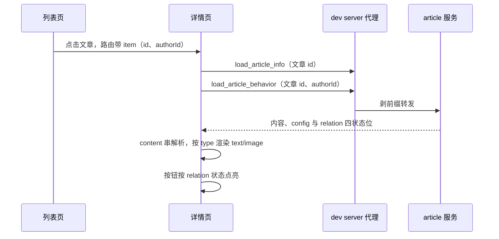

# 详情页前台链路：登录态、两个接口与渲染分工

> 🔒 安全提示：文中示例的口令/密钥均为课程教学环境演示口径，生产环境的安全要求见《安全与合规须知》。

后台把详情域三件套备齐之后，前台是让它们真正被用起来的那一端。这一课不动后端一行代码，任务是把前端工程里已经写好的详情页读懂：登录后 token 走了哪条路，点文章时参数怎么传，详情页加载时发了哪两个请求，正文、行为按钮、阅读计时各由谁负责。读懂这份代码是调试的前提，后面的联调课全靠它定位问题。

## 先给结论

- 登录页 `pages/login/index.vue` 在 `code` 为 0 时把 `d.data.token` 存进本地缓存并跳转主页，token 从此作为请求身份随行。
- 所有请求地址集中在 `config/config.js` 管理：服务名前缀拼在 url 前，dev server 的代理转发时剥掉前缀、换成真实目标，登录接口最终落到 `POST /api/v1/login/login_auth`。
- 列表页点文章把整条 item 通过路由带进详情页，路由开 `props: true`，详情页组件用 props 声明直接接参，不用再查一遍列表。
- 详情页初始化时 `loadInfo` 与 `loadBehavior` 两个请求分别拉内容与关系：内容里是 JSON 串，解析后按 type 分支渲染 text 与 image；关系回显 islike、isunlike、iscollection、isfollow 四个状态位。
- 点赞、不喜欢、关注都是「参数加取反」的同一套动作，阅读行为靠定时器持续记录时长与比例，转发与收藏本课留白。

## 登录页：token 的起点

登录页的提交方法把校验、请求、跳转三件事串成一条线：

```javascript
methods: {
  login: function() {
    if(this.params.phone=="" || this.params.password==""){
      modal.toast({ message: '请输入用户名或密码', duration: 3 });
    }else{
      Api.login(this.params).then(d=>{
        if(d.code==0){
          this.Store.setToken(d.data.token);   // token 进本地缓存
          this.$router.push({name: '/home'});  // 跳转主页
        }else{
          modal.toast({ message: '用户或密码错误', duration: 3 });
        }
      }).catch(e=>{
        console.log(e);
      })
    }
  }
}
```

前端先做一道空值拦截，再把手机号与密码交给 `Api.login` 发出请求，业务码为 0 才算成功。`Store.setToken` 是本地缓存动作，weex 里对应 storage 模块，可以理解为浏览器缓存的 App 版；token 存进去之后，后续每个需要身份的请求都要把它带回来，服务端过滤器才能还原出当前用户。失败分支只弹一个提示框，错误码的细分（账号不存在、密码错误）在前端这里先合并处理，排查时以后端日志为准。

请求地址本身长在配置文件里。`config/config.js` 是前端的地址簿，服务名、本地开关、请求路径集中声明：

```javascript
// config/config.js 节选：服务清单与地址
const config = {
  services: { article: 'ARTICLE', behavior: 'BEHAVIOR', user: 'USER', login: 'LOGIN' },
  local: { user: true, article: true, behavior: true, login: true },
  load: {
    user_login: '/api/v1/login/login_auth',
    show_behavior: '/api/v1/behavior/show_behavior',
    read_behavior: '/api/v1/behavior/read_behavior'
  }
}
```

`services` 声明各后端服务名，`local` 决定直连本机服务还是走统一地址，请求发出时在 url 前拼上服务名前缀，代理转发时把前缀剥掉、换成真实目标地址。前端拿到的路径与后端注解能一一对上：登录请求拼上 login 前缀后正是 `/api/v1/login/login_auth`，后端 `LoginController` 的类级与方法级注解拼出的就是这个地址。

## 从列表到详情：路由带参

详情页的入口是列表页的点击事件。列表渲染每篇文章时绑了一个方法，点击把当前 item 整条传回来，方法里做一次路由跳转：

```javascript
// home/index.vue：点击文章，带 item 跳详情
goArticleInfo: function(item) {
  this.$router.push({name: 'ArticleInfo', params: {item: item}});
}
```

路由表里 `ArticleInfo` 指向详情页组件，并开了 `props: true`，路由参数随之转成组件 props。详情页的 props 声明把要用到的字段一次列全：

```javascript
export default {
  name: 'index',
  props: ['id', 'title', 'comment', 'type', 'source', 'authorId'],
  data() {
    return {
      config: {},      // 文章配置：是否可评论、可转发、可下
      relation: {},    // 行为关系：islike / isunlike / iscollection / isfollow
      content: []      // 解析后的正文段落
    }
  }
}
```

这条传参路径的价值在于 id 与 authorId 一并到位：文章 id 是两个详情接口的入参，作者 id 是关注操作与关系查询的入参，列表页顺手带来的数据让详情页免去了额外的查询。

## 两个接口的加载时序

详情页初始化阶段发出两个请求，各管一摊。`loadInfo` 拉文章内容与配置，`loadBehavior` 拉当前用户与当前文章的关系状态。整条时序如下：



内容请求回来后有一道必经的加工：返回的 content 是一串 JSON 文本，不是现成的段落数组，要先解析再渲染：

```javascript
// loadInfo 成功回调的关键步骤（解析写法按本课写法补全）
loadInfo: function() {
  Api.loadInfo({articleId: this.id}).then(d=>{
    if(d.code==0){
      this.config = d.data.config;                      // 文章配置入仓
      this.content = JSON.parse(d.data.content.content); // 正文串转段落数组
    }else{
      modal.toast({ message: d.errorMessage, duration: 3 });
    }
  })
}
```

段落结构是约定的两种形态：type 为 text 渲染文本节点，type 为 image 渲染图片节点，模板里一个 `v-for` 配两个分支全覆盖。`loadBehavior` 的入参除了文章 id 还带 authorId，返回的四个状态位装进 relation，按钮的初始态由它点亮：已关注显示「取消关注」，已点赞高亮点赞按钮。两个请求互不依赖，谁先回谁先渲染，页面不会被慢的那个卡住。

## 行为按钮与阅读计时

点赞、不喜欢、关注三个按钮共用一套模式：带参数请求、成功后本地状态取反。点赞的实现最典型：

```javascript
// 点赞：operation 取反，0 点赞、1 取消
like: function() {
  Api.like({articleId: this.id, operation: this.relation.islike ? 1 : 0})
    .then(d=>{
      if(d.code==0){
        this.relation.islike = !this.relation.islike;
      }else{
        modal.toast({message: d.errorMessage, duration: 3});
      }
    })
}
```

不喜欢与它同构，关注的入参多一个 authorId，落点是 user 服务的关注接口。operation 的取值语义以行为保存课的契约为准：0 是正向动作，1 是撤销，前端用三元表达式把当前状态翻译成下一次动作。阅读行为是唯一不用点按钮的：页面挂一个定时器，阅读期间持续累计时长，离开或停留达标时把时长与阅读比例上报，`ap_read_behavior` 表里的 read_duration 与 percentage 两个字段就来自这里。转发与收藏两个按钮本课只占位不做，逻辑留白。

## 常见误区

- **把 content 当普通字符串直接渲染。** 它是 JSON 串，必须先解析成段落数组，再按 type 分支处理；直接塞给 text 组件得到的是一坨带方括号的原文。
- **路由不开 props 就想接参。** `params: {item}` 只有在路由配置开 `props: true` 时才转成组件属性，否则 props 全是 undefined，报错却看不出与路由有关。
- **本地取反不等价于服务端确认。** 按钮 states 取反要在请求成功之后做，失败分支保持原状；不等回调就取反，网络一抖界面与库就不同步。
- **设备 id 手写明文数字。** 行为接口的 equipmentId 走统一混淆序列化，明文 1 传到服务端反序列化会失败，要用缓存里现成的混淆串。

## 面试可能被问到的问题

1. 面试官追问：「前端为什么要把请求地址集中到一个 config 文件？」
   答：地址集中后，环境切换、服务迁移、路径改名都只动一处；服务名前缀加代理剥前缀的机制还能让前端代码不感知真实端口与主机，联调期改 proxyTable 就能换目标，前端代码零改动。
2. 面试官追问：「详情页为什么用路由 params 传整条 item，而不只传 id？」
   答：列表页手上已经有完整的文章数据，带上 title、authorId 等字段可以让详情页骨架先渲染，无需为展示性字段再发请求；真正的重数据（正文、关系）仍按 id 拉取。这是展示数据复用与权威数据请求的分工。
3. 面试官追问：「content 存成 JSON 串而不是结构化表，好处和坏处是什么？」
   答：好处是正文的段落形态自由，图文混排不必为每段建行，存取都是一整块；坏处是数据库层无法按段落检索与统计，解析成本转移到展示端。富文本类内容普遍这么存，配合全文检索引擎补查询能力。
4. 面试官追问：「阅读时长靠前端定时器上报，可信吗？」
   答：不完全可信，切后台、杀进程都会丢样本，属尽力而为的埋点。改进手段有 visibilitychange 时机补报、上报批量合并、服务端按时间窗去重；读行为的统计精度要求决定投入程度，不必为绝对精确过度设计。
5. 面试官追问：「点赞按钮的状态为什么本地取反，而不重新查一遍？」
   答：操作成功意味着服务端状态已翻转，本地取反是零成本的同步；重新查询多一次往返且结果必然一致。风险在并发场景，多端同时操作时本地视图可能偏离，列表回到详情页时会用 loadBehavior 重新校准，短时不一致可接受。

## 配套资料

- 代码：`materials/code/05/头条day04/`。该日资料包解压结果为空（未含源码文件），前端工程随课下发不在资料包内，文中登录页、config、详情页片段按画面线抄录，JSON 解析与 loadInfo、loadBehavior 封装按本课写法补全；引用路径截至 `头条dayNN/` 层级，内层目录冠以项目原名，正文统一以「头条类资讯项目」指代。
- 环境：课程集群 node01~node03，MySQL root/123456。
