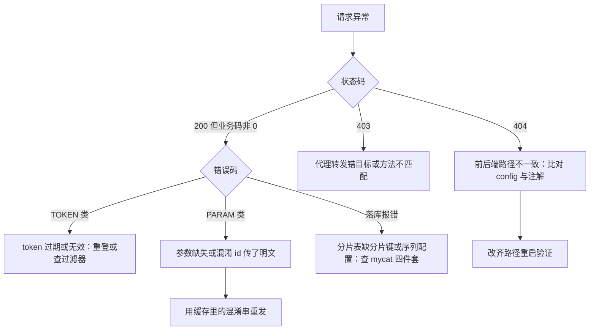

# 四服务联调：从登录 token 到行为落库的全链路验证

> 🔒 安全提示：文中示例的口令/密钥均为课程教学环境演示口径，生产环境的安全要求见《安全与合规须知》。

接口单测各自为政时都绿，拼到一起跑才是真考验。这一课把 article、behavior、login、user 四个微服务与前端 dev server 一次拉起，从登录换 token 开始，沿着展示行为、详情加载、关注、点赞、阅读的顺序逐段对账：前端看效果，后端打断点，数据库刷表看结果，三重视角对同一条请求。过程中还顺带抓出两个经典问题，一个 404，一个设备 id 反序列化失败，排查思路比结论更值钱。

## 先给结论

- 联调阵容是四个后端服务加一个前端工程：article 9001、behavior 9004、user 9005、login（按 common 清单分配），前端走 proxyTable 代理转发。
- 登录用测试账号 test/test，`login_auth` 返回 token 后前端存入本地缓存，Network 面板按请求顺序对账：login_auth、load、show_behavior 各就各位。
- 404 的根因是前后端路径不一致：config.js 发 `show_behavior`，后台注解是 `save_show_behavior`，两边改谁都行，本课把后台改成 `/show_behavior` 求统一。
- equipmentId 必须传混淆串：统一序列化约定下，明文 1 到服务端反序列化会失败，缓存里存的正是 id 为 1 的设备经混淆后的值。
- 关注链路要手动补一条作者数据：ap_author 表 2105 号作者的 user_id 先补上，followId 换算才有源头；ap_user_follow 与 ap_user_fan 各落一行，行为流水失败不阻断关系保存。

## 启动阵容与登录对账

四个服务照端口表逐一启动，前端 dev server 殿后，浏览器打开预览页就是登录界面。测试账号在用户表里现成躺着：手机号 test、密码 test，输入后点登录。后端在 `login_auth` 打断点，入参里 test/test 完整到达，三道校验依次放行，返回的 map 里 token 是一长串三段式字符串，user 实体的密码字段已是 null。前端的动作在流程课读过：存 token、跳主页，主页随即发 `load` 请求拉文章列表，Network 面板里这条请求携带了 token 请求头，服务端过滤器解析绑定，ThreadLocal 里的当前用户自此有值。

## 展示行为 404：路径对不上

列表页加载完成后前端会自动上报展示行为，Network 面板里这条请求红了，状态 404。定位方法是把前后端两头的路径摆在一起看：前端 config.js 里声明的地址是 `show_behavior`，后台行为控制器的注解写的却是另一个名字。这种不一致没有对错之分，两边改哪边都行，原则是保持统一。本课把后台注解改成与前端一致（类与前文行为课的控制器同构，端点更名为准）：

```java
@Autowired
private AppShowBehaviorService appShowBehaviorService;

@Override
@PostMapping("/show_behavior")
public ResponseResult saveShowBehavior(@RequestBody ShowBehaviorDto dto) {
    return appShowBehaviorService.saveShowBehavior(dto);
}
```

改完重启 behavior 服务再刷页面，断点进来了。dto 里的字段值得看一眼：equipmentId 是设备 id，article 是一个数组，首页这一屏 19 篇文章就是 19 个元素，每条只有 id。批量上报一次搞定，这是展示行为接口与单条行为接口的设计差异。

## equipmentId 为什么必须是混淆串

断点里 equipmentId 的值是一长串十六进制样式字符，不是 1。来源在前端 storage：本地缓存初始化时写入了一个固定值，取出来直接进请求。这个值其实是 id 为 1 的设备经过统一 ID 混淆序列化之后的产物，两边约定死同一套编码。如果图省事直接写明文 1，请求到服务端后 Jackson 按混淆模块反序列化，拿到的就是解不开的乱码或报错，参数校验那一关直接阵亡。前端storage 模块的初始化代码把这条约定写死了：

```javascript
_check : function(){
    if(this.storage == null){
      this.storage = weex.requireModule('storage');
      this.setEquipmentId('SD3EBECF883C4E99329AF8A29300A86');
    }
    return this.storage;
}
```

这串字符与后端 IdUtils 的 AES 混淆口径一一对应，属于前后端最容易被忽略的暗契约。换设备、换环境时这个值要按混淆规则重新生成，不能手敲一个看起来像的。

## 关注链路：三张表一次对账

进详情页点关注按钮，user 服务的关系控制器接到请求（契约接口路径 `/api/v1/user/user_follow`）：

```java
@RestController
@RequestMapping("/api/v1/user")
public class UserRelationController implements UserRelationControllerApi {

    @Autowired
    private AppUserRelationService appUserRelationService;

    @PostMapping("/user_follow")
    public ResponseResult follow(@RequestBody UserRelationDto dto) {
        return appUserRelationService.follow(dto);
    }
}
```

断点里 dto 三件套齐了：articleId、authorId、operation，operation 为 0 是关注。往下走是 followId 的换算：入参没有 followId，要拿 authorId 去作者表借道。这里联调前有个手工前置动作，ap_author 表里 2105 号作者的 user_id 是空的，手动补上一个 App 账号 id，否则换算出的 followId 为空，后续写入直接报错。数据补好后断点继续，两笔写入先后完成：ap_user_follow 插一行「我关注了谁」，ap_user_fan 插一行「谁关注了我」，两张表刷新各多一条当日数据，界面上按钮同步变成「取消关注」。再点一次取消，operation 为 1，两表对应行删除，对账闭环。

这段测试里还有一处故意安排的翻车：行为流水保存处人为制造了一个除零异常，观察结果是行为流水没落库，但关注与粉丝两表照常写入。这个现象验证的正是关注接口课立过的边界：关系变更是主业务，行为流水是旁路记录，流水失败不能拖垮主流程，两份数据的提交边界天然分开。

## 点赞、不喜欢与阅读行为

关注测完轮到行为域。点赞与不喜欢是两张独立表的事：清掉旧数据，点一次点赞，ap_likes_behavior 落一条 operation 为 0 的记录；再点取消，operation 翻成 1。不喜欢同理落 ap_unlikes_behavior。阅读行为最隐蔽，它不靠按钮触发：进入详情页停留一段时间再退出，ap_read_behavior 表里多出一条记录，read_duration 记录阅读时长，percentage 记录阅读比例，count 是阅读次数。这条链路测过一遍后，详情页涉及的全部落库点就对完账了。整页排查思路收成一张图：



## 常见误区

- **把 404 当成服务没启动。** 端口通而路径不通同样 404，先比 config.js 与 `@PostMapping` 两头字符串，再怀疑服务本身。
- **设备 id 图省事写明文。** 统一混淆序列化是全链路约定，一处明文全链报错；前端必须用 storage 里的现成混淆值，新设备要按规则生成。
- **作者数据不补就点关注。** ap_author 的 user_id 为空时 followId 换算断链，报的错却在写入阶段，离真正的病灶隔着一整段调用栈；联调前先核对种子数据。
- **看到流水失败就以为主业务挂了。** 行为流水与关系变更的提交边界分开，流水失败主流程照走；反过来若把它们捆在一个事务里，一次埋点异常会连累关注操作，方向正好相反。

## 面试可能被问到的问题

1. 面试官追问：「前后端路径不一致的 404，怎么在流程上避免而不是靠联调发现？」
   答：契约先行，接口文档或契约接口作为唯一事实源，前端配置与后端注解都从它生成或核对；再加一层集成测试直接打后端真实路径，路径改动时测试先红。联调发现的 404 说明契约环节失守。
2. 面试官追问：「ID 混淆给联调带来了什么额外成本？」
   答：所有 id 出入都要走混淆通道，手工造数、Postman 直调都不能用明文 id，必须先解出混淆串；换来的是防遍历攻击与隐藏数据规模。成本控制靠工具方法统一加解密，别让散落的字符串转换稀释约定。
3. 面试官追问：「关注操作里行为流水失败为什么不影响关系保存？」
   答：两者是主业务与旁路记录的关系，提交边界分开：关系两表是用户强感知的状态，必须成功；流水是分析用数据，失败可补偿可丢弃。若捆进同一事务，埋点抖动会连累核心操作，得不偿失。
4. 面试官追问：「行为表都是分片表，联调时什么错误说明分片键没带上？」
   答：MyCat 报路由类错误，提示找不到分片列或无法定位分片。点赞、阅读这类表按设备或用户维度分片，insert 必须带分片键，主键与 burst 由 MyCat 全局序列补；排查入口在 mycat 四件套的 schema 与 rule 配置。
5. 面试官追问：「token 过期在联调中怎么表现，怎么快速验证？」
   答：业务码返回 TOKEN 类错误，HTTP 层仍是 200，容易被误判成业务 bug；快速验证法是把本地缓存里的 token 清掉或改一位再发请求，比对错误码变化。过滤器里 `true ||` 全放行的教学开关打开时这条链路测不到，要先确认开关状态。

## 配套资料

- 代码：`materials/code/05/头条day04/`。该日资料包解压结果为空（未含源码文件），文中控制器片段与前端 storage 片段按画面线抄录并按既有工程风格补全，包名统一改写为 `com.study.headline`；端口以 common 统一清单为准。
- 代码：`materials/code/05/头条day02/`，mycat 配置四件套（schema.xml、rule.xml、server.xml、sequence_db_conf.properties），行为分片表的分片键与全局序列口径可在其中核对。
- 代码：`materials/code/05/头条day01/`，内层资料目录含数据库规范设计说明书，ap_author、ap_user_follow、ap_user_fan 等表字段命名可对照其规范条目；原始目录与文件名冠以项目原名，正文统一以「头条类资讯项目」指代。
- 环境：课程集群 node01~node03，MySQL root/123456。
