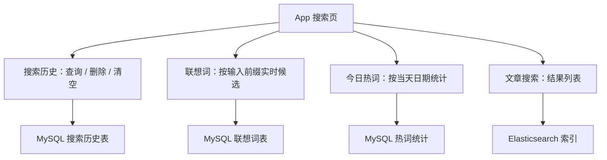

# 搜索功能的契约先行：五个接口与一次 ES 换道

> 🔒 安全提示：文中示例的口令/密钥均为课程教学环境演示口径，生产环境的安全要求见《安全与合规须知》。

电商与资讯 App 顶栏那个搜索框，背后是一整套分工明确的接口：进页面先看到历史记录，输入时实时蹦出联想词，点搜出结果列表，旁边还有今日热词引流。头条类资讯项目要补齐这块能力，动手写代码之前先把需求拆开、把接口契约定稳。这一课不产出一行业务代码，产出的契约决定后面几节课写出来的代码长什么样。

## 先给结论

- 搜索功能拆四块需求：搜索历史（查询、删除、清空三个接口）、今日热词、联想词、文章搜索，前端交互与成熟 App 的搜索页完全同构。
- 接口统一挂在 `POST /api/v1/search/*` 前缀下，落到后续新建的搜索微服务；历史、热词、联想的数据继续存 MySQL，文章搜索的存储换道 Elasticsearch。
- MySQL like 承担不了文章搜索：前后通配符全表扫描、不做分词、没有相关度排序，三宗罪决定了换技术而不是加索引。
- 入参契约两个 DTO：历史与联想共用携带 searchWords 的分页请求对象，文章搜索在此基础上扩展；返回侧历史与联想是词列表，文章搜索是文章列表。
- 今天先契约后实现，实现顺序按接口拆课推进：历史三接口、热词、联想词、ES 环境与搜索编码、最后前后端联调。

## 需求怎么拆：把搜索页读成接口清单

成熟 App 的搜索页有一套通用布局，拿过来对着拆就行。搜索框上方是历史记录区：你上周搜过「分布式事务」，今天再进搜索页，它原样摆在那里，每条可以单独删掉，右上角一个清空按钮一键全灭。输入框每敲一个字，下方实时列出一串联想词，输入「微服务」就带出「微服务治理」「微服务网关」这些候选。再往下是今日热词栏目：按当天日期统计出的热门搜索词，点一个词直接以其为关键字发起搜索。最终点击搜索，展示的是文章列表，这是资讯 App 的搜索结果形态。四块需求与数据源的关系如下：



关键路径在最下面那条分支：三块轻量结构化需求留在 MySQL，唯独文章搜索换了存储。需求阶段就把这条分界线画出来，后面每节课的选型之争都免了。

## 接口清单：六个契约一次定完

需求对齐之后接口跟着出。六个接口统一 POST、统一 `ResponseResult` 返回、统一挂在 `/api/v1/search` 前缀下，与文章域的 `/api/v1/article` 形成同样的家族式规范：

| 接口端点 | 作用 | 入参要点 |
|---|---|---|
| `/api/v1/search/load_search` | 查询当前用户搜索历史 | 分页参数 |
| `/api/v1/search/del_search` | 删除历史，支持单条或多条 | searchWords |
| `/api/v1/search/clear_search` | 清空全部历史 | 无业务参数 |
| `/api/v1/search/hot_keywords` | 查询今日热词 | 按当天日期统计 |
| `/api/v1/search/associate_search` | 按输入联想候选词 | searchWords |
| `/api/v1/search/article_search` | 全文检索文章列表 | searchWords 加分页 |

三个历史接口与后续三节课一一对应，热词与联想词各占一节，文章搜索压轴，它依赖 Elasticsearch 环境搭建与数据导入两节铺垫。画面线的前端配置里这些地址以 load_search、del_search、associate_search、article_search 等键集中声明，与后端契约一一呼应；后台端点名按本课写法整理，联调时以双方配置为准。历史接口的身份来自过滤器绑定的当前用户，登录链路在前几课铺平，这里直接受益。

## 入参契约：两个 DTO 的分工

入参不必六个接口六套对象。历史、联想、热词都是「一个词加一分页」的形态，抽一个请求 DTO 承载（day04 资料包为空，DTO 按本课写法补全，包名统一 `com.study.headline`）：

```java
package com.study.headline.model.search.dtos;

import com.study.headline.model.common.dtos.PageRequestDto;

/** 搜索历史与联想词共用的请求体 */
public class UserSearchDto extends PageRequestDto {

    /** 搜索关键字：删除与联想接口必传，查询历史可不传 */
    private String searchWords;
}
```

文章搜索在词与分页之外还要支持锚点翻页，独立成 SearchArticleDto，避免历史接口被无关字段污染：

```java
package com.study.headline.model.search.dtos;

import com.study.headline.model.common.dtos.PageRequestDto;

/** 文章搜索请求体：关键字加分页 */
public class SearchArticleDto extends PageRequestDto {

    /** 搜索关键字 */
    private String searchWords;

    /** 分页参数继承自 PageRequestDto：pageSize 与 pageNum */
}
```

返回侧同样按家族口径统一：历史与联想返回词列表，热词返回词列表，文章搜索返回文章列表，data 里装对应数组，业务失败走统一错误码。契约定到这里，接口文档画得出来，前端配置写得出，mock 也能先跑起来。

## 文章搜索为什么换 Elasticsearch

把 like 方案放在真实数据面前算三笔账。**第一笔是扫描成本。** 文章表行数百万级起步，`like '%关键字%'` 前后都是通配符，索引彻底失效，每一查都是全表扫描，并发一来数据库先躺下。**第二笔是分词能力。** 用户搜「微服务」，like 只能匹配连续子串，「微服务治理」「服务治理实践」这类包含变体的文章全部漏网，而分词后的倒排索引天然召回它们。**第三笔是排序质量。** like 按主键或时间排，命中即返回，谈不上谁更相关；搜索引擎按词频、位置与权重打分，热门与相关的内容排前面。倒排索引的原理一句话讲透：正排是「文章里有哪些词」，倒排是「词出现在哪些文章」，搜索场景问的恰是后一个问题。

换道不是替换：MySQL 仍是文章数据的权威存储，Elasticsearch 存一份面向检索的副本，写入侧通过采集或消息同步保持两份数据一致，这套同步链路在后续课程落地。历史的归 MySQL，检索的归 ES，各干各的强项。

## 常见误区

- **把联想词当成 like 模糊查询。** 联想要的是前缀命中加热度排序，`like '词%'` 只解决了命中，排序还要靠词频统计；直接拿文章表做模糊查询，量级与响应时间都撑不住实时输入。
- **热词按累计搜索量算。** 今日热词的「今日」是时间窗口，按全量累计算出来的是历史最热，栏目每天刷新的意义就没了；统计口径按天分窗，必要时叠加时段权重。
- **把 ES 当权威存储。** ES 里的文章副本要允许重建，删了能从 MySQL 恢复才安全；把它当唯一真身，一旦索引损坏或同步丢数据，文章就真没了。
- **接口契约边写边定。** 六个接口的端点名、入参、返回形态定不稳，前端配置与 mock 就要反复返工；先契约后编码多花一小时，省下的是后面每节课的来回改。

## 面试可能被问到的问题

1. 面试官追问：「搜索历史、联想词、热词为什么不也放进 ES？」
   答：它们是结构化小数据，查询按用户、前缀、日期精确命中，MySQL 的索引足够，还要支撑删除与统计这类事务性操作；ES 的强项在全文召回与相关度，为几行小数据维护一套索引得不偿失，存储选型跟着访问模式走。
2. 面试官追问：「倒排索引和数据库索引的本质区别是什么？」
   答：数据库 B+ 树索引按列值有序组织，服务等值与范围查询，通配符前缀查询会失效；倒排索引按词项组织，每个词挂一串文档 id，查询先分词再取倒排链，天然服务全文检索与多词交集，两者解决的问题不同，不是替代关系。
3. 面试官追问：「MySQL 与 ES 的数据一致性怎么保证？」
   答：主流是异步双写或基于消息的最终一致：文章发布、修改事件发出去，消费侧更新 ES，失败重试加对账任务兜底；强一致没必要也不现实，检索副本容忍秒级延迟。历史方案同步双写的问题在于任何一侧抖动都会拖垮主流程。
4. 面试官追问：「搜索历史存用户维度还是设备维度？」
   答：登录用户按用户维度，未登录按设备维度，行为域的行为实体机制已经把两种身份统一成 entry id，搜索历史沿用同一套定位；这样游客搜过的词在登录后也能衔接，体验连续。
5. 面试官追问：「联想词的响应时间要求多少，怎么做到？」
   答：实时输入场景一般要求百毫秒级返回。手段是前缀索引或内存字典结构、结果按热度预排序、请打包短 TTL 缓存，前端加输入防抖减少请求次数；数据量可控时这些手段叠加轻松达标。

## 配套资料

- 代码：`materials/code/05/头条day04/`。该日资料包解压结果为空（未含源码文件），文中接口清单、DTO 与契约说明为按本课写法补全的示例，包名统一改写为 `com.study.headline`；端点命名与前端 config 键名以画面线为准，联调时以双方配置为准；引用路径截至 `头条dayNN/` 层级，内层目录冠以项目原名，正文统一以「头条类资讯项目」指代。
- 代码：`materials/code/05/头条day01/`，内层资料目录含数据库规范设计说明书，搜索历史与联想词表的新增字段可对照其规范条目设计。
- 环境：课程集群 node01~node03，MySQL root/123456。
