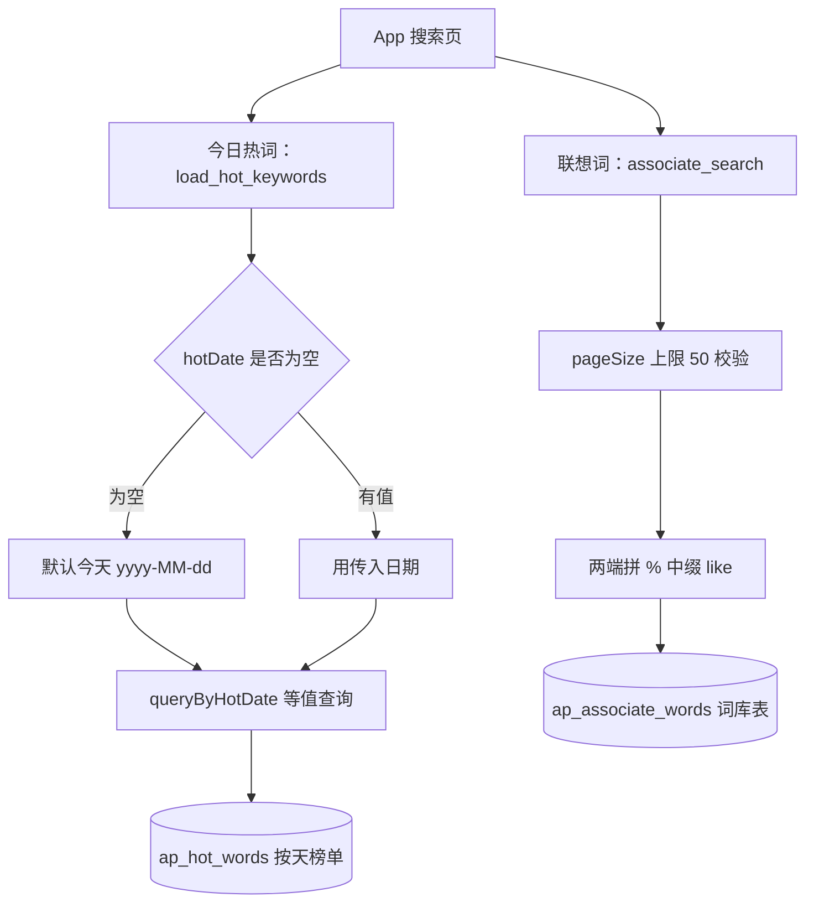

# 今日热词与搜索联想：按天分窗的热词榜单与词库表的实时模糊查询

> 🔒 安全提示：文中示例的口令/密钥均为课程教学环境演示口径，生产环境的安全要求见《安全与合规须知》。

搜索页里有两块「打开就有内容」的区域：今日热词在历史记录旁边按天换榜，输入框每敲一个字就实时蹦出一串联想词。上一课的搜索历史挂身份、走行为实体，这一课的两块恰好反过来：都不需要登录态，都直接查一张专用表，但查询条件一个是日期精确命中、一个是关键字模糊匹配，两条路径的写法差异正是本课的主线。头条类资讯项目的搜索家族六个接口里，这两块各占一个端点，契约在需求分析那一课已经定好，落到代码里各是一条 SQL 的事。

依然沿用搜索域的既有结构：Service 方法继续挂在 `ApArticleSearchService` 上，请求体继续用统一的 `UserSearchDto`，上一课已按画面线补齐了 hotDate 与 searchWords 字段，本课就是它们的用武之地。前端配置里热词的键是 hot_keywords、联想的键是 associate_search，控制器上的真实端点按画面线为 load_hot_keywords 与 associate_search，联调时两份配置对齐。两接口的代码量都不大，真正的价值在于看清两类查询的形态差异：榜单查询是「按时间窗口取预聚合结果」，联想查询是「按输入片段在静态资产里做模糊命中」，搜索场景里绝大多数非全文检索需求都能归进这两类。

## 先给结论

- 热词表按天预聚合，查询侧一条 `where hot_date = 日期` 精确命中；日期不传默认取今天，格式必须与表里 hot_date 的存储格式一致。
- 联想词存独立词库表 ap_associate_words，服务层把关键字两端拼上 `%` 走 like 模糊查询，limit 控制返回条数，pageSize 上限 50。
- 两接口都不需要行为实体：热词是全局榜单，联想词库全局共享，身份定位在这一课缺席是设计选择而不是省事。
- 热词的统计发生在写入侧（按天分窗汇总），查询接口只负责按天取榜单，统计链路由搜索行为数据后续补齐。
- 验证套路与上一课一致：MockMvc 发 POST，热词用固定日期、联想用固定关键字，回库对照返回列表。

## 今日热词：一张按天分窗的榜单表

「今日热词」的「今日」两个字决定了一切。热词要每天刷新，统计口径就必须按天分窗：当天的搜索行为汇成当天的榜单，跨天不累计。ap_hot_words 表正是按这个口径设计的，五个字段：id 主键、hot_words 热词本体、type 类型标记、hot_date 归属日期、created_time 入库时间。实体类对应如下（day04 资料包为空，实体与后文代码按本课写法补全，包名统一 `com.study.headline`）：

```java
package com.study.headline.model.search.pojos;

import java.util.Date;

/** 热词表 ap_hot_words 对应实体 */
public class ApHotWords {
    private Integer id;
    /** 热词 */
    private String hotWords;
    /** 类型标记，预留区分热词来源 */
    private Integer type;
    /** 归属日期，格式 yyyy-MM-dd */
    private String hotDate;
    private Date createdTime;
}
```

type 字段在预置数据里统一为 1，真实业务里可以区分热词来源，比如来自搜索行为还是来自运营置顶。表里每一行天然带着 hot_date 这个时间窗口标记，榜单的「按天」属性落在数据上而不是落在查询逻辑里。统计动作发生在写入侧：把当天的搜索行为按关键字汇总计数，高词频的写入当天批次，一个 `group by 关键字` 加日期窗口就是统计骨架，链路随搜索行为数据埋点完善后落地，本课先用手工预置的测试数据把查询链路跑通。查询侧因此轻得不能再轻：

```java
public interface ApHotWordsMapper {

    /** 按日期查热词榜单 */
    List<ApHotWords> queryByHotDate(@Param("hotDate") String hotDate);
}
```

```xml
<mapper namespace="com.study.headline.model.mappers.app.ApHotWordsMapper">
    <resultMap id="BaseResultMap" type="com.study.headline.model.search.pojos.ApHotWords">
        <id column="id" property="id"/>
        <result column="hot_words" property="hotWords"/>
        <result column="type" property="type"/>
        <result column="hot_date" property="hotDate"/>
        <result column="created_time" property="createdTime"/>
    </resultMap>
    <sql id="Base_Column_List">id, hot_words, type, hot_date, created_time</sql>

    <select id="queryByHotDate" resultMap="BaseResultMap" parameterType="java.lang.String">
        select
        <include refid="Base_Column_List"/>
        from ap_hot_words
        where hot_date = #{hotDate,jdbcType=VARCHAR}
    </select>
</mapper>
```

一条等值条件就是全部。聚合已经在写入时做完，查询永远是一次窄范围扫描，热词接口的响应时间与榜单行数成正比，与搜索总量无关，这是预聚合方案最大的好处。

把统计与查询拆在两侧还有一层工程含义：统计任务可以慢慢跑、失败可以重跑，当天批次没算完，查询侧顶多返回旧榜单，不会把错误传导给用户；反过来如果把汇总逻辑塞进查询接口，每次打开搜索页都要现算一遍全量搜索日志，接口延迟与日志量一起膨胀，榜单一热数据库先撑不住。榜单行数天然有限（一屏放得下的量级），存储与计算成本都被压在一个小常数上，这也是热词继续留在 MySQL 而不引入额外组件的底气；并发真上去之后，常规做法是在接口外再套一层短 TTL 缓存，整个榜单几十秒刷新一次，缓存的收益与改造成本都可控。

## 默认日期与格式对齐：热词接口的两个细节

Service 方法只做两件事：把日期参数补齐默认值，然后查库：

```java
@Override
public ResponseResult hotKeywords(String date) {
    // 日期为空默认查今天
    if (StringUtils.isBlank(date)) {
        date = DateUtils.format(new Date(), "yyyy-MM-dd");
    }
    List<ApHotWords> hotWords = apHotWordsMapper.queryByHotDate(date);
    return ResponseResult.okResult(hotWords);
}
```

两个细节都在这个方法里。日期为空时默认取今天，前端不传参就能拿到当日榜单，传了日期就能复盘任意一天的热词，验证时用 `2019-07-24` 这样的固定日期可以稳定复现结果。格式串 `yyyy-MM-dd` 不是随手写的：where 条件是字符串等值匹配，格式必须与表里 hot_date 的存储格式逐字符对齐，表里存的是带横杠的 `2019-09-20`，格式串就得带横杠；若表结构改成不带横杠的 `yyyyMMdd`，格式串跟着改，否则查询不报错但永远查不到数据，这类静默失效比抛异常难查得多。默认值还有一层防御意味：前端漏传或传了空串，接口依旧有确定的返回，而不是把空参直接砸进 SQL；若要更严格，可以在补默认值之前先做格式校验，非法格式直接返回参数无效，把静默失效扼杀在入口处。

控制器与测试收尾：

```java
/** 今日热词 */
@PostMapping("/load_hot_keywords")
public ResponseResult hotKeywords(@RequestBody UserSearchDto dto) {
    return apArticleSearchService.hotKeywords(dto.getHotDate());
}
```

热词是榜单不是个人数据，方法体里没有 getEntryId 也没有 ThreadLocal，请求进来直接按日期取数。MockMvc 测试里 DTO 只设 hotDate 一个字段，跑完在打印的响应里核对 hot_words、hot_date 等字段是否与库中当日批次一致；再跑一遍不设 hotDate 的用例，核对默认走今天的分支。

## 联想词：一张小词库表的模糊查询

联想词的需求形态是：用户输入「微服务」，下方实时列出「微服务治理」「微服务网关」「微服务架构实践」。候选词不是临时算出来的，而是提前维护好的一个词库，查询时按输入做模糊匹配。词库独立成表 ap_associate_words，只有 id、associate_words、created_time 三个字段，与文章表彻底解耦。这一步与需求分析那一课的口径是衔接的：拿文章表做 like 模糊查询撑不住实时输入，是因为文章表百万级行数；词库表量级可控，like 的代价就变得可以接受，同样的 SQL 放在两张量级差三个数量级的表上，结论完全不同。

词库的维护是这套方案里容易被忽略的另一半。候选词有三个来源：运营手工录入的精选词、搜索日志里挖出来的高频词、配合活动周期性置顶的引流词。三个来源最终都落到 ap_associate_words 这一张表上，查询接口对词库怎么来的完全不感知。词库不带权重列时，返回顺序就是表的默认顺序；要控制展示次序，加一列排序权重即可，查询 SQL 顺势补一个 order by，接口契约不动。词库的增删与搜索历史完全无关，运营改了词库，下一次输入立刻生效，这也是把候选词做成独立资产而不是实时计算的价值所在。

```java
public interface ApAssociateWordsMapper {

    /** 按关键字模糊查联想词，限条数 */
    List<ApAssociateWords> selectByAssociateWords(@Param("searchWords") String searchWords,
                                                  @Param("limit") Integer limit);
}
```

```xml
<mapper namespace="com.study.headline.model.mappers.app.ApAssociateWordsMapper">
    <resultMap id="BaseResultMap" type="com.study.headline.model.search.pojos.ApAssociateWords">
        <id column="id" property="id"/>
        <result column="associate_words" property="associateWords"/>
        <result column="created_time" property="createdTime"/>
    </resultMap>
    <sql id="Base_Column_List">id, associate_words, created_time</sql>

    <select id="selectByAssociateWords" resultMap="BaseResultMap">
        select
        <include refid="Base_Column_List"/>
        from ap_associate_words
        where associate_words like #{searchWords}
        limit #{limit}
    </select>
</mapper>
```

XML 里 like 的参数是裸的 `#{searchWords}`，通配符不在 XML 里拼，而是收在 Service 层拼进参数值：

```java
@Override
public ResponseResult searchAssociate(UserSearchDto dto) {
    // 条数上限校验
    if (dto.getPageSize() > 50 || dto.getPageSize() < 0) {
        return ResponseResult.errorResult(AppHttpCodeEnum.PARAM_INVALID);
    }
    // 两端加通配符，中缀匹配词库
    List<ApAssociateWords> words = apAssociateWordsMapper.selectByAssociateWords(
            "%" + dto.getSearchWords() + "%", dto.getPageSize());
    return ResponseResult.okResult(words);
}
```

`%` 拼在参数值里而不是 SQL 文本里，是这十几行代码里最值得讲的决定。拼接后的字符串整体作为预编译参数传入，占位符依旧走 `#{}`，用户输入里就算混进单引号或 SQL 关键字，也只会被当成普通字符参与匹配，注入路径被堵死。反过来若在 XML 里用 `${}` 把通配符和输入一起拼进 SQL 文本，输入原样进入语句结构，注入风险立刻回来。两端都加 `%` 是中缀匹配：输入「服务」也能带出「微服务治理」，命中面比前缀匹配宽；代价是索引彻底用不上，词库全表扫描，这正是词库必须保持小表的原因。控制器补上端点：

```java
/** 联想词 */
@PostMapping("/associate_search")
public ResponseResult searchAssociate(@RequestBody UserSearchDto dto) {
    return apArticleSearchService.searchAssociate(dto);
}
```

联想词同样不需要身份：词库是全局共享的静态资产，谁输入同一个词，看到的候选都一样。MockMvc 测试设 pageSize 与 searchWords 两个字段，用「微服务」做关键字，命中「微服务治理」「微服务网关」这类包含关系的词条；换个只出现在词库中段的片段去查，验证中缀匹配生效。

实时输入场景对响应时间的敏感度远高于普通接口。用户每敲一个字就发一次请求，前端的标准配合是输入防抖，停顿两三百毫秒才真正发请求，请求次数先砍掉一截；服务端的百毫秒预算里，小表 like 全扫绰绰有余，加上 pageSize 上限 50 的条数控制，单次查询的返回体也被压住。两端配合下来，「输入到候选出现」的体感延迟稳定在百毫秒级，这是需求分析那一课对联想词接口定下的体验目标在本课的兑现。

## 两接口的联调口径与一张全景图

两个接口的返回形态同为词列表，data 里装 `ApHotWords` 或 `ApAssociateWords` 的数组，前端按字段名渲染即可。热词按天换榜、联想按输入实时刷新，两者的触发时机不同，但请求都落在 `POST /api/v1/article/search` 家族下，与搜索历史的三个接口共用一个类级前缀。全景一张图：



左侧分支的关键在默认值与格式对齐，右侧分支的关键在通配符拼接位置与词库量级。两条分支都不经过行为实体，搜索页打开即查，与上一课「先定身份再查历史」形成鲜明对照。

联调前的造数也有讲究。热词表要插几行带当天 hot_date 的词条，再插几行带历史日期的词条，正好用来验证「不传日期默认今天、传日期精确复盘」两条分支；联想词库插一组包含关系的词条（微服务、微服务治理、微服务网关），再用一个只命中部分词条的短词去查，中缀匹配的命中范围一目了然。造数时把 hot_date 写成与默认日期分支一致的真实当天，查询结果与库中记录逐条对照，接口问题还是数据问题当场分辨。

## 一个 DTO 撑起搜索家族：共用与克制

搜索家族六个接口至今共用一个 `UserSearchDto`，热词只用 hotDate，联想只用 searchWords 加 pageSize，历史三接口用 equipmentId 与 hisList。共用的好处直观：前端序列化逻辑只有一套，服务端参数校验只有一处，家族内部新增接口不用新开请求对象。共用的克制点在于字段必须有清晰的归属注释，哪个接口读哪些字段在契约里写明白，否则半年后没人说得清 tag 字段是给谁用的。字段语义越界的风险靠两层约束兜住：一是注释与契约文档同步维护，二是服务端校验只看本接口关心的字段，无关字段多余传值不影响行为。请求对象按域聚合（搜索域一个、文章域一个），而不是按接口一对一开类，是这个项目反复出现的建模习惯，背后的取舍是契约稳定性优先于字段最小化。

## 常见误区

- **热词按累计搜索量算。** 错例：去掉 hot_date 条件查全表，再按计数排一次。正解：「今日」是时间窗口，hot_date 就是分窗字段，查询必须带日期条件；累计量算出来的是历史最热，榜单每天刷新的意义就没了。
- **日期格式与存储格式不一致。** 错例：格式串写成 `yyyy/MM/dd` 而表里存 `2019-09-20`。正解：格式串以表里 hot_date 的实际存储样式为准，逐字符对齐；字符串等值匹配格式不齐时查询静默失效，不报错但永远空结果。
- **联想词拿文章表做模糊查询。** 错例：直接 `select ... from ap_article where title like ...`。正解：候选词提前沉淀到独立词库表，查询只打小表；文章表的量级撑不住实时输入的模糊匹配，这是需求分析那一课定下的存储分界线。
- **通配符用 `${}` 拼进 SQL 文本。** 错例：XML 里写 `like '%${searchWords}%'`。正例：`%` 在 Service 层拼进参数值，占位符保持 `#{}` 预编译，用户输入永远不进入语句结构。

## 面试可能被问到的问题

1. 面试官追问：「今日热词的数据从哪来，为什么要按天分窗？」
   答：来源是搜索行为日志，写入侧按关键字加日期窗口汇总计数，高频词进入当天批次。「今日」是产品口径，跨天不累计才叫今日热词；分窗字段直接落在 hot_date 列上，查询一次等值命中，统计与查询彻底解耦。
2. 面试官追问：「like 两端加通配符为什么用不上索引，词库表为什么可以接受？」
   答：B+ 树索引按列值有序组织，前缀未知时无法定位起始位置，`%词%` 只能全表扫描。词库表行数在千到万级，全扫一次也在毫秒内完成；文章表百万行起步，同样的写法就是灾难，存储选型跟着量级与访问模式走。
3. 面试官追问：「like 的通配符应该拼在哪一层，怎么防注入？」
   答：拼在服务层、作为预编译参数的一部分传入，占位符保持 `#{}`。拼接发生在参数值内部，用户输入不改变语句结构，单引号与关键字都只是普通字符；`${}` 做字符串替换会把输入拼进语句文本，攻击面立刻打开，除非输入来自受控白名单。
4. 面试官追问：「热词和联想词为什么不需要登录态，和历史接口的差别在哪？」
   答：历史记录是个人数据，必须先定行为实体才能读写；热词是全局榜单、联想词库是全局资产，与个人无关，请求进来直接查。判断依据是数据的归属维度：数据属于人就过身份链路，数据属于全局就跳过，接口能省的依赖就省。
5. 面试官追问：「联想词的排序目前是什么策略，要更精细怎么办？」
   答：本课按词库默认顺序返回，limit 截断。精细化的常规做法是词库加权重列，按热度或运营权重倒序；再往上可以在内存里维护 Trie 前缀树或用 ES 的 completion suggester，前缀命中加权重排序一起解决，词库量级增长后再演进。
6. 面试官追问：「热词要按频道细分怎么扩展？」
   答：ap_hot_words 加频道维度列，统计写入时按频道分组汇总，查询接口在 DTO 里带频道号，where 条件从单日期变成日期加频道双条件；榜单行数不大的情况下不需要分表，加索引即可，维度扩展优先走列扩展而不是新表。

## 配套资料

- 代码：`materials/code/05/头条day04/`。该日资料包解压结果为空（未含源码文件），文中实体、Mapper、XML、Service、Controller 与测试代码为按本课画面线补全的示例，包名统一改写为 `com.study.headline`；端点路径以画面线为准，前端配置键与后端端点联调时对齐。
- 代码：`materials/code/05/头条day01/`，内层资料目录含数据库规范设计说明书，ap_hot_words 与 ap_associate_words 的字段命名可对照其规范条目。
- 环境：课程集群 node01~node03，MySQL root/123456；库层接入 day02 搭建的 MyCat 分片环境，两张表查询均带等值或窄范围条件，扫描范围可控。
