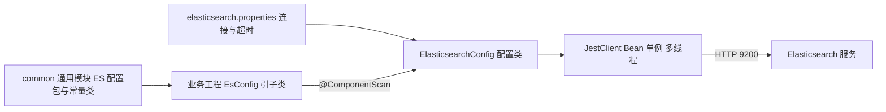

# 文章搜索的引擎地基：Elasticsearch 环境接入与测试数据导入

> 🔒 安全提示：文中示例的口令/密钥均为课程教学环境演示口径，生产环境的安全要求见《安全与合规须知》。

文章搜索接口动手之前还差一块地基。需求分析那一课算过 like 的三笔账，文章全文检索换道 Elasticsearch；历史、热词、联想都在 MySQL 里跑通了，检索这一份副本从哪来、怎么查，就是这一课要铺的底。工程里要接 ES 客户端、建 `app_info_article` 索引、把一批文章灌进去，做完这三件事，下一课的文章搜索接口才有库可查。环境上，ES 与 Kibana 的安装、ik 分词器的配置在 ES 专题课讲过，课程集群是 node01~node03 三节点，本课的 ES 装在本机开发环境，地址就是 `localhost:9200`，装到服务器上时改一处配置即可。

## 先给结论

- 客户端选 Jest：引入 jest 客户端与 elasticsearch 依赖（版本按画面线为 7.2.0 配套），JestClient 注册成 Spring Bean 单例。
- 连接配置收在 common 通用模块：一个 properties 文件加一个配置类产出 JestClient，业务工程用一个带 `@ComponentScan` 的引子类按需加载。
- 索引名与默认 type 收进常量类，文章检索副本叫 `app_info_article`，type 用 ES 默认的 `_doc`。
- mapping 在 Kibana 里显式创建，title 与 content 指定 ik 分词，字段与 MySQL 文章数据一一对应。
- 测试数据用 JestClient 从 MySQL 查出文章再批量写入索引，50 篇文章灌库后即具备搜索验证条件；导入按文章主键写文档，重跑幂等。

## 接入方式：Jest 客户端加 common 模块配置

ES 的 Java 客户端有原生与社区两路，工程选了社区的 Jest 客户端，特点是接口轻、以 HTTP 方式与 ES 通信，依赖只有两件（示例依赖坐标按本课画面线整理）：

```xml
<dependency>
    <groupId>io.searchbox</groupId>
    <artifactId>jest</artifactId>
    <version>6.3.1</version>
</dependency>
<dependency>
    <groupId>org.elasticsearch</groupId>
    <artifactId>elasticsearch</artifactId>
    <version>7.2.0</version>
</dependency>
```

配置不散落在各业务工程，而是集中在 common 通用模块。resource 目录下放一个专属 properties 文件，连接地址与两个超时都在这里（day04 资料包为空，本节配置与代码为按本课画面线补全的示例，包名统一 `com.study.headline`）：

```properties
# ES 连接配置：本机安装用 localhost，装在集群节点改成对应 IP
spring.elasticsearch.jest.url=http://localhost:9200
spring.elasticsearch.jest.read-timeout=20000
spring.elasticsearch.jest.connection-timeout=20000
```

配置类用 `@ConfigurationProperties` 绑定这份文件，产出一个 JestClient Bean：

```java
package com.study.headline.elasticsearch.config;

import io.searchbox.client.JestClient;
import io.searchbox.client.JestClientFactory;
import io.searchbox.client.config.HttpClientConfig;
import org.springframework.boot.context.properties.ConfigurationProperties;
import org.springframework.context.annotation.Bean;
import org.springframework.context.annotation.Configuration;
import org.springframework.context.annotation.PropertySource;

@Configuration
@ConfigurationProperties(prefix = "spring.elasticsearch.jest")
@PropertySource("classpath:elasticsearch.properties")
public class ElasticsearchConfig {

    private String url;
    private Integer readTimeout;
    private Integer connectionTimeout;

    @Bean
    public JestClient getJestClient() {
        JestClientFactory factory = new JestClientFactory();
        factory.setHttpClientConfig(new HttpClientConfig
                .Builder(this.url)
                .multiThreaded(true)
                .connTimeout(this.connectionTimeout)
                .readTimeout(this.readTimeout)
                .build());
        return factory.getObject();
    }

    public void setUrl(String url) { this.url = url; }
    public void setReadTimeout(Integer readTimeout) { this.readTimeout = readTimeout; }
    public void setConnectionTimeout(Integer connectionTimeout) { this.connectionTimeout = connectionTimeout; }
}
```

`multiThreaded(true)` 让这个客户端内部维护连接池，Spring 容器里它是单例，所有业务共享，不要每次用时 new 一个。配置放 common 是为了「按需加载」：哪个业务工程想用 ES，就在自己的 config 包里放一个引子类，把 common 里的 ES 配置包扫进来：

```java
package com.study.headline.article.config;

import org.springframework.context.annotation.ComponentScan;
import org.springframework.context.annotation.Configuration;

/** 引入 common 模块的 ES 配置，本工程即可注入 JestClient */
@Configuration
@ComponentScan({"com.study.headline.elasticsearch"})
public class EsConfig {
}
```

依赖、配置、加载三者的关系一张图理清：



从上到下是配置的产出链，从左到右是工程的加载链。引子类只有几行，却让 common 里的配置在多个工程间复用，文章工程要 ES、后续其他工程也要 ES 时，各自放一个 EsConfig 就完事。

## 建索引：Kibana 里显式 mapping

索引相当于数据库里的表，mapping 相当于表结构。ES 的动态映射虽然能自动猜字段类型，但中文文本会被默认的标准分词器打散成单字，数字与日期也可能被猜偏，检索质量从源头受损，所以索引与映射都在 Kibana 里显式创建。索引名不硬编码在代码里，收进 common 的常量类：

```java
package com.study.headline.elasticsearch.constants;

/** ES 索引名与默认 type 常量 */
public class EIndexConstants {

    /** 默认文档类型：ES 的 type 概念已弱化，统一用默认值 */
    public static final String DEFAULT_DOC = "_doc";
    /** 索引名前缀 */
    public static final String ALL_INDEX = "app_info_";
    /** 文章检索索引 */
    public static final String ARTICLE_INDEX = "app_info_article";
    /** 预留：用户索引 */
    public static final String USER_INDEX = "app_info_user";
    /** 预留：作者索引 */
    public static final String AUTHOR_INDEX = "app_info_author";
}
```

前缀加常量的组合是为后期扩展准备的：文章、用户、作者三份索引共用 `app_info_` 前缀，通配与批量操作时能一把抓，单独操作时取具体常量。Kibana 开发控制台里建索引与映射（DSL 为 ES 通用语法，示例按本课写法补全）：

```json
PUT app_info_article
{
  "mappings": {
    "properties": {
      "article_id":   { "type": "long" },
      "channel_id":   { "type": "long" },
      "title":        { "type": "text", "analyzer": "ik_max_word" },
      "content":      { "type": "text", "analyzer": "ik_max_word" },
      "publish_time": { "type": "date", "format": "yyyy-MM-dd HH:mm:ss||epoch_millis" },
      "status":       { "type": "short" },
      "tag":          { "type": "keyword" },
      "user_id":      { "type": "long" }
    }
  }
}
```

title 与 content 指定 ik 分词器，搜索「微服务」时能命中「微服务治理」这类变体，这正是换 ES 的初衷；publish_time 兼容两种格式，避免导入时日期序列化踩坑；tag 定成 keyword 不分词，它是来源标记而不是检索字段。索引建好，mapping 可用 `GET app_info_article/_mapping` 回查确认。

## 灌数据：从 MySQL 到索引的批量导入

索引有了，往里放数据。文档实体与 mapping 字段一一对应，camelCase 属性配 `@JsonProperty` 对齐下划线字段名（示例按本课画面线补全）：

```java
package com.study.headline.model.search.es;

import java.util.Date;
import com.fasterxml.jackson.annotation.JsonProperty;

/** 写入 app_info_article 索引的文档实体 */
public class EsIndexEntity {

    @JsonProperty("article_id")
    private Long articleId;

    @JsonProperty("channel_id")
    private Long channelId;

    private String title;

    private String content;

    @JsonProperty("publish_time")
    private Date publishTime;

    private Long status;

    @JsonProperty("user_id")
    private Long userId;

    private String tag;
}
```

导入动作放在测试类里跑一次：从 MySQL 查文章列表，逐篇取正文，封装成文档实体写入索引：

```java
@Test
public void testSave() throws Exception {
    ArticleDto dto = new ArticleDto();
    dto.setPageSize(50);
    dto.setTag("_all_");
    // 查文章列表
    List<ApArticle> apArticles = apArticleMapper.loadArticleListByLocation(dto, null);
    for (ApArticle apArticle : apArticles) {
        // 按文章 id 补查正文
        ApArticleContent apArticleContent =
                apArticleContentMapper.selectByArticleId(apArticle.getId());
        EsIndexEntity esIndexEntity = new EsIndexEntity();
        esIndexEntity.setArticleId(apArticle.getId());
        esIndexEntity.setChannelId(apArticle.getChannelId());
        esIndexEntity.setTitle(apArticle.getTitle());
        // 正文压缩写入，节省索引体积
        esIndexEntity.setContent(UrlUtils.gzip(apArticleContent.getContent()));
        esIndexEntity.setPublishTime(apArticle.getPublishTime());
        esIndexEntity.setStatus(1L);
        esIndexEntity.setUserId(apArticle.getUserId());
        // 来源标记：article 表示站内文章，爬虫来的数据后续另作标记
        esIndexEntity.setTag("article");
        Index.Builder builder = new Index.Builder(esIndexEntity);
        builder.id(apArticle.getId().toString());
        Index index = builder.index(EIndexConstants.ARTICLE_INDEX)
                .type(EIndexConstants.DEFAULT_DOC)
                .build();
        JestResult result = jestClient.execute(index);
        if (result != null && !result.isSucceeded()) {
            throw new RuntimeException(result.getErrorMessage() + "插入更新索引失败！");
        }
    }
}
```

方法体里有四个值得留意的点。文章列表与正文分两步查，列表接口不带大字段，正文按文章 id 精确补查，避免一次查询拖出全部大文本。content 走 gzip 压缩后再入库，索引体积显著缩小，检索侧取出后再解压还原。tag 是来源标记：站内发布的写 `article`，后续爬虫抓取的文章另行标记，同一份索引里靠 tag 区分内容来源。`builder.id()` 把文档 id 定成文章主键，这一步决定导入的幂等性：同一个 id 再写一次是覆盖更新而不是追加，脚本重跑不会产生重复文档。测试只导 50 篇，够验证搜索链路即可；后期文章审核流程落地后，文章发布通过审核会自动同步进索引，这份手工导入脚本退居兜底与重建工具。导入完成，用 Kibana 验证库里有货、搜得出东西：

```json
GET app_info_article/_count

GET app_info_article/_search
{
  "query": { "match": { "title": "分布式事务" } },
  "size": 5
}
```

count 返回 50 说明导入齐整；match 查询返回命中列表，高亮与分值是下一课文章搜索接口要拿去排序的东西。到这里，MySQL 与 ES 双份数据、各司其职的格局就位。

## 常见误区

- **把 ES 当权威存储。** 错例：只往索引写数据，MySQL 不留底。正解：索引是面向检索的副本，删了能从 MySQL 重新灌出来才安全；导入脚本幂等，随时可当重建工具。
- **依赖动态映射猜字段。** 错例：不建 mapping 直接写文档。正解：中文被标准分词打散、日期被猜偏都是静默问题；显式 mapping 指定 ik 分词与字段类型，检索质量从源头保证。
- **每次操作 new 一个 JestClient。** 错例：业务方法里 new JestClientFactory 现建客户端。正解：注册成 Spring Bean 单例并开多线程模式，连接池复用，超时参数统一在配置类管理。
- **写文档不带 id。** 错例：`new Index.Builder(entity)` 直接 execute。正解：`builder.id(文章主键)`，重复导入是覆盖不是追加；不带 id 时 ES 自动生成随机 id，同一篇文章会越导越多。

## 面试可能被问到的问题

1. 面试官追问：「为什么选 Jest 客户端，而不是 ES 原生客户端？」
   答：Jest 基于 HTTP 通信，与 ES 的 REST 风格天然契合，API 轻量、依赖少，对版本升级的兼容压力小；原生客户端走 TCP，性能更好但 API 复杂、版本耦合紧。项目选型的权衡点是接入成本与可维护性，中小数据量下 Jest 的性能足够。
2. 面试官追问：「JestClient 为什么注册成单例 Bean？」
   答：客户端内部维护 HTTP 连接池，单例共享避免反复建连销毁的开销；多线程模式下并发请求复用连接，超时与地址集中在一个配置类里管理。每次 new 客户端等于每次重建连接池，高并发下连接数失控。
3. 面试官追问：「mapping 为什么要显式建，动态映射有什么坑？」
   答：动态映射按首个文档猜类型，中文文本进 text 却被标准分词器拆成单字，检索「微服务」只命中逐字共现的文档，召回质量塌方；日期与数字猜错类型会让范围查询失效。显式 mapping 把分词器与类型定死，问题在建模阶段解决而不是在检索阶段排障。
4. 面试官追问：「测试数据为什么只导 50 条，全量导入不行吗？」
   答：验证搜索链路只需要一批能覆盖频道、标题、正文场景的样本，50 条足够；全量导入耗时长且与接口验证无关，后续有审核发布流程自动同步。数据的权威源在 MySQL，索引随时可以重灌，导多少条只取决于验证需要。
5. 面试官追问：「后续文章更新，索引怎么保持同步？」
   答：主线是发布链路同步：文章审核通过落库时同步写索引，保证新内容立即可搜；已存量数据靠幂等的导入脚本兜底，按文章主键覆盖写。同步失败不阻塞发布主流程，靠重试与人工重跑脚本修复，检索副本容忍短暂滞后。

## 配套资料

- 代码：`materials/code/05/头条day04/`。该日资料包解压结果为空（未含源码文件），文中依赖坐标、配置类、常量类、文档实体、导入测试与 DSL 为按本课画面线补全的示例，包名统一改写为 `com.study.headline`；依赖版本以画面线为准（elasticsearch 7.2.0 配套的 jest 客户端）。
- 代码：`materials/code/03/day13-ElasticStack学习之Elasticsearch入门/`、`materials/code/03/day14-ElasticStack学习之Elasticsearch进阶/`、`materials/code/03/day16-ElasticStack学习之Beats、Kibana、Logstash/`，ES、Kibana 与 ik 分词器的安装配置出处为这三个 ES 专题日（资料包解压为空，目录仅作专题出处指引），DSL 均为 ES 通用语法。
- 环境：课程集群 node01~node03，MySQL root/123456；ES 与 Kibana 本课装在本机开发环境（localhost:9200），装到集群节点时改 properties 里的连接地址。
