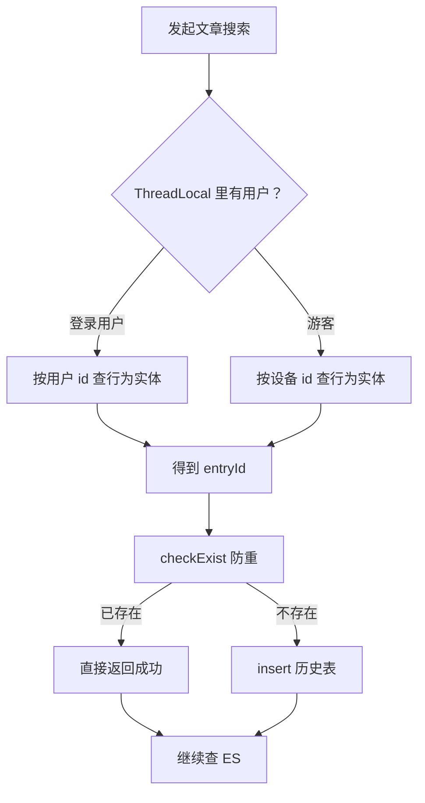

# 搜索历史的落库时机：文章搜索接口里的保存动作

> 🔒 安全提示：文中示例的口令/密钥均为课程教学环境演示口径，生产环境的安全要求见《安全与合规须知》。

历史接口 `load_search` 先行上线之后，App 搜索页的历史区依旧空白。查询端没有毛病，缺的是写端：整条链路上还没有任何代码往 `ap_user_search` 表里插数据。补这块拼图的位置很讲究，不在历史接口里，而在文章搜索接口里。用户每次发起文章搜索的那一刻，就是历史记录该落库的那一刻。

## 先给结论

- 保存历史的入口挂在文章搜索 `article_search` 内，查 Elasticsearch 之前先写 `ApUserSearch`，搜了什么就记什么。
- 防重靠一条 count 查询：`checkExist` 按 entryId、keyword、status=1 计数，大于 0 直接返回成功，不再重复插入。
- 身份不直接拿用户 id，而是经行为实体换算成 entryId：登录用户按用户 id 查，游客按设备 id 查，两条分支汇到同一个值。
- 记录只在第一页触发，`fromIndex == 0` 才保存，翻页不重复写，历史区不会被同一次搜索刷出五六条。
- `ap_user_search` 用 status 软删，1 为有效 0 为已删，删除历史只是改状态不删行。

## 接口文档里的隐藏需求

文章搜索接口的契约在需求分析课已经定下：`POST /api/v1/search/article_search`，入参是搜索 DTO，出参 ResponseResult 包文章列表。把入参摊开看，除了搜索必需的关键字与分页，还有两个容易被忽略的字段（day04 资料包为空，DTO 按本课写法补全，包名统一 `com.study.headline`）：

```java
package com.study.headline.model.search.dtos;

import com.study.headline.model.common.dtos.PageRequestDto;

/** 文章搜索请求体：关键字加分页加锚点 */
public class SearchArticleDto extends PageRequestDto {

    /** 搜索关键字 */
    private String searchWords;

    /** 锚点起始行：0 表示第一页，兼任是否保存历史的开关 */
    private Integer fromIndex;

    /** 游客设备 id：未登录时用它换算行为实体 */
    private String equipmentId;
}
```

fromIndex 是分页锚点，同时兼任保存开关；equipmentId 服务于游客身份；接口文档里另有一个 tag 字段，默认 article，当前索引库里只存文章，先留作扩展位。隐藏需求说清楚了：查询搜索记录接口只查不写，真正的写入发生在本接口内，用户搜文章的同时关键字先进历史表。

代码落点是新引入的搜索模块 leadnews-search，搜索相关的 Controller、Service 都集中在这里，实体与 Mapper 复用 model 工程里用户域、文章域的既有产物。

## Mapper 层：两个方法加两份 XML

写入逻辑很薄，薄到 Mapper 只需要两个方法：

```java
public interface ApUserSearchMapper {

    /**
     * 插入搜索记录
     */
    int insert(ApUserSearch record);

    /**
     * 查询记录是否存在
     */
    int checkExist(@Param("entryId") Integer entryId, @Param("keyword") String keyword);
}
```

映射文件一插入一查询：

```xml
<insert id="insert" parameterType="com.study.headline.model.user.pojos.ApUserSearch">
    insert into ap_user_search (entry_id, keyword, status, created_time)
    values (#{entryId}, #{keyword}, #{status}, #{createdTime})
</insert>

<select id="checkExist" resultType="java.lang.Integer">
    select count(1)
    from ap_user_search
    where entry_id = #{entryId} and keyword = #{keyword} and status = 1
</select>
```

checkExist 的 where 条件带着 status = 1，说明这套历史是软删语义：删除接口把状态置 0，数据还留在表里。同一天顺带补的另一处 Mapper 是 ApArticleMapper，它此前没有按主键查单条的方法，而 ES 命中的文章字段不全，要回 MySQL 补全，这次加上 selectById，留给下一课的结果组装用。

## Service 层：saveUserSearch 的实现

Service 声明两个方法，一个文章搜索主流程，一个保存搜索记录：

```java
public interface ArticleSearchService {

    /** 文章搜索：查 ES 前先保存历史 */
    ResponseResult articleSearch(SearchArticleDto dto);

    /** 保存搜索记录：entryId 由上层换算好传入 */
    ResponseResult saveUserSearch(Integer entryId, String searchWords);
}
```

saveUserSearch 按「先查后插」展开：

```java
@Override
public ResponseResult saveUserSearch(Integer entryId, String searchWords) {
    // 检查当前数据是否存在，存在则不重复保存
    int count = apUserSearchMapper.checkExist(entryId, searchWords);
    if (count > 0) {
        return ResponseResult.okResult(count);
    }
    // 不存在，构建实体保存
    ApUserSearch apUserSearch = new ApUserSearch();
    apUserSearch.setEntryId(entryId);
    apUserSearch.setKeyword(searchWords);
    apUserSearch.setStatus(1);
    apUserSearch.setCreatedTime(new Date());
    int insert = apUserSearchMapper.insert(apUserSearch);
    return ResponseResult.okResult(insert);
}
```

四行属性赋值各管一件事：entryId 定位到人或设备，keyword 存词，status 置 1 表示有效，createdTime 记录首次搜索时间。返回值把 Mapper 的受影响行数原样包进 ResponseResult，调用方只关心成功与否。

## entryId 从哪来：登录与游客的两条分支

saveUserSearch 的第一个参数是换算好的 entryId，换算动作发生在文章搜索主流程的开头。行为实体机制在行为功能课铺过：App 端所有行为都挂在一台行为实体上，登录用户的行为实体经用户 id 查出，游客的行为实体经设备 id 查出，两张面孔一个出口。当前用户由过滤器解析 token 后绑定线程，取用时从 ThreadLocal 直接拿：

```java
// 登录用户：按用户 id 查行为实体；游客：按设备 id 查（示例按既有行为模块写法补全）
ApUser user = AppThreadLocalUtils.getUser();
if (user != null) {
    entryId = apBehaviorEntryMapper.selectByUserId(user.getId()).getId();
} else {
    entryId = apBehaviorEntryMapper.selectByEquipmentId(dto.getEquipmentId()).getId();
}
```

两条分支连同防重与插入汇成一张图：



关键路径在分叉点：身份判断只做一次，两条分支的产出都是 entryId，后续的防重与插入完全感知不到调用者是人是机。

## 为什么第一页才保存，以及要不要异步

同一次搜索可能翻五六页结果，历史只需要记一次，判断条件就是 `fromIndex == 0`。第二页第三页进来直接跳过保存段，历史区不会被同一次搜索的翻页动作刷满。

保存放在主流程里同步执行，代价是一次 count 加一次 insert，毫秒级开销，换来实现简单与顺序确定。真要抠性能，可以把它丢进线程池或改发消息异步落库，但会引入两个新问题：查询与记录不再严格先后，极端情况下历史还没写完，用户回到搜索页刷新历史区却看不到刚搜的词；异步链路失败还需要补偿逻辑兜底。搜索是低频动作，同步保存绰绰有余，异步化留给真正出现瓶颈的那天。

## 常见误区

- **把 checkExist 的返回值当布尔用。** 它返回 int 计数，直接写 `if (checkExist(...))` 编译不过；先与 0 比较再参与判断。
- **翻页也保存。** 历史记录的意义是「搜过什么」，不是「看过第几页」，判断条件压在 `fromIndex == 0` 上，翻页一律跳过。
- **XML 占位符少花括号。** `#{entryId}` 写成 `#entryId`，MyBatis 解析直接抛异常，这种错肉眼看页面很容易扫过去，报错信息却不会说谎。
- **忽略软删后的重复插入。** checkExist 只数 status = 1 的行，用户删过的词再次搜索会插一条新记录；要严格去重，要么给 entryId 加 keyword 建唯一索引，要么删除时改成复活旧记录。

## 面试可能被问到的问题

1. 面试官追问：「保存历史为什么放在文章搜索接口里，而不是单独给个保存接口？」
   答：保存的触发时机是「用户发起了真实搜索」，这个事件只有文章搜索接口知道，前端单独调保存接口要么漏记要么多记。后端在搜索主流程内顺带落库，触发时机与业务动作天然对齐，前端零改造。
2. 面试官追问：「防重为什么用 count 查询而不是唯一索引？」
   答：count 加软删语义实现最简单，查得到就跳过；唯一索引在软删场景会误伤，同一条词删了再搜，status 为 0 的旧行还占着唯一键。更稳的组合是唯一索引加删除时复活旧记录，历史表数据量小，count 方案完全够用。
3. 面试官追问：「历史表为什么用 status 软删而不是物理删除？」
   答：软删保留行为数据，后续做搜索行为分析、个性化推荐时数据还在；物理删除省空间但历史不可追溯。历史表按用户维度分片后单表规模可控，软删的存储成本可以忽略。
4. 面试官追问：「保存历史失败要不要阻断搜索？」
   答：不要。搜索是主业务，历史是旁路记录，保存失败顶多这条历史缺失，捕获异常打日志即可；若把保存做成强一致的前置条件，历史表一抖动就拖垮搜索主流程，方向反了。
5. 面试官追问：「游客搜过的词登录后会串吗？」
   答：不会。历史按行为实体隔离，游客与登录用户是两个行为实体，各查各的；如果产品要求登录后继承游客历史，可以在登录成功处做一次设备实体到用户实体的迁移，那是产品策略问题，不是存储层问题。

## 配套资料

- 代码：`materials/code/05/头条day04/`。该日资料包解压结果为空（未含源码文件），文中 DTO、Mapper、XML 与 Service 片段按画面线抄录并按既有工程风格补全，包名统一改写为 `com.study.headline`；引用路径截至 `头条dayNN/` 层级，内层目录冠以项目原名，正文统一以「头条类资讯项目」指代。
- 代码：`materials/code/05/头条day01/`，内层资料目录含数据库规范设计说明书与项目原型，`ap_user_search` 表字段命名可对照其规范条目。
- 环境：课程集群 node01~node03，MySQL root/123456。
