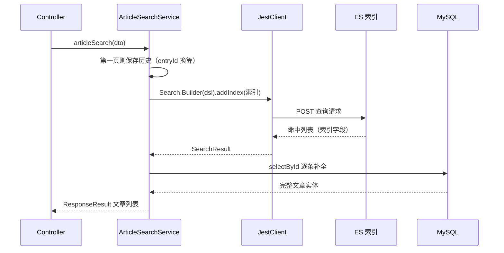

# 文章搜索四步走：构建查询、执行搜索与结果补全

> 🔒 安全提示：文中示例的口令/密钥均为课程教学环境演示口径，生产环境的安全要求见《安全与合规须知》。

saveUserSearch 已经开过工，`articleSearch` 的主流程还空着。这一课把它写满：方法体里其实只有四步，保存搜索记录、构建查询条件、执行搜索、处理结果。客户端用课程画面里的 JestClient，它走 HTTP 发 JSON，本质上就是把一段 DSL 发给已建好的 `app_info_article` 索引，再把命中结果捞回来反序列化。

## 先给结论

- 主流程四步：保存记录（仅第一页）→ `SearchSourceBuilder` 构条件 → `jestClient.execute` 执行 → `getSourceAsObjectList` 反序列化。
- 查询用 `matchQuery`，作用域是 title 域，域名必须与索引 mapping 里的字段严格对上，写错域等于查了个寂寞。
- 分页用 from 与 size 两件套：from 取 `dto.getFromIndex()`，size 取 `dto.getPageSize()`，深翻页有性能上限。
- ES 命中只含索引里那几个字段，标题之外的完整数据要回 MySQL 按主键补全，补不到的丢弃。
- 客户端与常量分工：JestClient 负责发请求，索引名与类型名集中在 common 工程的 `ESIndexConstants`，别在业务代码里裸写字符串。

## 客户端选型：JestClient 是什么

课程用的是 JestClient，一个基于 HTTP 的 Elasticsearch 客户端：把 `SearchSourceBuilder` 拼出来的 DSL 字符串塞进请求体，发给指定索引，拿到 JSON 再反序列化成实体。它的好处是不依赖传输层客户端的版本绑定，只认 HTTP。Elasticsearch 官方现役推荐是 RestHighLevelClient，两者思路完全同构：都是 builder 拼 DSL、execute 发请求、结果转实体，迁移过去只是 API 名字的变化，这一课的思路照样成立。

## 主流程：一个方法装下四步

方法签名在契约课定过，实现按四步展开（day04 资料包为空，代码按画面线抄录并按既有工程风格补全，包名统一 `com.study.headline`）：

```java
@Override
public ResponseResult articleSearch(SearchArticleDto dto) {
    // 第一步：保存搜索记录，只在第一页触发
    if (dto.getFromIndex() == 0) {
        ResponseResult ret = getEntryId(dto);
        if (ret.getCode() != AppHttpCodeEnum.SUCCESS.getCode()) {
            return ret;
        }
        saveUserSearch((Integer) ret.getData(), dto.getSearchWords());
    }
    // 第二步：构建查询条件
    SearchSourceBuilder builder = new SearchSourceBuilder();
    builder.query(QueryBuilders.matchQuery("title", dto.getSearchWords()));
    builder.from(dto.getFromIndex());
    builder.size(dto.getPageSize());
    Search search = new Search.Builder(builder.toString())
            .addIndex(ESIndexConstants.ARTICLE_INDEX)
            .addType(ESIndexConstants.DEFAULT_DOC)
            .build();
    try {
        // 第三步：执行搜索
        SearchResult result = jestClient.execute(search);
        // 第四步：处理结果，命中列表反序列化成实体
        List<ApArticle> articles = result.getSourceAsObjectList(ApArticle.class);
        List<ApArticle> resultList = new ArrayList<>();
        for (ApArticle apArticle : articles) {
            // ES 里字段不全，回 MySQL 按主键补全
            ApArticle dbArticle = apArticleMapper.selectById(Long.valueOf(apArticle.getId()));
            if (dbArticle == null) {
                continue;
            }
            resultList.add(dbArticle);
        }
        return ResponseResult.okResult(resultList);
    } catch (Exception e) {
        e.printStackTrace();
        return ResponseResult.errorResult(AppHttpCodeEnum.PARAM_INVALID);
    }
}
```

第一步的身份换算被抽成了私有方法，登录用户与游客两条分支在这里汇合：

```java
/** 登录用户按用户 id 查行为实体，游客按设备 id 查（示例按既有行为模块写法补全） */
private ResponseResult getEntryId(SearchArticleDto dto) {
    ApUser user = AppThreadLocalUtils.getUser();
    ApBehaviorEntry entry = user != null
            ? apBehaviorEntryMapper.selectByUserId(user.getId())
            : apBehaviorEntryMapper.selectByEquipmentId(dto.getEquipmentId());
    if (entry == null) {
        return ResponseResult.errorResult(AppHttpCodeEnum.PARAM_INVALID);
    }
    return ResponseResult.okResult(entry.getId());
}
```

换算失败的分支直接把错误返回给调用方，历史保存与后续查询一并终止，不让无主请求继续往下走。

## 查询条件为什么这样拼

`SearchSourceBuilder` 拼出来的就是一段 DSL。`matchQuery("title", dto.getSearchWords())` 是分词匹配：输入「面试」，分词器把 title 域里含有「面试」这个词的文档全部召回，标题为「面试详细分析」的文章就是这么被命中的。域名的对应关系可以在 Kibana 的控制台里打开索引 mapping 核对，title 就在 `app_info_article` 的字段列表里，旁边还能看到 channel_id、content 这些同期建好的域。

from 与 size 控制窗口：from 是起始行，size 是每页条数。翻页时前端只递增 fromIndex，查询条件结构不变，这就是契约课说的锚点翻页。整条调用链画出来是这样的：



关键路径在补全那一跳：ES 返回的实体只有索引字段，主键 id 用来回 MySQL 换完整数据，补不到的 continue 跳过，最终列表里每一条都是可以点开详情的完整文章。

## Controller 与 MockMvc 验收

Service 之上是契约接口与控制器，端点沿用 `POST /api/v1/search/*` 家族：

```java
@RestController
@RequestMapping("/api/v1/search")
public class ArticleSearchController implements ArticleSearchControllerApi {

    @Autowired
    private ArticleSearchService articleSearchService;

    @Override
    @PostMapping("/article_search")
    public ResponseResult articleSearch(@RequestBody SearchArticleDto dto) {
        return articleSearchService.articleSearch(dto);
    }
}
```

单测沿用 MockMvc 口径，入参把设备 id 用统一混淆串传进去，关键字先用「面试」试水：

```java
@Test
public void testArticleSearch() throws Exception {
    SearchArticleDto dto = new SearchArticleDto();
    dto.setPageNum(1);
    dto.setPageSize(10);
    dto.setFromIndex(0);
    dto.setSearchWords("面试");
    dto.setEquipmentId("SD3EBECF883C4E99329AF8A29300A86");
    mockMvc.perform(MockMvcRequestBuilders
            .post("/api/v1/search/article_search")
            .contentType(MediaType.APPLICATION_JSON_VALUE)
            .content(JSON.toJSONString(dto)))
            .andExpect(status().isOk())
            .andDo(print());
}
```

跑绿之后看打印的响应体：code 为 0，data 里命中一篇标题含「面试」的文章；换一个索引里存在的词再试，同样能捞到对应文章。真机联调放到下一课，先把单板验收掉。

## 补一手：bool 组合与高亮

课程实现只压了 title 一个域，工程里常见的增强是 bool 组合加高亮（示例为按主流写法补全，非课程原码）：

```java
// 多域 must 组合 + 标题高亮，替换主流程第二步的条件构建
BoolQueryBuilder boolQuery = QueryBuilders.boolQuery()
        .must(QueryBuilders.matchQuery("title", dto.getSearchWords()));
HighlightBuilder highlight = new HighlightBuilder()
        .field("title")
        .preTags("<em>")
        .postTags("</em>");
builder.query(boolQuery);
builder.highlighter(highlight);
```

命中后把 title 替换成带高亮标记的片段，与补全数据合成展示用的 ArticleSearchVo（视图对象，承载高亮标题、发布时间、封面等展示字段），列表渲染时搜索词自动飘红。这套增强不改变主流程骨架，只在结果组装段多做一步字段替换。

## 常见误区

- **matchQuery 与 termQuery 混用。** match 会先分词再匹配，term 是精确命中不分词；对标题这类文本域用 termQuery，只有输入与词项完全一致才命中，表现为「明明有数据却搜不到」。
- **域名随手写。** `matchQuery("name", ...)` 里的 name 若不是 mapping 里的域，查询照常返回，只是命中数为零；先去 Kibana 核对 `app_info_article` 的字段再写查询。
- **异常吞掉后返回 null。** ES 连不上、DSL 有错都会在 execute 处抛异常，catch 后返回 null 会让前端拿到空响应无从判断；必须返回带错误码的 ResponseResult。
- **忘了回库补全。** ES 副本只存索引字段，直接把命中实体返给前端，详情跳转时发现字段残缺；补全失败的那几条也要果断丢弃，宁可少一条不能错一条。

## 面试可能被问到的问题

1. 面试官追问：「JestClient 与 RestHighLevelClient 怎么选？」
   答：两者都基于 HTTP，Jest 出现得早、用法简单，教学与老项目常见；RestHighLevelClient 是官方现役方案，API 覆盖全、随版本演进。核心都是 builder 拼 DSL 加 execute 发请求，迁移成本主要在 API 名字与结果解析层。
2. 面试官追问：「matchQuery 的分词匹配和数据库 like 有什么区别？」
   答：match 先把查询词与文档 title 分别分词，按词项去倒排索引里取交集或并集，能召回「面试详细分析」这类含词变体；like 是连续子串匹配，召回窄且全表扫描。检索质量与性能都不是一个量级。
3. 面试官追问：「from 加 size 翻页有什么坑，怎么破？」
   答：from 与 size 之和受 max_result_window 限制（默认一万），翻深了直接报错，而且越翻越慢。浅层用 from 加 size 足够，深层滚动改用 search_after 加游标，首页直接给 total 告诉用户量级，引导搜索而不是翻页。
4. 面试官追问：「为什么 ES 命中后还要回 MySQL 查一遍，不嫌慢吗？」
   答：ES 是检索副本，只存标题、频道这类索引字段，完整的正文、作者、配置都在 MySQL。搜索列表只要标题的话可以不回库，但本接口返回的是可点开的完整文章列表，回库补全保证了数据权威与完整；性能上按主键批量查是毫秒级，可接受。
5. 面试官追问：「高亮是后端做还是前端做？」
   答：两种都有。ES 的 HighlightBuilder 在返回时把命中片段包上标记，后端做的好处是分词边界准确、天然只包住真正命中的词；前端做要自己实现分词定位，容易标错。列表页标题高亮一般由后端返回片段，前端只负责渲染样式。

## 配套资料

- 代码：`materials/code/05/头条day04/`。该日资料包解压结果为空（未含源码文件），文中主流程、控制器与测试代码按画面线抄录并按既有工程风格补全，包名统一改写为 `com.study.headline`；高亮与 VO 段为按主流写法补全的示例；引用路径截至 `头条dayNN/` 层级，内层目录冠以项目原名，正文统一以「头条类资讯项目」指代。
- 代码：`materials/code/05/头条day01/`，内层资料目录含数据库规范设计说明书，`ap_article` 与搜索结果字段的对应关系可对照其规范条目。
- 环境：课程集群 node01~node03，MySQL root/123456；Elasticsearch 与 Kibana 已在节点上就绪，索引为已建好的 `app_info_article`。
