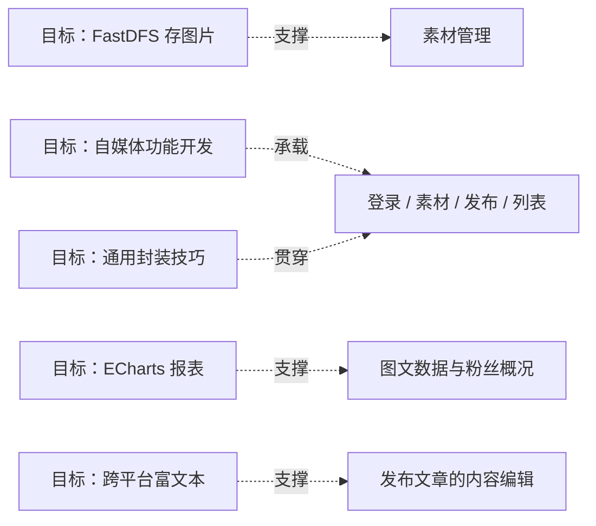

# day05 任务书：自媒体端开工与内容生产四件套

> 🔒 安全提示：文中示例的口令/密钥均为课程教学环境演示口径，生产环境的安全要求见《安全与合规须知》。

day04 收官时，App 端的搜索全链路已经打通，读者侧的能力基本齐了。内容却不能凭空长出来，得有人写文章、传图片、管发布。day05 把视角切到生产侧：新建自媒体工程，做登录、素材、发布、列表管理四块功能，外加两张数据报表。今天目标清单里有五个条目，代码量是开课以来最大的一天，先把目标与技术点的映射捋清楚再动手。

## 先给结论

- day05 五个目标：用 FastDFS 存图片、完成自媒体系统功能开发、掌握 Vue 加 ECharts 的报表用法、沉淀后台通用封装技巧、熟悉跨平台富文本的处理方式。
- 自媒体功能拆四块主线：登录换 token、素材管理管图片、发布文章管草稿与审核、内容列表管查询与改删，四块是一条依赖链。
- 图片不再塞数据库：FastDFS 分布式文件存储承担文章图片与封面，库表里只留 URL。
- 报表用 ECharts：图文数据与粉丝数据两张统计图，折线图配环形图。
- 新建工程 leadnews-wemedia，数据表以 wm_ 前缀家族铺开，与 App 端的 ap_ 家族分库而治。

## 五个目标怎么映射到技术点

目标与支撑技术不是一对一，FastDFS、ECharts、富文本是三件新工具，都服务于自媒体功能这条主线。映射关系如下：



关键路径在目标二：登录、素材、发布、列表四块功能是今天的主战场，其余四个目标都是给它们当武器。FastDFS 解决图片放哪，ECharts 解决数据怎么看，富文本编辑器解决内容怎么编，封装技巧决定代码写多长。

## 四块功能与它们的依赖链

四块功能不是并列关系，按依赖顺序排：没有登录就没有自媒体用户身份，素材要挂在用户名下，发布要引用素材里的图片，列表管的是发布出来的文章。每块的核心动作与数据落点如下：

| 功能模块 | 核心动作 | 技术点 | 主要数据 |
|---|---|---|---|
| 自媒体登录 | 手机号加密码换 token | 复用 App 端 JWT 口径 | wm_user |
| 素材管理 | 上传、删除、查询、收藏 | FastDFS 图片存储 | wm_material |
| 发布文章 | 表单编辑、存草稿、提交审核 | 跨平台富文本编辑器 | wm_news |
| 内容列表 | 状态筛选、分页、修改、删除 | 条件分页查询 | wm_news |
| 数据报表 | 图文与粉丝统计图 | Vue 加 ECharts | 统计表 |

登录课的口径从简：后端很多数据依赖当前 token，登录只为把 token 写到前端并随请求带回，验证逻辑复用已有的签发与校验工具，不另起炉灶。素材管理围绕图片转：先上传，上传成功的图片进素材列表，之后写文章时从这里选图，收藏与取消收藏是列表上的标记位。发布文章是今天最重的模块，表单收标题与频道，内容区由富文本编辑器产出 HTML，两个提交按钮对应两种去向：存草稿留待再改，提交审核进入审核流程，审核通过才真正发布到 App 端让读者看到。

## FastDFS 为什么进场

文章里图片与封面的体量会持续增长，塞进数据库既撑大存储又拖慢查询，文件得挪出去。FastDFS 是分布式文件存储系统，三个角色各司其职：tracker 负责调度与负载均衡，storage 负责实际存文件，client 上传时先问 tracker 要一台可用的 storage，文件推过去后拿到组名与远程路径。上传动作的量级大致如下（示例为按主流写法补全，day05 资料包为空）：

```java
// FastDFS 上传最小示例：文件字节流换远程路径
StorageClient1 client = fastDFSFactory.getClient();
String[] paths = client.upload_file(imageBytes, "jpg", null);
// paths[0] 为 group 名，paths[1] 为远程文件名
String url = "http://" + storageHost + "/" + paths[0] + "/" + paths[1];
wmMaterial.setUrl(url);
```

落库的只有这串 URL，图片本体在 storage 节点上。这套能力装好之后，素材管理的上传、文章封面、内容里的插图走的是同一条路。

## 报表与封装：两件容易被低估的事

ECharts 承担两张统计图：图文数据把发布量、阅读量、点赞量、评论量、收藏量、转发量与不喜欢数画成折线与环形，粉丝概况把粉丝的行为数据按日期筛选展示。前端只管画，后端要先把按天聚合的统计数据喂出来，查询接口的口径决定了图好不好画。

封装技巧是今天顺带迭代的事：连写几天业务后回头看，Controller 调 Service、DTO 校验、分页参数处理这些样板代码高度重复，把公共片段抽成基类或工具方法，代码量立减。富文本编辑器跨平台的点在于它产出的是纯 HTML，这段 HTML 直接进文章内容字段，App 端与 Web 端拿到同一份内容各自渲染，编辑一次两端通用。

## 常见误区

- **把今天当成只讲发布。** 发布是重头，但素材、列表、登录、两张报表同样在今天交付，漏掉任何一块，自媒体端都无法独立跑起来。
- **图片继续存数据库。** 图片走 base64 或 blob 进库，行宽暴涨、备份变慢、CDN 无从谈起；正确姿势是文件进 FastDFS，库里只留 URL。
- **草稿与发布混为一谈。** 提交审核不等于发布，中间隔着审核环节；把提交直接标成已发布，审核流程就被架空了。
- **富文本当纯文本存。** 编辑器产出的 HTML 带样式与图片标签，落库要用足够长的文本类型，取出后按 HTML 渲染；按纯文本处理会把样式与插图全弄丢。

## 面试可能被问到的问题

1. 面试官追问：「FastDFS 在系统里承担什么角色，为什么不用数据库存图片？」
   答：FastDFS 是面向小到中型文件的分布式存储，tracker 调度加 storage 分组的架构天然支持横向扩容与冗余备份；图片存数据库会让行宽与备份成本失控，也无法直接给 CDN 或浏览器提供静态访问，文件与结构化数据分离存储是标准做法。
2. 面试官追问：「自媒体端与 App 端为什么分两套库表？」
   答：两端视角与读写模式不同，自媒体端是作者视角的写作与管理数据，App 端是读者视角的内容与行为数据，量级、增长曲线、分片键都不一样。分库后各自独立演进，靠审核发布这个动作把两边的数据衔接起来。
3. 面试官追问：「登录为什么要单独做一版，App 端不是有登录了吗？」
   答：两端用户体系不同，App 端是读者账号，自媒体端是创作者账号，身份、权限、密码策略都不同。复用的是 token 签发与校验机制，不复用的是用户数据与权限边界。
4. 面试官追问：「后台通用封装可以从哪些点下手？」
   答：常见的有统一 Controller 基类收编通用注入、分页参数与返回包装的模板化、DTO 参数校验的工具化、MyBatis 公用列映射的抽取。原则是只封装确实重复三次以上的片段，为复用而复用会把简单逻辑藏进继承树里。
5. 面试官追问：「富文本内容直接存 HTML 有什么风险，怎么防？」
   答：风险是脚本注入与样式失控，编辑器产出的 HTML 需要经过白名单过滤再落库，展示端按受控样式渲染；图片标签指向的地址要校验域名，防止外链滥用。存储用足够长的文本类型，量大时考虑压缩或分离附件。

## 配套资料

- 代码：`materials/code/05/头条day05/`。该日资料包解压结果为空（未含源码文件），文中功能拆解、FastDFS 示例与接口口径按画面线与本课写法补全，包名统一改写为 `com.study.headline`；引用路径截至 `头条dayNN/` 层级，内层目录冠以项目原名，正文统一以「头条类资讯项目」指代。
- 代码：`materials/code/05/头条day01/`，内层资料目录含项目原型与数据库规范设计说明书，原型里有发布、内容管理等自媒体页面，wm_ 家族表字段可对照其规范条目。
- 环境：课程集群 node01~node03，MySQL root/123456。
