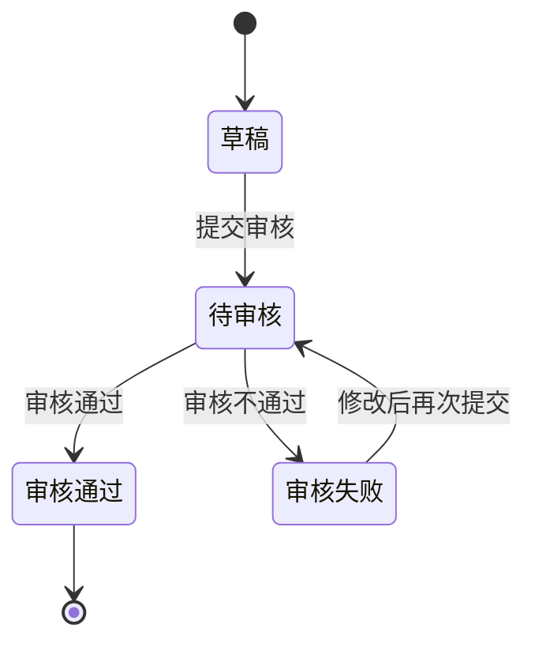
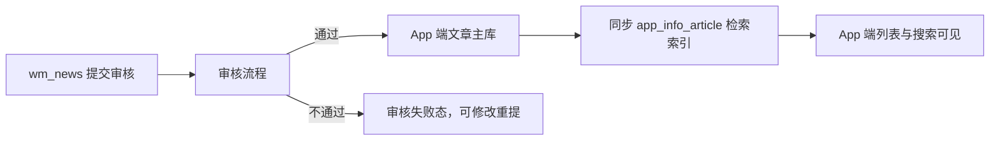

# 自媒体端需求分析：五块功能、wm 家族表与文章状态机

> 🔒 安全提示：文中示例的口令/密钥均为课程教学环境演示口径，生产环境的安全要求见《安全与合规须知》。

App 端是消费侧，自媒体端是生产侧：创作者在这里传图、写文章、提交审核、看数据。开工前把需求图读透，功能怎么拆、表怎么分片、状态怎么流转、与 App 端文章怎么衔接，四个问题都有明确答案，后面几天的编码才不会边写边返工。

## 先给结论

- 功能五块：图文数据报表、素材管理、发布文章、内容列表、粉丝概况，前三块是生产工具，后两块是管理与复盘。
- 数据落在 wm_ 前缀家族：wm_user、wm_news、wm_material 与图文关系表等，与 App 端的 ap_ 家族分库而治。
- 自媒体库拆 6 个数据节点 DN[0-5]，主键两种生成方式：单字段走 MyCat 全局自增，id 加 burst 双字段走 ZK 分布式主键。
- 文章状态机是发布的核心约束：存草稿与提交审核是两条入口，审核通过才发布进 App，审核失败可修改后再次提交。
- 新建工程 leadnews-wemedia，前端是 Vue 管理端工程，与 App 端的 weex 工程是两套体系。

## 五块功能怎么读

图文数据需求面向自媒体用户展示文章运营数据：发布量、阅读量、点赞量、评论量、收藏量、转发量与不喜欢统计，用 Vue 加 ECharts 做成折线图与饼图，让创作者直观看到经营状况，这部分放到内容做完后再展开。素材管理是发布的前置：写文章要插图，图片得先在素材区上传，之后才能在编辑器里选用，上传之外还有删除、查询与收藏取消收藏。发布文章是重头，表单收标题与频道，内容区用跨平台富文本编辑器产出 HTML，底部两个按钮对应两条去路：存草稿暂存再改，提交审核进入审核流程，注意是提交审核而非直接发布，只有审核通过的文章才真正发到 App 端供读者查看。内容列表是发布后的管理台：按状态筛全部、草稿、待审核、审核通过、审核失败，叠加频道与时间条件，列表上还能修改与删除。粉丝概况把粉丝的行为数据画成折线与环形图，支持按日期筛选。

## 文章状态机：为什么提交不等于发布

发布文章的状态流转是一条受控链路：



两条入口对应创作者的两种节奏：内容没写完或还不满意，存草稿随时回来改；写好了提交审核，进入待审核。审核结论只有通过与失败两种，失败的可以修改后重新提交，通过的进入发布态，从此对 App 端读者可见。状态机约束的是内容质量关口：没有审核环节，App 端就失去了对生产内容的最后一道控制。

## wm 家族表与 MyCat 路由

自媒体数据体量没有 App 端大，但表结构同样按分库分表预先设计。路由定义里自媒体库拆 6 个数据节点 DN[0-5]，主要表的分片口径如下（按画面线表格整理，day05 资料包为空，个别补行按功能补全）：

| 表名 | 描述 | 主键方式 | 存放 DN | 分表字段 |
|---|---|---|---|---|
| wm_user | 自媒体用户信息表 | auto_increment | DN[1-3] | user_id |
| wm_user_login | 自媒体用户登录信息表 | auto_increment | DN[4] | user_id |
| wm_user_equipment | 自媒体用户设备信息表 | auto_increment | DN[1-3] | id |
| wm_sub_user | 自媒体子账号信息表 | auto_increment | DN[0-2] | parent_id |
| wm_user_auth | 自媒体子账号权限信息表 | auto_increment | DN[1-3] | id |
| wm_news | 自媒体图文内容信息表 | auto_increment | DN[0] | id |
| wm_material | 素材信息表 | auto_increment | DN[0] | id |
| wm_news_statistics | 自媒体图文数据统计表 | zk_sequence | DN[0-5] | burst(id, user_id) |
| wm_fans_statistics | 自媒体粉丝数据统计表 | zk_sequence | DN[1-3] | burst(id, user_id) |
| wm_fans_portrait | 自媒体粉丝画像信息表 | zk_sequence | DN[1-3] | id |

图文内容信息集中在最后三张：文章存 wm_news，图片素材存 wm_material，文章与素材的多对多关系存图文关系表，发布一篇文章配了几张图、封面用哪张，靠关系表描述。主键生成方式分两派：单字段主键交给 MyCat 全局自增序列，业务侧不用操心；双字段主键的表用 zk_sequence，id 与 burst 由 ZK 分布式主键封装同时产出，burst 是分片路由的辅助字段，实体入库时两个字段都必须赋值，day03 的 client 与 config 封装在这里直接受益。以文章表为例（示例为按本课写法补全，字段命名对照 day01 数据库规范设计说明书）：

```sql
create table wm_news (
  id          bigint       not null comment '主键：MyCat 全局序列',
  user_id     int          not null comment '自媒体用户 id',
  title       varchar(64)  not null comment '文章标题',
  channel_id  int          comment '所属频道 id',
  content     longtext     comment '富文本内容',
  images      varchar(512) comment '图片列表',
  status      tinyint      not null comment '状态：草稿/待审核/审核通过/审核失败',
  publish_time datetime     comment '发布时间',
  created_time datetime     not null comment '创建时间',
  primary key (id)
) comment '自媒体图文内容信息表';
```

## 接口与工程口径

工程定义：新建自媒体工程 leadnews-wemedia，仍按既有微服务模板起步。技术定义里的接口清单按四族展开（示例按本课写法补全）：

```java
public interface WmNewsControllerApi {

    /** 提交文章：按 dto 的开关决定存草稿还是提交审核 */
    ResponseResult submitNews(WmNewsDto dto);

    /** 按状态、频道、时间分页查询文章列表 */
    ResponseResult findList(WmNewsPageDto dto);

    /** 按主键查询，回显给修改页 */
    ResponseResult findNewsById(Integer id);
}
```

登录族为 token 而生，后端大量数据依赖当前登录身份；素材族管上传删除与收藏；文章族覆盖提交草稿、查看、修改、删除；统计族出图文与粉丝两张报表的数据。前端定义按结构过一眼：Vue 管理端工程，src 下分 api、components、views，router 配路由，permission 做访问控制，与 App 端 weex 工程完全独立。

## 与 App 端文章怎么衔接

自媒体库与 App 端库是两套数据：wm_news 管作者视角的稿件，App 端的文章表管读者视角的已发布内容，衔接点就是审核。审核通过后，稿件进入 App 端文章主库并生成详情内容，同时同步进已建好的 `app_info_article` 检索索引，读者才在列表与搜索里看到它；审核失败则原地停留，等作者修改后重新提交。这条流转画出来是：



关键路径在通过分支：进主库与进索引是两步，主库是权威数据，索引是检索副本，这与 App 端搜索课定下的存储口径一致。

## 常见误区

- **把 wm 家族表当 App 端表用。** 两端分库各有职责，跨库直查会把管理数据与读者数据搅在一起；衔接只发生在审核通过的那一步。
- **ZK 主键当单字段用。** zk_sequence 方式下 id 与 burst 成对生成，只赋 id 不赋 burst，MyCat 找不到分片路由，插入直接报错；双字段必须同时维护。
- **提交审核当发布。** 状态机里待审核与已发布隔着审核环节，把提交直接标成发布，App 端读者会看到未审内容，质量关口形同虚设。
- **素材与文章不分表。** 富文本内容与图片素材体量、访问模式都不同，混存会让文章表膨胀且图片无法复用；素材独立成表，靠关系表挂接。

## 面试可能被问到的问题

1. 面试官追问：「自媒体端为什么独立建库建工程，而不是塞进 App 端文章服务？」
   答：用户体系、读写模式、数据量级都不同：创作者写多读少，读者读多写少；分库后两边独立扩容与演进，工程上互不拖累。衔接点收窄到审核发布一个动作，边界清晰，出问题也好定位。
2. 面试官追问：「burst 字段是干什么的，为什么 ZK 主键要带它？」
   答：MyCat 按分表字段路由，burst 就是路由依据之一。ZK 生成的全局主键只保证 id 唯一，不保证分布均匀，封装在生成 id 的同时产出 burst 值，让同一批数据按规则散到不同节点，业务侧只要两个字段一起赋值即可。
3. 面试官追问：「状态机为什么必须有审核失败态，直接打回草稿不行吗？」
   答：失败态保留审核结论的痕迹，作者能区分「自己存的草稿」与「审核没过被退回的稿件」，两者下一步动作不同：前者是继续编辑，后者是按驳回原因修改后重提。全部坍缩成草稿态，审核意见就丢了入口。
4. 面试官追问：「审核通过后进主库，怎么保证主库与检索索引一致？」
   答：以主库为权威，同步进索引是副本更新，失败可重试可重建，索引删了还能从主库恢复；主库与索引的一致性容忍秒级延迟，最终一致即可，这是检索副本的天然定位。
5. 面试官追问：「素材的收藏与取消收藏影响发布吗？」
   答：收藏是素材列表的筛选标记位，把常用的图收进收藏夹方便选用，发布时引用素材靠的是关系表而不是收藏状态；取消收藏不影响已发布文章里的图片，关系一旦建立，素材的引用与展示独立于管理端的标记。

## 配套资料

- 代码：`materials/code/05/头条day05/`。该日资料包解压结果为空（未含源码文件），文中功能拆解、路由表格与接口片段按画面线抄录整理并按本课写法补全，包名统一改写为 `com.study.headline`；引用路径截至 `头条dayNN/` 层级，内层目录冠以项目原名，正文统一以「头条类资讯项目」指代。
- 代码：`materials/code/05/头条day01/`，内层资料目录含数据库规范设计说明书与项目原型，wm_ 家族表字段与自媒体端页面（发布、内容管理等）可对照核对。
- 代码：`materials/code/05/头条day02/`，mycat 配置四件套可对照自媒体库的分片路由口径。
- 环境：课程集群 node01~node03，MySQL root/123456。
