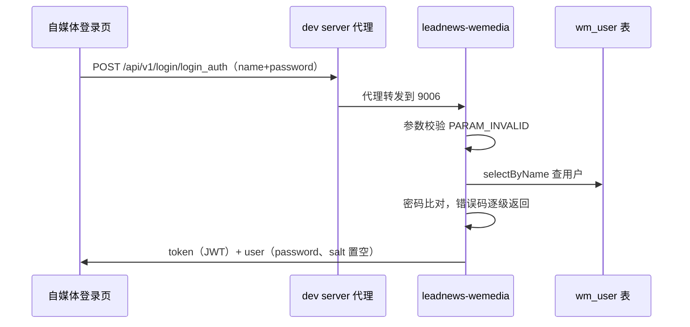

# 自媒体登录后台落地：leadnews-wemedia 微服务与 JWT 签发

> 🔒 安全提示：文中示例的口令/密钥均为课程教学环境演示口径，生产环境的安全要求见《安全与合规须知》。

App 端登录在 leadnews-login 里已经立过完整样板：三道校验、统一错误码、JWT 签发。自媒体端不能直接复用这套代码，根子在两端是两套身份体系：App 端按手机号查 ap_user，自媒体端按用户名查 wm_user，token 签发后的消费方也从 App 端过滤器换成了管理端的 WmTokenFilter。工程结构可以照抄，身份链路必须重走一遍。这一课把 leadnews-wemedia 微服务建起来，登录的后台三层写完，前台联调与 token 的前端去向放到下一课。

## 先给结论

- 新建微服务 leadnews-wemedia，包根 `com.study.headline.wemedia`，端口与应用名取自 common 统一清单，本课分到 9006。
- 配置类从行为服务拷贝再改：MysqlConfig 照旧，另加一份扫描 common 里 wemedia 端安全包的配置，把 WmTokenFilter 装配进容器，admin、app、wemedia 每端各一套过滤器。
- 登录按用户名查 wm_user，三道校验依次是参数为空、用户不存在、密码错误，错误码口径与 App 端登录共用一份枚举。
- 成功返回 token 与 user 两键：token 由 AppJwtUtils 按用户签发，user 返回前把 password 与 salt 都置空，凭据不出服务端。
- 端点为 `POST /api/v1/login/login_auth`；明文 equals 是教学口径，wm_user 的 salt 列就是给加盐改造预留的。

## 工程创建与配置类

微服务的创建动作已经是熟路：聚合工程 leadnews 下新建模块 leadnews-wemedia，打包 jar，依赖清单照行为服务抄一份，内部还是 model、common、apis、utils 四模块加 web、test 两个 starter 与 jackson 的 xml、yaml 支持。resources 下两份文件从模板拷来，`log4j2.xml` 原样，`application.properties` 只改两行：

```properties
# 端口与应用名：值在 common 统一清单中定义，wemedia 分到 9006
server.port=9006
spring.application.name=leadnews-wemedia
```

引导类落在包根，结构与 login、behavior 的引导类逐字同构：

```java
package com.study.headline.wemedia;

import org.springframework.boot.SpringApplication;
import org.springframework.boot.autoconfigure.SpringBootApplication;

@SpringBootApplication
public class WemediaApplication {
    public static void main(String[] args) {
        SpringApplication.run(WemediaApplication.class, args);
    }
}
```

包结构顺手补全：config、service、controller.v1 与 apis 各就各位，契约接口与控制器分层放置的惯例不变。

配置类这一步有个新东西。**数据库与初始化照抄。** MysqlConfig 扫 `com.study.headline.common.mysql.core`，数据源与 Mapper 代理启动即装配，初始化类一并从行为服务拷来，这些与端别无关。**安全过滤按端取件。** common 的 web 支撑包里过滤器按端分包：admin、app、wemedia 各一套，功能同构只是端别不同。App 端用的是 AppTokenFilter，wemedia 端对应 WmTokenFilter，负责从请求头取 token、解析验签、把用户绑定到 ThreadLocal。装进来只需要一个配置类（包路径按画面线整理）：

```java
package com.study.headline.wemedia.config;

import org.springframework.context.annotation.ComponentScan;
import org.springframework.context.annotation.Configuration;

@Configuration
@ComponentScan("com.study.headline.common.web.wm.security")
public class WemediaSecurityConfig {
}
```

`@ComponentScan` 的参数可以写成数组一次扫多个包，新技术接进来时也可以直接往既有初始化配置的扫描列表里追加一项。登录请求此刻还没有 token，过滤器配置里对登录路径放行，其余请求才做解析与绑定。

## wm_user 表与按用户名查询

自媒体用户的落库表是 wm_user（按画面线整理，索引列表省略；salt 列按口播与实体字段补全）：

```sql
create table wm_user (
  id           int(11)      not null auto_increment comment '主键',
  ap_author_id int(11)      default null comment '关联作者 id',
  name         varchar(32)  default null comment '登录用户名',
  password     varchar(32)  default null comment '登录密码',
  salt         varchar(32)  default null comment '盐，供摘要校验使用',
  nickname     varchar(255) default null comment '昵称',
  image        varchar(255) default null comment '头像',
  phone        varchar(20)  default null comment '手机号',
  email        varchar(255) default null comment '邮箱',
  status       tinyint(1)   default '1' comment '状态',
  login_time   datetime     default null comment '登录时间',
  create_time  datetime     default null comment '创建时间',
  primary key (id),
  key idx_user_name (name)
) comment '自媒体用户信息表';
```

登录只关心 name 与 password 两列，表上给 name 建了索引，按名查询走索引不扫全表。查询落在 model 工程的 mappers 包下，与 App 端的 mappers.app 并列新建 wemedia 包：

```java
package com.study.headline.model.mappers.wemedia;

import com.study.headline.model.media.pojos.WmUser;

public interface WmUserMapper {

    /** 按登录用户名查询自媒体用户 */
    WmUser selectByName(String name);
}
```

XML 从 App 端的模板拷来改命名空间，SQL 本身就一句：

```xml
<select id="selectByName" resultMap="BaseResultMap">
    select * from wm_user where name = #{name}
</select>
```

查询条件只有用户名，返回值限定一个用户；这里没有对状态位做约束，教学期保持最小实现，生产上要带上状态位把停用账号挡掉。

## Service：三道校验与脱敏返回

接口先立：WmUserLoginService 定义 `ResponseResult login(WmUser user)`，入参实体里带用户名与密码。实现类三道校验按序把关（按画面线整理）：

```java
@Service
@SuppressWarnings("all")
public class WmUserLoginServiceImpl implements WmUserLoginService {

    @Autowired
    private WmUserMapper wmUserMapper;

    @Override
    public ResponseResult login(WmUser user) {
        //1. 参数校验：用户名与密码都不能为空
        if (StringUtils.isEmpty(user.getName()) || StringUtils.isEmpty(user.getPassword())) {
            return ResponseResult.errorResult(AppHttpCodeEnum.PARAM_INVALID, "用户名或密码不能为空");
        }
        //2. 按用户名查用户，查不到即账号不存在
        WmUser wmUser = wmUserMapper.selectByName(user.getName());
        if (wmUser == null) {
            return ResponseResult.errorResult(AppHttpCodeEnum.DATA_NOT_EXIST, "用户不存在");
        }
        //3. 密码比对：入参密码与库中密码一致才放行
        if (!user.getPassword().equals(wmUser.getPassword())) {
            return ResponseResult.errorResult(AppHttpCodeEnum.LOGIN_PASSWORD_ERROR, "密码错误");
        }
        //4. 登录成功：签发 token，user 清空敏感字段后一并返回
        Map<String, Object> result = new HashMap<>();
        result.put("token", AppJwtUtils.getToken(wmUser));
        wmUser.setPassword(null);
        wmUser.setSalt(null);
        result.put("user", wmUser);
        return ResponseResult.okResult(result);
    }
}
```

三道校验的次序与 App 端登录完全同构，错误码也共用一份枚举：请求残缺拦在 `PARAM_INVALID`，查无此人拦在数据不存在，凭据不对拦在 `LOGIN_PASSWORD_ERROR`。区别在两处。**凭据是用户名而不是手机号。** 前端表单提交的是 name，查询条件跟着换成 name，这是两套用户体系最表层的差异。**脱敏多清一个 salt。** App 端只置空 password，这里 salt 也要置空：盐虽然不是密码本身，但它直接参与摘要运算，跟着实体出服务端等于把「加盐」的防御拆掉一半。

密码比对是明文 equals，教学期为了聚焦链路可以接受，工程化的改法与 App 端登录课给出的方案一致：注册侧用 MD5(密码 + salt) 落库，校验侧把入参密码拼上查回的 salt 再摘要比对，wm_user 的 salt 列就是为这条路预留的。

## Controller：契约接口与 POST 端点

控制器沿用 apis 惯例，契约接口先立、实现类跟上：

```java
@RestController
@RequestMapping("/api/v1/login")
public class LoginController implements LoginControllerApi {

    @Autowired
    private WmUserLoginService wmUserLoginService;

    @PostMapping("/login_auth")
    @Override
    public ResponseResult login(@RequestBody WmUser user) {
        return wmUserLoginService.login(user);
    }
}
```

`@RequestBody` 不再是可选注解：前端送来的是 JSON 体，漏了它实体全空，第一道校验就会把请求打回。类级与方法级注解拼出的对外地址是 `POST /api/v1/login/login_auth`。整条链路连起来是：



关键路径在返回那一步：token 与 user 同包发出，token 进前端本地缓存供后续请求携带，user 用于页面上的昵称展示，一次登录喂饱两个消费方。跑通与否放到前台联调一起测。

## 常见误区

- **把 password 或 salt 写进 JWT 载荷。** 载荷任何人都能解码，只放 id 这类无敏感性标识；要拿完整用户信息就回库查，往载荷里塞凭据等于把机密当明文发。
- **返回体忘记清 salt。** password 置空容易成为肌肉记忆，salt 常被漏掉；盐参与摘要运算，泄露后离线撞库的难度直线下降，两个字段要一起过「能不能给」的审查。
- **登录接口被自家过滤器拦下。** WmTokenFilter 装配进容器后对全端请求生效，登录路径必须放行，否则第一个登录请求就会因为「无 token」被拒在门外。
- **明文 equals 原样上生产。** 教学画面是明文比对，库里也是明文，生产必须换成 MD5 加盐或 BCrypt，注册侧与校验侧用同一套算法，否则永远对不上。

## 面试可能被问到的问题

1. 面试官追问：「App 端已有登录服务，自媒体端为什么不复用？」
   答：两端用户表、查询键、token 消费方都不同：App 端按手机号查 ap_user，token 交给 App 端过滤器；自媒体端按用户名查 wm_user，token 交给 WmTokenFilter。工程模板可以复用，身份链路独立成套，边界清楚也避免一端改登录逻辑把另一端带崩。
2. 面试官追问：「按端分包放过滤器，比写一个万能过滤器好在哪？」
   答：各端的 token 载荷、放行路径、用户绑定工具都不同，万能过滤器里全是端别判断，改一处怕伤全局。按端分包后每套过滤器只管自己的端，新增端别加一个包一个配置类，互不影响。
3. 面试官追问：「三道校验的顺序可以换吗？」
   答：参数校验必须在最前，空参进查询毫无意义还可能触发空指针；账号存在性在密码比对前，否则没有实体可比对。顺序固定为参数、账号、密码，错误码一一对应，前端提示与日志统计都依赖这个次序。
4. 面试官追问：「salt 随实体返回有什么风险？」
   答：盐本身不保密，但它与密码摘要运算直接相关；攻击者拿到盐后可以针对单个用户高效构造彩虹表，弱密码加已知盐等于半明文。盐可以存库，不该跟着接口响应外发，服务端内部使用即可。
5. 面试官追问：「selectByName 只按用户名查，停用账号怎么办？」
   答：查询条件补上状态位，把状态异常的行挡在查回之外，与「查不到」走同一个错误码；也可以查回后在 Service 判状态再拒绝，但要把错误语义区分开，避免前端把停用提示成密码错误。

## 配套资料

- 代码：`materials/code/05/头条day05/`。该日资料包解压结果为空（未含源码文件），文中 properties、配置类、DDL、Mapper、Service、Controller 均按画面线抄录并按既有工程风格补全为可运行版本；画面线 DDL 的索引列表存在重复抄录，已省略，salt 列按口播与实体字段补全。包名统一改写为 `com.study.headline`；引用路径截至 `头条dayNN/` 层级，内层目录冠以项目原名，正文统一以「头条类资讯项目」指代。
- 代码：`materials/code/05/头条day01/`，内层资料目录含数据库规范设计说明书（建表规约、idx_ 索引命名、字段注释要求等条目），wm_user 的 DDL 写法可对照其规约核对。
- 环境：课程集群 node01~node03，MySQL root/123456；wemedia 服务端口 9006 以 common 统一清单为准。
