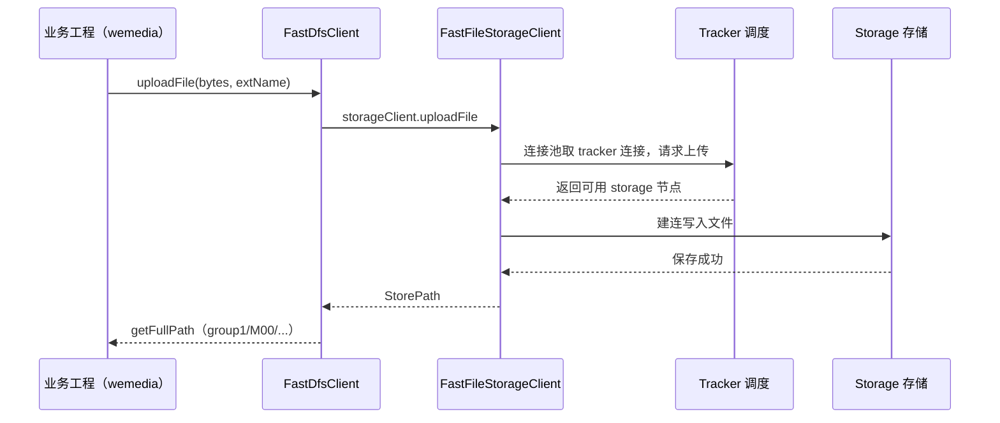

# FastDFS 客户端封装：连接池、Tracker 调度与开箱即用的上传工具

> 🔒 安全提示：文中示例的口令/密钥均为课程教学环境演示口径，生产环境的安全要求见《安全与合规须知》。

素材上传的第一步不是写接口，而是让 Java 工程能稳定连上 FastDFS。架构与环境在讲分布式文件系统的课时已经铺过，服务器也是现成的，剩下的问题是工程侧怎么接：直连客户端 API 每次都要自己找 tracker、建连接、管超时，样板代码散落每个调用点。这一课把这套东西收敛成一个 starter 加一个工具类，业务侧要上传图片时只剩一行调用。

## 先给结论

- 封装落在 common 工程：第三方技术统一在 common 集成，业务微服务按需扫描引入，ZK、MyCat 的封装都是这个套路。
- 依赖是定制的 `fastdfs-spring-boot-starter`，内部提供属性类、连接池、Tracker 连接管理器与 `FastFileStorageClient`。
- 配置三项就够：`fast.dfs.connect-timeout`、`fast.dfs.so-timeout`、`fast.dfs.tracker-server`，tracker 地址按自己的环境填。
- `FastDfsClient` 封装两个 `uploadFile` 重载（文件路径版与字节数组版），返回 `StorePath` 的 fullPath，形如 `group1/M00/00/00/xxx.jpg`。
- 业务工程在 InitConfig 的 `@ComponentScan` 数组里追加 common 的 fastdfs 包即可，注入 `FastDfsClient` 直接用。

## 为什么封装、在哪封装

FastDFS 是开源的轻量级分布式文件系统，角色只有两个：Tracker 负责调度，Storage 负责存文件。客户端上传前先问 tracker 要一台可用的 storage，再把文件写到那台 storage 上，返回一个全局路径。流程不复杂，但每个调用点都要重复「取 tracker 连接、挑 storage、建连、写文件、处理异常」，这类重复就是封装的对象。

封装位置也有讲究。**统一收口在 common 工程。** ZK 分布式主键、MyCat 路由支撑都是先在 common 里集成成配置类与工具类，业务工程只面对注解和注入。FastDFS 照此办理：common 里建 fastdfs 包，starter 依赖也声明在 common 的 pom 里，谁需要谁扫描，避免每个微服务各自引一份客户端、各配一份地址。课程还提供了打包好的 FastDFS 服务器镜像，挂载起来就是一个现成的文件存储节点，环境搭建零成本。

## 依赖与配置

common 的 pom 里加入定制 starter（画面线坐标为课程内置封装包，此处按中性写法呈现，API 风格与开源 tobato 客户端一致）：

```xml
<dependency>
    <groupId>com.study.headline</groupId>
    <artifactId>fastdfs-spring-boot-starter</artifactId>
    <version>${fastdfs.version}</version>
</dependency>
```

同一段 pom 里还能看到 curator-framework 与 curator-recipes 两条依赖，那是 ZK 分布式主键在用，与 FastDFS 无关，读 pom 时别被带偏。starter 到位后建配置文件 `fast-dfs.properties`：

```properties
# 建连超时（毫秒）
fast.dfs.connect-timeout=3000
# 读写超时（毫秒）
fast.dfs.so-timeout=6000
# tracker 地址与端口，按自己的环境填写（课程集群写 node01 对应地址，22122 为 tracker 默认端口）
fast.dfs.tracker-server=192.168.25.133:22122
```

装配类把配置读进来并产出两个核心 Bean（按画面线整理）：

```java
package com.study.headline.common.fastdfs;

import org.springframework.boot.context.properties.ConfigurationProperties;
import org.springframework.context.annotation.Bean;
import org.springframework.context.annotation.Configuration;
import org.springframework.context.annotation.PropertySource;

/**
 * FastDFS 自动装配：读取 fast.dfs 前缀配置，装配连接池与 tracker 连接管理器
 */
@Configuration
@ConfigurationProperties(prefix = "fast.dfs")
@PropertySource("classpath:fast-dfs.properties")
public class FastDfsConfig extends FastDfsAutoConfiguration {

    public FastDfsConfig(FastDfsProperties properties) {
        super(properties);
    }

    @Bean
    public PooledConnectionFactory pooledConnectionFactory() {
        PooledConnectionFactory factory = new PooledConnectionFactory();
        // 建连与读写超时都来自配置文件
        factory.setConnectTimeout(getConnectTimeout());
        factory.setSoTimeout(getSoTimeout());
        return factory;
    }

    @Bean
    public TrackerConnectionManager trackerConnectionManager(ConnectionPool pool) {
        // trackerServer 由基类按 tracker-server 地址解析得到，地址可配多个
        return new TrackerConnectionManager(pool, Arrays.asList(trackerServer));
    }
}
```

两个 Bean 分工明确：连接池管 TCP 连接的复用，tracker 连接管理器管「问哪台 tracker 要 storage」。池化的收益要算一笔账，每次上传都要与 tracker、storage 各建一次 TCP 连接，握手加挥手的开销在高频上传下不可忽视，连接池把建好的连接反复出借，超时参数则保证坏连接尽快被识别淘汰。

## FastDfsClient：把上传收敛成一行调用

装配完成只是底座，业务侧要的是语义化的工具类（按画面线整理）：

```java
package com.study.headline.common.fastdfs;

import org.apache.commons.io.FileUtils;
import org.springframework.beans.factory.annotation.Autowired;
import org.springframework.stereotype.Component;

import java.io.File;

@Component
public class FastDfsClient {

    @Autowired
    private FastFileStorageClient storageClient;

    /**
     * 上传文件方法
     * @param fileName 文件全路径
     * @param extName  文件扩展名，不含（.）
     */
    public String uploadFile(String fileName, String extName) throws Exception {
        StorePath s = storageClient.uploadFile(
                FileUtils.readFileToByteArray(new File(fileName)), extName);
        return s.getFullPath();
    }

    /**
     * 上传文件方法（字节数组版，适合接 MultipartFile）
     * @param fileContent 文件内容字节数组
     * @param extName     文件扩展名
     */
    public String uploadFile(byte[] fileContent, String extName) throws Exception {
        StorePath s = storageClient.uploadFile(fileContent, extName);
        return s.getFullPath();
    }
}
```

`FastFileStorageClient` 是 starter 提供的门面，注入即用。返回值值得多看一眼：`StorePath` 的 `getFullPath()` 拼出的是 `group1/M00/00/00/xxx.jpg` 这样的完整路径，group 是存储组，M00 是虚拟磁盘编号，中间两级是目录散列，末段是 FastDFS 生成的文件名。这个相对路径就是素材表里要存的 url 原料，前端要展示时还得拼上图片服务器的对外地址，那是下一课的活。工具类里同样封装了下载与删除方法，本课用到的只有上传，其余方法等用到的课再展开。

## 接进业务工程

封装在 common，消费在业务工程。wemedia 的 InitConfig 把 fastdfs 包追加进扫描列表，`@ComponentScan` 接受数组，一次可以扫多个包：

```java
@Configuration
@ComponentScan({"com.study.headline.common.init", "com.study.headline.common.fastdfs"})
public class InitConfig {
}
```

扫描即装配，FastDfsConfig 产出的连接池与 tracker 管理器、FastDfsClient 组件一起进容器，业务类里 `@Autowired FastDfsClient` 就能上传。整条链路是：



关键路径在 tracker 那一步：tracker 只做调度不存文件，按组内 storage 的状态挑一台返回，真正的读写发生在与 storage 的连接上，调度与存储分离让 storage 可以按组水平扩容。

## 常见误区

- **把 tracker 地址当图片访问地址。** 22122 是客户端与 tracker 通信的调度端口，浏览器访问不了；图片对外访问走 storage 的 http 端口或前置 nginx，素材表里存相对路径、返回时拼对外地址，两套地址不能混。
- **上传丢了扩展名。** FastDFS 按扩展名决定存储与访问行为，extName 传空或不传，文件名末段失去类型信息，按类型访问与浏览器渲染都会出问题；从原始文件名里截最后一个点之后的字符串就是扩展名。
- **连接池参数拍脑袋。** connect-timeout 管建连，so-timeout 管读写，两个值设得过大，故障时线程被长期挂住；过小则慢网络下误杀正常请求，按机房网络实测调，不要默认值一路裸奔。
- **绕过封装直连原生 API。** starter 已经把连接池与超时管起来，业务代码再手写客户端连接，等于脱离池化管控，连接泄漏与超时不一致都是这么来的；业务层只认 FastDfsClient。

## 面试可能被问到的问题

1. 面试官追问：「Tracker 和 Storage 的职责怎么分？」
   答：Tracker 只做调度与负载均衡，记录各组各节点状态，客户端上传下载前先从它这里拿可用节点；Storage 负责实际存文件，按 group 组织，组内互备、组间独立扩容。调度与存储分离，tracker 无状态可横向堆，storage 按容量加组加节点。
2. 面试官追问：「上传返回的 group1/M00/00/00/xxx.jpg 各段是什么含义？」
   答：group1 是存储组；M00 是该 storage 上配置的虚拟磁盘路径编号；两个两级目录是对文件名做的散列，把文件均匀摊到目录树避免单目录文件过多；末段是 FastDFS 生成的文件名，内含时间戳与大小信息。客户端只管存这个相对路径，访问时配合对外地址拼 URL。
3. 面试官追问：「为什么要做连接池，FastDFS 客户端不能每次新建连接吗？」
   答：可以，但每次上传都要与 tracker、storage 各建一次 TCP，握手开销在图片类高频小文件场景被放大；连接池复用已建连接，把建连成本摊到多次请求上，同时用超时参数淘汰坏连接，吞吐与稳定性都更好。
4. 面试官追问：「把第三方客户端封成 starter 的收益是什么？」
   答：配置收口为属性文件与属性类，业务工程零样板；Bean 的装配与依赖关系在 starter 内固化，升级客户端只动 common 一处；业务侧统一面对自研门面类，未来把 FastDFS 换成云存储时，替换实现而不动业务代码。
5. 面试官追问：「tracker 配了多个地址时客户端怎么用？」
   答：地址列表交给连接管理器，轮询取用，某台失联按超时剔除后换下一台；tracker 本身无状态，多台之间数据等价，客户端多地址只提升可用性，不存在数据一致问题。

## 配套资料

- 代码：`materials/code/05/头条day05/`。该日资料包解压结果为空（未含源码文件），文中 pom 片段、fast-dfs.properties、FastDfsConfig、FastDfsClient 与 InitConfig 均按画面线抄录并按本课写法补全为可运行版本；定制 `fastdfs-spring-boot-starter` 源码未随资料包留档，其内部类型（属性类、连接池、TrackerConnectionManager）按画面线类名呈现。包名统一改写为 `com.study.headline`；引用路径截至 `头条dayNN/` 层级，内层目录冠以项目原名，正文统一以「头条类资讯项目」指代。
- 说明：经核对各阶段资料包（含好客租房阶段），未检出 FastDFS 客户端源码文件可挂接，FastDFS 环境为课程提供的现成服务器镜像。
- 环境：课程集群 node01~node03，MySQL root/123456；tracker 端口 22122，图片对外访问地址见下一课 `file.server.url` 配置。
