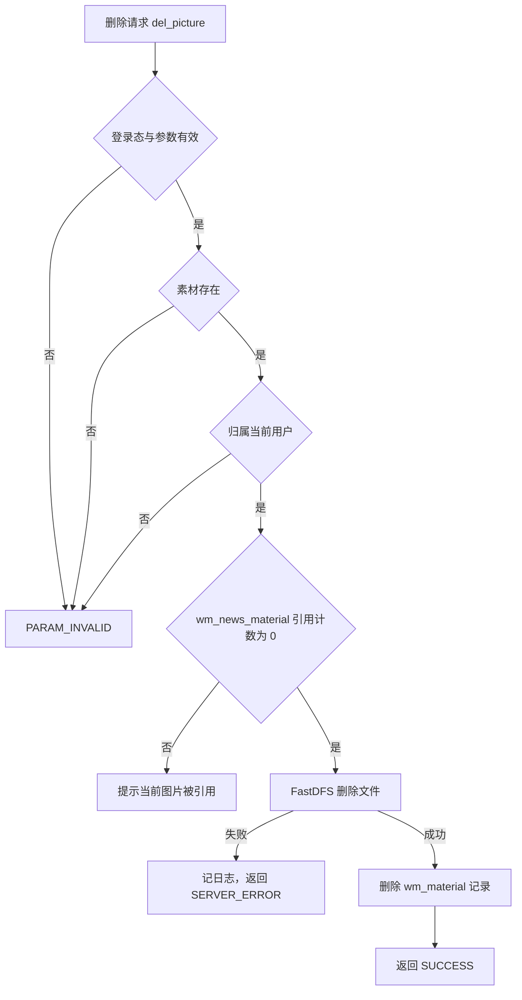

# 删除图片接口：归属校验、被引用保护与文件与记录的删除顺序

> 🔒 安全提示：文中示例的口令/密钥均为课程教学环境演示口径，生产环境的安全要求见《安全与合规须知》。

删除是素材管理里看起来最简单、约束却最密的一个接口。前端只是点一下删除按钮，后端要在同一笔请求里回答五个问题：参数合法吗、素材存在吗、是你自己的吗、被文章引用了吗、文件和库记录先删哪个。任何一步松了，结果要么是「不该删的被删了」，要么是「删了的留下尾巴」，后者更难缠，因为它的表现往往延迟到几天后用户点开一张裂开的图才暴露。

## 先给结论

- 接口路径 `POST /api/v1/material/del_picture`，入参 `WmMaterialDto` 里只有一个 id，参数是结构化 JSON，走 `@RequestBody`。
- 删除前先到图文关系表 `wm_news_material` 里按素材 id 计数，count 大于 0 一律拒绝，这就是接口文档里「删除无关联图片」的落点。
- 归属校验补在存在性校验之后：素材的 `user_id` 与当前登录用户不一致，按参数错误处理，防止横向越权删别人的素材。
- 顺序是先删 FastDFS 文件、后删 `wm_material` 记录，文件删除失败立即中止并返回服务器内部错误，不能让记录先走。
- 从 url 剥 fileId 时注意 `replaceAll` 的第一个参数是正则，域名里带点号时要转义，否则剥离结果不可靠。

## 接口定义：一个 id 走通删的 DTO

接口文档把语义限定得很清楚：删除无关联的图片，响应 `data` 为 `SUCCESS`。入参只有一个图片 id，对齐到 `WmMaterialDto`：

```java
public interface MaterialManageControllerApi {

    /** 上传图片 */
    @PostMapping("/upload_picture")
    ResponseResult uploadPicture(MultipartFile file);

    /** 删除图片：删除无关联的图片 */
    @PostMapping("/del_picture")
    ResponseResult delPicture(@RequestBody WmMaterialDto dto);
}
```

```java
@RestController
@RequestMapping("/api/v1/material")
public class MaterialManageController implements MaterialManageControllerApi {

    @Autowired
    private MaterialService materialService;

    @Override
    @PostMapping("/del_picture")
    public ResponseResult delPicture(@RequestBody WmMaterialDto dto) {
        return materialService.delPicture(dto);
    }
}
```

这里用 POST 加 `@RequestBody` 而不是把 id 拼在路径上，原因在参数形态：入参是结构化 DTO，本次虽然只有 id 一个字段，但同一套 Controller 契约后续扩展字段（比如批量删除的 id 列表）不用动方法签名，前端也不用换传参方式。上一节上传接口不加 `@RequestBody` 是因为请求体是文件分片，这一节加是因为请求体确实是 JSON，同一个 Controller 里两种姿态并存，正说明注解是跟着请求形态走的，不是跟着习惯走的。

## 五道校验的 Service 主链

关系表 `wm_news_material` 只需要一条计数 SQL，素材 id 就是过滤条件：

```java
public interface WmNewsMaterialMapper {

    /** 按素材 id 统计被文章引用次数 */
    int countByMaterialId(@Param("materialId") Integer materialId);
}
```

```xml
<mapper namespace="com.study.headline.model.mappers.wemedia.WmNewsMaterialMapper">
    <select id="countByMaterialId" resultType="int">
        select count(*) from wm_news_material where material_id = #{materialId}
    </select>
</mapper>
```

Service 的完整主链如下，前四步全是校验，第五步才开始动真格：

```java
@Override
public ResponseResult delPicture(WmMaterialDto dto) {
    // 1. 登录态与参数校验
    WmUser user = WmThreadLocalUtils.getUser();
    if (user == null) {
        return ResponseResult.errorResult(AppHttpCodeEnum.NEED_LOGIN);
    }
    if (dto == null || dto.getId() == null) {
        return ResponseResult.errorResult(AppHttpCodeEnum.PARAM_INVALID);
    }
    // 2. 存在性校验
    WmMaterial wmMaterial = wmMaterialMapper.selectByPrimaryKey(dto.getId());
    if (wmMaterial == null) {
        return ResponseResult.errorResult(AppHttpCodeEnum.PARAM_INVALID);
    }
    // 3. 归属校验：只能删自己的素材（按安全口径补全）
    if (!user.getId().equals(wmMaterial.getUserId())) {
        return ResponseResult.errorResult(AppHttpCodeEnum.PARAM_INVALID);
    }
    // 4. 引用校验：被文章引用的素材不允许删除
    int count = wmNewsMaterialMapper.countByMaterialId(wmMaterial.getId());
    if (count > 0) {
        return ResponseResult.errorResult(AppHttpCodeEnum.PARAM_INVALID, "当前图片被引用");
    }
    // 5. 先删 FastDFS 文件：url 兜底剥掉服务器前缀，得到纯 fileId
    String fileId = wmMaterial.getUrl().replaceAll(fileServerUrl, "");
    try {
        fastDfsClient.deleteFile(fileId);
    } catch (Exception e) {
        log.error("user {} delete file {} from fastdfs error, error info: {}",
                user.getId(), fileId, e.getMessage());
        return ResponseResult.errorResult(AppHttpCodeEnum.SERVER_ERROR);
    }
    // 6. 文件删除成功，再删 wm_material 记录
    wmMaterialMapper.deleteByPrimaryKey(dto.getId());
    return ResponseResult.okResult(AppHttpCodeEnum.SUCCESS);
}
```

整条链的决策过程画出来是一棵纯剪枝树，五个条件任何一处不满足都不触碰存储：



归属校验这一步在原画面里没有显式出现，属于按安全口径补全的加固点：删除接口的 id 来自前端，攻击者可以任意构造，服务端必须拿素材记录里的 `user_id` 与登录上下文比对，否则任何登录用户都能遍历 id 删掉别人的素材，这是典型的横向越权（IDOR）。

## 先删文件还是先删记录

两种顺序对应两种失败残留，值得掰开算账。课程实现取「先文件后记录」：FastDFS 删除失败时记录还在，素材管理页面上这张图仍然可见、删除按钮仍可重试，用户视角是「暂时没删成」；而一旦文件删除成功、库记录删除失败，残留是一条指向不存在文件的死记录，用户再点删除时 FastDFS 侧对不存在文件报错，走 `SERVER_ERROR` 分支，这条记录可能永远删不掉。

反向顺序「先记录后文件」的残留形态正相反：记录先删，文件删除失败留下孤儿文件。孤儿文件不挡任何用户操作，只是占存储空间，可以由对账脚本按扫描存储与库记录的差集清理。所以工程上更稳的取舍其实是先删记录（或先打删除标记）再异步删文件，把不可自动回滚的文件操作放在失败代价最小的一侧。课程顺序保留在主链里是因为它简单直观、与「先确认无引用再动手」的直觉一致，把两种残留形态讲清楚后，读者可以按自己的运维能力选型。`@Transactional` 在这条链里只兜得住 `wm_material` 记录的删除这一步数据库操作，FastDFS 的文件删除是远程副作用，失败只能靠显式中止与日志暴露，别指望注解。

还有一个细节藏在第 5 步：按上一节的口径，库里 `url` 存的就是纯 fileId，正常情况下 `replaceAll` 什么也剥不掉；它是防御性写法，万一有人把完整地址存进了库，删除时也能剥出 fileId，不至于拿一个带域名的字符串去 FastDFS 找文件。但 `replaceAll` 的第一个参数是正则，`fileServerUrl` 里若有 `.`（比如以 IP 形式配置的 `http://192.168.25.133/`），点号会被当成「匹配任意字符」的通配符，碰巧不出错是因为匹配过于宽松而非语义正确，严谨写法是 `replace` 或 `Pattern.quote(fileServerUrl)`。

## 常见误区

- **先删库记录再删文件且无兜底。** 文件删除失败后，库里没有记录、存储里有文件，清理失去了依据，只能靠扫描存储做差集对账；至少要留下 url 日志，把对账线索打出来。
- **引用判断查错表。** 判断素材是否被引用，要查关系表 `wm_news_material` 的计数，而不是去 `wm_material` 自己表里找；关系不在素材表里，查错表的结果恒为 0，保护形同虚设。
- **`replaceAll` 当普通字符串替换用。** 第一个参数是正则表达式，域名或 IP 里的点号会改变匹配语义；剥离服务器前缀用 `replace`，或对前缀做 `Pattern.quote`。
- **归属校验省略。** 只校验素材存在不校验归属，登录用户拿到别人的素材 id 就能删，接口在功能测试里全绿，在安全测试里一捅就破。

## 面试可能被问到的问题

1. 面试官追问：「被文章引用的素材为什么不能直接删？」
   答：文章与素材是多对多关系，引用落在 `wm_news_material` 关系表上；文章正文与封面渲染的是素材 URL，素材删掉文件，所有引用它的文章页面图片立即 404。所以删除接口在关系表计数大于 0 时直接拒绝，提示当前图片被引用，把决定权交回创作者：先改文章，再删素材。
2. 面试官追问：「删除时先删文件还是先删记录，两种顺序各自的失败残留是什么？」
   答：先删文件，残留可能是死记录，记录指向不存在的文件且重删会继续失败；先删记录，残留是孤儿文件，不影响用户操作，可由对账脚本清理。孤儿文件的代价小于死记录，工程上更倾向先删记录再异步删文件。
3. 面试官追问：「这个删除流程里 @Transactional 能兜住什么，兜不住什么？」
   答：只兜得住数据库记录删除这一步的本地事务，比如记录删除后后续数据库操作异常可以回滚记录；FastDFS 的文件删除是远程副作用，不在事务边界内，失败只能靠显式捕获中止流程、记日志并返回错误码，跨存储一致性要靠补偿或对账。
4. 面试官追问：「素材删除的归属校验为什么必须放在服务端？」
   答：前端的 id 是用户可任意篡改的输入，前端隐藏、禁用按钮都只是交互约束；服务端必须拿素材记录的 user_id 与登录上下文比对，不匹配按无效参数处理，否则构成横向越权，任何登录用户可以删除他人素材。
5. 面试官追问：「url 字段里存的明明是 fileId，为什么删除时还要做一次前缀剥离？」
   答：这是防御性编程。正常口径下库里只存 fileId，剥离操作是空操作；一旦上游有人把完整地址写进库，没有这层兜底就会拿带域名的字符串去 FastDFS 找文件，删除必然失败。防御代码的价值就在异常数据出现的那一天。

## 配套资料

- 代码：`materials/code/05/头条day05/`。该日资料包解压结果为空（未含源码文件），文中代码按画面线抄录整理，并按本课写法补全为可编译版本，包名统一改写为 `com.study.headline`；归属校验为按安全口径补全，已在代码注释标注；引用路径截至 `头条dayNN/` 层级，内层目录冠以项目原名，正文统一以「头条类资讯项目」指代。
- 代码：`materials/code/05/头条day01/`，内层资料含数据库规范设计说明书与项目原型，图文关系表与素材页删除交互可对照核对。
- 环境：课程集群 node01~node03，MySQL root/123456；FastDFS 删除验证可在 node01 的存储目录下确认文件消失、MySQL 客户端确认 `wm_material` 记录消失。
