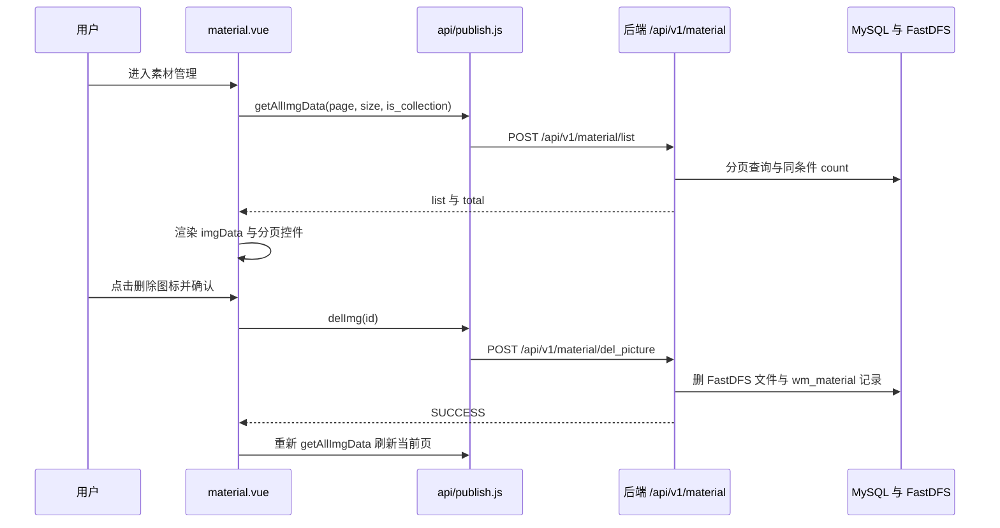

# 素材页前端联调：列表渲染、分页控件与删除确认的全链路验证

> 🔒 安全提示：文中示例的口令/密钥均为课程教学环境演示口径，生产环境的安全要求见《安全与合规须知》。

后端的素材列表与删除接口都齐了，把它们接到页面上跑通，才算素材管理真正闭环。联调要验证的不是「接口能不能通」，而是数据在页面上的每个流转点：进页面加载、翻页、筛选、删除确认、成功提示，每一处都有自己的状态要维护。这一环节的报错往往不在业务代码里，而在请求形态、跨域、URL 拼接这些结合部上，值得把排查路径也一并理清楚。

## 先给结论

- 页面状态三件套：`imgData` 装列表数据，`imgPage` 装分页状态，`activeSelect` 装收藏筛选，默认第 1 页、每页 15 条、查全部。
- 翻页只做一件事：把新页码写回 `imgPage.currentPage` 然后重调加载方法，数据永远以列表接口为唯一来源。
- 删除前必须过 `$confirm` 确认框，成功后提示并重新加载当前页，不在本地手工剪数组。
- 收藏切换的方法结构先行就位：点图标翻转 `is_collection` 并调接口，对应的后端实现在下一节补齐。
- 联调报错按链路速查：401 查登录态、CORS 查跨域、415 查请求形态、图片 404 查 URL 前缀。

## 页面结构与状态设计

素材页组件把「页面骨架」与「上传能力」分开：列表、分页、操作图标都在页面组件里，上传是独立组件塞进弹窗按需引用。页面 data 的三件套对应三类状态：

```javascript
data () {
  return {
    // 存储图片数据，同时作为收藏数据和全部数据的引用
    imgData: [],
    // 分页状态：total 总条数，pageCount 总页数，currentPage 当前页，pageSize 每页条数
    imgPage: {
      total: 0,
      currentPage: 1,
      pageCount: 0,
      pageSize: 15
    },
    // 收藏筛选：0 全部，1 只看收藏
    activeSelect: '0',
    // 上传弹窗开关
    showPicDialog: false,
    imgChange: false
  }
}
```

`imgPage` 的四个字段就是分页控件的全部输入：`total` 与 `pageSize` 决定总页数，`currentPage` 决定高亮在哪一页。组件挂载完成后由 `mounted` 触发首次 `loadData`，把当前页、条数与收藏筛选一次性传给接口，默认值约定与后端 `checkParam` 的兜底范围正好衔接。

## 数据加载与分页联动

加载方法拆成两层：`loadData` 负责收集当前状态组装参数，`gettingData` 负责发请求与回填状态。请求统一封装在 api 模块里：

```javascript
// src/api/publish.js
import http from '@/utils/request'

// 获取图片素材列表
export function getAllImgData (params) {
  return http({
    url: '/api/v1/material/list',
    method: 'POST',
    data: params
  })
}

// 删除图片
export function delImg (id) {
  return http({
    url: '/api/v1/material/del_picture',
    method: 'POST',
    data: { id }
  })
}
```

```javascript
import { getAllImgData, delImg as delImgApi, collectOrCancel as collectApi } from '@/api/publish'

methods: {
  // 初始化与刷新共用的加载入口
  loadData () {
    this.gettingData({
      page: this.imgPage.currentPage,
      size: this.imgPage.pageSize,
      is_collection: this.activeSelect
    })
  },
  // 分页控件翻页回调
  pageChange (newPage) {
    this.imgPage.currentPage = newPage
    this.loadData()
  },
  // 获取图片素材：回填列表与分页状态
  async gettingData (params) {
    const result = await getAllImgData(params)
    this.imgData = result.data.data.list
    this.imgPage.total = result.data.data.total
    this.imgPage.pageCount = Math.ceil(this.imgPage.total / this.imgPage.pageSize)
  }
}
```

翻页的联动只有两行：控件回调 `pageChange` 拿到新页码写回 `imgPage.currentPage`，再调 `loadData`。所有变化都走「改状态、重拉接口」这一条路，不出现第二条数据通路，这是列表页状态管理的纪律。`pageCount` 用 `Math.ceil(total / pageSize)` 算出，与 `el-pagination` 的 `page-count` 绑定，算式必须和组件 `page-size` 用同一个值，两处口径漂移就会出现控件允许跳到不存在的页。

## 列表渲染与删除确认

模板里循环 `imgData` 渲染图片，操作区挂收藏与删除两个点击事件，底部铺分页控件：

```html
<div class="img_list">
  <div class="img_list_item" v-for="img in imgData" :key="img.id">
    
    <div v-if="activeSelect == 0" class="operate">
      
      
    </div>
  </div>
</div>

<el-pagination
    background
    layout="prev, pager, next, jumper"
    :total="imgPage.total"
    :page-count="imgPage.pageCount"
    :page-size="imgPage.pageSize"
    :current-page="imgPage.currentPage"
    @current-change="pageChange"
/>
```

删除是破坏性操作，交互上必须有一道确认关：

```javascript
// 删除图片：先确认，后调接口，成功后重载当前页
async delImg (img) {
  const confirmed = await this.$confirm('确认删除该素材？').catch(() => false)
  if (!confirmed) return
  await delImgApi(img.id)
  this.$message.success('删除成功')
  this.loadData()
},
// 点击收藏或取消收藏：翻转状态后调接口（后端实现见下一节）
async collectOrCancel (img) {
  const next = img.is_collection == 1 ? 0 : 1
  await collectApi(img.id, next)
  this.$message.success('操作成功')
}
```

`$confirm` 返回的是 Promise，确认时 resolve、取消时 reject，`.catch(() => false)` 把取消归一成 false，否则用户点取消会在控制台留下一个未捕获的 Promise 异常。删除成功后调 `loadData` 重拉当前页，让 total 与列表自动回到正确状态，而不是在前端 `splice` 数组装作删掉了：本地剪数组在跨页场景下必然与 total 脱节，第 15 条是本页最后一条时，删完该自动回到上一页，只有服务端重拉才能算对。

## 全链路验证

把整条链画在一张时序图上，验证时照着走一遍：



实际操作顺序：启动自媒体微服务，再启动前端工程，登录进入内容管理。素材管理页应直接出图，点下一页数据随之变化，说明列表与分页接口正常；点某张图的删除图标，弹出确认框，确认后提示删除成功且该图从列表消失，再到数据库与存储侧核对，`wm_material` 记录与 FastDFS 文件同时消失，删除链路才算真正验证过。收藏切换点击后会调接口报错，属预期现象，对应接口在下一节实现。

联调结合部的高频报错可以按现象对号入座：

| 现象 | 根因 | 处理 |
|---|---|---|
| 列表请求返回 401 | 登录 token 缺失或过期 | 重新登录，检查请求拦截器是否带上 token |
| 浏览器报 CORS 拦截 | 前端端口与后端不同源 | 前端代理或网关统一配置跨域放行 |
| 列表或删除返回 415 | 请求体形态与 `@RequestBody` 不匹配 | JSON 请求带上 `Content-Type: application/json` |
| 图片全部裂开且 404 | 响应里的 url 没拼文件服务器前缀 | 后端 Service 出口统一补齐前缀 |
| 删除提示「当前图片被引用」 | 素材仍被文章引用 | 先解除文章引用，再执行删除 |
| 第一页永远少一条 | SQL 的 offset 直接写了 page | offset 按 `(page - 1) * size` 计算 |

## 常见误区

- **删除成功后本地剪数组。** `imgData.splice` 只改了视图，total 不变，分页控件显示的页数立刻失真；破坏性操作后一律以服务端重拉为准。
- **`$confirm` 不接取消分支。** 组件的确认框在用户取消时走 Promise reject，不做 `.catch` 会抛未捕获异常；把取消归一成 false 再统一判断。
- **切筛选后不回第 1 页。** 收藏筛选结果可能只有几条，停留在第 5 页去请求会拿到空列表；筛选条件变化时把页码重置为 1。
- **把页数算式写两份。** 组件用 `page-count` 时前端自己算 `Math.ceil(total / pageSize)`，若与绑定的 `page-size` 值不一致，控件与数据互相矛盾；口径只留一处。

## 面试可能被问到的问题

1. 面试官追问：「删除成功后为什么要重新拉接口，而不是在前端把这条数据剪掉？」
   答：列表、分页、收藏筛选是一组互相关联的状态，删除影响 total、总页数与当前页的数据分布，本地剪数组只更新了列表本身，其余状态全部失真。以服务端重拉为唯一刷新手段，前端不维护第二份事实，跨页边界（比如删掉本页最后一条）也能自然回落到正确页码。
2. 面试官追问：「前端分页控件的总页数是怎么来的？」
   答：由 total 与每页条数算出，`Math.ceil(total / pageSize)`，向上取整保证余数不满一页的数据也有页可看。这个算式与后端 count 的口径必须一致，任何一侧条件不同都会出现可点但为空的页码。
3. 面试官追问：「联调时列表能出来但图片全部 404，排查路径是什么？」
   答：先看响应体里 url 的实际值：若是 `group1/M00/...` 这种相对路径，说明后端出口没拼文件服务器前缀，属于回显口径问题；若已是完整地址，再检查该地址是否可达、nginx 反代与 FastDFS 存储是否正常。方向是先分清前端渲染问题与后端数据问题，再逐段缩小。
4. 面试官追问：「确认框取消时为什么会抛 Uncaught (in promise)，怎么处理？」
   答：组件的 `$confirm` 在用户确认时 resolve、取消时 reject，用 await 接收又不捕获 rejection，就会留下未处理的 Promise 异常。处理方式是给 await 挂 `.catch` 把取消归一成 false，或用 try-catch 包住按分支处理，两种写法选一种贯穿项目保持一致。
5. 面试官追问：「前后端分离项目里 401 一般怎么统一处理？」
   答：在 http 封装层的响应拦截器里统一识别 401，清掉本地登录态并跳转登录页，业务代码不重复处理；配合请求拦截器统一携带 token，登录态的过期与恢复收敛在一个入口，避免每个页面各自为战。

## 配套资料

- 代码：`materials/code/05/头条day05/`。该日资料包解压结果为空（未含源码文件），文中后端接口按画面线抄录整理，前端 Vue 片段按管理端工程结构补全为可运行示例，包名统一改写为 `com.study.headline`；引用路径截至 `头条dayNN/` 层级，内层目录冠以项目原名，正文统一以「头条类资讯项目」指代。
- 代码：`materials/code/05/头条day01/`，内层资料含项目原型，素材管理页的列表、分页与删除交互可对照原型核对。
- 环境：课程集群 node01~node03，MySQL root/123456；前端工程以本地代理指向后端网关完成同源。
