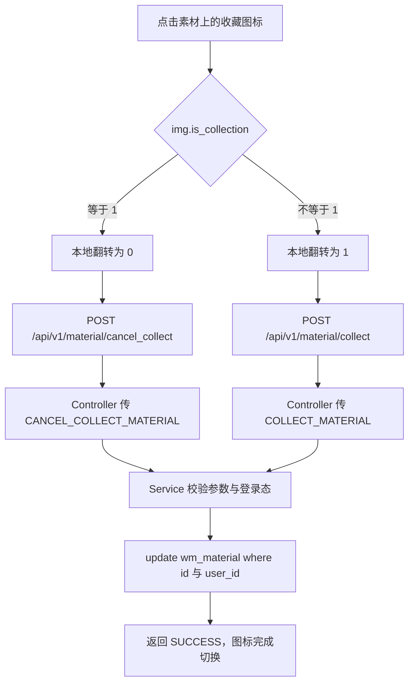

# 素材收藏与取消收藏：两个端点共用一条 update

> 🔒 安全提示：文中示例的口令/密钥均为课程教学环境演示口径，生产环境的安全要求见《安全与合规须知》。

素材管理还剩最后一个接口。收藏功能看上去只是把 `is_collection` 字段在 0 和 1 之间翻转，动手时会遇到三个问题：端点要不要拆成两个、Service 要不要写两份、前端点了图标之后页面状态怎么跟上。这三个问题各自的答案决定这一小段代码干不干净，也决定素材管理能不能真正闭环。上一节联调时点击收藏图标会请求报错，那是有意留出的空位，这一节把它补上。

## 先给结论

- 收藏与取消收藏拆成两个 POST 端点：`/api/v1/material/collect` 与 `/api/v1/material/cancel_collect`，请求体只有一个素材 id。
- 两个端点共用同一个 Service 方法，差异用 `WmMediaConstants` 里的 `COLLECT_MATERIAL` 与 `CANCEL_COLLECT_MATERIAL` 两个常量表达，不写魔法值。
- 数据库动作只有一条 update：`update wm_material set is_collection = ? where id = ? and user_id = ?`，归属条件与列表、删除接口是同一套纪律。
- 前端点击图标先在本地翻转 `is_collection` 再调接口，「全部」视图图标即时切换；如果保留「收藏」筛选下的操作入口，翻转后要重拉列表。
- 这个接口落地后，素材管理的上传、删除、列表、收藏四条链路全部闭环。

## 接口定义：一对镜像端点

收藏与取消收藏是同一件事的两个方向：入参相同、返回相同、落库动作相同，只有目标状态不同。所以接口文档里它们成对出现，请求 DTO 复用已有的 `WmMaterialDto`，成功响应就是标准的 `data` 为 `SUCCESS`。Controller 层两个方法分别映射两个路径，各自把一个状态常量交给同一个 Service 方法：

```java
@Override
@PostMapping("/collect")
public ResponseResult collectMaterial(@RequestBody WmMaterialDto dto) {
    // 收藏：目标状态 1
    return materialService.changeUserMaterialStatus(dto, WmMediaConstants.COLLECT_MATERIAL);
}

@Override
@PostMapping("/cancel_collect")
public ResponseResult cancelCollectMaterial(@RequestBody WmMaterialDto dto) {
    // 取消收藏：目标状态 0
    return materialService.changeUserMaterialStatus(dto, WmMediaConstants.CANCEL_COLLECT_MATERIAL);
}
```

两个端点都必须挂 `@RequestBody`，否则 Spring 拿不到 JSON 请求体里的 id，`dto` 会是空对象，校验直接拦下。写到这里顺手要在 api 接口里补上这两个方法声明，保持接口定义与实现同步。

## 常量替代魔法值

状态翻转的语义是「收藏 1、未收藏 0」，这组值马上会被 Controller 和 Mapper 两个地方用到。直接在代码里写 `1` 和 `0`，过两周没人记得 1 是收藏还是取消。集中定义到常量类里，名字本身就带语义：

```java
public class WmMediaConstants {

    /** 收藏：is_collection 置 1 */
    public static final Short COLLECT_MATERIAL = 1;

    /** 取消收藏：is_collection 置 0 */
    public static final Short CANCEL_COLLECT_MATERIAL = 0;
}
```

这个常量类后面还会继续扩充，发布文章时的封面模式、提交与草稿状态都会往里放。自媒体侧所有「枚举型小整数」都应该住在这里，而不是散落在各个 Controller 里。

## 一条 update 完成，归属条件不能省

Service 方法只做三件事：判参、取登录态、更新。方法名沿用 `changeUserMaterialStatus`，第二个参数就是端点传进来的目标状态：

```java
@Override
public ResponseResult changeUserMaterialStatus(WmMaterialDto dto, Short type) {
    // 素材 id 是唯一业务参数，缺失直接判无效参数
    if (dto == null || dto.getId() == null) {
        return ResponseResult.errorResult(AppHttpCodeEnum.PARAM_INVALID);
    }
    // 登录上下文：只能更新当前登录用户自己的素材
    WmUser user = WmThreadLocalUtils.getUser();
    if (user == null) {
        return ResponseResult.errorResult(AppHttpCodeEnum.NEED_LOGIN);
    }
    wmMaterialMapper.updateStatusById(dto.getId(), user.getId(), type);
    return ResponseResult.okResult(AppHttpCodeEnum.SUCCESS);
}
```

Mapper 侧一条 update 就够了。注意 where 条件有两个：素材 id 限定改哪一条，`user_id` 限定这条必须属于当前登录用户：

```xml
<update id="updateStatusById">
    update wm_material
    set is_collection = #{type}
    where id = #{id}
      and user_id = #{uid}
</update>
```

`user_id` 这个条件是归属校验的落点，与删除接口、列表接口共用同一套纪律：素材数据按用户隔离，任何按 id 的写操作都要同时证明「id 属于我」。少了它，拿到别人的素材 id 也能改人家的收藏状态，这是一类典型的横向越权。这条 update 还有个特性值得点出：重复执行结果一致，给一条已收藏的素材再发一次收藏请求，影响的行数是 0，但状态仍符合预期，天然幂等。

## 前端状态翻转与联调收尾

api 层补上收藏切换的封装，按目标状态选端点：

```javascript
// src/api/publish.js
import http from '@/utils/request'

// 收藏与取消收藏：isCollection 为 1 走收藏端点，为 0 走取消端点
export function collectOrCancel (id, isCollection) {
  return http({
    url: isCollection === 1 ? '/api/v1/material/collect' : '/api/v1/material/cancel_collect',
    method: 'POST',
    data: { id }
  })
}
```

页面方法把上一节留空的结构填实：点击图标时读当前素材的 `is_collection`（这个值来自列表接口，源头是数据库），翻转后按新状态选端点，成功提示的同时把新值写回本地对象：

```javascript
// 点击收藏图标：本地翻转状态，再按新状态选端点
async collectOrCancel (img) {
  const next = img.is_collection == 1 ? 0 : 1
  await collectApi(img.id, next)
  // 写回本地状态，图标立刻切换
  img.is_collection = next
  this.$message.success('操作成功')
}
```

翻转写回 `img.is_collection` 之后，模板里 `:src="img.is_collection ? collectSelectedIcon : collectIcon"` 的三元表达式会自动切换图标，Vue 对已有属性的赋值是响应式的。如果项目里出现了图标不刷新的情况，检查一下是不是用 `find` 从别处找了个新对象来改，改的不是列表里那一个引用；实在不行可以 `this.$forceUpdate()` 兜底，但那是在掩盖数据引用错乱的问题。若在「收藏」筛选视图下也保留了操作图标，取消收藏成功后应改为调 `loadData()` 重拉，让这条素材从视图里消失，靠本地翻转是撑不住筛选条件的。

整条链路画出来是这样的：



联调收尾时把页面顶部的「全部」与「收藏」两个单选按钮也过一遍：它们通过 `v-model` 绑定 `activeSelect`，值变化就触发 `loadData`，把 `is_collection` 作为查询参数传给列表接口，Mapper 里的动态 `<if>` 只在传 1 时拼收藏条件，这套口径在列表接口那一节已经写好。验收标准：全部视图点收藏图标，图标切换且数据库 `is_collection` 变 1；切到收藏筛选，只出刚收藏的图；再点一次取消，图从收藏视图消失。四条素材链路到此全部验证完毕，素材管理模块结束。

## 常见误区

- **两个端点复制两份 Service 代码。** 错例是 `cancelCollectMaterial` 里再写一遍判参、取用户、更新，两处改动永远改不齐。正解是一个方法带状态参数，差异收敛到两个常量，校验逻辑只存在一份。
- **update 只按 id 更新。** 错例是 `where id = #{id}`，任何登录用户拿到别人的素材 id 都能改状态。正解是补上 `and user_id = #{uid}`，让归属校验成为写操作的固定动作。
- **前端只调接口不写回本地状态。** 错例是等接口返回后重新拉一次全量列表，一次点击变成两次请求。正解是「全部」视图直接翻转对象属性，图标即时切换，服务端数据仍以接口为准。
- **状态值写成散落的魔法值。** 错例是 Controller 里直接传 `1`、`0`，读代码的人要跳进 Mapper 才能猜出含义。正解是常量入 `WmMediaConstants`，名字即文档。

## 面试可能被问到的问题

1. 面试官追问：「收藏和取消收藏为什么要拆成两个端点，而不是一个接口传状态参数？」
   答：两种拆法都能工作，拆成两个端点的理由是语义明确，接口文档、网关鉴权、日志排查都能按「收藏」和「取消」分开统计，也避免前端拼状态参数出错。代价是 Controller 多一个方法，用共用 Service 方法把重复压到最低，两端点加起来也只有四行有效代码。
2. 面试官追问：「这条 update 为什么必须带 user_id 条件？」
   答：素材按用户隔离，接口入参只有素材 id，如果不校验归属，任何人构造别人的素材 id 就能改它的状态，属于横向越权。where 里同时限定 id 与 user_id，等于是把「这条数据属于当前登录用户」这个业务前提写进了 SQL，越权请求最多影响 0 行。
3. 面试官追问：「用户连点两次收藏，服务端会怎样？这个接口幂等吗？」
   答：幂等。第二次请求执行同样的 update，is_collection 已经是 1，影响行数为 0，状态仍然是收藏，不会产生重复数据。正因为是绝对更新而不是累加操作，前端也不需要做点击去重的强约束，最多加个防抖优化体验。
4. 面试官追问：「前端点了图标图标没变，可能是什么原因？」
   答：最常见的是数据引用错乱，比如用 find 之类的方法又造了一个对象，改的属性不在渲染列表的引用上，视图自然不更新。其次是模板绑定的表达式写死或条件相反。排查顺序是先确认改的是列表里同一个对象，再确认赋值发生在接口成功之后，最后才考虑用 forceUpdate 兜底。
5. 面试官追问：「取消一个未收藏的素材，接口应该报错还是成功？」
   答：报成功。收藏切换的语义是「把状态置为目标值」，目标状态与当前状态一致时操作无事可做，返回成功更符合幂等语义。如果产品上要求精确反馈「取消了一个未收藏项」，可以判断 update 的返回行数再决定，但一般没必要为此多一次查询往返。

## 配套资料

- 代码：`materials/code/05/头条day05/`。该日资料包解压结果为空（未含源码文件），文中代码按画面线抄录整理，并按本课写法补全为可编译示例，包名统一改写为 `com.study.headline`；引用路径截至 `头条dayNN/` 层级，内层目录冠以项目原名，正文统一以「头条类资讯项目」指代。
- 代码：`materials/code/05/头条day01/`，内层资料含项目原型，素材页的收藏图标、全部与收藏筛选交互可对照原型核对。
- 环境：课程集群 node01~node03，MySQL root/123456。
