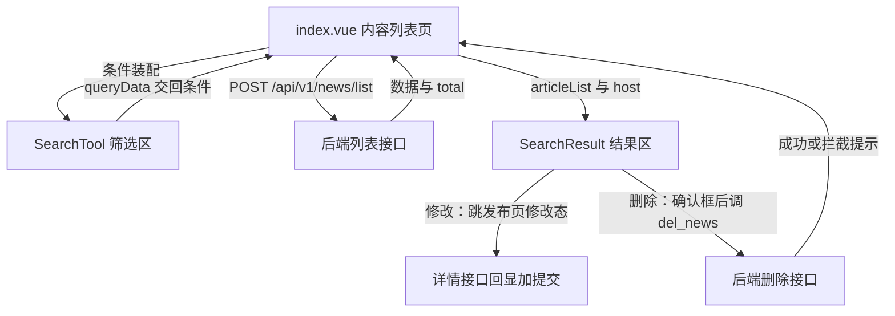

# 内容管理页联调：筛选、回显与删除的两态验证

> 🔒 安全提示：文中示例的口令/密钥均为课程教学环境演示口径，生产环境的安全要求见《安全与合规须知》。

列表、详情、删除三个后台接口都齐了，把它们接到内容列表页上跑通，自媒体文章管理才算真正交付。联调要验证的不只是接口通不通，而是每一个交互点上的数据是否正确：筛选组合出来的结果对不对、修改页回显全不全、删除在可删与不可删两种状态下的行为是否都符合预期。这一轮跑完，day05 的内容生产链路也就正式收官。

## 先给结论

- 联调路径：启动自媒体微服务与前端工程，登录进内容管理的内容列表页，列表出数据即列表接口通了。
- 筛选组合逐项验证：状态、频道、时间范围各自生效，也支持叠加，条件变化一律重拉接口并把页码回到 1。
- 修改复用发布页的修改态：点修改跳转发布页，详情接口回显全量字段，改完提交列表自动刷新。
- 删除验证两态：草稿与审核失败态删得掉，待审核与通过态被状态闸门拦下，提示不可删除。
- 前端三层分工：index.vue 组装查询，SearchTool 收筛选条件，SearchResult 渲染列表与操作按钮。

## 联调路径与筛选组合验证

微服务与前端工程先后启动，用自媒体用户登录，进入内容管理的内容列表页。刚在发布页提交的文章出现在列表里，状态标着待审核，第一条链路即列表接口就此验证通过。

筛选是列表接口的核心能力，逐项过一遍：切到草稿，列表为空，因为当前账号还没有存过草稿，空结果本身就是正确答案；切到待审核，刚发布的文章回来了；换频道筛选，两个频道各自查到属于自己的文章；再叠加时间范围，范围外的文章被过滤掉。筛选条件可以自由组合，状态加频道加时间一起传，后端的动态 SQL 按传了的条件生效。每次条件变化，前端都把页码重置回第 1 页再发请求，不然停在第 3 页切状态，可能直接落进一个空页。

| 验证点 | 操作 | 预期结果 |
|---|---|---|
| 列表展示 | 进入内容列表 | 出现已发布文章，状态为待审核 |
| 状态筛选 | 切草稿、待审核 | 草稿空列表，待审核有数据 |
| 频道筛选 | 选某个频道 | 只剩该频道的文章 |
| 时间筛选 | 选开始与结束日期 | 范围外的文章消失 |
| 组合筛选 | 状态加频道加时间 | 三条件同时生效 |
| 修改回显 | 点修改跳转 | 表单填满文章原数据 |
| 删除可删态 | 草稿或失败态点删除 | 确认后成功，列表重拉 |
| 删除拦截 | 待审核或通过态调删除 | 返回错误提示，数据不动 |

## 修改与详情回显

列表上点修改，路由跳到发布页的修改态。发布页带着文章 id 初始化时调详情接口，把标题、标签、频道、定时时间、内容 JSON 与封面类型全部填回表单，富文本编辑器按内容数组还原文字块与图片块。试着把标题从 888 改成 222，点提交，成功后页面自动跳回列表，列表重拉一遍，标题已经变成 222。

这条链路验证了两个接口的配合：详情接口给出修改页需要的一切，发布页的提交方法看到 id 有值就走修改而非新增。回显任何一个字段缺失都会暴露，比如 host 没回填，封面预览与内容里的插图就全部裂图，联调时看一眼修改页就能发现。

## 删除的两态验证

删除要验证的是两种命运。挑一条草稿态或审核失败态的文章点删除，确认框弹出来，点头之后提示删除成功，列表重拉，数据消失，再到数据库核对，`wm_news` 的记录与素材关系表里的对应行都没了，物理删加关系清理的口径在库里得到确认。再挑一条待审核态的文章直接调删除接口，后端状态闸门把它拦下，返回不可删除的提示，数据原地不动。两条路都走通，说明删除接口的资格线起作用了。



这张图讲的是前端三层组件的协作关系：页面组件持有查询入口与数据状态，筛选区只负责收集条件，结果区只负责渲染与发起行内操作，后端接口是它们共同的数据来源。

## 前端代码走读

页面组件在 views/content/index.vue，查询入口是一个统一方法，条件变化、翻页、删除后的刷新都汇到它身上：

```javascript
// views/content/index.vue：查询与删除（按画面线整理）
methods: {
  // 统一查询入口：所有条件变化都走这里
  async searchArticle (newParams) {
    this.tempParams = newParams
    const result = await searchArticles({
      ...this.params,
      key_word: this.searchText,
      ...this.tempParams
    })
    this.total = result.data.total
    this.articleList = result.data.list
  },
  // 行内删除：先确认，成功后重拉列表
  async deleteArticlesById (id) {
    const confirmed = await this.$confirm('确认删除该文章？').catch(() => false)
    if (!confirmed) return
    const result = await delArticle({ id })
    if (result.code == 0) {
      this.$message.success('删除成功')
      this.searchArticle()
    } else {
      this.$message.error(result.errorMessage)
    }
  }
}
```

筛选区是独立组件，状态下拉、频道下拉与时间范围都在这里装配。下拉选项里「全部」对应 null，后端动态 SQL 对 null 不拼条件，查出来的就是全集：

```javascript
// components/search-tool.vue：条件装配（按画面线整理）
data () {
  return {
    selectState: [
      { label: '全部', value: null },
      { label: '草稿', value: 0 },
      { label: '待审核', value: 1 },
      { label: '审核通过', value: 2 },
      { label: '审核失败', value: 3 }
    ]
  }
},
methods: {
  queryData () {
    const params = {
      status: this.selectState.value,
      channelId: this.channelId,
      page: 1,
      beginPubDate: (this.date && this.date.length > 1) ? this.date[0] : null,
      endPubDate: (this.date && this.date.length > 1) ? this.date[1] : null
    }
    this.changePage && this.changePage(params)
  }
}
```

接口地址集中在 api 模块里定义，列表、详情、删除各对应一条 POST：

```javascript
// src/api/content.js
import http from '@/utils/request'

// 分页查询文章列表
export function searchArticles (data) {
  return http({
    url: '/api/v1/news/list',
    method: 'POST',
    data
  })
}

// 查询文章详情，修改页回显
export function getArticleInfo (data) {
  return http({
    url: '/api/v1/news/news',
    method: 'POST',
    data
  })
}

// 删除文章
export function delArticle (data) {
  return http({
    url: '/api/v1/news/del_news',
    method: 'POST',
    data
  })
}
```

结果区组件循环 articleList 渲染每一行，封面拼上 host 显示，状态按 0 到 3 翻译成人话，操作按钮按状态决定显隐：可删的状态才露删除按钮，失败与草稿态才露修改入口，界面引导与后端闸门保持同一套状态口径。路由集中在 router 配置里，内容列表、发布页、素材页各占一条路径，api 常量与路由的落点都有固定位置，新页面照着这个结构放就行。

## day05 收官

到这里 day05 的主线全部走完：自媒体工程落地，登录换到 token，素材管理管住了图片的上传、删除、收藏与列表，发布文章把表单、富文本、封面与草稿两种去路打通，文章管理再用列表、详情、删除三接口把稿件的生命周期收尾。生产侧的闭环已经成形，作者能独立完成写稿、配图、提交、返修、弃稿的完整循环，审核通过的稿件从此流向 App 端。

整个 day05 反复出现的几个口径值得再钉一遍：状态机 0 草稿、1 待审核、2 通过、3 失败是所有文章操作的资格线；图片地址库里存裸路径、出口回填 host 前缀是展示口径；列表数据永远以服务端重拉为准是前端刷新纪律。这些口径在后续的审核、统计与 App 端衔接里都会继续生效。下一天转入 admin 端与通用后端封装，把这几天手写接口里反复出现的样板代码收进通用层。

## 常见误区

- **切筛选不回第 1 页。** 停在第 3 页切状态，请求直接落到空页，用户以为没数据；筛选条件变化必须把页码重置为 1 再发请求。
- **用列表行的残缺数据做修改回显。** 列表行没有内容 JSON 与封面图的全量字段，靠它回填的修改页必然缺数据；修改态只信详情接口。
- **删除验证只测成功路径。** 只验证草稿删得掉，不验证待审核与通过态被拦截，状态闸门形同虚设；两态都要实际调一次。
- **空结果当成异常。** 草稿筛选查出空列表是正确行为，不是接口坏了；判断列表接口是否正常，要看结果与条件是否自洽。

## 面试可能被问到的问题

1. 面试官追问：「前端筛选条件变化时为什么要重置页码？」
   答：页码是上一份结果集上的位置，条件变了结果集就换了，旧页码在新结果集里可能越界，请求直接落到空页。重置为 1 再发请求，让页码永远描述当前结果集上的位置，这与服务端无关，是前端状态一致性的一部分。
2. 面试官追问：「修改功能为什么复用发布页，而不是单独做一个修改页？」
   答：修改与发布的表单字段、校验规则、提交通道完全一致，差异只在初始数据来源与目标状态：修改态多一个 id，详情接口回显后走更新。复用一套页面与提交逻辑，只加一个回显步骤，代码少一半，改校验规则也不用改两处。
3. 面试官追问：「删除按钮前端已经按状态隐藏了，后端的闸门是不是多余？」
   答：不多余，两者防的攻击面不同。前端显隐只是界面引导，构造请求可以绕过页面直接打接口；后端闸门是唯一强约束，越权与恶意请求都在这一层被挡下。安全约束必须落在服务端，前端只做体验优化。
4. 面试官追问：「联调时怎么组织验证用例，才不会漏？」
   答：按接口的输入域画用例矩阵：每个条件字段取空值、单条件、多条件组合几档，状态类字段还要覆盖边界值与非法值。列表接口看筛选组合，删除接口看可删与不可删两态，详情接口看全量回显，每格有明确预期，跑完一格勾一格，漏项一目了然。
5. 面试官追问：「删除成功后前端为什么要重拉列表？」
   答：删除影响的不只是这一行，total 与总页数都会变，跨页边界时当前页的数据分布也变了。以服务端重拉为唯一刷新手段，前端不维护第二份事实，任何破坏性操作后都回到同一套刷新纪律，状态永远不会漂。

## 配套资料

- 代码：`materials/code/05/头条day05/`。该日资料包解压结果为空（未含源码文件），文中前端页面与接口片段按画面线抄录整理并按本课写法补全，包名统一改写为 `com.study.headline`；引用路径截至 `头条dayNN/` 层级，内层目录冠以项目原名，正文统一以「头条类资讯项目」指代。
- 代码：`materials/code/05/头条day01/`，内层资料目录含项目原型，内容列表页的筛选布局、行内操作与状态展示可对照原型核对。
- 环境：课程集群 node01~node03，MySQL root/123456；联调时前端工程以本地代理指向自媒体微服务，删除结果可在库中直接核对。
