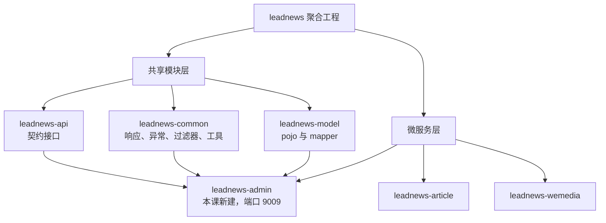

# admin 端工程起步：leadnews-admin 模块搭建与按端装配公共配置

> 🔒 安全提示：文中示例的口令/密钥均为课程教学环境演示口径，生产环境的安全要求见《安全与合规须知》。

管理后台是头条类资讯项目的第三个端：App 端面向读者，自媒体端面向创作者，admin 端面向运营人员，频道审核、敏感词治理、用户管理这些后台动作都在这里发生。day06 上午的任务是把 admin 端登录做掉，动手写接口之前得先让微服务立起来。建模块这件事在项目里已经做过好几轮，照理说闭着眼都能走完，实际上每一轮都有人翻车：多环境配置拷漏一份、公共配置类扫错端别的包、IDEA 把新模块悄悄 ignore 了还纳闷为什么 Maven 面板里找不到。这一课把 leadnews-admin 从零立到可启动，登录接口与后面的通用封装都在这个壳子里展开。

## 先给结论

- 聚合工程 leadnews 下新建 `leadnews-admin` 模块，依赖 `leadnews-model`、`leadnews-common`、`leadnews-api` 三个内部模块，包根 `com.study.headline.admin`。
- 新模块起步三件事：建模块、拷 `maven_dev/test/prod` 三份多环境配置、从既有微服务拷 config 公共配置类，一件都不能省。
- 应用名与端口登记在 common 的统一清单里，admin 端登记为 `leadnews-admin`，端口 9009，与 admin-web 前端代理的指向一致。
- 引导类 `AdminApplication` 与 login、behavior 等微服务的引导类逐字同构，包根位置决定默认扫描范围。
- config 装配按端取件：数据源与 MyBatis-Plus 照旧，init 配置收 jackson 初始化，`SecurityConfig` 专门扫 `com.study.headline.common.web.admin.security`，把 admin 端自己的 token 过滤器装进容器。

## admin 为什么必须是独立微服务

登录功能的骨架在自媒体端刚走过一遍，把 `leadnews-wemedia` 复制一份改改名似乎就能用。工程模板确实可以照抄，微服务边界却不能合并：admin 端与自媒体端是两套用户体系，账号分别在 ad_user 与 wm_user 两张表里，token 的校验过滤器、放行规则、权限边界各管各的端。合并到一个进程里，这些差异全要靠 if 分支糊在一起，任何一端改登录策略都可能把另一端带崩。端别即边界，微服务拆分让这条边界落到了物理层面。

整个聚合工程的模块关系如下：



关键路径在共享模块层指向 admin 的三条依赖线上：model 供实体与 Mapper，common 供统一响应、异常处理与按端分装的过滤器，api 供前后端契约接口。新建微服务的本质动作就是把这层公共能力「接电」：拷依赖、拷配置、扫对包。

## 起步三件事

**第一件事，建模块。** 在聚合工程下新建 `leadnews-admin`，pom 里声明父工程与三个内部依赖（按画面线整理）：

```xml
<parent>
    <artifactId>leadnews</artifactId>
    <groupId>com.study</groupId>
    <version>1.0-SNAPSHOT</version>
</parent>
<artifactId>leadnews-admin</artifactId>

<dependencies>
    <dependency>
        <groupId>com.study</groupId>
        <artifactId>leadnews-model</artifactId>
    </dependency>
    <dependency>
        <groupId>com.study</groupId>
        <artifactId>leadnews-common</artifactId>
    </dependency>
    <dependency>
        <groupId>com.study</groupId>
        <artifactId>leadnews-api</artifactId>
    </dependency>
</dependencies>
```

版本号交给父工程统一管理，依赖里不必重复声明。IDEA 有一个小坑：新建的模块偶尔会被自动加入 Maven 的 ignore 列表，面板里迟迟刷不出来，颜色也不对。到 Maven 面板里取消忽略再刷新，模块变回正常颜色才算建成。

**第二件事，拷多环境配置。** 从既有微服务把 `maven_dev.properties`、`maven_test.properties`、`maven_prod.properties` 三份文件拷进 admin 模块，连同 `log4j2.xml` 与 `application.properties` 两个 resources 文件一起拿过来：

```bash
# admin 模块起步的拷贝动作（示例为按本课写法补全）
cp maven_dev.properties maven_test.properties maven_prod.properties leadnews-admin/
cp log4j2.xml application.properties leadnews-admin/src/main/resources/
```

`application.properties` 只需要改两行，应用名与端口不在这里硬编，值登记在 common 模块的统一清单里，各微服务的名称与端口都在那张表上定义，配置文件按占位符读取：

```properties
# 端口与应用名：值在 common 统一清单中定义，admin 端分到 9009
server.port=9009
spring.application.name=leadnews-admin
```

**第三件事，拷公共配置类。** 从行为服务或其他微服务把 config 目录整体拷来，再把业务包结构补齐：service、controller.v1、apis 各就各位。多环境配置最容易漏，dev 与 prod 的数据库地址、注册中心端口都不同，漏拷之后模块能编译却起不来，报错还绕到注册中心那边去。

## 引导类与包根

引导类是整个工程唯一的 main 入口，结构与既有微服务逐字同构：

```java
package com.study.headline.admin;

import org.springframework.boot.SpringApplication;
import org.springframework.boot.autoconfigure.SpringBootApplication;

@SpringBootApplication
public class AdminApplication {

    public static void main(String[] args) {
        SpringApplication.run(AdminApplication.class, args);
    }
}
```

这个类放的位置比内容更重要。`@SpringBootApplication` 自带的组件扫描从类所在包向下递归，包根定在 `com.study.headline.admin`，意味着 config、service、controller 这些子包里的 bean 全部默认可见。包根一旦漂移，比如多套了一层或少套了一层，启动不报错，运行期才会陆续冒出 `NoSuchBeanDefinitionException`，排查成本比启动失败高得多。

## config 装配：公共能力按端取件

common 模块里的支撑能力不是一股脑全装的，config 包里要引三类配置。**数据源与初始化照抄。** MysqlConfig 扫 `com.study.headline.common.mysql.core`，数据源与 Mapper 代理启动即装配；init 配置收 jackson 初始化这类与端别无关的公共动作，从行为服务拷来即可：

```java
package com.study.headline.admin.config;

import org.springframework.context.annotation.ComponentScan;
import org.springframework.context.annotation.Configuration;

@Configuration
@ComponentScan("com.study.headline.common.init")
public class InitConfig {
}
```

**安全过滤按端取件。** common 的 web 支撑包里过滤器按端分包，一共三块：admin、app、wm，分别对应管理端、移动端、自媒体端，功能同构但端别不同。App 端有 AppTokenFilter，自媒体端有 WmTokenFilter，admin 端对应的是 AdminTokenFilter，负责校验请求头里的 token 并把用户绑定到线程上下文。admin 端要用 admin 那一套，配置类里扫的包必须写对：

```java
package com.study.headline.admin.config;

import org.springframework.context.annotation.ComponentScan;
import org.springframework.context.annotation.Configuration;

@Configuration
@ComponentScan("com.study.headline.common.web.admin.security")
public class SecurityConfig {
}
```

拷贝自 wemedia 工程时最容易犯的错就是这里的包名没改，`wm` 两个字留着，装配进容器的就是自媒体端过滤器，token 解析用的用户上下文也是自媒体那套，登录校验看起来能跑，身份信息却完全错位。启动 admin 服务确认无报错，工程骨架到此立完，登录接口的编写放进下一课。

## 常见误区

- **只拷 `application.properties` 不拷多环境文件。** 三份 maven 环境属性是构建期注入的来源，缺了它们模块照样编译通过，启动时才在数据源或注册中心连接上报错，且报错信息不直接指向缺文件，是起步三件事里被漏得最多的一件。
- **SecurityConfig 扫错端别包。** 从 wemedia 拷来的配置类里 `wm` 没改成 `admin`，装进容器的是别端的过滤器。表现是 token 校验行为诡异、用户上下文取不到，根源在扫描包名，启动日志里能翻到装配了哪个过滤器，对着查最快。
- **引导类包根放偏。** `@SpringBootApplication` 按包根向下扫描，包根多一层或少一层都会让部分 bean 失踪。错误做法是把引导类挪到更上层去「扫全」，正确做法是固定 `com.study.headline.admin`，公共能力靠显式 `@ComponentScan` 按需引入。
- **依赖漏拷 model 或 api。** 少了 model，pojo 与 Mapper 接口全部标红；少了 api，契约接口无法实现。新模块的依赖清单从同类微服务整段拷贝再删减，比从零回忆补全可靠得多。

## 面试可能被问到的问题

1. 面试官追问：「同一套登录逻辑，为什么 admin 端要单独建一个微服务？」
   答：端别即边界。admin 与 wemedia 的用户表、token 过滤器、放行规则、权限边界都不相同，独立成服务后各自的登录策略可以独立演进，部署与故障也被隔离开。工程模板可以复用，身份链路必须独立，合并只会把差异压进 if 分支里。
2. 面试官追问：「@SpringBootApplication 已经会扫描组件了，为什么配置类里还要写 @ComponentScan？」
   答：默认扫描只覆盖本模块包根以下，common 是另一个 Maven 模块，其包路径在包根之外，默认扫不到。配置类里显式 `@ComponentScan` 就是把 common 中指定包的 bean 显式纳入容器，按端取件还能控制只装本端需要的那套过滤器。
3. 面试官追问：「多环境配置是怎么进入应用的？」
   答：dev、test、prod 各一份 properties 文件，构建时按 Maven profile 选定其中一份注入，应用配置里用占位符引用。数据库地址、注册中心、端口这类随环境变化的项全部收进属性文件，代码与配置文件里不出现环境硬编码，换环境只切 profile。
4. 面试官追问：「新微服务从拷贝起步，怎么保证不漏东西？」
   答：把起步动作固化成清单：建模块并确认父工程聚合、拷三份多环境属性、拷 resources 配置并改应用名与端口、整段拷依赖再删减、拷 config 三件套并改端别包名、补包结构与引导类。每一步都有可验证的结果，最后以启动成功为验收标准。
5. 面试官追问：「统一清单里登记端口有什么好处，不用行不行？」
   答：好处是端口与应用名的单一事实来源，前端代理、服务间调用、运维脚本都从同一处取值，冲突与漂移在登记时就能发现。不用也能跑，但每个服务自说自话，联调对端口、排障查地址的成本会随服务数量线性上涨。

## 配套资料

- 代码：`materials/code/05/头条day06/`。该日资料包解压结果为空（未含源码文件），文中 pom、properties、引导类与配置类均按画面线抄录整理，包名统一改写为 `com.study.headline`，端口与统一清单取值按本课工程惯例补全并已在文中注明。
- 代码：`materials/code/05/头条day01/`，内层资料目录含项目原型页面，admin 端频道管理、用户管理、敏感词管理几个页面的形态可对照原型核对。
- 环境：课程集群 node01~node03，MySQL root/123456；admin 服务端口 9009，与 admin-web 前端 dev server 代理指向一致。
