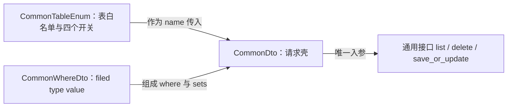

# 通用封装的三个 DTO：表枚举、条件项与请求壳

前端接通用接口时，第一个问题不是接口在哪，而是参数怎么传：查哪张表、什么条件、分页多大、是新增还是修改。传统接口里每个 DTO 只描述一张表，通用层要一个壳描述所有表，参数设计本身就是前后端的契约。这一节把契约的三个类逐字段拆开：表枚举、条件项、请求壳。

## 先给结论

- CommonTableEnum 是表的白名单，每张表带查询、新增、修改、删除四个开关，枚举名与构造参数里的表名都必须和真实表名一致。
- CommonWhereDto 是最小条件项：filed、type、value 三件套，type 默认 eq，可扩展 like 与 between。
- CommonDto 是请求壳：page 与 size 管分页，model 区分新增与修改，name 指向目标表，where 装条件集合，sets 装修改字段集合。
- sets 只在修改时使用，绝大多数请求只用 where。

## CommonTableEnum：一张表一行开关

这个枚举类解决「哪些表允许通用操作、开放哪些动作」的问题。要进通用层的表都在这里登记：用户、频道、敏感词，一张表一行，四个布尔按序表示是否允许查询、是否允许新增、是否允许修改、是否允许删除：

| 枚举常量 | 对应表 | 查询 | 新增 | 修改 | 删除 |
|---|---|---|---|---|---|
| AD_CHANNEL | ad_channel | 是 | 是 | 是 | 是 |
| AD_SENSITIVE | ad_sensitive | 是 | 是 | 是 | 是 |
| AP_ARTICLE | ap_article | 是 | 否 | 否 | 否 |
| AP_ARTICLE_CONFIG | ap_article_config | 是 | 否 | 是 | 否 |
| AP_USER | ap_user | 是 | 否 | 是 | 否 |

频道与敏感词全开；文章表只允许查询；文章配置与用户允许查询和修改，不允许新增与删除。以后要放行新动作，改枚举里的布尔值即可，不用动任何代码逻辑：

```java
package com.study.headline.model.admin.dtos;

import lombok.AllArgsConstructor;
import lombok.Getter;

/**
 * 通用操作的表白名单：一张表一行，四个布尔按序为 查询 新增 修改 删除
 */
@Getter
@AllArgsConstructor
public enum CommonTableEnum {
    AD_CHANNEL("ad_channel", true, true, true, true),
    AD_SENSITIVE("ad_sensitive", true, true, true, true),
    AP_ARTICLE("ap_article", true, false, false, false),
    AP_ARTICLE_CONFIG("ap_article_config", true, false, true, false),
    AP_USER("ap_user", true, false, true, false);

    /** 表名，必须与数据库里的表逐字一致 */
    private final String tableName;
    /** 是否允许查询 */
    private final Boolean query;
    /** 是否允许新增 */
    private final Boolean insert;
    /** 是否允许修改 */
    private final Boolean update;
    /** 是否允许删除 */
    private final Boolean delete;
}
```

枚举常量名与表名是同一个信息，只是命名风格不同：`AD_CHANNEL` 对应表 `ad_channel`，`AP_ARTICLE_CONFIG` 对应表 `ap_article_config`。课件画面里构造参数位置的表名以占位符显示，语义是与数据库一致的表名字符串。新登记一张表时表名写错一个字母，持久层拼接 SQL 就会报表不存在，这个对应关系不能随手写。

## CommonWhereDto：一个条件项的三件套

条件查询的最小单位是「哪个字段、按什么方式、比什么值」。字段名叫 filed，值叫 value，中间的操作方式叫 type，默认精确等于：

```java
package com.study.headline.model.admin.dtos;

import lombok.Data;

/**
 * 通用条件项：字段名 + 操作方式 + 值
 */
@Data
public class CommonWhereDto {
    /** 字段名（课程源码即为此拼写，前端与通用层保持一致） */
    private String filed;
    /** 操作方式：eq 等于，like 模糊，between 范围；默认 eq */
    private String type = "eq";
    /** 字段的值 */
    private String value;
}
```

type 封装时先支持三种：默认 `eq` 精确匹配，`like` 模糊查询，`between` 范围查询。举个例子，按名称精确查询一个用户：filed 传 `name`，type 传 `eq`，value 传 `小明`；换模糊就改 type 为 `like`。之后有按大于、小于、不等于查的需求，再往枚举分支里加，扩展点是开放的。

一个值得注意的细节：源码里这个字段名就叫 filed，是 field 的历史笔误。前端传参、通用 DAO 取值、这里的三件套全链路沿用同一拼写才对得上；名字难看不致命，两边拼写不一致才致命。

## CommonDto：把一次操作装进一个壳

请求壳把一次增删改查的全部参数装在一起：

```java
package com.study.headline.model.admin.dtos;

import lombok.Data;
import java.util.List;

/**
 * 通用接口入参：一次增删改查的全部参数
 */
@Data
public class CommonDto {
    /** 每页条数 */
    private Integer size;
    /** 当前页码 */
    private Integer page;
    /** 动作标记：区分新增与修改 */
    private String model;
    /** 目标表：可操作的表枚举 */
    private CommonTableEnum name;
    /** 查询或定位条件，可多个 */
    private List<CommonWhereDto> where;
    /** 修改的字段，仅修改时使用 */
    private List<CommonWhereDto> sets;
}
```

**page 与 size** 是分页参数，列表接口靠它们出分页数据。**model** 存在的理由要回到类图：通用 Service 里新增和修改是同一个方法，前端多传一个 model 过来区分动作，不传就说不清这次是插入还是更新。**name** 的类型是表枚举，传 `AD_CHANNEL` 就是操作频道表，传 `AD_SENSITIVE` 就是对敏感词做增删改查，非法值在反序列化阶段就被拒收。**where** 是条件集合，`List<CommonWhereDto>`，因为条件可能有多个；**sets** 是修改字段集合，结构与 where 完全一样，只在修改时使用，语义是 set 子句的内容。

一个列表请求和一个修改请求分别长这样（示例按 dto 字段推演补全）：

```json
{
  "name": "AD_CHANNEL",
  "page": 1,
  "size": 10,
  "where": [
    { "filed": "name", "type": "like", "value": "音乐" }
  ]
}
```

```json
{
  "name": "AD_CHANNEL",
  "model": "update",
  "where": [ { "filed": "id", "type": "eq", "value": "3" } ],
  "sets": [ { "filed": "name", "type": "eq", "value": "音乐频道" } ]
}
```

修改请求的结构值得多看一眼：where 负责定位到 id 为 3 的那行，sets 负责给出要改的字段与新值，两组三件套各司其职。

## 三个类怎么协作



这张图在讲三个类的组装关系：枚举定义能力边界，条件项组成集合，请求壳一次装齐。关键路径读法：通用 Service 拿到壳先查 name 的开关，再遍历 where 与 sets 走参数校验，最后交给 DAO 拼接执行；三个类在前端、Service、DAO 三层之间传递的是同一份契约。

## 常见误区

- **枚举里的表名随手写。** 表名字符串必须与数据库逐字一致，写错一个字母，拼接 SQL 直接报表不存在；登记新表时对照数据库核对一遍。
- **where 与 sets 混用。** sets 只在修改时使用，查询请求里传 sets 没有意义；修改时 where 负责定位、sets 负责改值，缺一组都可能变成全表更新。
- **以为 type 不传会报错。** 默认值就是 eq，不传按精确匹配处理；要模糊或范围必须显式传 like 或 between。
- **把 model 当表名。** model 是动作标记，区分新增与修改；指向表的是 name，两个字段含义完全不同。

## 面试可能被问到的问题

1. 面试官追问：「为什么用枚举而不是字符串传表名？」
   答：枚举把可操作的表白名单化，非法值在反序列化阶段就失败；枚举里还携带表名与四个动作开关，权限检查与 SQL 拼接从同一处取值，避免两套口径。
2. 面试官追问：「CommonWhereDto 的 type 支持哪些操作符，怎么扩展？」
   答：先支持 eq、like、between 三种，默认 eq。扩展就是新增操作符分支，并在业务层合法性校验里同步放行，大于、小于、不等于按需求补，不能让前端传未登记的操作符。
3. 面试官追问：「查询条件为什么设计成集合？」
   答：业务上经常多条件组合，按名称模糊再加状态精确是常态；集合让通用 DAO 用 foreach 拼 and 条件，一次请求任意组合，单对象设计会逼着前端发多次请求或另造结构。
4. 面试官追问：「这套通用 DTO 与每个接口自定义 DTO 相比牺牲了什么？」
   答：牺牲了编译期类型安全与字段级语义，前端传的是字段名字符串，拼写错误要运行期才发现；换来的是接口数量不随表增长、校验与权限统一收口。表多业务薄的管理后台这笔交换划算，核心业务域不合适。
5. 面试官追问：「sets 的结构与 where 一模一样，为什么不另造一个类？」
   答：复用的是同一个类，语义靠字段名区分，where 出现在条件子句，sets 出现在 set 子句；结构一致让前端只需要会构造一种对象，通用层解析逻辑也只写一份。

## 配套资料

- 代码：`materials/code/05/头条day06/`。该日资料包解压结果为空（未含源码文件），文中三个类的字段与取值按画面线课件抄录整理，枚举构造参数的表名占位按口播还原，包名统一改写为 `com.study.headline`；JSON 请求示例按 dto 字段推演补全；引用路径截至 `头条dayNN/` 层级，内层目录冠以项目原名，正文统一以「头条类资讯项目」指代。
- 代码：`materials/code/05/头条day01/`，内层资料目录含数据库规范设计说明书与项目原型，可对照 ad_channel、ad_sensitive、ap_user 等表名与后台管理页面。
