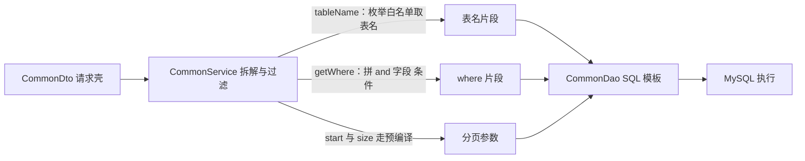

# CommonDao：一个接口装下单表增删改查的动态 SQL

管理后台的每一张管理页背后都是同一套样板：实体类、Mapper 接口、Mapper XML、Service、Controller，五件一套按表复制，表一多，代码膨胀得比业务还快，而这些样板之间的差异往往只有一个表名。通用封装落到持久层，问题就变成一句话：能不能只写一个 DAO，让表名、条件、分页全部参数化。CommonDao 就是这个问题的答案，它是整个通用后端里离数据库最近的一层。

## 先给结论

- CommonDao 用 MyBatis 注解版动态 SQL 实现，一个接口 7 个方法覆盖单表查询、统计、新增、修改、删除，所有通用接口共用这一个 DAO。
- SQL 模板里两类占位符分工明确：表名、字段串、条件串、值串用 `${}` 字符串替换，分页参数 start 与 size 用 `#{}` 预编译传参。
- `${}` 天然带注入风险，这套封装的安全防线不设在 DAO，而在上层：表名来自 CommonTableEnum 白名单，条件与值由 CommonService 过滤后才拼进来。
- 每条带条件的 SQL 都先写 `where 1=1` 恒真条件，后面的片段统一以 `and` 开头拼接，首条件就不会多出或缺少连接词。
- 删除方法尾部固定 `limit 1`，把通用删除锁死成一次只删一行。

## 七个方法，一张清单

通用 DAO 只需要回答「传给我表名和条件，我给你执行」这一件事。拆开看就是 7 个方法：

| 方法 | 参数 | 用途 |
|---|---|---|
| list | tableName、start、size | 无条件分页查询 |
| listCount | tableName | 无条件统计总数 |
| listWhere | tableName、where、start、size | 带条件分页查询 |
| listCountWhere | tableName、where | 带条件统计总数 |
| insert | tableName、fields、values | 通用新增 |
| update | tableName、sets、where | 通用修改 |
| delete | tableName、where | 通用删除 |

查询占四个，是因为分页查询必须同时返回当页数据与总条数，前端分页组件两样都要；有条件与无条件分开，是为了 SQL 模板保持最简单的形态。上一节类图里 CommonDto 被画成 DAO 的唯一入参，那是站在请求链的角度：请求壳一路携带参数向下传。真正落码时 DAO 的方法签名拆得更细，表名、条件、分页逐个传参，壳的拆解发生在 CommonService，DAO 只认拆好的片段。

## 接口全貌

```java
package com.study.headline.admin.dao;

import org.apache.ibatis.annotations.*;
import java.util.HashMap;
import java.util.List;

/**
 * 通用 DAO：动态 SQL 与表名拼接的落地处
 * ${} 为字符串拼接，#{} 为预编译占位
 */
public interface CommonDao {

    /** 无条件分页查询 */
    @Select("select * from ${tableName} limit #{start},#{size}")
    @ResultType(HashMap.class)
    List<HashMap> list(@Param("tableName") String tableName,
                       @Param("start") int start,
                       @Param("size") int size);

    /** 无条件统计 */
    @Select("select count(*) from ${tableName}")
    @ResultType(Integer.class)
    int listCount(@Param("tableName") String tableName);

    /** 带条件分页查询：where 片段自带 and，模板用恒真条件接住 */
    @Select("select * from ${tableName} where 1=1 ${where} limit #{start},#{size}")
    @ResultType(HashMap.class)
    List<HashMap> listWhere(@Param("tableName") String tableName,
                            @Param("where") String where,
                            @Param("start") int start,
                            @Param("size") int size);

    /** 带条件统计 */
    @Select("select count(*) from ${tableName} where 1=1 ${where}")
    @ResultType(Integer.class)
    int listCountWhere(@Param("tableName") String tableName,
                       @Param("where") String where);

    /** 通用修改：sets 是逗号分隔的字段等于值片段 */
    @Update("update ${tableName} set ${sets} where 1=1 ${where}")
    @ResultType(Integer.class)
    int update(@Param("tableName") String tableName,
               @Param("sets") String sets,
               @Param("where") String where);

    /** 通用新增：fields 与 values 是括号内的两段内容，顺序必须一一对应 */
    @Insert("insert into ${tableName} (${fields}) values (${values})")
    @ResultType(Integer.class)
    int insert(@Param("tableName") String tableName,
               @Param("fields") String fields,
               @Param("values") String values);

    /** 通用删除：limit 1 保证一次只删一行 */
    @Delete("delete from ${tableName} where 1=1 ${where} limit 1")
    @ResultType(Integer.class)
    int delete(@Param("tableName") String tableName,
               @Param("where") String where);
}
```

读这份接口有三个看点。第一，返回值只有两种形状：查询返回 `List<HashMap>`，一行数据落成一个 Map，因为通用层事先不知道目标表有哪些列，按实体类接收反而做不到；写操作统一返回 int 受影响行数，交给上层判断成败。第二，`@ResultType` 在这里更多是显式声明意图，MyBatis 对带返回值的方法会按接口签名推断结果类型。第三，`insert into` 模板里 fields 与 values 的顺序有强约束，Service 拼接这两个串时必须按同一份字段清单同步推进，错一位数据就插歪了。

## `${}` 与 `#{}` 的分工

这套接口最值得琢磨的就是占位符的选择。`#{}` 在 MyBatis 里生成预编译参数，值以 `?` 占位交给 `PreparedStatement`，类型安全且天然免疫注入；`${}` 是纯粹的字符串替换，参数写到哪里就拼到哪里。表名、拼装好的 where 片段、set 片段、insert 的字段与值串，都是 SQL 结构本身的一部分，预编译占位符表达不了这类「结构可变」，只能用 `${}`。limit 的 start 与 size 是纯数字，用 `#{}` 既安全又省事。

以一次带条件的频道查询为例，Service 把请求壳拆成三段，最终落成的 SQL 是这样：

```sql
-- ${tableName} = ad_channel，${where} = and name like '%音乐%'
select * from ad_channel where 1=1 and name like '%音乐%' limit 0,10
```

`where 1=1` 的价值在这一条 SQL 里看得很清楚：条件片段统一以 `and` 开头，模板里恒真条件负责「接住」第一个 and，之后无论传一个条件还是五个条件，语法都成立，模板里不需要任何 if 判断。而 `${where}` 里出现的值已经过 Service 层的 parseValue 过滤与字段名校验，注入字符在拼进 SQL 之前就被剥掉了，这是白名单式的兜底。责任的分工必须记牢：DAO 负责拼，Service 负责防。



这张图在讲一条请求从壳到 SQL 的拼装路径：Service 先拆壳再过滤，三段素材分别走 `${}` 与 `#{}` 两条通道汇入 DAO 模板。关键路径读法：表名与 where 片段是注入风险区，全部在 Service 侧完成清洗；数字型分页参数直通预编译，是这条链里唯一不需要清洗的输入。

## 交给 Spring：@Mapper 与 @MapperScan

接口本身没有实现类，能被注入使用靠的是 MyBatis 的动态代理。两个注解配合完成这件事：接口上加 `@Mapper` 声明这是要生成代理的 Mapper 接口，启动类或配置类上加 `@MapperScan` 指定扫描哪个包：

```java
// 启动类或 MyBatis 配置类上
@MapperScan("com.study.headline.admin.dao")
@SpringBootApplication
public class AdminApplication {
    public static void main(String[] args) {
        SpringApplication.run(AdminApplication.class, args);
    }
}
```

容器启动时，MyBatis 扫描该包下所有接口，逐个生成代理对象注册成 Bean，CommonService 里的 `@Autowired private CommonDao commonDao` 就能拿到代理实例。少了 `@MapperScan`，启动直接报找不到 Bean；这也是通用封装篇最常见的第一课报错。

## 常见误区

- **表名写成了 `#{tableName}`。** 预编译会把表名当字符串值处理，生成的 SQL 形如 `from 'ad_channel'`，直接语法报错；结构可变的部分只能 `${}`。
- **漏掉 `@MapperScan` 或包路径写错。** 接口没有实现类，扫不到就没有代理 Bean，注入处启动期报 `NoSuchBeanDefinitionException`；包名必须与 DAO 实际所在包逐字一致。
- **片段与模板的 and 约定两边各写各的。** 模板已写 `where 1=1 ${where}`，Service 拼的每个片段又以 and 开头，这是强约定；哪一边漏了或重复，SQL 就多一个 or 少一个 and，错误在运行期才暴露。
- **把前端原始串直接透传给 `${}`。** DAO 不做清洗是设计使然，清洗责任在 Service；跳过 Service 层校验直接调 DAO，等于把白名单拆了。

## 面试可能被问到的问题

1. 面试官追问：「`${}` 与 `#{}` 的区别是什么，什么场景必须用 `${}`？」
   答：`#{}` 生成预编译参数，值经类型安全通道传入，可防注入；`${}` 是字符串替换，值直接写进 SQL 文本。当参数是表名、列名或整个子句这类 SQL 结构的一部分时，预编译占位符表达不了，只能 `${}`，同时必须在上层用白名单与过滤兜住风险。
2. 面试官追问：「`where 1=1` 这种写法你怎么评价？」
   答：它是动态拼接多条件的经典手法，恒真条件让后续片段统一带 and，模板侧不用判断首个条件。代价是 SQL 审计工具常把它标为可疑写法，配合索引也基本失效于这个常量本身；管理后台的内部场景里利大于弊，对外的核心链路更建议用 MyBatis 的动态 SQL 标签处理。
3. 面试官追问：「delete 为什么要拼 `limit 1`？」
   答：通用删除的语义是按唯一条件删一行，通常是按 id。不带 limit 时，如果条件因传参失误变宽，一次误删可能波及整张表；limit 1 把最坏情况的破坏半径压到一行，属于防御性 SQL。
4. 面试官追问：「返回 `List<HashMap>` 而不是实体列表，好处和代价是什么？」
   答：好处是彻底解耦，新增一张表不需要新实体与新 Mapper，列变化也不用改代码；代价是失去编译期字段检查，字段拼写错误要等运行期或前端反馈才发现，取值全部走字符串 key。管理后台的轻量表场景可以接受，核心域不建议。
5. 面试官追问：「`@Mapper` 与 `@MapperScan` 是什么关系，能只用一个吗？」
   答：两者都为了把 Mapper 接口注册成 Bean。`@Mapper` 逐个标注，配合自动配置的扫描生效；`@MapperScan` 按包批量登记。一个项目里用其一即可，都用也不冲突，工程上表多时普遍只留 `@MapperScan`，省去逐接口标注。
6. 面试官追问：「这套注解动态 SQL 与 XML 里 `<if>`、`<where>` 标签的方案比，你怎么选？」
   答：注解加 `${}` 拼接适合结构完全参数化的极简模板，一个接口服务所有表；XML 动态 SQL 适合结构固定、只有条件可变的场景，类型安全与可读性更好。通用封装要的是「一个接口打天下」，所以选前者，代价是把防注入责任显式交给了 Service 层。

## 配套资料

- 代码：`materials/code/05/头条day06/`。该日资料包解压结果为空（未含源码文件），文中 CommonDao 接口按画面线课件抄录整理（DML 三方法的注解按 MyBatis 正确用法还原为 `@Update`、`@Insert`、`@Delete`，条件查询方法的分页参数按接口实际签名补全），包名统一改写为 `com.study.headline`；引用路径截至 `头条dayNN/` 层级，内层目录冠以项目原名，正文统一以「头条类资讯项目」指代。
- 代码：`materials/code/05/头条day01/`，内层资料目录含数据库规范设计说明书，可对照 ad_channel、ad_sensitive 等表名核对拼接 SQL 的目标表。
