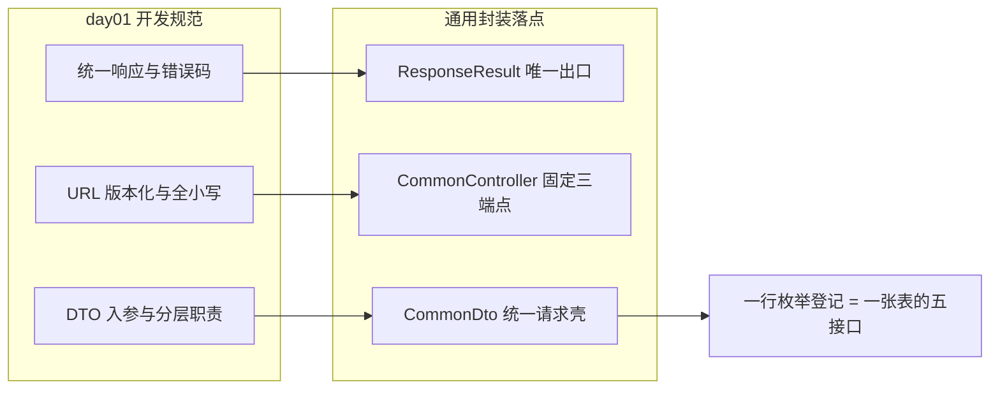
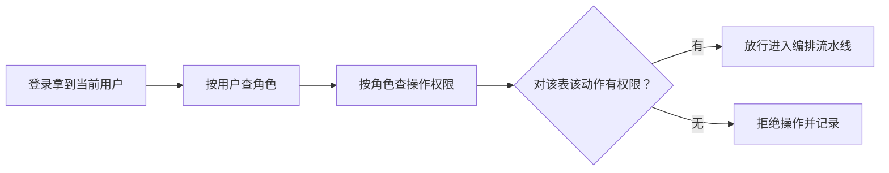

# 通用封装收官：收益盘点、风险边界与优化路线

从需求分析、八步流水线、类图定形，到 DAO、编排层、控制器落地，再到前端对接与功能测试，通用封装的整条链在 day06 走完。收尾要回答三个问题：这套东西到底省了多少、边界画在哪里、还能往哪里优化。通用封装在传统企业与后台关键系统里是常见玩法，单表操作密集时收益立竿见影，但通用操作天然带着风险，收益与风险必须一起盘点清楚。

## 先给结论

- 收益：接入一张表只剩一行枚举登记，后端四层样板与前端页面配置同时复用。
- 边界：通用层只吃单表维护，多表 join、聚合统计、跨表事务仍然走专用接口。
- 风险：入口统一意味着风险统一，操作日志是必选项；RBAC 权限与行级数据权限是进生产前要补齐的两道闸。
- 优化两条主线：后端补权限校验与前置钩子闭环，前端把 fields 配置做厚；长期方向是注解化或代码生成器取代手工登记。

## 收益盘点：day01 的规范在这里变成唯一实现

day01 开发规范立过几条规矩：统一响应 ResponseResult 与错误码枚举、URL 带版本段、DTO 承接入参、分层职责清晰。当时每写一个接口都要人肉对齐这些约定，写多了难免漂移。通用封装把这层关系倒了过来：规范不再靠自觉，而是被焊进唯一的那条链路，所有单表请求自动合规。



这张图在讲规范与实现之间的对应：左边三条规矩分别落在通用层的响应、入口与入参上，右边一行枚举登记就是新表接入的全部成本。关键路径读法：规范从「每个接口各自对齐」变成「结构本身自带」，这就是通用性带来的复利。

数量级对比更直观。传统做法一张表要写 Controller、Service、Mapper、映射文件四层，五个接口几百行起步；通用做法一张表一行枚举。前端同理，一个 params 加一份 fields 就是一张表的管理页。后台系统几十张配置表的项目里，这两种模式的维护成本差出一个量级。

## 边界：通用层不接的活

通用层的能力圈必须画清楚，超出圈子的需求硬塞进来，封装会迅速腐化。**多表 join 不接。** 通用 DAO 的 SQL 由表名与条件拼出来，天然只有单表形态；关联查询带业务语义，走专用接口写专门的映射文件。**聚合统计不接。** 列表接口里的 total 计数是最简单的 count，超出这个粒度的分组统计、报表汇总都该是专门的查询接口。**跨表事务不接。** 通用层一次只动一张表，牵涉多表一致性的操作要有业务层的事务编排。**带业务语义的批量操作不接。** 一次只删一条是安全约束，批量清理这类需求自带校验语义，理应走专用接口兜底。

认清边界之后，通用层的定位就一句话：管理后台的单表维护通道。把「看起来都能通用」的活全塞进这条通道，是这类封装失败的头号原因。

## 后端优化清单：六件事按优先级排

课件把后端优化列成一张清单，逐条过一遍。**RBAC 登录人权限校验。** 流水线第二步目前留白，标准链路是登录后查用户，按用户查角色，再按角色查操作权限，链路走完有权限才放行表操作。这条闸成本不高，收益是整套接口从「白名单级」安全升级到「人级」安全。



这张图在讲权限链路的查法：三段查询串起来，判定发生在进入编排层之前。关键路径读法：权限判定不通过时直接拒绝并记日志，持久化根本不会发生。

**行级数据权限检查。** 表级开关管的是「能不能动这张表」，行级权限管的是「能动这张表的哪些行」，比如用户只能改自己部门的数据，这是进一步防范数据误操作的纵深。**前置处理接口。** 后置增强 BaseCommonFilter 已落地，前置一侧本课留作练习，补一个对称的接口并不费事：

```java
/**
 * 前置增强：持久化之前执行，返回 false 时编排层中断请求（按本课写法补全）
 */
public interface BaseCommonPreFilter {

    /**
     * 返回 true 放行，返回 false 中断
     */
    boolean doBefore(AdUser user, CommonDto dto);
}
```

前置与后置的分界在持久化：前置能拒绝请求，后置只能影响返回。**后置处理投入使用。** 后续做文章审核时，审核通过要发消息驱动下游，这类「落库之后补一个动作」的需求正是 BaseCommonFilter 的用武之地，接口已备好，到时按表注册增强类即可。**MyCat 场景的 SQL 节点注解。** 分库分表接入后，动态拼出来的 SQL 要明确路由到哪个节点，需要在动态 SQL 里加上节点选择的注解提示，否则全节点广播会拖垮性能，这是 MyCat 环境里必须做的性能优化。**操作日志。** 建议必须加上：谁、对哪张表、什么动作、什么参数、结果如何，一行记录在出问题时就是唯一的排查线索，也是监控与审计的数据源。落点就在编排层，写操作统一埋一次，所有表自动覆盖：

```java
/**
 * 操作日志埋点：放在编排层写操作的统一出口（示意，按本课写法补全）
 */
private void logWrite(AdUser user, CommonDto dto, String action, int affected) {
    // 谁、对哪张表、什么动作、什么参数、结果如何
    log.info("user={} table={} action={} sets={} where={} affected={}",
            user.getId(), dto.getName(), action, dto.getSets(), dto.getWhere(), affected);
}
```

## 前端优化清单：把 fields 做厚

前端一侧的优化围绕 fields 配置展开。让 fields 支持更多表单类型，下拉、单选、日期这些控件类型加进 type 体系；表单选择项支持远程动态加载，选项来自另一张表时不用改组件。搜索输出与行操作输出也由 fields 自动控制：配置里声明哪些字段可搜索、哪些动作按钮可见，通用组件照单渲染，页面零代码。更进一步是通用页面自动渲染，后台提供配置获取接口，把表名、字段、动作开关整套下发，新模块连页面文件都可以省掉；差异化的功能允许自定义覆盖，或在配置里支持动态脚本。配套要求只有一条：后端要把 CommonDto 每种动作的参数规范写成文档，新增、修改、删除、查询各自传什么，写得越清楚，前端接得越快。

## 演进路线：注解化、代码生成器与 MyBatis-Plus 对照

手工登记枚举是现在唯一的手工成本，两条路线能把它继续压低。**注解化**：把表名与动作开关做成注解标在实体类上，启动时扫描生成白名单，配置与实体住在一起，不容易漏登。**代码生成器**：读表结构直接生成枚举项与前端 fields 配置，接入成本从一行配置降到零次点击。

与 MyBatis-Plus 的对照有助于选型判断。BaseMapper 用泛型加反射按实体定位表与列，自动化程度高，但开放能力大，白名单要另建；这套封装用枚举白名单加动态 SQL，控制粒度到动作开关，安全口径显式可审计。选型口径很朴素：后台配置表多、需要统一审计与强白名单，选通用封装；业务实体清晰、追求单表开发速度，选 MyBatis-Plus；两者在同一个项目里共存并不冲突，管住各自的边界即可。

## 常见误区

- **把通用层当万能 CRUD。** join、报表、批量清理都往里塞，动态 SQL 很快长成注入风险与性能黑洞；超出单表维护的需求一律走专用接口。
- **认为封装完就不用逐表验证。** 每张新表接入后仍要过一遍动作开关与参数底线，枚举登记错了开关，接口行为就与预期相反，功能测试一节的三张表走查就是标准动作。
- **操作日志等出事再补。** 日志的价值在事后追溯，没有日志的事故无法复盘；埋点在编排层一次完成，没有理由后置。
- **优化先动前端不动权限。** fields 配置再厚，也盖不住没有 RBAC 的裸奔入口；权限与日志是地基，前端体验是装修，顺序不能反。

## 面试可能被问到的问题

1. 面试官追问：「什么场景适合引入这种通用封装？」
   答：单表操作密集、表结构稳定、以维护为主的场景，典型如管理后台的配置表、字典表管理。这类需求四层样板重复度极高，通用化收益最大；反过来，交互复杂、强业务语义的功能不适合，强行通用会腐化整条链路。
2. 面试官追问：「通用接口对所有表开放，怎么防滥用？」
   答：分层设防。表枚举白名单在反序列化时挡住非法表名，动作开关控制每张表开放的增删改查，RBAC 校验登录人权限，行级数据权限约束可操作的行，删除限定单条，操作日志全程留痕。任何一层失守还有下一层兜底。
3. 面试官追问：「这套方案与 MyBatis-Plus 怎么选？」
   答：看控制粒度与审计要求。MyBatis-Plus 泛型反射自动化高，适合业务实体清晰、追求开发速度的项目；这套封装白名单加动作开关显式可审计，适合后台配置表多、安全要求严的场景。两者可以共存，按模块划分边界。
4. 面试官追问：「接入分库分表后，这套封装要额外注意什么？」
   答：动态拼装的 SQL 需要明确路由，MyCat 环境下要为动态 SQL 补节点选择的注解提示，避免查询广播到全部节点；同时跨片的事务与聚合本来就不在通用层能力圈里，边界要收得更紧。
5. 面试官追问：「如果让你继续优化这套封装，先做什么？」
   答：先补 RBAC 权限校验与操作日志，两者是生产环境的安全底线且改造成本低；然后落地前置处理接口形成前后增强闭环；再往后才是注解化或代码生成器这类开发效率优化，安全永远排在效率前面。
6. 面试官追问：「通用封装对前后端协作方式有什么改变？」
   答：接口从按页面定义变成按动作定义，前端靠 params 与 fields 两份配置声明页面，后端靠枚举与文档定义能力边界；协作的重心从对接口字段变成对参数规范，规范的文档化程度直接决定联调效率。

## 配套资料

- 代码：`materials/code/05/头条day06/`。该日资料包解压结果为空（未含源码文件），文中优化清单按画面线课件整理，前置增强接口示例为按本课写法补全，包名统一改写为 `com.study.headline`；引用路径截至 `头条dayNN/` 层级，内层目录冠以项目原名，正文统一以「头条类资讯项目」指代。
- 代码：`materials/code/05/头条day01/`，内层资料目录含数据库规范设计说明书与项目原型，可对照开发规范原文与用户、频道、敏感词等表结构。
