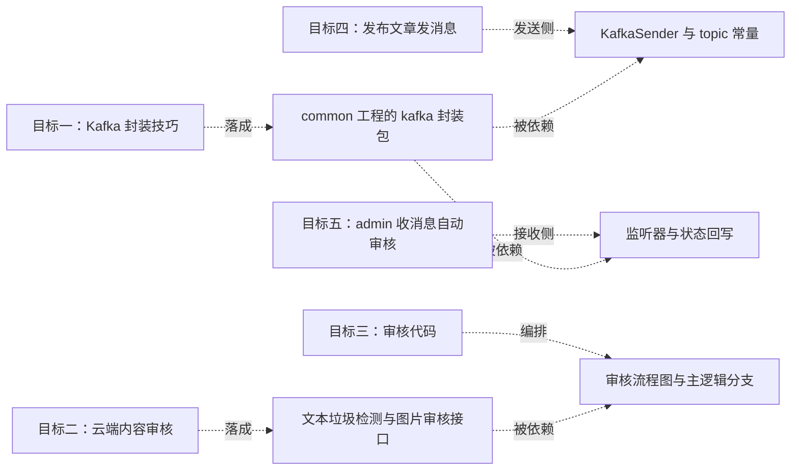

# day07 任务书：Kafka 封装与文章自动审核开工

> 🔒 安全提示：文中示例的口令/密钥均为课程教学环境演示口径，生产环境的安全要求见《安全与合规须知》。

day06 把通用后端封装收了尾，增删改查的样板代码告一段落，day07 转进一条新链路：文章审核。day05 写发布文章时，「提交审核」只是把 wm_news 的 status 置成 1，稿件落库后等一个不会自动到来的审核；day07 要把这一步补成真正的流水线，自媒体端发布文章后发出消息，admin 端接收消息触发自动审核，文本与图片交给云端内容安全服务判定，结论回写文章状态。动手前照例把目标与技术点的映射捋清楚。

## 先给结论

- day07 五个目标：熟悉 Kafka 的封装技巧、熟悉云端服务对图片与文本内容的审核、完成自媒体文章审核代码、完成自媒体端发布文章发送消息、完成 admin 端接收消息并自动审核。
- Kafka 封装是全天地基：一批工具类收进 common 工程，业务侧只保留发消息与收消息两个动作，不再各自拼配置。
- 云端内容安全审核是前置知识：先弄清文本垃圾内容检测与图片审核的接口形态、返回口径与开通流程，再进审核主流程。
- 审核主流程逻辑较复杂，课件的做法是先画流程图，照图把分支捋顺再动手写代码。
- 消息链路两端各一个动作：自媒体端发消息，admin 端收消息并自动审核，Kafka 在项目里「审核异步解耦」这一职责从这一天开始落地。

## 五个目标怎么映射到技术点

目标与支撑技术各有一条自己的线索，封装是底座，云端审核是外部依赖，主流程把两者串起来：



关键路径在目标一：封装落在 common 工程的 `com.study.headline.common.kafka` 包下，九个工具类在资料包里真实存在，生产者与消费者配置、消息信封、监听注册全在其中，目标四与目标五都建立在它上面。目标二给目标三供弹药，审核主流程的每个分支都要落到云端接口的一个返回值上；目标四与目标五是同一条消息的两端，先修发送侧再修接收侧。

## Kafka 为什么排第一个讲

技术栈清单里 Kafka 挂着两个职责，一是系统间消息通知与异步解耦，二是热文章的实时流计算，day09 才轮到第二职责，day07 先把第一职责做实。选消息中间件而不是同步调用，原因在审核这件事的耗时结构上：云端审核要走网络往返，文本尚可，图片一张一张送检，耗时从几百毫秒到数秒不等，同步等待会把提交接口拖进不可控的响应时间。发一条消息的代价是毫秒级，审核挪到消费端慢慢做，提交接口发完消息即返回，两端按各自的节奏扩容。

## 云端审核为什么是前置课

审核方式理论上有人工、自研程序、云服务三种：人工撑不住内容平台的量，自研要长期养词库与模型，云服务按量调用、识别规则持续更新，项目采用阿里云的内容安全服务。它的结论口径是三值：pass 正常、review 疑似违规需人工复核、block 违规，映射到状态机就是审核通过、转人工、审核失败三种去向。文本检测单次最长收 1 万字符，标签覆盖广告、涉政、暴恐、色情、辱骂、灌水等；图片同步检测走同一套三值口径。审核对象也不只是正文，封面图与配图同样要过审，这一课把接口能力与开通步骤都过一遍，后面写主流程才不会卡在外部依赖上。

## 消息链路两端长什么样

封装层把连接细节收走之后，业务代码在两端各只剩一个动作。发送侧从 topic 配置类取常量，把消息交给 KafkaSender；接收侧实现监听接口，声明自己听哪个 topic。形态大致如下（示例为按本课写法补全，封装类签名以真实工具类为准）：

```java
// 自媒体端：提交审核成功后一条消息出门，审核细节全部交给消费端
kafkaSender.sendMesssage(kafkaTopicConfig.getAdminTest(),
        String.valueOf(wmNews.getUserId()), message);

// admin 端：实现封装的监听接口，声明 topic 即完成注册
public class AdminReviewListener implements KafkaListener<String, String> {
    @Override
    public String topic() {
        return kafkaTopicConfig.getAdminTest();
    }
    // onMessage 里进审核主流程，按云端结论回写 wm_news 的状态
}
```

配置统一走一份 `kafka.properties`，连接地址、消费组、topic 常量都在里面（示例按画面线整理，键名与封装类的前缀对应）：

```properties
kafka.hosts=localhost:9092
kafka.group=headline.${profiles.name}.${spring.application.name}
# 单消息通道以 single 结尾，业务批量消息以 bus 结尾
kafka.topic.admin-test=headline.topic.admin-test.single
```

## 常见误区

- **把目标清单当背诵材料。** 五个目标的价值在动手：封装类要自己拷进 common、自己连上 broker、自己收发一遍，面试官问的是为什么封装、怎么封装，不是目标原文。
- **把自动审核当算法课。** 主流程是流程编排：读文章、抽图片、调云端、算匹配度、落库回写，识别能力由云端接口提供，本地写的都是分支控制与数据流转。
- **以为 Kafka 只为审核而生。** 项目里它还承担热文章实时计算，两个职责对应不同天的落地，介绍时要把职责与业务问题对上号。
- **忽略 review 这类中间态。** 云端结论不是布尔值，疑似违规的内容交给人工复核，直接当失败处理会误伤正常稿件，状态机里要给转人工留位置。

## 面试可能被问到的问题

1. 面试官追问：「文章审核为什么用 Kafka 异步解耦，而不是提交后同步调审核服务？」
   答：审核耗时不可控，云端文本与图片检测都有网络往返，同步会把提交接口的响应时间拖进数秒级；异步化后提交接口发完消息即返回，审核在消费端按自己的节奏做，两端独立扩容，审核服务抖动也不会传导到发布链路。
2. 面试官追问：「Kafka 封装层要解决什么问题？」
   答：把 topic 命名、序列化配置、失败重试、监听器注册这些每个业务点都要回答的问题收进一个公共包，业务代码只面对发消息与收消息两个动作。不封装的结果是每个服务各拼一套配置，口径不一致，出问题各修各的。
3. 面试官追问：「云端审核的三值结论怎么映射到文章状态机？」
   答：pass 对应审核通过，稿件可进入发布；block 对应审核失败，作者可修改后重新提交；review 是中间态，疑似违规转人工复核，不能粗暴归入通过或失败。
4. 面试官追问：「审核通过之后数据往哪流？」
   答：稿件进入 App 端文章主库并生成详情内容，同时同步进检索索引，App 端列表与搜索才可见；审核失败则留在自媒体端等修改重提，两端数据的衔接只发生在审核通过这一个动作上。

## 配套资料

- 代码：`materials/code/05/头条day07/`。内层资料目录含 Kafka 封装的工具类九个真实文件（生产者与消费者配置、消息信封、发送器、监听接口与注册工厂、重试错误处理器、topic 配置、消息类型注册器），是全天目标的实体；引用路径截至 `头条dayNN/` 层级，内层目录冠以项目原名，正文统一以「头条类资讯项目」指代。
- 代码：`materials/code/05/头条day12/`，Kafka Stream 流处理封装，对应 Kafka 在项目里的另一职责，day09 展开。
- 环境：课程集群 node01~node03，MySQL root/123456；Kafka 连接地址随环境配置在 `kafka.properties`。
