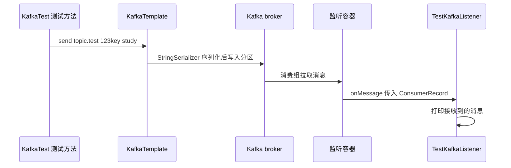

# Kafka 生产消费打通测试：admin 模块里的第一封消息

> 🔒 安全提示：文中示例的口令/密钥均为课程教学环境演示口径，生产环境的安全要求见《安全与合规须知》。

封装类拷进 common 之后，编译通过只说明代码自洽，连不连得上 broker、监听器注册不注册得起来，都要在真实模块里冒烟一次。测试选在 admin 模块做：common 没有引导类，起不了 Spring 上下文，而 admin 端正是后面承接自动审核的消费方，先在这里把收发打通，等于提前演练了明天的战场。这一课跟着一次真实操作走，包括其中一次当场翻车。

## 先给结论

- 测试放 admin 模块：common 无引导类起不了上下文，admin 是消息消费端，正好提前打通。
- 让封装生效两步：一个配置类 `@ComponentScan` 扫到 `com.study.headline.common.kafka` 包，`kafka.properties` 里 hosts 指向真实 broker。
- 发送端注入 KafkaTemplate，三参 `send(topic, key, value)` 一行搞定；接收端实现 KafkaListener 接口，`topic()` 指向同一个 topic，`onMessage` 打印消息。
- 当场翻车一次：`@ConfigurationProperties` 绑定时占位符解析失败，根因是配置文件里留了一行无法解析的自引用占位符，注释掉即可。
- 验证看控制台：发送端打出「消息发送了」，消费端 ConsumerRecord 的 value 打出消息体，两端对上号即收工。

## 第一步：让封装包被扫描到

封装类都带着 @Configuration 与 @Component 注解，但它们在 common 的包里，admin 的引导类默认只扫自己包下的组件，需要在 admin 侧放一个配置类把封装包引进来：

```java
package com.study.headline.admin.config;

@Configuration
@ComponentScan("com.study.headline.common.kafka")
public class KafkaConfig {
}
```

这一个空类做的是拼装动作：把 common 里的 KafkaProducerConfig、KafkaConsumerConfig、KafkaListenerFactory、RetryErrorHandler 全部拉进 admin 的上下文。连接信息另一路进来，admin 的 resources 下放一份 `kafka.properties`，`kafka.hosts` 写真实 broker 地址，消费组按环境拼好。单机自测可以写 `localhost:9092`，指向集群环境时把 hosts 换成 node01 的地址即可。

## 第二步：发送端测试类

测试类挂上 Spring Boot 测试的两个标准注解，注入 KafkaTemplate 后用三参 send 发一条：

```java
package com.study.headline.admin.kafka.test;

@SpringBootTest
@RunWith(SpringRunner.class)
public class KafkaTest {

    @Autowired
    private KafkaTemplate<String, String> kafkaTemplate;

    @Test
    public void test() {
        try {
            kafkaTemplate.send("topic.test", "123key", "study");
            System.out.println("消息发送了");
            Thread.sleep(500000);   // 停住进程，给消费端留出消费时间
        } catch (InterruptedException e) {
            e.printStackTrace();
        }
    }
}
```

三个参数各司其职：topic 决定消息去哪个通道，key 参与分区路由，相同 key 进同一分区，value 是消息体，序列化后落到 StringSerializer 这一侧的约定上。`Thread.sleep` 在这里不是可有可无的装饰：测试方法一返回，Spring 上下文就关闭，监听容器随之停摆，消息可能还在路上。把线程停住，消费端才有时间把消息收掉、把日志打出来，控制台才能看到一收一发的完整现场。

## 第三步：接收端监听器

消费者不写注解，实现封装的 KafkaListener 接口，声明自己听哪个 topic：

```java
package com.study.headline.admin.kafka.listener;

@Component
public class TestKafkaListener implements KafkaListener<String, String> {

    @Override
    public String topic() {
        return "topic.test";   // 与发送端同一个 topic，才能对上号
    }

    @Override
    public void onMessage(ConsumerRecord data, Consumer consumer) {
        System.out.println("接收到的消息为===" + data);
    }
}
```

注册是自动的：KafkaListenerFactory 在 Bean 初始化完成后扫描容器里所有 KafkaListener 实现，逐个建容器挂监听。接口继承自 ConsumerAwareMessageListener，所以 onMessage 能同时拿到消息记录与 Consumer 对象，后者留给需要手动提交位移或自定义拉取的场景，测试阶段只打印。topic() 返回值必须与发送端逐字符一致，这里两端都是 `topic.test`。

## 一场真实翻车：占位符解析失败

第一次启动没有走通，测试直接红了，异常栈停在配置绑定环节：

```text
Tests failed: 1 of 1 tests
java.lang.IllegalArgumentException: Could not resolve placeholder
    at org.springframework.util.PropertyPlaceholderHelper.replacePlaceholders(...)
    at org.springframework.boot.context.properties.bind.PropertySourcesPlaceholderResolver.resolvePlaceholders(...)
    at org.springframework.boot.context.properties.bind.Binder.bind(...)
```

读栈能定位到病根：`Binder.bind` 是 @ConfigurationProperties 的绑定入口，`PropertyPlaceholderHelper.replacePlaceholders` 在解析属性值里的占位符时失败了。封装类里 KafkaTopicConfig 前缀 `kafka.topic` 下的字段要求配置文件里有对应项，而 admin 这份 `kafka.properties` 里 topic 那一行的值写成了自引用的占位符，解析器找不到它的实值，绑定阶段直接抛异常。修法二选一：把值换成真实的 topic 名，或者测试阶段整行注掉，等业务真正发消息时再启用。课程现场选的是后者，注掉重启，测试通过。

这类启动期报错的排查路径值得记住：绑定异常先看栈里的 `Binder.bind`，再翻 @ConfigurationProperties 对应前缀的属性文件，占位符没解析十有八九是 `${...}` 引用了一个不存在的键。

## 验证：两端日志对上号

修完配置再跑，控制台一收一发全部到位：

```text
消息发送了
接收到的消息为===ConsumerRecord(topic = topic.test, partition = 0, key = 123key, value = study...)
```

完整链路画出来是这样：



关键确认点在 ConsumerRecord 的 value 字段：它就是发送端写入的字符串原样，说明序列化与反序列化两端对上了。这条链路通了，封装层的生产者配置、消费者配置、监听器注册、位移提交就全部经过了一次实测，后面自媒体端发消息、admin 端审核消费只是在业务层加代码。

## 常见误区

- **测试类放进 common 模块。** common 没有引导类，@SpringBootTest 找不到启动入口；封装的冒烟测试要放在真实业务模块里跑。
- **两端 topic 名不一致。** topic 靠字符串对号，发送端 `topic.test` 消费端写成 `topic-test` 就各说各话，且 broker 若关闭了自动建 topic，消费端只会安静地什么都收不到。
- **省掉 Thread.sleep。** 测试方法返回即上下文关闭，监听容器停摆，消息发出去却没人收，现象是发送日志有、接收日志无，容易误判成消费配置错了。
- **消息体与序列化配置不匹配。** 发送端按 StringSerializer 序列化，直接 send 一个对象会走到 ObjectSerializer 产出一堆类型元数据，消费端按 String 反序列化可能拿到不合法内容；统一走信封加 JSON 字符串。

## 面试可能被问到的问题

1. 面试官追问：「send 的三个参数里，key 起什么作用？」
   答：key 决定分区路由，相同 key 经默认分区器进同一分区，同分区消息有序。需要按业务实体保序时用它，比如同一篇文章的消息固定同一个 key；不需要保序时可以传 null，由分区器轮询打散。
2. 面试官追问：「Kafka 消费端测试要注意什么？」
   答：三点。测试进程要停住等消费完成，否则上下文关闭监听容器停摆；消费组与 topic 配置要与生产端对齐，确认分区与重平衡结果；断言不能只看发送成功，要校验消费端实际收到的消息内容，两端日志对上号才算打通。
3. 面试官追问：「启动时报 Could not resolve placeholder，怎么排查？」
   答：这是属性绑定阶段占位符解析失败。看异常栈确认发生在 Binder.bind 与哪个 @ConfigurationProperties 前缀，再翻对应属性文件，通常是 `${...}` 引用了不存在的键或值写成了自引用；补上实值或删掉该行即可。
4. 面试官追问：「测试打通之后，怎么确认封装层的重试与错误处理也在工作？」
   答：在监听器里临时抛异常观察日志：容器内重试模板先按指数退避重试，每次重试打 warn；五次耗尽后错误处理器接手，消息被回滚到原 topic 重新入队，retry 计数递增，超过抛弃线才落抛弃日志。靠日志序列就能验证整条失败闭环。
5. 面试官追问：「为什么选择在 admin 模块做这次冒烟测试？」
   答：common 没有引导类起不了上下文；admin 是后续自动审核链路的消费方，提前在它这里打通收发，等于把消费端的装配、扫描、连接配置先验证一遍，之后接审核业务时基础设施已经是实测过的。

## 配套资料

- 代码：`materials/code/05/头条day07/`。内层资料目录含 Kafka 封装工具类九个真实文件，测试所依赖的封装层以它们为准；测试类 KafkaConfig、KafkaTest、TestKafkaListener 与 `kafka.properties` 未随资料包提供，文中按画面线抄录整理并按本课写法补全，包名统一改写为 `com.study.headline`；引用路径截至 `头条dayNN/` 层级，内层目录冠以项目原名，正文统一以「头条类资讯项目」指代。
- 环境：课程集群 node01~node03，MySQL root/123456；Kafka 地址按环境写在 `kafka.properties`，单机自测可用 `localhost:9092`。
