# 自媒体文章自动审核全链路：云端内容安全、匹配度粗筛、跨库落库与消息驱动

> 🔒 安全提示：文中示例的口令/密钥均为课程教学环境演示口径，生产环境的安全要求见《安全与合规须知》。

## 先给结论

本系列 10 篇串起自媒体文章从提交到发布的完整自动审核链路：先备齐云端审核能力（文本与图片内容安全的开通与封装），再做需求与全链路设计，然后逐段实现数据访问层、匹配度粗筛、双云审核、审核通过与转人工的落库，最后补齐检索索引、站内通知与发布侧的消息驱动，端到端联调收口。
链路的骨架是异步消息：自媒体端保存文章成功且状态为提交时只发一条 Kafka 消息（消息体只有文章 id 与来源类型），提交接口立即返回；审核动作全部挪到 admin 微服务的消费侧，两端解耦，失败可重投。
云端审核口径统一三值 `suggestion`：pass 放行、review 转人工、block 判失败；文本场景固定 `antispam`、单任务上限 1 万字符，图片同步检测按场景计费，一张图审 N 个场景算 N 次；AccessKey 走配置文件，密钥不进代码不打日志。
自动审核链三道关依次过：标题与内容匹配度（最长公共子串占比，零成本粗筛，兜住云审核看不见的语义错配）、文本云审核、图片云审核；两侧结论收进 Map 按「取最严」合并，任一 block 判死，任一 review 置 5 转人工。
状态字典在 0 草稿、1 待审核、2 审核通过、3 审核失败之上扩充：4 人工审核通过、5 待人工审核、8 待发布、9 已发布；审核入口按状态分流，只有状态 1 进自动审核链，4 与发布时间已到的 8 直接落库。
数据访问层补七个 Mapper，关键纪律是 `ap_article` 的 insert 必须配 `useGeneratedKeys` 与 `keyProperty` 回填主键，配置表与内容表才挂得上 `article_id`；作者走「查无则插」，回写自媒体侧用 `updateByPrimaryKeySelective` 动态更新。
审核通过后的落库顺序由依赖决定：作者建档先于文章主表，文章主键回填后配置与内容两表跟上；富文本 JSON 经 gzip 压缩存 `ap_article_content`，四个互动开关按 `is_xxx` 规约落 `ap_article_config`，`is_down` 是「是否下架」不是「是否下载」。
事务边界划得清楚：App 端四表落库抱在同一个本地事务里，回写 `wm_news` 与站内信在事务边缘；云审核、ES 索引、消息推送三类远程动作一律不进事务，靠日志告警与重试兜底，MySQL 是权威存储、索引是可重建的副本。
主键两条口径并存：演示期自增回填，分库分表后 `ap_article` 按 id 取模路由、自增失效，切换为 ZooKeeper 发号组件取号后再 insert，取号失败必须终止写入。
发布决策收口在一个方法：发布时间为空或已到点走四表落库并置 9，未到点置 8 待发布；索引同步用 Jest 写 `app_info_article`，文档 id 用文章主键保证幂等覆盖，`refresh(true)` 让刚发布的文章立即可搜。
测试与联调的完整路径：`@SpringBootTest` 起容器传待审文章 id 驱动全链路，三态出口逐个架用例验证；端到端走前端提交、media 落库发消息、admin 消费审核、App 端落库、`wm_news` 状态推进到已发布。

## 第1部分：云端内容安全审核：文本与图片审核接口的开通、口径与调用方式

day05 的发布文章把「提交审核」落成了 wm_news 的 status 置 1，稿件从此停在待审态；审核由谁来做，是 day07 要回答的问题。人工看稿在真实平台撑不住量，项目选的是云端内容安全服务：文本走垃圾内容检测，图片走图片审核，两路结论共同决定一篇文章能不能发布。这一课是审核自动化的准备篇，讲清服务是什么、要开通什么、密钥放哪、接口长什么样、返回值怎么映射到状态机。

### 审核为什么交给云端

内容类产品的质量关口必须严：一篇涉政或色情的稿子发出去，伤害的是整个平台。审核有三条路，人工审核准但贵，撑不住每日新增稿件的量；自研程序要长期维护敏感词库与识别模型，投入产出比差；云服务把识别能力做成接口，多维特征配合多模型多标签持续更新，按调用量计费。项目采用第三条路，阶段技术栈里给云端 AI 服务留的位置，在这两天具体落地为阿里云内容安全。选择它还有一层工程理由：结论是结构化的三值加标签加概率，直接映射状态机，不需要本地再做二次判断。控制台里还能看到文本与图片的调用统计报表，服务本身也支持视频与语音审核，项目暂时只用到文本与图片两类。

### 开通服务与密钥准备

接入动作按官网流程走：登录阿里云官网，找到内容安全产品页点立即开通，已开通的账号直接进控制台。开通后要准备访问密钥 AccessKey，它是调用所有阿里云接口的身份凭证，一对 id 与 secret。密钥的管理纪律比接口本身更重要，落进独立的属性文件（示例值已打码）：

```properties
# aliyun.properties：密钥独立存放，加入版本库忽略清单，示例值已打码
aliyun.accessKeyId=LTAI****
aliyun.accessKeySecret=example-sk
```

代码里通过占位符注入这两个值，真实密钥只存在于部署环境的配置里。课程资料提供的本地仓库里已含 green SDK 的坐标，不用再联网下载。

### 文本垃圾内容检测：scene、label 与三值结论

文本检测的接口文档里最该记住三样东西。场景参数是 antispam，代表反垃圾这一族能力；识别标签覆盖面很宽，检测什么内容脏、脏在哪一类，全在 label 里；单次送检的 content 最长 1 万字符，一般文章不会超限，超长要先分段再逐段送检。主要标签如下（按画面线表格整理）：

| label | 含义 |
|---|---|
| normal | 正常文本 |
| spam | 垃圾信息总类目 |
| ad | 广告 |
| politics | 涉政 |
| terrorism | 暴恐 |
| violence | 谩骂与暴力 |
| sex | 色情 |
| contradiction | 灌水与逻辑混乱类内容 |
| other | 其他 |

接口返回的不是布尔值，而是 suggestion 三值加概率：pass 表示文本正常，review 表示疑似违规需要人工确认，block 表示违规。三值与文章状态机的映射是审核主流程的骨架：

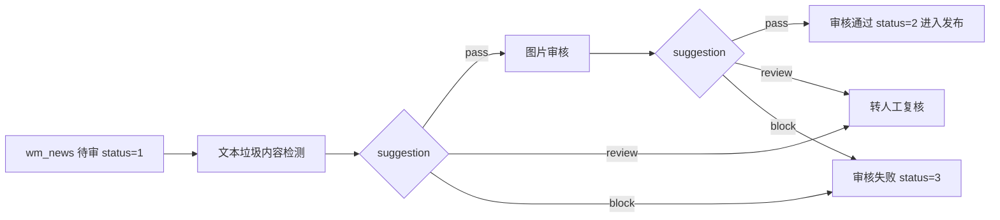

关键路径在两个判定框：文本与图片任一环节给出 block，文章直接判失败；给出 review 则转人工，既不当通过也不当失败处理，这是三值口径里最容易被简化掉的一环。

### 图片审核：同步检测与同一套三值

图片审核与文本同族，同步接口送图即返回结论。识别类别比文本更细：正常、性感、色情之外，还有血腥、涉政、打斗、武器等，封面图与正文配图各自过检。返回结构里每个结果带四个字段：scene 是检测场景，label 是命中的分类，suggestion 仍是 pass、review、block 三值，rate 是判定为该分类的概率，取值 0 到 100，越高越可信。处理规则与文本完全一致，block 拦下，review 转人工，pass 放行。文本与图片共用一套口径的好处在这里显现：审核主流程写一遍三值分支，两个接口都往里送。

### SDK 坐标与调用骨架

依赖两个坐标，core 是阿里云 SDK 的公共底座，green 是内容安全的能力包：

```xml
<dependency>
    <groupId>com.aliyun</groupId>
    <artifactId>aliyun-java-sdk-core</artifactId>
    <version>3.4.1</version>
</dependency>
<dependency>
    <groupId>com.aliyun</groupId>
    <artifactId>aliyun-java-sdk-green</artifactId>
    <version>3.4.1</version>
</dependency>
```

调用骨架四步：取 profile 绑定地域与密钥，建 client，组请求送内容，读结果。文本检测的写法如下（示例按官方 SDK 文档写法整理，密钥已打码，类名以 SDK 实际版本为准）：

```java
IClientProfile profile = DefaultProfile.getProfile("cn-hangzhou",
        "LTAI****", "example-sk");                 // 密钥从 aliyun.properties 注入
IAcsClient client = new DefaultAcsClient(profile);

TextScanRequest request = new TextScanRequest();
request.setSysMethod(MethodType.POST);
request.setSysEncoding("UTF-8");
// 场景 antispam：文本垃圾检测，content 最长 10000 字符
request.setHttpContent(buildAntispamTasks("这是待检测的文章文本"),
        "UTF-8", FormatType.JSON);
TextScanResponse response = client.getAcsResponse(request);
// 逐条读取任务的 suggestion：pass / review / block
```

骨架里值得盯住的是内容组装与结果消费两端：请求侧把待检文本按文档要求包成任务列表，响应侧逐条读 suggestion 与 label，这两端在 day07 后续的审核测试里会展开成完整可跑的代码。图片审核同构，换场景参数与请求类即可，不必另起一套判断逻辑。

## 第2部分：云端 AI 审核起步：文本与图片内容审核的封装与测试

文章能不能发出去，机器要先看一眼。云内容安全服务把文本反垃圾与图片违规识别做成了 HTTP 接口，官方 SDK 示例给得很全，但直接把示例散落在业务代码里并不合适：密钥读取、区域选择、任务组装、结果解析都是固定动作，应该收进公共模块的封装类里，业务侧只管传内容、收结论。这一篇把文本与图片两个封装类搭出来，用测试类跑通正常与违规两种对照，并把 `suggestion` 的三态语义讲清楚，后面的自动审核主链路全靠这三个值分流。

### 接入前备齐三样东西

接入动作拆开看只有三件事：SDK 依赖、鉴权密钥、区域选择。SDK 是两个 Maven 坐标，core 是底层客户端，green 是内容安全接口模型（版本号按主流稳定版补全）：

```xml
<dependency>
    <groupId>com.aliyun</groupId>
    <artifactId>aliyun-java-sdk-core</artifactId>
    <version>4.5.16</version>
</dependency>
<dependency>
    <groupId>com.aliyun</groupId>
    <artifactId>aliyun-java-sdk-green</artifactId>
    <version>3.6.6</version>
</dependency>
```

鉴权凭证在云控制台开通内容安全服务后创建 AccessKey 与 AccessSecret，服务开通与账号准备属于接入前的一次性动作。两个码只放进配置文件，不写进源码：

```properties
aliyun.accessKey=LTAI****
aliyun.secret=vA****（AccessSecret 示例值，已打码）
```

区域按服务支持列表选，文本审核接口在 `cn-shanghai` 可用，北京、杭州、深圳、青岛等区域也有支持。区域一旦确定，请求对象里的 `regionId` 与建客户端时传入的区域必须一致，不一致会报区域不支持的错误。这套封装放 common 模块的 `com.study.headline.common.aliyun` 包，与 FastDFS 封装同层：凡是多端可能共用的能力，都归公共模块管。

### 文本审核封装：一个任务、一个场景、一个结论

封装类的形态是配置加方法：配置读密钥，方法收一段文本、发一次请求、把响应整体转成字符串返回。业务侧拿到的不是解析过的对象，而是原始响应，怎么取值由调用方决定，这样封装层保持最薄：

```java
/** 云端文本审核封装：业务侧传文本，拿回响应 JSON 字符串 */
@Configuration
@PropertySource("classpath:aliyun.properties")
@ConfigurationProperties(prefix = "aliyun")
public class AliyunTextScanRequest {

    /** 云控制台创建的访问密钥，示例值已打码 */
    private String accessKey;
    private String secret;

    public String textScanRequest(String content) throws Exception {
        // 区域与建客户端保持一致：cn-shanghai
        IClientProfile profile = DefaultProfile.getProfile("cn-shanghai", accessKey, secret);
        IAcsClient client = new DefaultAcsClient(profile);
        TextScanRequest textScanRequest = new TextScanRequest();
        textScanRequest.setAcceptFormat(FormatType.JSON);
        textScanRequest.setMethod(MethodType.POST);
        textScanRequest.setEncoding("UTF-8");
        textScanRequest.setRegionId("cn-shanghai");
        textScanRequest.setConnectTimeout(3000);
        textScanRequest.setReadTimeout(6000);
        // 任务列表：一次请求可以带多个任务，这里一次送审一段文本
        List<Map<String, Object>> tasks = new ArrayList<Map<String, Object>>();
        Map<String, Object> task1 = new LinkedHashMap<String, Object>();
        task1.put("dataId", UUID.randomUUID().toString());
        // 待检测的文本，长度不能超过 10000 个字符
        task1.put("content", content);
        tasks.add(task1);
        JSONObject data = new JSONObject();
        // 侦测场景，文本反垃圾场景：antispam
        data.put("scenes", Arrays.asList("antispam"));
        data.put("tasks", tasks);
        textScanRequest.setHttpContent(
                data.toJSONString().getBytes("UTF-8"), "UTF-8", FormatType.JSON);
        // 发起请求，响应整体转成 JSON 字符串交给调用方
        TextScanResponse response = client.getAcsResponse(textScanRequest);
        return JSON.toJSONString(response);
    }

    public void setAccessKey(String accessKey) {
        this.accessKey = accessKey;
    }

    public void setSecret(String secret) {
        this.secret = secret;
    }
}
```

几个组装细节值得停下来看。`dataId` 用 UUID 生成，它不是鉴权参数，而是这次任务的自定义标识，服务端原样返回，排查审核记录日志时靠它对任务。`scenes` 决定审什么，文本反垃圾固定传 `antispam`，接口在结果里按场景给出细分标签：`normal` 正常、`ad` 广告、`politics` 涉政、`porn` 色情、`terrorism` 暴恐、`abuse` 辱骂、`contraband` 违禁、`flood` 灌水、`meaningless` 无意义、`customized` 自定义词库命中。真正要拿回家的只有 `suggestion`，它是三态枚举：

| suggestion | 语义 | 后续动作 |
|---|---|---|
| pass | 内容正常 | 放行，继续下一道审核 |
| block | 命中违规，直接判死 | 审核失败，回写原因并通知作者 |
| review | 机器拿不准 | 转人工复审，等待人给出结论 |

三态里最容易误处理的是 `review`。它不是通过也不是失败，而是机器把判断权交还给人，后面的人工复审队列就是被它触发出来的。

### 图片审核封装：同步扫描与多场景计费

图片审核与文本结构同源，差别有三处：入参是图片地址列表，一次能审多张；每个任务要带 `dataId`、`url`、`time` 三个字段；场景可以叠加多个，各场景独立出结论：

```java
/** 云端图片审核封装：业务侧传图片地址列表，拿回响应 JSON 字符串 */
@Configuration
@PropertySource("classpath:aliyun.properties")
@ConfigurationProperties(prefix = "aliyun")
public class AliyunImageScanRequest {

    private String accessKey;
    private String secret;

    public String imageScanRequest(List<String> urls) throws Exception {
        IClientProfile profile = DefaultProfile.getProfile("cn-shanghai", accessKey, secret);
        IAcsClient client = new DefaultAcsClient(profile);
        ImageSyncScanRequest imageSyncScanRequest = new ImageSyncScanRequest();
        imageSyncScanRequest.setAcceptFormat(FormatType.JSON);
        imageSyncScanRequest.setMethod(MethodType.POST);
        imageSyncScanRequest.setEncoding("utf-8");
        imageSyncScanRequest.setRegionId("cn-shanghai");
        imageSyncScanRequest.setConnectTimeout(3000);
        imageSyncScanRequest.setReadTimeout(10000);
        JSONObject httpBody = new JSONObject();
        // 检测场景按需增减：logo、ad、porn、terrorism，计费按图片数乘场景数
        httpBody.put("scenes", Arrays.asList("logo", "ad", "porn", "terrorism"));
        // 每张图片一个任务：dataId 标识任务，url 是网络可访问的图片地址
        List<Map<String, Object>> tasks = new ArrayList<Map<String, Object>>();
        for (String url : urls) {
            Map<String, Object> task = new LinkedHashMap<String, Object>();
            task.put("dataId", UUID.randomUUID().toString());
            task.put("url", url);
            task.put("time", new Date());
            tasks.add(task);
        }
        httpBody.put("tasks", tasks);
        imageSyncScanRequest.setHttpContent(
                JSON.toJSONString(httpBody).getBytes("UTF-8"), "UTF-8", FormatType.JSON);
        // 同步接口：请求返回时结果已经就绪
        ImageSyncScanResponse response = client.getAcsResponse(imageSyncScanRequest);
        return JSON.toJSONString(response);
    }

    public void setAccessKey(String accessKey) {
        this.accessKey = accessKey;
    }

    public void setSecret(String secret) {
        this.secret = secret;
    }
}
```

传图方式有两种：网络上可访问的 URL，或者本地文件路径。头条类资讯项目里的图片都存在文件服务器上，审核时拼上文件服务器前缀还原成网络地址走 URL 方式。场景课上演示选了四个：`logo` 查标志物、`ad` 查广告、`porn` 查色情、`terrorism` 查暴恐，文档里还有含特定文字、特殊装饰、武器、打斗等更多场景可选。场景叠加要连带考虑成本：图片审核按次计费，一张图审四个场景记四次，课程口径约 1.8 元每千次，十张图就是四十次。个人调试定好流量包，公司用则由成本预算定场景，这个账在选场景前就要算清。

### 测试用例：pass 与 block 的对照

封装类在 common 模块，测试放 admin 模块的 test 目录跑。引导类的包根是 `com.study.headline.admin`，扫不到 common 里的封装，需要一行显式扫描把 aliyun 包装进容器（与工程搭建课按端装配的口径一致）：

```java
@Configuration
@ComponentScan("com.study.headline.common.aliyun")
public class AliyunScanConfig {
}
```

测试类两个注解起步，注入封装类，正常与违规各来一条对照用例：

```java
@RunWith(SpringRunner.class)
@SpringBootTest(classes = {AliyunScanConfig.class})
public class AliyunTest {

    @Autowired
    private AliyunTextScanRequest aliyunTextScanRequest;

    @Autowired
    private AliyunImageScanRequest aliyunImageScanRequest;

    /** 正常文本：返回 pass */
    @Test
    public void testTextScanPass() throws Exception {
        String message = "智能内容审核服务支持文本与图片两种检测形态，可按场景灵活组合。";
        String response = aliyunTextScanRequest.textScanRequest(message);
        System.out.println(response);
    }

    /** 含违禁品字样的文本：返回 block，label 指向 contraband */
    @Test
    public void testTextScanBlock() throws Exception {
        String message = "……此处替换为包含违禁品交易字样的文本……";
        String response = aliyunTextScanRequest.textScanRequest(message);
        System.out.println(response);
    }

    /** 网络图片同步审核 */
    @Test
    public void testImageScan() throws Exception {
        List<String> urls = new ArrayList<String>();
        urls.add("https://file-server/group1/M00/00/01/demo.jpg");
        String response = aliyunImageScanRequest.imageScanRequest(urls);
        System.out.println(response);
    }
}
```

正常文本的用例打印出的核心字段是 `suggestion` 为 `pass`，级别与标签干净无值；换成含违禁品字样的文本再跑，返回变成 `block`，`label` 落在 `contraband` 上，能在接口文档的内容检测章节里对应到违禁品这一档。响应里的结构长这样（省略与业务无关的字段，requestId 已打码）：

```json
{
  "code": 200,
  "data": [
    {
      "code": 200,
      "dataId": "8f5b3c2a-8f0d-4f0f-9f4a-demo",
      "results": [
        {
          "scene": "antispam",
          "label": "contraband",
          "suggestion": "block",
          "rate": 98.1
        }
      ]
    }
  ]
}
```

外层 `code` 是请求级状态码，任务级 `code` 是每条任务的处理结果，都为 200 才说明审核真正完成；`results` 数组里每个场景一条结论，取 `suggestion` 前先判这两层 `code`，否则接口异常时会把空结果误当通过。一次调用从发起到拿结论的完整链路是：

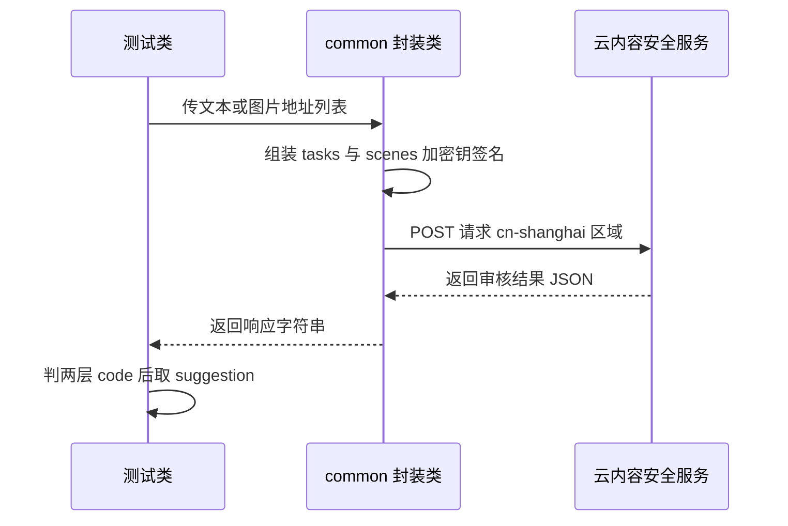

关键路径在最后一跳：`suggestion` 不是封装层替调用方决定的，而是业务侧按自己的风险偏好解释三态。文本与图片两个接口跑通之后，主链路里就只有两个调用点，一个传文本，一个传图片地址集合。

## 第3部分：自动审核怎么跑：从消息监听到发布决策的全链路设计

创作者按下「提交审核」的那一刻，文章并没有资格出现在读者面前。审核要接两个云接口、可能还要人介入，把这一整套动作同步塞进提交请求里，用户就要盯着转圈等几秒甚至更久，失败重试还会把提交页卡死。异步是唯一合理的选择：提交只负责落库与发消息，审核侧收到消息再慢慢干。这一篇把整条链路的流程图走一遍，把状态字典、三道审核关卡与发布决策的设计理由讲透，编码篇的所有分支都从这里展开。

### 需求回顾：审核为什么是发布的前置闸

自媒体用户在自媒体端发表一篇文章，要通过审核之后才能在 App 端展示。这条约束在需求分析篇的状态机里已经立住：提交审核把文章推进待审核态，审核通过才发布进 App 端，审核失败可以修改后再次提交。审核环节是内容质量关口，云服务管违规内容，人工管机器拿不准的部分，两条线都要在这条链路里给出口。

异步化的理由不止用户体验一条。云审核接口的耗时在几百毫秒到几秒之间，一篇文章多张图、多个场景时更长；人工复审天然有排队。把审核做成消息驱动的后台任务，提交动作只花一次落库加一次发消息的时间；审核侧挂了，消息重投一遍就补上了，可靠性也顺手拿到。

### 状态字典：在四态之上扩充

文章的状态机在审核链路里必须完整覆盖「机器、人工、发布进度」三种维度。day05 立下的四态（0 草稿、1 待审核、2 审核通过、3 审核失败）沿用，审核链路在此之上扩充四个状态与两个字段：

| 值 | 状态 | 谁置的 | 说明 |
|---|---|---|---|
| 0 | 草稿 | 创作者 | 存草稿入口，不进审核链路 |
| 1 | 待审核 | 创作者 | 提交审核后落库即为此态，审核入口的准入条件 |
| 2 | 审核通过 | 自动审核 | 通过的结论态，随后按发布进度推进到 8 或 9 |
| 3 | 审核失败 | 自动审核或人工 | reason 必写，作者据此修改重提 |
| 4 | 人工审核通过 | 人工复审 | 放行结论，消息重投后由审核入口直接落库发布 |
| 5 | 待人工审核 | 自动审核 | 云审核返回 review 时置入，等待人工给出结论 |
| 8 | 待发布 | 自动审核 | 审核已通过但发布时间未到，到点后由发布任务推进 |
| 9 | 已发布 | 审核落库 | App 端四表落库完成后的终态 |

两个字段同步补进 `wm_news`：`reason` 存审核结论文字（失败原因或待发布标记），`article_id` 存审核通过后落库 App 端的文章主键，两边数据靠它互查。设计上要分清两组概念：2 与 4 是审核结论，一个来自机器、一个来自人工；8 与 9 是发布进度，描述文章离读者还有多远。结论态往进度态推进的桥梁就是发布决策。

### 全链路：消息、监听、三道关

整条链路画出来是这张图：

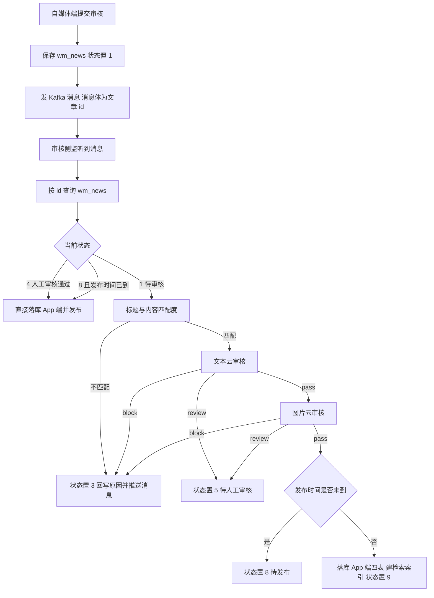

关键路径在状态分流的三个分支上。消息里只有文章 id，审核侧第一步永远是查库，库里有什么就是什么，消息本身不承载业务数据，被重投或乱序也不怕。状态 4 的文章是人工已经放行的，直接落库发布，不再审一遍；状态 8 的文章是审核已通过、只等发布时间的，到点后补发落库。只有状态 1 才真正走三道关：标题与内容匹配度是自实现规则的粗筛，不匹配可以转人工也可以直接拒绝；匹配度过了，文本与图片分别送云审核，`block` 拦下、`review` 转人工、`pass` 放行。

监听入口的写法按课程 Kafka 封装的接入方式泛写，消费到字符串后转成文章 id，直接调审核服务（示例为按本课写法补全）：

```java
// 监听入口示例：消费文章 id 并调用审核服务，主题与消费组按课程 Kafka 封装的配置为准
public void onArticleSubmit(String message) {
    reviewMediaArticleService.autoReviewArticleByMedia(Integer.valueOf(message.trim()));
}
```

监听器只做一件事：把消息翻译成一次服务调用。校验、分流、容错全部收在审核服务里，消息层的职责越薄，重投、扩容、换封装方式时需要改动的代码就越少。

### 人工从哪里进来、往哪里去

人工复审的入口有两个来源。一是云审核返回 `review`，机器拿不准，文章置 5 进待人工审核，运营在管理端复审；二是匹配度这类自实现规则拦下的文章，可以选拒绝也可以选转人工。人工的出口只有三个：放行置 4、拒绝置 3、维持待审。放行后还有一步容易漏掉：把文章 id 重新投递到审核消息里，让审核入口的「状态 4」分支接住，App 端落库的动作仍然收在审核链路里，不给人工操作另开一条写库的通道。

审核结论要通知作者。失败与通过都推送一条消息，消息类型字典里就有文章审核成功与文章审核失败两类，作者在自媒体端能直接看到驳回原因，这依赖 `reason` 字段认真回写。

### 发布决策：立即发布、待发布与检索索引

三道关全过之后剩下最后一个判断：发布时间。发布时间为空或已到点，立即发布：App 端的文章、配置、内容、作者四张表依次落库，同时同步进已建好的 `app_info_article` 检索索引，读者才能在列表与搜索里看到它；`wm_news` 回写 `article_id` 并置 9。发布时间在未来，文章置 8 待发布，落库动作延后，到点由发布任务推进为 9。发布侧四表与索引的落库细节单独展开，这一篇只锁定决策口径：过审即决策，决策即状态，状态即下一步动作。

## 第4部分：审核落地：七个 Mapper、状态分流与自动审核主链实现

思路分析篇把全链路画成了图，编码阶段就是把这张图翻译成类与方法。翻译的工作量集中在两处：数据访问层要一口气补齐七个 Mapper，因为审核通过后的落库横跨 App 端四张表、自媒体端回写与站内消息；业务层要写审核服务的状态分流主链，从消息里拿到的只是一个文章 id，查库、审关、决策、落库、回写、推送一环扣一环。day07 资料包里审核部分没有随包源码，这一篇的代码按画面线抄录整理，并按本课的工程风格补成可编译的形态，重点是每一处写法背后的时序与纪律。

### 数据访问层清单：一次审核要动几张表

审核动作看着只是「改个状态」，展开后横跨两端七八张表。App 端要新写四张：文章主表 `ap_article`、配置表 `ap_article_config`、内容表 `ap_article_content`，外加作者表 `ap_author` 的查插；自媒体端要回写 `wm_news`；辅助侧要按频道 id 反查频道名，要给作者推送审核结论。逐个数下来，Mapper 清单是七个新增或扩展：

| Mapper | 新增方法 | 给谁用 |
|---|---|---|
| AdChannelMapper | selectByPrimaryKey | 落库时按频道 id 反查频道名 |
| ApAuthorMapper | selectByAuthorName、insert | 作者查无则插 |
| ApArticleMapper | insert（主键回填） | App 端文章主表落库 |
| ApArticleConfigMapper | insert | 文章配置落库，挂 article_id |
| ApArticleContentMapper | insert | 文章内容落库，挂 article_id |
| WmNewsMapper | updateByPrimaryKeySelective | 回写状态、原因、关联主键 |
| ApUserMessageMapper | insert | 审核结论推送站内消息 |

回写自媒体文章之前，`wm_news` 还要补两列，`reason` 存审核结论文字，`article_id` 存 App 端文章主键，审核链路生成的信息都要有落点：

```sql
alter table wm_news
    add column reason varchar(200) default null comment '审核结论：失败原因或待发布标记',
    add column article_id int default null comment '审核通过后落库 App 端文章的主键';
```

Mapper 接口与 XML 的归属纪律沿用工程惯例：`ap_` 家族进 `com.study.headline.model.mappers.app`，`wm_` 与频道进各自域的包，实体放 model 模块对应 pojos 包，namespace 与包路径严格一致，放错目录就是 BindingException。

七个方法里五个是纯 insert 与 select，单看工作量不大，真正的分量在方法签名的设计上：反查方法一律带 `@Param` 命名参数，insert 一律配主键回填，回写方法必须是 selective 版本。签名定错一次，XML 与调用点跟着返工一遍，这也是先把清单列全、想清每张表的读写角色再动手的原因。

### 频道与作者：给 App 端文章补齐归属信息

App 端文章主表除了频道 id 还冗余频道名，列表页展示时不用再关联频道表。频道名在自媒体侧拿不到，审核落库前要按频道 id 反查一次，`AdChannelMapper` 补一个按主键查询：

```xml
<select id="selectByPrimaryKey" resultType="com.study.headline.model.admin.pojos.AdChannel">
    select id, name, description, status
    from ad_channel
    where id = #{id}
</select>
```

作者这边有一个业务前置要先想明白：创作者在自媒体端发文，App 端的读者看到的作者从哪来？答案是 `ap_author` 表，文章主表的 `author_id` 与 `author_name` 都挂在这条记录上。文章落库前作者必须存在，没有就补一条，`ApAuthorMapper` 两个方法配套使用：

```xml
<select id="selectByAuthorName" resultType="com.study.headline.model.article.pojos.ApAuthor">
    select * from ap_author where name = #{authorName}
</select>

<insert id="insert" useGeneratedKeys="true" keyProperty="id">
    insert into ap_author (name, type, user_id, wm_user_id, created_time)
    values (#{name}, #{type}, #{userId}, #{wmUserId}, #{createdTime})
</insert>
```

「查无则插」这个动作解决的是首次发文场景：自媒体用户从没在 App 端留下过作者记录，第一篇文章落库时先查一次，查空就插入一条，name 取自媒体用户的昵称，`wm_user_id` 挂自媒体用户主键，`user_id` 待两端账号打通后回填，课程实现先留空。重复执行查插组合也不会造成重复数据，第二次进来查到已有记录就直接复用，这是查在前、插在后的意义。

### App 端三张内容表：先拿主键，再挂关系

文章落库的顺序是整段实现的时序骨架：先写主表拿主键，再写配置与内容，两张子表都靠 `article_id` 挂到主表上。主表的 insert 要的就是主键回填：

```xml
<insert id="insert" useGeneratedKeys="true" keyProperty="id">
    insert into ap_article
        (title, author_id, author_name, channel_id, channel_name,
         layout, flags, images, labels, publish_time, created_time)
    values
        (#{title}, #{authorId}, #{authorName}, #{channelId}, #{channelName},
         #{layout}, #{flags}, #{images}, #{labels}, #{publishTime}, now())
</insert>
```

`useGeneratedKeys` 与 `keyProperty` 是发布文章课立过的老规矩，这里再次立功：执行完 insert，`apArticle.getId()` 就有值了。配置表与内容表的写入都是单行 insert，字段少，动作轻：

```xml
<insert id="insert">
    insert into ap_article_config (article_id, is_comment, is_forward, is_down, is_delete)
    values (#{articleId}, #{isComment}, #{isForward}, #{isDown}, #{isDelete})
</insert>

<insert id="insert">
    insert into ap_article_content (article_id, content)
    values (#{articleId}, #{content})
</insert>
```

配置表的四个开关决定读者侧的互动能力：评论、转发、下载默认开启，删除标记默认关闭，运营后续可以按文章粒度调整。内容表只存两个字段，富文本 JSON 原样搬运，App 端详情接口取的正是这条记录。三张表落库是一个整体，任何一步失败都不能留下「主表有、子表无」的半成品，这段动作在发布链路里要包进事务，这一篇先把方法骨架立起来。

三张表拆开存放是按读写模式划的边界。主表承载列表与搜索的高频查询，列少且短；配置表是四个开关，运营低频修改；内容表只有一个大字段，详情接口按文章主键点查时才取。拆开后列表页的查询不拖大字段，主表的缓存行也更紧凑，这是 App 端把一篇文章拆成三条记录的架构理由，审核落库只是按这个既定结构补数，不替发布侧做结构决定。

### 回写自媒体侧与推送消息

审核的每一步结论都要回到 `wm_news`：失败要写原因，转人工要改状态，通过要挂 `article_id`。这些回写的共同点是只改部分字段，全字段 update 会把没参与审核的字段也重写一遍，风险大且没必要。按条件动态更新最合适：

```xml
<update id="updateByPrimaryKeySelective"
        parameterType="com.study.headline.model.media.pojos.WmNews">
    update wm_news
    <set>
        <if test="userId != null">user_id = #{userId},</if>
        <if test="title != null">title = #{title},</if>
        <if test="type != null">type = #{type},</if>
        <if test="channelId != null">channel_id = #{channelId},</if>
        <if test="labels != null">labels = #{labels},</if>
        <if test="content != null">content = #{content},</if>
        <if test="images != null">images = #{images},</if>
        <if test="status != null">status = #{status},</if>
        <if test="publishTime != null">publish_time = #{publishTime},</if>
        <if test="reason != null">reason = #{reason},</if>
        <if test="articleId != null">article_id = #{articleId},</if>
        <if test="submitedTime != null">submited_time = #{submitedTime},</if>
    </set>
    where id = #{id}
</update>
```

`<set>` 标签自动掐掉末尾多余的逗号，每个 `<if>` 判空决定该列是否参与更新。调用侧只把要改的字段塞进实体，其余保持 null，SQL 里就只有这几列。审核结论还要通知作者本人，站内消息表 `ap_user_message` 承担这个职责，消息类型字典里登记了关注、点赞、评论与文章审核成功、失败等类型，审核侧只管按类型写消息：

```xml
<insert id="insert">
    insert into ap_user_message (user_id, message_type_id, content, created_time)
    values (#{userId}, #{messageTypeId}, #{content}, now())
</insert>
```

至此数据访问层七件套齐了，业务层可以在它们之上搭建主链，不再碰一行 SQL。

### 审核服务：接口定义与入口分流

审核服务落位在 admin 端：人工复审的动作发生在管理后台，自动审核的调度与 App 端落库也归管理端管，自媒体端只负责发消息。接口定义极简，一个方法一个入参：

```java
public interface ReviewMediaArticleService {

    /** 自媒体文章自动审核：接收文章 id，按状态分流审核与发布 */
    void autoReviewArticleByMedia(Integer newsId);
}
```

实现类先备齐依赖：七个 Mapper、文本与图片两个云审核封装、`ObjectMapper`，再加文件服务器前缀，审核链路里所有要用到的能力一目了然：

```java
@Service
public class ReviewMediaArticleServiceImpl implements ReviewMediaArticleService {

    @Autowired
    private WmNewsMapper wmNewsMapper;
    @Autowired
    private AdChannelMapper adChannelMapper;
    @Autowired
    private ApAuthorMapper apAuthorMapper;
    @Autowired
    private ApArticleMapper apArticleMapper;
    @Autowired
    private ApArticleConfigMapper apArticleConfigMapper;
    @Autowired
    private ApArticleContentMapper apArticleContentMapper;
    @Autowired
    private ApUserMessageMapper apUserMessageMapper;
    @Autowired
    private WmUserMapper wmUserMapper;
    @Autowired
    private AliyunTextScanRequest aliyunTextScanRequest;
    @Autowired
    private AliyunImageScanRequest aliyunImageScanRequest;
    @Autowired
    private ObjectMapper objectMapper;

    /** 文件服务器前缀，把文件 ID 还原成网络地址 */
    @Value("${file.server.url}")
    private String fileServerUrl;
}
```

调用方是审核侧的消息监听器：收到 Kafka 消息后把文章 id 递进来，方法签名里没有第二个参数，也没有任何上下文依赖，方法本身无状态。无状态换来两个好处：监听器多实例并发消费时互不干扰；消息重投时同一个 id 再算一遍，结论由库里的状态决定，天然可重入。

主方法完全按思路篇的流程图落笔，查库、分流、审关、决策四段：

```java
@Override
public void autoReviewArticleByMedia(Integer newsId) {
    // 根据文章 id 查询文章信息，查不到直接结束
    WmNews wmNews = wmNewsMapper.selectByPrimaryKey(newsId);
    if (wmNews == null) {
        return;
    }
    // 人工审核通过的文章：直接落库发布，不再走机器审核
    if (WmNewsConstants.ADMIN_SUCCESS.equals(wmNews.getStatus())) {
        reviewSuccessSaveAll(wmNews);
        return;
    }
    // 待发布的文章：发布时间已到，补发 App 端数据
    // （录屏此处条件写的是发布时间大于当前时间即落库，按语义整理为已到点才补发，
    //   配合后续的定时发布任务才能闭环，避免未到点提前发布）
    if (WmNewsConstants.TO_BE_PUBLISHED.equals(wmNews.getStatus())
            && wmNews.getPublishTime() != null
            && wmNews.getPublishTime().getTime() <= new Date().getTime()) {
        reviewSuccessSaveAll(wmNews);
        return;
    }
    // 待审核的文章：进入自动审核链
    if (WmNewsConstants.PENDING_REVIEW.equals(wmNews.getStatus())) {
        // 1. 标题与内容匹配度，自实现规则粗筛，算法单独成篇
        double ratio = Compute.SimilarDegree(wmNews.getContent(), wmNews.getTitle());
        if (ratio <= 0) {
            failReview(wmNews, "文章标题与内容不匹配");
            return;
        }
        // 2. 拆 content：文本与图片两组，图片补全网络地址
        Map<String, List<String>> parts = splitContent(wmNews);
        // 3. 文本与图片分别送云审核，各自拿回 suggestion
        String textSuggestion = scanText(parts.get("texts"));
        String imageSuggestion = scanImage(parts.get("images"));
        // 4. 三态合并：block 判失败，review 转人工
        if ("block".equals(textSuggestion) || "block".equals(imageSuggestion)) {
            StringBuilder reason = new StringBuilder();
            if ("block".equals(textSuggestion)) {
                reason.append("文本内容违规");
            }
            if ("block".equals(imageSuggestion)) {
                if (reason.length() > 0) {
                    reason.append("；");
                }
                reason.append("图片内容违规");
            }
            failReview(wmNews, reason.toString());
            return;
        }
        if ("review".equals(textSuggestion) || "review".equals(imageSuggestion)) {
            updateWmNews(wmNews, WmNewsConstants.ADMIN_PENDING, "内容涉嫌违规，转人工复审");
            return;
        }
        // 5. 发布决策：发布时间为空或已到点立即发布，否则置待发布
        if (wmNews.getPublishTime() == null
                || !wmNews.getPublishTime().after(new Date())) {
            reviewSuccessSaveAll(wmNews);
        } else {
            updateWmNews(wmNews, WmNewsConstants.TO_BE_PUBLISHED, "待发布");
        }
    }
}

/** 失败回写加推送，失败路径共用 */
private void failReview(WmNews wmNews, String reason) {
    updateWmNews(wmNews, WmNewsConstants.FAIL_REVIEW, reason);
    pushMessage(wmNews.getUserId(), WmNewsConstants.MSG_ARTICLE_AUDIT_FAIL,
            "您的文章审核未通过：" + reason);
}
```

状态常量集中定义，注释本身就是状态字典：

```java
public class WmNewsConstants {

    /** 0 草稿 1 待审核 2 审核通过 3 审核失败 */
    public static final Short DRAFT = 0;
    public static final Short PENDING_REVIEW = 1;
    public static final Short SUCCESS_REVIEW = 2;
    public static final Short FAIL_REVIEW = 3;
    /** 4 人工审核通过 5 待人工审核 */
    public static final Short ADMIN_SUCCESS = 4;
    public static final Short ADMIN_PENDING = 5;
    /** 8 待发布（审核通过但发布时间未到） 9 已发布 */
    public static final Short TO_BE_PUBLISHED = 8;
    public static final Short PUBLISHED = 9;

    /** 消息类型示例值，以消息类型字典登记为准 */
    public static final Short MSG_ARTICLE_AUDIT_PASS = 7;
    public static final Short MSG_ARTICLE_AUDIT_FAIL = 8;
}
```

分流逻辑画出来是一棵状态树，三个入口分支互斥，每个分支都以明确动作收尾：

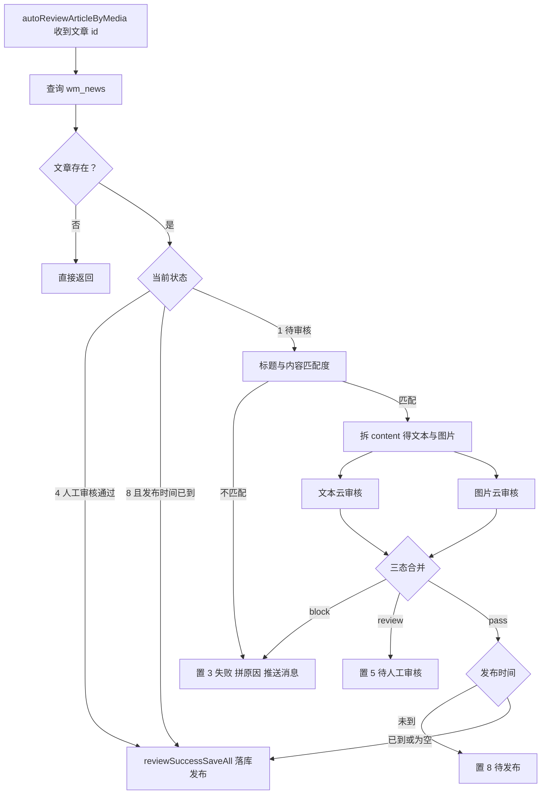

几个写法决策值得展开。**状态比较用常量在前的 equals。** `WmNewsConstants.ADMIN_SUCCESS.equals(wmNews.getStatus())` 防的是状态字段为 null 时的空指针，顺序反过来比较就悬了。**每个分支 return 收尾。** 分流方法里一条路径只做一件事，处理完立刻返回，消息重投时状态已经离开准入集合，天然幂等。**失败原因集中拼接。** 文本与图片两道关卡的结果合并成一句文案，分号隔开，作者一次就能看到全部问题，不用改一轮被另一轮打回。**调用异常宁可转人工。** `scanText` 与 `scanImage` 的 catch 里返回 `review` 而不是 `pass` 或 `block`，云接口抖一下不该影响文章的生死判定，交给人工最稳。

### 拆 content：文本与图片的分拣

富文本 content 是 JSON 数组字符串，结构在发布文章课已经拆过一次：文本节点键是 `type` 与 `text`，图片节点键是 `type` 与 `value`。审核要的是两组东西：纯文本列表送文本审核，图片列表送图片审核。落库口径存的是文件 ID，云审核要网络地址，拼上文件服务器前缀还原：

```java
/** 把富文本拆成文本与图片两组，封面图并入图片组，图片补全为网络地址 */
private Map<String, List<String>> splitContent(WmNews wmNews) throws IOException {
    List<String> texts = new ArrayList<>();
    List<String> images = new ArrayList<>();
    // content 是 JSON 数组，解析成 List<Map>，文本节点取 text，图片节点取 value
    List<Map> list = objectMapper.readValue(wmNews.getContent(), List.class);
    for (Map map : list) {
        if ("text".equals(map.get("type"))) {
            texts.add(String.valueOf(map.get("text")));
        } else if ("image".equals(map.get("type"))) {
            String url = String.valueOf(map.get("value"));
            if (!"null".equals(url)) {
                // 库里存的是文件 ID，云审核要网络地址，拼上文件服务器前缀
                images.add(fileServerUrl + url);
            }
        }
    }
    // 封面图也是文章的一部分，逗号拼接的文件 ID 拆开并入
    if (wmNews.getImages() != null && !wmNews.getImages().isEmpty()) {
        for (String img : wmNews.getImages().split(",")) {
            images.add(fileServerUrl + img);
        }
    }
    Map<String, List<String>> parts = new HashMap<>();
    parts.put("texts", texts);
    parts.put("images", images);
    return parts;
}
```

方法一次解析产出两组结果，文本与图片各取所需，避免 content 被解析两遍。`"null".equals(url)` 的防御判断沿用了发布文章课的写法，编辑器漏传 value 的脏节点在这里被滤掉。有一个细节业务上要留意：封面图往往选自正文图片，并入图片组会送审两次，云审核按次计费，量大的站点值得在这里加一个去重集合，同一张图审一次，结论复用。

### 云审核结果解析与三态合并

两个 scan 方法把内容送出去，`getSuggestion` 把结论拿回来。响应解析要过两层 `code`：请求级 `code` 说明接口调用是否成功，任务级 `code` 说明每条任务是否处理完成，然后才是 `results` 里的 `suggestion`：

```java
/** 文本审核：文本段拼成一个任务送审，返回 suggestion */
private String scanText(List<String> texts) {
    if (texts.isEmpty()) {
        return "pass";
    }
    try {
        // 单个任务上限 10000 字符，超长可按段落拆成多个 task
        return getSuggestion(aliyunTextScanRequest.textScanRequest(String.join("", texts)));
    } catch (Exception e) {
        // 调用异常宁可转人工，也不能当成通过或失败
        return "review";
    }
}

/** 图片审核：地址列表一次送审，返回 suggestion */
private String scanImage(List<String> urls) {
    if (urls.isEmpty()) {
        return "pass";
    }
    try {
        return getSuggestion(aliyunImageScanRequest.imageScanRequest(urls));
    } catch (Exception e) {
        return "review";
    }
}

/** 解析响应：判请求级与任务级两层 code，取最严的 suggestion */
private String getSuggestion(String responseJson) {
    JSONObject resp = JSON.parseObject(responseJson);
    JSONArray data = resp.getJSONArray("data");
    if (data == null || data.isEmpty()) {
        return "review";
    }
    String suggestion = "pass";
    for (int i = 0; i < data.size(); i++) {
        JSONObject task = data.getJSONObject(i);
        if (task.getIntValue("code") != 200) {
            return "review";
        }
        JSONArray results = task.getJSONArray("results");
        for (int j = 0; results != null && j < results.size(); j++) {
            String s = results.getJSONObject(j).getString("suggestion");
            // block 最严，命中即短路返回；review 次之；pass 最低
            if ("block".equals(s)) {
                return "block";
            }
            if ("review".equals(s)) {
                suggestion = "review";
            }
        }
    }
    return suggestion;
}
```

多任务多场景的响应里结论不止一条，合并规则是「取最严」：任何一条 `block` 就整体判死，任何一条 `review` 就整体转人工，全是 `pass` 才放行。这个规则保证了风险判断的单向性，不会出现「文本 pass、图片 block、最终 pass」的荒唐结果。

`results` 里的 `label` 与 `rate` 两个字段在分流时没有用上，但值得留在日志里：`label` 说明命中的违规类别，`rate` 是置信度，运营复盘误判、作者申诉复核都要靠这两个字段还原现场。把响应 JSON 完整打一行日志，排查成本最低，密钥不在响应里，日志可以放心落盘。

### 审核通过：发布决策与四表落库骨架

三道关全过，发布决策只剩一个时间判断。发布时间从发布表单一路带过来：创作者提交时可以指定定时发布时间，为空就是立即发布。置 8 的文章把发布决策暂存进状态位，后续发布任务到点扫描待发布文章，或者重投消息让入口分支接住，两条路最终都汇到 `reviewSuccessSaveAll`，发布动作只有一个出口，口径不会分叉。落库动作收口在这个方法上，状态 4 与到点的状态 8 两个入口也复用它，三路合一：

```java
/** 审核通过：落库 App 端四表，回写关联主键，状态推进为已发布 */
private void reviewSuccessSaveAll(WmNews wmNews) {
    // 1. 作者：查不到就补插一条，ap_article 的 author 字段挂在这里
    WmUser wmUser = wmUserMapper.selectByPrimaryKey(wmNews.getUserId());
    ApAuthor author = apAuthorMapper.selectByAuthorName(wmUser.getName());
    if (author == null) {
        author = new ApAuthor();
        author.setName(wmUser.getName());
        author.setType((short) 0);
        author.setWmUserId(wmUser.getId());
        // user_id 待两端账号打通后回填，课程实现先留空
        apAuthorMapper.insert(author);
    }
    // 2. 频道：按频道 id 反查名称，ap_article 冗余一份展示用
    AdChannel channel = adChannelMapper.selectByPrimaryKey(wmNews.getChannelId());
    // 3. 保存文章主表，insert 配置主键回填，id 立即可用
    ApArticle apArticle = new ApArticle();
    apArticle.setTitle(wmNews.getTitle());
    apArticle.setAuthorId(author.getId());
    apArticle.setAuthorName(author.getName());
    apArticle.setChannelId(wmNews.getChannelId());
    apArticle.setChannelName(channel.getName());
    apArticle.setLayout(wmNews.getType());
    apArticle.setImages(wmNews.getImages());
    apArticle.setLabels(wmNews.getLabels());
    apArticle.setPublishTime(wmNews.getPublishTime());
    apArticleMapper.insert(apArticle);
    // 4. 配置表：评论、转发、下载默认开启，未删除
    ApArticleConfig config = new ApArticleConfig();
    config.setArticleId(apArticle.getId());
    config.setIsComment(true);
    config.setIsForward(true);
    config.setIsDown(true);
    config.setIsDelete(false);
    apArticleConfigMapper.insert(config);
    // 5. 内容表：富文本 JSON 原样搬运
    ApArticleContent content = new ApArticleContent();
    content.setArticleId(apArticle.getId());
    content.setContent(wmNews.getContent());
    apArticleContentMapper.insert(content);
    // 6. 回写自媒体文章：挂上 App 端主键，状态推进为已发布
    wmNews.setArticleId(apArticle.getId());
    updateWmNews(wmNews, WmNewsConstants.PUBLISHED, "审核通过");
    // 7. 推送消息；同步检索索引的动作归发布链路展开
    pushMessage(wmNews.getUserId(), WmNewsConstants.MSG_ARTICLE_AUDIT_PASS,
            "您的文章审核通过，已发布");
}
```

方法骨架的顺序就是依赖关系：作者与频道是文章主表的外键来源，必须先查好；主表 insert 回填主键后，配置与内容才挂得上；最后回写 `wm_news`，把两边数据用 `article_id` 缝起来。回写与推送合在一步，作者收到「审核通过」的站内消息时，文章已经对读者可见。检索索引的同步归发布链路展开，主库落成之后索引可重试可重建，定位是检索副本。课程录屏到这里把落库细节留作后续填充，这里的骨架按画面线整理补全，方法签名与调用时序与录屏一致。

到这里，审核主链从消息进、到状态出，每一层都有了落点。回头看这段代码的结构：入口分流管状态，三道关卡管风险，决策与落库管发布，辅助方法管回写与推送，职责一层压一层，读起来跟着状态走就不会迷路。

## 第5部分：标题与内容匹配度：用最长公共子串补上云审核的盲区

云审核能回答「这段内容违不违规」，回答不了「这个标题是不是在讲这篇内容」。标题写着惊天秘闻、正文讲的是理财广告，云接口两边都给 pass，读者点进来却是一场骗局，这类文不对题的稿件是内容平台的经典顽疾。云服务没有现成接口管这件事，审核链路里需要一段自实现规则先把明显的错配拦下来。这一篇把课程里那把「尺子」拆开看：算法是什么、为什么阈值敢定得这么宽、它在整条审核链里站在什么位置。

### 云审核的盲区：标题党与文不对题

内容安全服务的能力边界由接口定义决定。文本反垃圾场景判断的是文本本身是否命中违规标签，图片同步扫描判断的是画面内容，两边的输入都是内容片段，输出都是违规结论，它们没有一个接口愿意回答「标题与正文讲的是不是一回事」。标题党恰恰就是这种两头干净的稿件：标题里堆热词，正文里塞软广，逐段送审都是 pass。

自实现规则要做的判断其实很朴素：标题里的词，正文里出现了吗？出现了多少？这个判断做不到语义理解，但能抓住最极端的错配，标题与正文一个共同的字都没有。作为机器审核的第一道粗筛，朴素规则的成本优势也摆在那里：本地一个 double 除法，对比按次计费的云接口调用。

### 相似度算法：最长公共子串占比

课程提供的工具类挂在 utils 模块的 common 包下，核心方法一对字符串进出，返回一个比值。方法的三个零件依次是剔除干扰符号、动态规划求最长公共子串、做除法：

```java
public class Compute {

    /** 相似度：最长公共子串长度除以较长字符串长度，取值 0 到 1 */
    public static double SimilarDegree(String strA, String strB) {
        String newStrA = removeSign(strA);
        String newStrB = removeSign(strB);
        // 用较长字符串长度作分母，最长公共子串长度作分子
        int temp = Math.max(newStrA.length(), newStrB.length());
        int temp1 = longestCommonSubstring(newStrA, newStrB).length();
        return temp1 * 1.0 / temp;
    }

    /** 剔除空白与标点，只留下参与比对的字符 */
    private static String removeSign(String str) {
        return str.replaceAll("[\\s\\pP\\pS]", "");
    }

    /** 最长公共子串：动态规划矩阵，字符连续相等才累加 */
    private static String longestCommonSubstring(String strA, String strB) {
        char[] charsA = strA.toCharArray();
        char[] charsB = strB.toCharArray();
        int m = charsA.length;
        int n = charsB.length;
        int[][] matrix = new int[m + 1][n + 1];
        int maxLen = 0;
        int maxIndex = 0;
        for (int i = 1; i <= m; i++) {
            for (int j = 1; j <= n; j++) {
                if (charsA[i - 1] == charsB[j - 1]) {
                    matrix[i][j] = matrix[i - 1][j - 1] + 1;
                    if (matrix[i][j] > maxLen) {
                        maxLen = matrix[i][j];
                        maxIndex = i;
                    }
                }
            }
        }
        return new String(charsA, maxIndex - maxLen, maxLen);
    }
}
```

算法的核心是那个二维矩阵：行对应第一个字符串的字符，列对应第二个字符串的字符，两个字符相等时，格子里填左上角格子加一，意思是「到这两个字符为止，连续重合的片段又长了一截」；不相等时格子留零，连续性就此打断。整个矩阵扫完，最大的那个格子就是最长公共子串的长度。它是「子串」而不是「子序列」：重合必须连续，标题里的「Vue」与正文里分散的两个「Vue」只算一个三字符片段，跳着匹配不算数。

分母取较长一方的长度，让比值有上界 1：两段内容完全相同时比值就是 1，毫无交集时分子为零、比值就是 0。演示跑一遍课程里那组数据，把标题词往内容里加、比值的变化是这样的（以剔除标点后内容为 60 个有效字符计）：

| 标题与内容的公共片段 | 分子 | 比值 |
|---|---|---|
| 毫无交集 | 0 | 0 |
| 连续重合 3 个字符 | 3 | 0.05 |
| 连续重合 6 个字符 | 6 | 0.1 |

比值随连续重合片段变长而上涨，0.05 到 0.1 正是片段加长一倍的结果。这个特性决定了它适合判「有没有交集」，不适合判「交集够不够多」，后者的语义靠这一把尺子量不准。

### 阈值与决策：大于 0 放行，等于 0 拦下

调用点在审核主链的第一关，传入顺序约定 content 在前、title 在后：

```java
// 标题与内容匹配度：自实现规则粗筛
double ratio = Compute.SimilarDegree(wmNews.getContent(), wmNews.getTitle());
if (ratio <= 0) {
    // 不匹配也可以选转人工复审，课程实现选择了直接拒绝
    updateWmNews(wmNews, WmNewsConstants.FAIL_REVIEW, "文章标题与内容不匹配");
    pushMessage(wmNews.getUserId(), WmNewsConstants.MSG_ARTICLE_AUDIT_FAIL,
            "您的文章审核未通过：文章标题与内容不匹配");
    return;
}
// ratio 大于 0 即视为匹配，继续走文本与图片的云审核
```

阈值定成「大于 0」不是偷懒，而是被一个数学事实逼出来的。标题可能只有四五个字，正文动辄上万字，就算标题的每个字都原样出现在正文里，分子也只有那几个字符，分母是上万，比值小到万分之一量级。任何看似合理的比例阈值（比如 0.3）都会把这类正常文章批量误杀。把阈值压到「只要有交集就放行」，等于把这道关的职责收窄到「拦住完全没有交集的极端错配」，精判断交给后面的云审核与人工复审，每道关只做自己擅长的事。

参数顺序值得交代一句：算法本身对两个参数对称，分母取较长者、公共子串按长度计，谁在前谁在后不影响结果；课程固定 content 在前，为的是所有调用点口径统一，读代码的人不会去猜分子分母各自来自哪个参数。另外标题与正文长度悬殊时，矩阵的内存开销由两段长度之积决定，长文可以直接把标题当行、只扫正文时按需截断，课程的文章量级下不必优化，知道这层成本在哪里就行。

### 与云审核的合并决策

匹配度关在整条审核链里的位置与汇合关系是这张图：

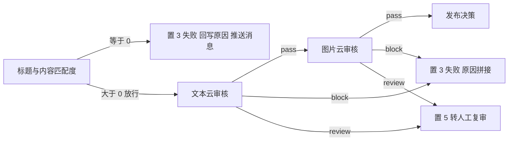

关键路径在两条失败分支的差别上：匹配度不匹配时课程直接拒绝，因为「标题与正文毫无交集」这种错配不需要人再看一眼；云审核返回 block 时同样拒绝但原因更具体，返回 review 时则转人工，机器拿不准的部分永远留给人。两道关的三态在主链里合并决策，谁严听谁的，任何一道不过都到不了发布决策。

## 第6部分：自媒体文章自动审核：文本与图片两道云审核的落地

标题匹配度这道粗筛放行的稿件，真正的内容风险判断才刚开始。文本违不违规、图片干不干净，由云内容安全接口回答；接口封装在接入阶段已经收进公共模块，业务侧剩三个问题要解决：一篇文章里的文本和图片怎么拆出来、拆出来之后怎么送审、两份结论怎么合成一个决定。这三个问题的答案就是 `handlerTextAndImages`、两个云审核组件的调用点与一张结论合并表，review 的状态写入也在这条链上。

### content 里有什么：一次遍历分拣两组数据

富文本的结构在发布文章时已经定型：`content` 是一个 JSON 数组，每个元素带 `type` 与 `value` 两个键，`type` 为 `text` 是文本节点，`type` 为 `image` 是图片节点，取值统一挂在 `value` 上。有一点要提醒：有些编辑器实现会把文本放在 `text` 键下，解析之前先打开表看一眼库里真实的结构，按实际结构取键，不要凭约定硬写。

分拣动作独立成一个方法，文本与图片各走一个容器：

```java
/** 一次遍历分拣正文：文本拼进 sb，图片地址收进 images */
private void handlerTextAndImages(List<String> images, StringBuilder sb, JSONArray jsonArray) {
    for (Object obj : jsonArray) {
        JSONObject jsonObj = (JSONObject) obj;
        String type = (String) jsonObj.get("type");
        if ("image".equals(type)) {
            String value = (String) jsonObj.get("value");
            if (value != null) {
                // 库里存的是文件 ID，云审核要网络地址，拼上文件服务器前缀
                images.add(fileServerUrl + value);
            }
        }
        if ("text".equals(type)) {
            // 文本段全拼成一个字符串，送审时是一个任务
            sb.append(jsonObj.get("value"));
        }
    }
}
```

调用侧先解析再分拣，封面图也是文章的一部分，逗号拼接的文件 ID 拆开并入图片组：

```java
List<String> images = new ArrayList<>();
StringBuilder sb = new StringBuilder();
JSONArray jsonArray = JSON.parseArray(wmNews.getContent());
handlerTextAndImages(images, sb, jsonArray);
// 封面图同样要过检，逗号分隔的文件 ID 逐个并入图片组
if (wmNews.getImages() != null && !wmNews.getImages().isEmpty()) {
    for (String img : wmNews.getImages().split(",")) {
        images.add(fileServerUrl + img);
    }
}
```

方法用出参回填而不是返回对象，是录屏里的原始形态，与「组装一个 Map 返回两个列表」的写法功能等价，工程里二选一即可。文本用 `StringBuilder` 累积有个讲究：文本审核按任务计费，整篇文本拼成一个任务一次送审，比逐段送审省调用次数；代价是失去段落级定位，返回的违规结论只知道命中在整段文本里，不知道在哪一段，审核日志里把响应完整落一行可以部分弥补。

从 content 到三态决策的整条路径是这张图：

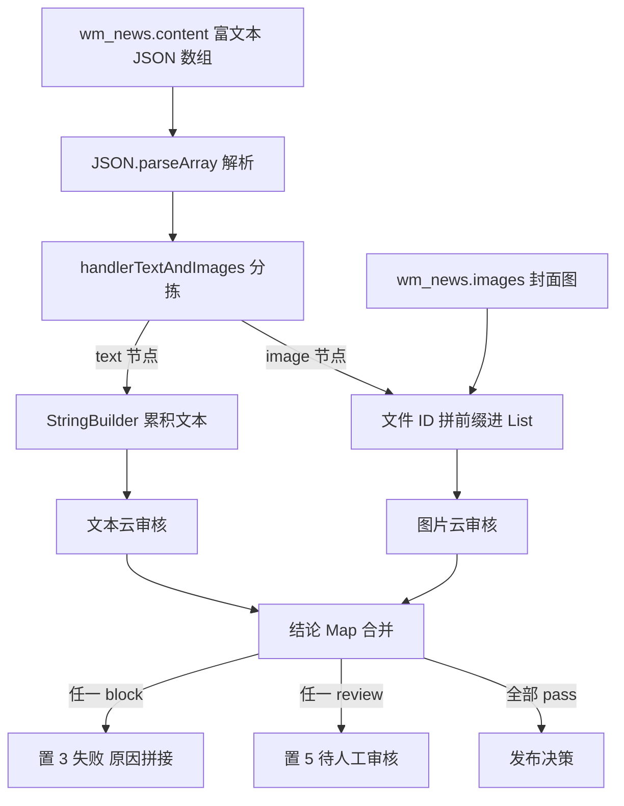

关键路径在分拣这一步：文本与图片走向不同接口，容器类型也不同，一次遍历同时产出两组数据，避免 content 被解析两遍。

### 两个云审核组件的接入与调用

两个封装类是普通 Spring 组件，密钥走配置文件注入，业务类里两个字段挂上 `@Autowired` 就能调：

```java
@Autowired
private AliyunTextScanRequest aliyunTextScanRequest;

@Autowired
private AliyunImageScanRequest aliyunImageScanRequest;
```

调用点各包一层，把空集合、异常这两类边界统一收口：

```java
/** 文本审核：整篇文本一个任务送审，返回 suggestion */
private String scanText(StringBuilder sb) {
    if (sb.length() == 0) {
        return "pass";
    }
    try {
        // 单个任务上限 10000 字符，超长文本要按段落拆成多个任务
        return getSuggestion(aliyunTextScanRequest.textScanRequest(sb.toString()));
    } catch (Exception e) {
        // 调用异常宁可转人工，也不能当成通过或失败
        return "review";
    }
}

/** 图片审核：地址列表一次送审，返回 suggestion */
private String scanImage(List<String> images) {
    if (images.isEmpty()) {
        return "pass";
    }
    try {
        return getSuggestion(aliyunImageScanRequest.imageScanRequest(images));
    } catch (Exception e) {
        return "review";
    }
}
```

三态的语义与后续动作是固定映射：

| suggestion | 语义 | 审核链路的动作 |
|---|---|---|
| `pass` | 内容正常 | 进入下一道关或发布决策 |
| `review` | 疑似违规，机器拿不准 | 置 5，转人工复审 |
| `block` | 命中违规 | 置 3，回写原因并推送作者 |

`getSuggestion` 负责从响应里取值：先判请求级 `code`，再判任务级 `code`，两层都过 200 才读 `results` 里的 `suggestion`，多个场景多条结论按「取最严」归并成单值。文本与图片两个接口共用这一套解析，理由在接入阶段说过：返回结构同族，业务侧的解释规则写一遍就够。

### 结论合并：Map 组装与取最严

两侧结论出来后收进一张 Map，key 是送审对象，value 是各自的 `suggestion`：

```java
// 两道云审核的结论收进 Map，LinkedHashMap 固定顺序，失败文案的拼接顺序随之稳定
Map<String, String> suggestions = new LinkedHashMap<>();
suggestions.put("text", scanText(sb));
suggestions.put("image", scanImage(images));

Map<String, String> failReasons = new LinkedHashMap<>();
failReasons.put("text", "文本内容违规");
failReasons.put("image", "图片内容违规");

String reason = null;
boolean needManual = false;
for (Map.Entry<String, String> entry : suggestions.entrySet()) {
    String suggestion = entry.getValue();
    if ("block".equals(suggestion)) {
        // 失败原因按送审对象逐段拼接，一次把问题说全
        reason = reason == null
                ? failReasons.get(entry.getKey())
                : reason + "；" + failReasons.get(entry.getKey());
    } else if ("review".equals(suggestion)) {
        needManual = true;
    }
}
// 任一 block 整体判死，哪怕另一侧是 pass
if (reason != null) {
    failReview(wmNews, reason);
    return;
}
// 没有 block 但有 review，转人工复审
if (needManual) {
    updateWmNews(wmNews, WmNewsConstants.ADMIN_PENDING, "内容涉嫌违规，转人工复审");
    return;
}
// 两道关全过，进入发布决策
```

这段代码里藏着三个决策。**合并规则取最严。** 文本 `pass`、图片 `block`，整体就是失败；任何一侧 `review`，整体就进人工。风险判断是单向的，取最严保证结果与遍历顺序无关，也不会出现「一半干净一半违规所以放行」的荒唐结论。**失败原因集中拼接。** 文本与图片的问题用分号连成一句文案回写 `wm_news` 并推送，作者改一轮就能改完所有问题，不用被同一篇文章打回两次。**Map 的装配顺序即文案顺序。** `LinkedHashMap` 保持 text 在前、image 在后，失败文案永远是「文本内容违规；图片内容违规」这种稳定次序，运营复盘日志时不用猜顺序为什么变来变去。

送审顺序本身也有讲究：文本先、图片后。文本审核是纯字符串计算，快且便宜；图片审核要云服务按地址把图拉回去再识别，慢且有取不到图的风险。先跑便宜的一侧，能在内容本身违规时省下一次图片调用，虽然合并决策的结论不变，成本账上有差别。

### review 转人工：状态写入与后续闭环

`review` 的落点是状态 5，回写动作与失败路径共用那个按需更新的 update，只改状态与原因两列：

```java
/** 转人工复审：置 5 待人工审核，原因一并回写 */
private void toManualReview(WmNews wmNews, String reason) {
    updateWmNews(wmNews, WmNewsConstants.ADMIN_PENDING, reason);
}
```

状态 5 的稿件离开自动审核链，进入管理端的人工复审队列。复审有两个出口：通过则置 4，驳回则置 3 写明原因。置 4 的稿件再次进入审核入口时，分流分支识别出「人工审核通过」，直接走落库发布，机器不再重审一遍。这张闭环图把 review 之后的事说全：

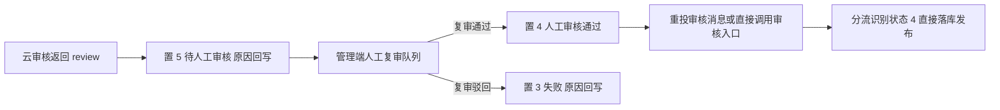

为什么 `review` 不折算成通过或失败？因为机器在这一刻没有把握。折算成 `pass`，违规内容放行的损失由全体读者承担；折算成 `block`，正常作者被误伤，申诉与二次审核的成本也省不掉。转人工把判断权交还给人，代价是一点人力，换来两类误判都不发生，这是三态设计里最值钱的一个值。

## 第7部分：审核通过后的跨库落库：作者建档与文章主表写入

三道审核关全过，发布决策落地，数据要从自媒体端搬进 App 端。搬运动作有先后：作者记录先就位，文章主表才有 `author_id` 与 `author_name` 可挂；主表行拿到主键，配置表与内容表才挂得上。这一篇把前两步写透：作者怎么「查无则建」，文章主表十几个字段各自从哪来，以及一个容易被忽略的底层问题，App 端文章的主键到底由谁发号。

### 保存顺序：依赖决定时序

落库四件套加回写，谁先谁后不是风格问题，是数据依赖问题。作者记录是文章主表的归属来源，文章主键是两张子表的挂接点，回写又要把两端数据用 `article_id` 缝起来：

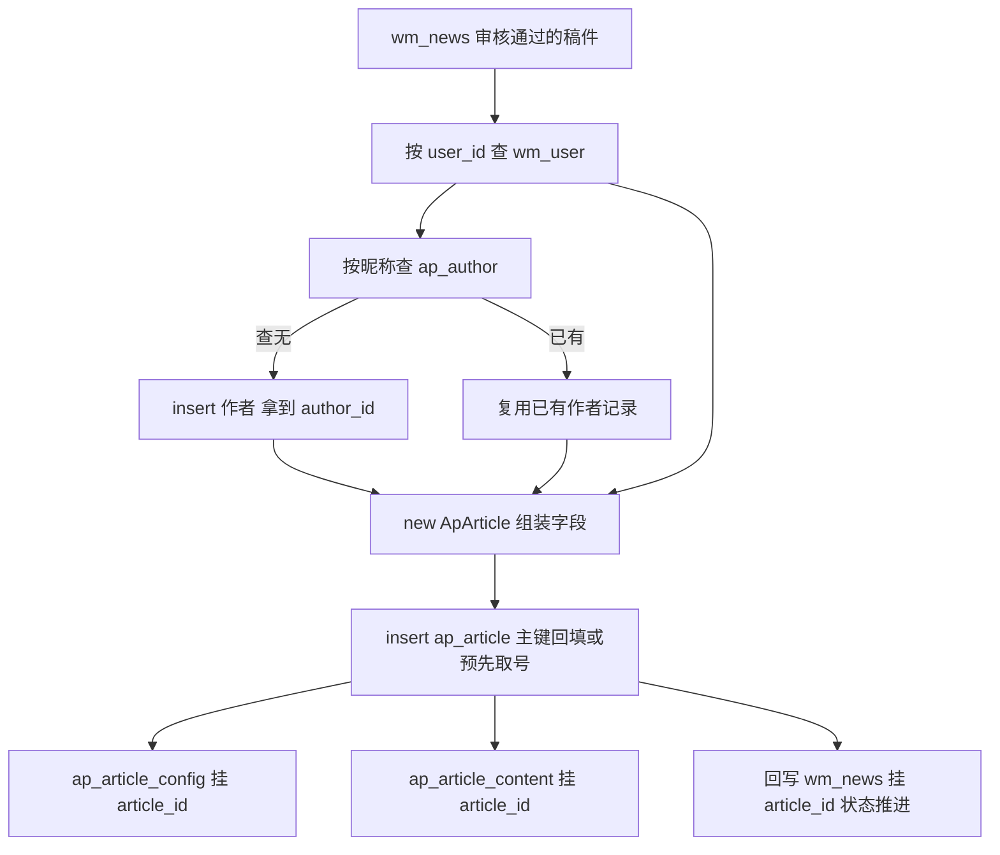

图上配置与内容两表的先后无所谓，它们互不依赖；作者与文章的先后不能动。作者这一步还有一个前置：昵称在自媒体用户表里，先按 `wm_news.user_id` 把 `wm_user` 查出来，昵称与两个关联 id 才有着落。

### 作者查无则建：给 App 端补上归属

创作者在自媒体端发文，App 端读者看到的作者从哪来？答案是 `ap_author` 表。文章主表的 `author_id` 与 `author_name` 都挂在这条记录上，所以文章落库前作者必须存在，没有就现场补一条：

```java
/** 作者查无则建：App 端文章的作者归属来源 */
private ApAuthor saveAuthorIfAbsent(WmNews wmNews) {
    if (wmNews.getUserId() == null) {
        return null;
    }
    // 昵称在自媒体用户表里，先查 wm_user
    WmUser wmUser = wmUserMapper.selectByPrimaryKey(wmNews.getUserId());
    if (wmUser == null || wmUser.getName() == null) {
        return null;
    }
    ApAuthor author = apAuthorMapper.selectByAuthorName(wmUser.getName());
    if (author == null || author.getId() == null) {
        author = new ApAuthor();
        author.setName(wmUser.getName());
        // 类型按字典落码：1 签约合作方，2 平台自媒体人
        author.setType((short) 2);
        // 过渡期两个关联都先落自媒体用户 id：user_id 在两端账号打通后改指 App 端用户主键
        author.setUserId(wmUser.getId());
        author.setWmUserId(wmUser.getId());
        author.setCreatedTime(new Date());
        apAuthorMapper.insert(author);
    }
    return author;
}
```

「查无则插」解决的是首次发文场景：创作者从没在 App 端留过作者记录，第一篇文章落库时补建，之后每次发文都查到已有记录直接复用。查在前、插在后，重复执行也不会造成重复数据。`type` 的取值看字典注释，录屏里先随口给了 1，对照字段注释把「平台自媒体人」的 2 定下来，取值本身不影响链路，语义以表注释为准。两个 id 字段值得分清：`wm_user_id` 固定指向 `wm_user` 主键，是自媒体侧的正式关联；`user_id` 是留给 App 端用户体系的关联位，课程数据里两端账号还没打通，过渡期先落自媒体用户 id，打通后改指 `ap_user` 主键，字段语义不因过渡赋值而改变。

### 文章主表：字段映射与图片地址拼装

主表十几个字段来自三个方向，组装前对着表列一遍，能避免「想当然有值」的漏设：

| ap_article 字段 | 来源 | 说明 |
|---|---|---|
| title / labels / publish_time | wmNews 对应字段 | 创作侧一路带过来 |
| layout | wmNews.type | 自媒体侧的排版类型映射为 App 端布局 |
| author_id / author_name | 作者记录 | 查无则建之后必有值 |
| channel_id | wmNews.channelId | 直接透传 |
| channel_name | ad_channel 反查 | 按频道主键查名称后冗余一份 |
| images | wmNews.images 拼前缀 | 文件 ID 逗号分隔，逐段补服务器地址 |
| created_time | new Date() | 落库时间 |
| 点赞、收藏、评论、阅读等统计列 | 暂不设 | 新文章从零起步 |

频道名为什么要冗余？列表页每次展示都要频道名，冗余一列换来免联查，这正是建表规约里「字段允许适当冗余」条款的教科书场景。图片的处理最容易被漏：`wm_news.images` 存的是逗号分隔的文件 ID，App 端要直接渲染，落库前逐段拼上文件服务器前缀：

```java
ApArticle apArticle = new ApArticle();
apArticle.setTitle(wmNews.getTitle());
apArticle.setLabels(wmNews.getLabels());
apArticle.setPublishTime(wmNews.getPublishTime());
// 自媒体侧的排版类型就是 App 端的布局值
apArticle.setLayout(wmNews.getType());
apArticle.setCreatedTime(new Date());
if (author != null) {
    apArticle.setAuthorId(author.getId());
    apArticle.setAuthorName(author.getName());
}
// 频道名按主键反查后冗余，判空后再取值，频道被删时不至于空指针
if (wmNews.getChannelId() != null) {
    AdChannel channel = adChannelMapper.selectByPrimaryKey(wmNews.getChannelId());
    apArticle.setChannelId(wmNews.getChannelId());
    apArticle.setChannelName(channel == null ? null : channel.getName());
}
// images 是逗号分隔的文件 ID，App 端要直接展示，逐段拼上服务器前缀
if (wmNews.getImages() != null && !wmNews.getImages().isEmpty()) {
    String[] splits = wmNews.getImages().split(",");
    StringBuilder sb = new StringBuilder();
    for (int i = 0; i < splits.length; i++) {
        if (i > 0) {
            sb.append(",");
        }
        sb.append(fileServerUrl).append(splits[i]);
    }
    apArticle.setImages(sb.toString());
}
apArticleMapper.insert(apArticle);
```

`fileServerUrl` 从配置注入，换域名或上 CDN 时改一处配置就够，这也是库里存 ID 而不存全 URL 的理由。来源列是表里后加的，实体类与 insert 列清单要同步补齐，表、实体、XML 三处口径一致，测试环节里这个坑还会现形一次。insert 语句沿用主键回填的老规矩：

```xml
<insert id="insert" useGeneratedKeys="true" keyProperty="id">
    insert into ap_article
        (title, author_id, author_name, channel_id, channel_name, layout,
         flags, images, labels, publish_time, created_time)
    values
        (#{title}, #{authorId}, #{authorName}, #{channelId}, #{channelName}, #{layout},
         #{flags}, #{images}, #{labels}, #{publishTime}, #{createdTime})
</insert>
```

执行完这行 insert，`apArticle.getId()` 就有值，后面两张子表全靠它挂接。

### 主键从哪来：自增回填与分布式发号

上面这套自增回填在演示环境里跑得好好的，前提是文章表还躺在单库单表里。mycat 那条线的规划里，`ap_article` 与用户、评论同属一组数据节点，按 id 对 40 取模拆成 `app_info_0` 到 `app_info_39`，路由条件就是 id 本身。这一下游戏规则变了：id 必须在 insert 之前就定下来，SQL 才知道往哪个分片发；而自增回填是「插完才知道 id」，且各分片各发各的号，40 个节点迟早撞车。

解法是应用侧发号，day03 封装好的 ZooKeeper 发号组件正好接上：枚举里登记 `AP_ARTICLE`，Sequences 组件按表名取号，跨实例唯一、严格递增。切换后的形态只多两行：

```java
// 分片口径：主键应用侧生成，取号失败终止写入
Long id = sequences.sequenceApArticle();
if (id == null) {
    throw new RuntimeException("文章主键取号失败，终止本次发布");
}
apArticle.setId(id);
apArticleMapper.insert(apArticle);
```

对应地，insert XML 里的 `useGeneratedKeys` 与 `keyProperty` 要摘掉，主键列由实体带入。发号组件的口径是现成的：计数器持久在 ZooKeeper 节点上，重启接着发、多实例不重号；每次取号一次 ZK 写入，文章发布是中低频操作，这点代价换全局唯一很划算。两条口径并存并不矛盾：单库演示期用回填，分片切换时换发号，切换点只在「insert 之前有没有 setId」这一处，后面的子表挂接逻辑一行不改，因为 `getId()` 在两种口径下都有值。

## 第8部分：文章内容与配置落库：大字段拆存、互动开关与事务边界

文章主表行有了主键，剩下两件行李各归各表：富文本正文进 `ap_article_content`，互动开关进 `ap_article_config`。两张子表字段都少，写法也就是两次 insert，但背后压着三个工程问题：大文本怎么存才不拖垮查询、布尔字段语义怎么定才不会写反、四个写操作怎么抱成一个整体。这一篇把这三个问题说透，顺带把事务的边界画出来。

### 内容表：压缩着存的大字段

一篇文章里最重的数据就是正文。发布编辑器产出的富文本是一段 JSON 数组字符串，动辄几十 KB 起步，审核链路里它原样躺在 `wm_news.content`，落库 App 端时原样搬进 `ap_article_content`，多压一道再进去：

```java
ApArticleContent apArticleContent = new ApArticleContent();
apArticleContent.setArticleId(apArticle.getId());
// 富文本 JSON 压缩后再入库，省一半以上存储
apArticleContent.setContent(ZipUtils.gzip(wmNews.getContent()));
apArticleContentMapper.insert(apArticleContent);
```

`ZipUtils` 是公共 utils 工程里的工具类，`gzip` 压缩、`gunzip` 解压两个静态方法成对出现。压缩的收益立竿见影：JSON 里大量重复的结构字符（引号、括号、键名）正是压缩算法的拿手好戏，长文压完往往只剩原来的一小半。代价是读侧多一步解压，App 端文章详情接口把这条记录取出来后先 `gunzip` 再回给前端，读写两侧必须成对，一边压缩另一边忘了解压，前端拿到的就是一串不可读的编码。

content 为什么独立成表而不进主表？按读写模式划边界：列表页、推荐流查询的是主表的短列，几百条一页也不会拖出大字段；只有详情接口按文章主键点查时才访问内容表。拆开之后主表的缓存行紧凑，列表查询的 IO 量小一个量级，这是 App 端把一篇文章拆成三条记录的架构理由，审核落库只是按既定结构补数。

### 配置表：四个互动开关

配置表记录读者侧能对当前文章做什么，四个开关加一个挂接键：

```java
ApArticleConfig apArticleConfig = new ApArticleConfig();
apArticleConfig.setArticleId(apArticle.getId());
// 默认值：可评论、可转发开启；未下架、未删除
apArticleConfig.setIsComment(true);
apArticleConfig.setIsForward(true);
apArticleConfig.setIsDown(false);
apArticleConfig.setIsDelete(false);
apArticleConfigMapper.insert(apArticleConfig);
```

四个字段的命名与类型出自建表规约的强制条款：表达「是与否」的字段必须用 `is_xxx` 命名、`tinyint(1)` 存储，1 表示是、0 表示否。Java 实体里映射成 `Boolean`，true 与 1、false 与 0 由驱动层换算。

| 字段 | 语义 | 默认值 | 谁来改 |
|---|---|---|---|
| is_comment | 是否可评论 | true | 运营在管理端按文章调整 |
| is_forward | 是否可转发 | true | 同上 |
| is_down | 是否下架 | false | 同上 |
| is_delete | 是否已删除 | false | 删除动作置位 |

默认全开是一个产品决策：新文章发布即具备完整互动能力，评论转发这些社交行为是内容分发的燃料；关闭是运营针对单篇的精确干预，不该由代码默认替运营做。`is_down` 是四个字段里最容易踩的坑，录屏里教师先口误说成「是否可以下载」，对照表注释后当场纠正为「是否下架」，默认值落 false。它的业务后果写在详情接口里：状态检查发现 `is_down` 为 true 时，接口只回配置不回正文，文章从读者侧消失但数据还在。字段名直译与业务语义有偏差时，一切以表注释为准。

### 事务边界：哪些写操作要抱在一起

落库方法现在有了完整动作序列：作者、文章、配置、内容四张 App 端表加回写。事务注解把这段动作抱成一个整体：

```java
@Transactional
public void reviewSuccessSaveAll(WmNews wmNews) {
    // 1 作者查无则建  2 反查频道
    // 3 insert ap_article 主键回填或预取号
    // 4 insert ap_article_config  5 insert ap_article_content
    // 6 回写 wm_news 挂 article_id 并推进状态
    // 7 站内信通知作者
}
```

注解罩住的是当前数据源的连接：四条 insert 任何一条失败，已执行的回滚，库里不会留下「主表有、子表无」的半成品。课程演示环境里两端表都挂在同一套库上，注解全包；工程化拆分后自媒体库与文章库各归各的数据源，一个本地事务就罩不住两端的写入了，边界要重新画：

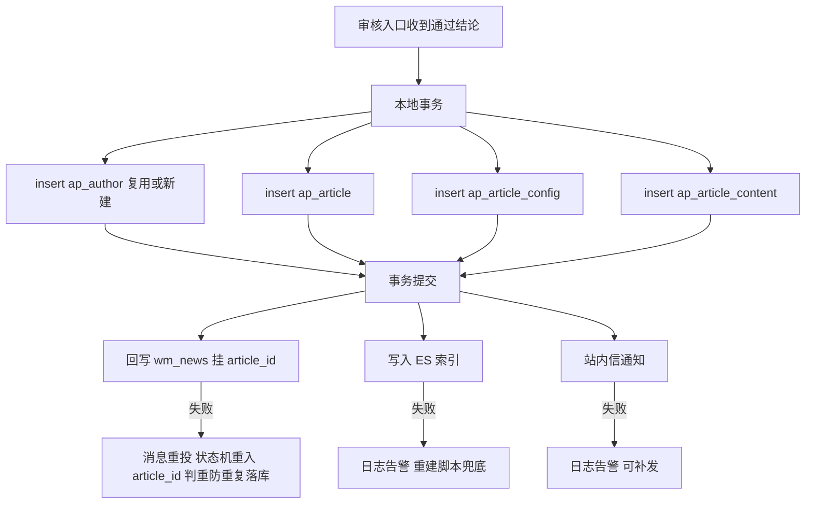

图上的三条虚线外动作是设计要点。**回写 `wm_news` 放在事务提交之后。** App 端四表是一致性的核心，先保它们；回写失败时文章已发布但稿件状态还停在旧值，重投审核消息让入口分流重新接住，入口先看 `article_id` 有没有值，有映射的稿件不重复插入，直接补齐回写即可。**ES 与站内信在事务之外。** 索引是检索副本，删了能从 MySQL 重灌，站内信是通知，晚到比回滚好；把它们塞进事务，等于把外部系统的故障传染给本地数据，一次 ES 抖动就回滚一次发布，得不偿失。**事务里不碰任何远程调用。** 持锁时间与事务时长成正比，云审核一次几秒的调用若是进了事务，连接池很快就被拖穿。

跨库一致性在这里的取舍是「本地事务加最终一致」，而不是分布式事务。发布链路的每一步都有明确的恢复路径：重投消息、状态机重入、幂等判重，三条腿把失败态拉回正轨，比引入分布式事务框架的复杂度划算得多。

## 第9部分：审核链路收官：检索索引同步、站内通知与三态全链路测试

审核代码一行行写完，不等于链路能用。从消息进、到落库出，中间任何一个 bean 没装配上、任何一列没对齐、任何一处比较符方向写反，都要靠真跑一遍才现形。这一课把审核服务架到单元测试上，先跟断点走通「通过落库」的完整链路，把发布之后的两件收尾事补齐（同步检索索引、给作者发站内通知），再把失败、转人工、待发布这些出口逐一验证，每条出口都查库对账。

### 测试怎么架：容器、bean 与一条待审数据

测试类放在 admin 服务的测试源码目录，注解口径与普通 Spring Boot 测试一致：

```java
@RunWith(SpringRunner.class)
@SpringBootTest
public class ReviewArticleTest {

    @Autowired
    private ReviewMediaArticleService reviewMediaArticleService;

    @Test
    public void testReview() {
        // 待审稿件：wm_news 里准备一条状态为 1 的文章
        reviewMediaArticleService.autoReviewArticleByMedia(6110);
    }
}
```

`@SpringBootTest` 不指定引导类时按工程默认配置启动完整容器，所有业务 bean 按生产形态装配，测出来的就是真实链路。方法入参只是一个文章 id，状态由库里的数据决定，测试本身无状态，重复跑不互相污染。

第一次运行没有走到业务逻辑就报了错：JestClient 找不到。审核通过后要往 ES 写索引，JestClient 是 common 通用模块产出的单例 bean，而 common 的配置类不在 admin 引导类的扫描范围内，容器里自然没有这个 bean。解法是课程里反复出现的引子类模式，admin 工程放一个配置类把 common 的 ES 包扫进来：

```java
/** 引入 common 模块的 ES 配置，admin 工程即可注入 JestClient */
@Configuration
@ComponentScan("com.study.headline.elasticsearch.config")
public class EsClientConfig {
}
```

两个注解各管一件事：`@Configuration` 声明配置类，`@ComponentScan` 把 common 的 ES 配置包拉进扫描范围。这类「bean 找不到」的报错排查有固定顺序：先确认依赖模块在不在 classpath，再看扫描范围罩没罩住，最后才怀疑业务代码。

测试数据用一条真实稿件，每轮跑之前把它拉回初始态：

```sql
-- 复位：状态回到待审核，清掉上轮留下的结论
update wm_news
set status = 1, article_id = null, reason = null, publish_time = null
where id = 6110;
```

发布时间按用例另设，三态验证那一段会用到。数据复位是链路测试的基本功，上一轮的终态就是下一轮的输入，不复位就会出现「为什么这次没走这个分支」的错觉。

### 通过场景：跟着断点走一遍全链路

断点打在审核入口方法上，debug 启动测试类，整条链路按代码顺序走一遍。查库拿到 6110 这条稿件，状态是 1，进自动审核链。匹配度先算，方法返回一个 0.012 附近的小值，大于 0 即放行，短标题配数字占位正文的占比特性，与阈值设计的口径完全对上。

往下是拆分与送审。`handlerTextAndImages` 分拣完，图片列表有一条，`StringBuilder` 里攒着正文文本。文本审核先跑，返回 `pass`。图片审核返回的却是 null：稿件里的图片地址是本机文件服务器路径，云服务按地址取图，公网上根本拉不到本机的内容，取不到就给不出结论。这个现象在录屏里被当场定性：不是代码错，是测试数据不可达，把稿件里的图片换成公网可访问的地址即可复测；同时代码要补上 null 分支，不能让空结论悬空：

```java
// 图片审核结论为 null：云接口没有取到可判定的内容，不能当 pass 处理
if (imageSuggestion == null) {
    failReview(wmNews, "图片审核出现问题");
    return;
}
```

空结论按失败处理是课程的取舍：取不到图通常意味着地址有问题，回写原因让作者换图重传，比转人工更快。与调用异常返回 `review` 的口径放在一起看，两条规则共同保证一件事，异常路径绝不落到 `pass`。

继续往下走到作者环节，查 `wm_user` 再查 `ap_author`，作者记录已经存在，走复用分支不重复插入。文章主表组装完执行 insert 时报错：insert 列清单里有一个来源列，实体类里没有对应的属性与读写方法，MyBatis 取值失败。原因很朴素，这列是表后来加的，实体没跟上。补上实体属性再跑，insert 通过。这个坑把一条纪律钉得很实：表、实体、XML 三处口径必须同步变更，任何一处滞后都会在运行期爆出来。

再往下是 ES。索引写入时连接被拒，本机开发环境的 ES 还没启动。把 ES 进程拉起来（安装目录下的启动脚本，地址 `localhost:9200`），断点继续，索引创建成功，状态回写执行完毕，方法走完。查库对账：

```sql
-- 自媒体侧：状态推进为已发布，挂上 App 端主键
select id, status, article_id, reason from wm_news where id = 6110;

-- App 端：主表按标题筛出新行
select id, title, channel_id, layout, publish_time
from ap_article where title = '222';

-- 子表各一行，article_id 用上一步查到的主键（示例值 6112）
select article_id, is_comment, is_forward, is_down, is_delete
from ap_article_config where article_id = 6112;

select article_id, length(content) from ap_article_content where article_id = 6112;
```

四组结果各自落位：`wm_news` 状态变 9 且 `article_id` 有值，主表新行带齐频道与布局，配置表四个开关是默认值，内容表躺着一条压缩后的富文本。链路走通的标准就是这种逐表对账，而不是控制台没报错。

### 发布之后：同步 app_info_article 检索索引

文章发布的权威落点是 MySQL 四表，但读者的入口还有一个搜索框。`app_info_article` 这份检索副本在搜索模块搭建时就建好了 mapping 与常量类，当时的灌库靠手工脚本，审核链路落地之后，发布即同步就替代了手工灌库成为常态路径。同步代码接在落库之后：

```java
// 组装索引文档，字段口径与 app_info_article 的 mapping 一一对应
EsIndexEntity esIndexEntity = new EsIndexEntity();
esIndexEntity.setArticleId(apArticle.getId() == null ? null : apArticle.getId().longValue());
esIndexEntity.setChannelId(wmNews.getChannelId() == null ? null : Long.valueOf(wmNews.getChannelId()));
esIndexEntity.setContent(wmNews.getContent());
esIndexEntity.setPublishTime(new Date());
// 1 表示上架有效
esIndexEntity.setStatus(1L);
esIndexEntity.setTitle(wmNews.getTitle());
if (wmNews.getUserId() != null) {
    esIndexEntity.setUserId(wmNews.getUserId().longValue());
}
// 来源标记：自媒体审核通过的文章标 media，与站内导入的 article 区分
esIndexEntity.setTag("media");

Index.Builder builder = new Index.Builder(esIndexEntity);
// 文档 id 用文章主键，重发是覆盖而不是追加
builder.id(apArticle.getId().toString());
// 立即刷新，刚发布的文章马上可搜
builder.refresh(true);
Index index = builder.index(EIndexConstants.ARTICLE_INDEX)
        .type(EIndexConstants.DEFAULT_DOC)
        .build();
JestResult result = null;
try {
    result = jestClient.execute(index);
} catch (Exception e) {
    log.error("执行 ES 创建索引失败, message: {}", e.getMessage());
}
if (result != null && !result.isSucceeded()) {
    log.error("插入更新索引失败, message: {}", result.getErrorMessage());
}
```

五个设计点值得逐个说清。**文档 id 用文章主键。** 同一篇文章因消息重投再同步一次，结果是覆盖更新，副本不会越写越多，这份幂等性是主键换来的，`builder.id()` 一行不能省。**`refresh(true)` 是有代价的即时可见。** ES 写入默认近实时，靠后台定期刷新把段变成可搜索，刚发布的文章想立刻被搜到就显式刷新一次，发布是低频动作，这点写放大换读者体验划算，高频批量导入反而不要开。**content 用明文入索引。** `title` 与 `content` 两个 text 域都配了 ik 分词器，分词器需要可切词的明文，压缩编码在文本域里只能切出噪声 token；省体积的压缩适合 MySQL 的存储层，不适合放在要参与检索的域上。**`tag` 是来源标记。** mapping 里它是 keyword 不分词，站内导入标 `article`，自媒体审核通过标 `media`，同一份索引靠它区分内容来源，后续按来源过滤、加权都有了抓手。**失败只记日志不回滚。** try 与结果判定两层都只打 error 日志，MySQL 权威数据已经落稳，索引是副本，丢了能从库里重灌，一次发布不该因为 ES 抖动而回滚。

发布成功后三份落点的分工是这张图：

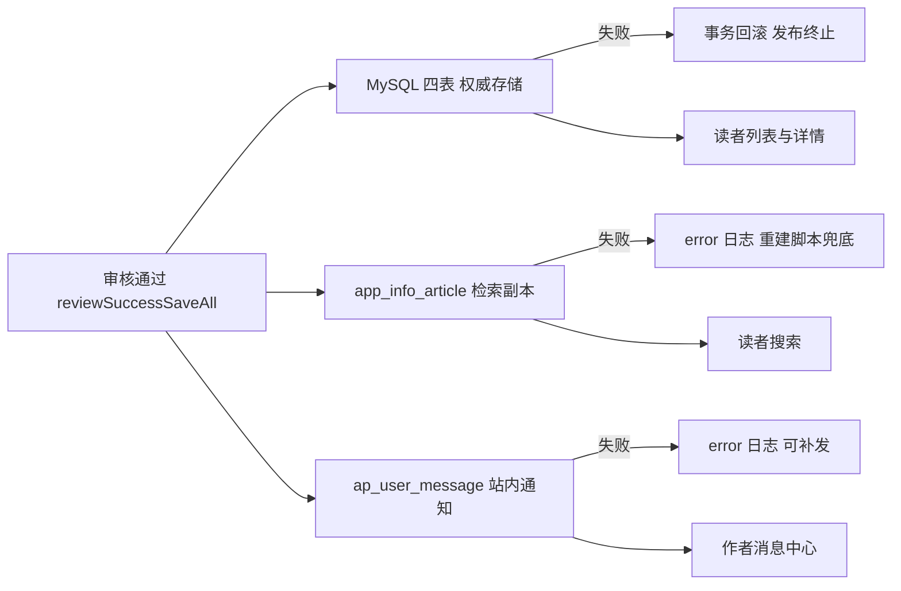

三条出路各自独立失败、各自有恢复路径，权威与副本的角色分得清清楚楚，这是发布链路里最重要的可靠性结构。

### 成功通知：给作者的一条站内信

落库与索引之后，作者本人还什么都不知道。审核链的最后一跳是站内信，`ap_user_message` 插一条记录，先看回写与通知的衔接：

```java
// 回写关联主键并推进状态：审核成功、已发布
wmNews.setArticleId(apArticle.getId());
updateWmNews(wmNews, WmNewsConstants.PUBLISHED, "审核成功");

// 通知作者审核成功：站内信一条记录
ApUserMessage apUserMessage = new ApUserMessage();
apUserMessage.setUserId(wmNews.getUserId());
apUserMessage.setCreatedTime(new Date());
// 未读标记默认 false，App 端消息列表据此亮红点
apUserMessage.setIsRead(false);
apUserMessage.setContent("您的文章审核通过，已发布");
// 消息类型走字典：文章审核通过（录屏按 108 落码，值以工程字典登记为准）
apUserMessage.setType(WmNewsConstants.MSG_ARTICLE_AUDIT_PASS);
apUserMessageMapper.insert(apUserMessage);
```

回写在通知之前，顺序有意义：作者点进消息跳到文章页时，文章必须已经对读者可见，落库是通知的前置事实。消息类型是一个登记在字典里的枚举值，关注、点赞、评论、审核通过与失败各占一档，App 端消息列表按类型渲染图标与跳转，录屏里给「文章审核通过」登记的是 108，示例代码收进常量类，取值以工程字典为准。未读标记落 false，作者打开消息列表才置已读，红点机制全靠这个字段。站内信选落库而不是即时推送，理由是可靠：作者此刻可能不在线，落库的消息什么时候打开都在，推送丢了一条就永远丢了。

### 三态各自验证：一张矩阵走完所有出口

通过场景只覆盖了一条路，审核链的出口还有五个。把它们列成矩阵，逐格设计用例：

| 初始状态 | 发布时间 | 走到的分支 | 终态 |
|---|---|---|---|
| 1 待审核 | 空或已到点 | 三道关全过，立即发布 | 9 已发布 |
| 1 待审核 | 未到点 | 三道关全过，暂存待发布 | 8 待发布 |
| 1 待审核 | 任意 | 云审核 review | 5 待人工 |
| 1 待审核 | 任意 | 云审核 block 或结论为空 | 3 失败 |
| 1 待审核 | 任意 | 匹配度为 0 | 3 失败 |
| 4 人工通过 | 任意 | 分流直落，跳过机器审核 | 9 已发布 |
| 8 待发布 | 已到点 | 补发落库 | 9 已发布 |
| 8 待发布 | 未到点 | 不动作，等定时任务 | 8 不变 |

分流入口的判定顺序支撑这张矩阵，整理后的代码长这样：

```java
// 状态 4：人工复审已通过，跳过机器审核直接落库
if (WmNewsConstants.ADMIN_SUCCESS.equals(wmNews.getStatus())) {
    reviewSuccessSaveAll(wmNews);
    return;
}
// 状态 8 且发布时间已到：到点补发
if (WmNewsConstants.TO_BE_PUBLISHED.equals(wmNews.getStatus())
        && wmNews.getPublishTime() != null
        && !wmNews.getPublishTime().after(new Date())) {
    reviewSuccessSaveAll(wmNews);
    return;
}
// 状态 8 且未到点：等定时任务，直接返回
if (WmNewsConstants.TO_BE_PUBLISHED.equals(wmNews.getStatus())) {
    return;
}
// 状态 1：进入自动审核链，三道关之后按发布时间决策
```

逐格验证的过程比结论更有信息量。**状态 4 的用例**把 `wm_news.status` 改成 4 再跑，断点落在分流第一支直接进落库，机器审核一秒都不跑，人工复审的结论被完整尊重，终态 9。**状态 8 加未来时间的用例**把发布时间设到还没到的日期，断点走进 8 分支后方法直接返回，数据原地不动保持 8，「什么都不做」也是正确出口，补发要等发布任务的定时扫描。**状态 8 加过去时间的用例**把发布时间改成已过去的日期，断点进补发分支，落库完成置 9。这个分支的判定方向最容易写反：录屏里最初写成「发布时间大于当前时间就落库」，没到点反而先发，语义完全是反的，正确写法是当前时间已过发布时间才补发。时间比较符的两侧谁减谁、大于小于朝哪边，写的时候对着「到点」两个字念一遍再落笔。

**状态 1 加未来时间的用例**最有意思：走自动审核链，三道关全过之后发布决策发现时间未到，置 8 待发布收尾。为了隔离变量，录屏把文本与图片两段送审临时注掉，只留匹配度关，这是合理的调试手法，但要立一条收尾纪律：注掉的代码必须还原，否则下一个真实稿件就会跳过云审核直奔发布。测试完顺手在 Kibana 里核对索引侧：

```json
GET app_info_article/_search
{
  "query": { "match": { "title": "222" } }
}
```

搜得到刚才那篇标题，说明同步路径健康。三态出口的完整地图是这张图：

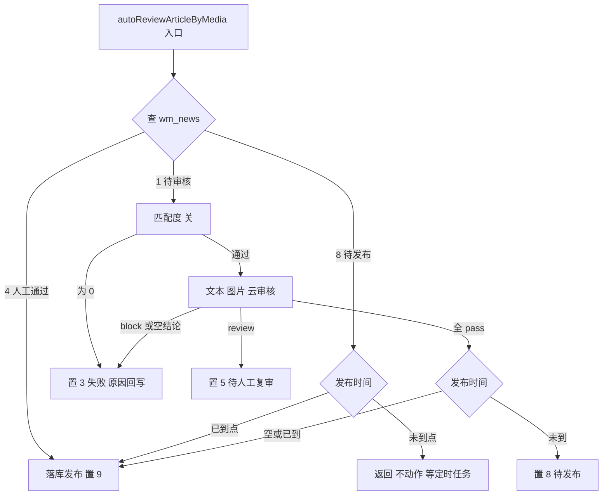

每条出口都以一个明确的状态值收尾，没有一条路是「走完了但什么都没改」。矩阵八行对应图上八个叶节点，测试要做的就是把每个叶节点至少踩一遍，然后查库确认终态与矩阵一致。

## 第10部分：自媒体发布文章接入消息队列：发送、消费与端到端联调

审核主流程到此已经齐了：标题与内容匹配度、文本云审核、图片云审核三道关依次放行，状态分流与发布决策也定了口径。还剩最后一块拼图：触发入口。自媒体用户点下「提交」按钮之后，谁来调这套审核服务？直接在提交请求里同步调用是能跑通的写法，代价是把发布动作与审核动作焊死在一起。这一天把入口换成 Kafka 消息：发布侧落库成功就发一条消息，审核侧监听到消息再开工，发送侧、接收侧、端到端联调三段一次讲完。

### 为什么发布不直接调审核

同步调用的代价可以数出三层。**第一层是耗时。** 云审核接口单次调用在几百毫秒到几秒之间，一篇多图文章要按图片数量多次调用，用户点提交后盯着按钮转圈等全套流程走完，体验直接崩坏。**第二层是耦合。** 发布在 media 微服务，审核在 admin 微服务，跨服务同步调用意味着 admin 一抖动，用户连文章都存不上；两边的发布节奏也被捆死，无法独立扩容。**第三层是可靠性。** 同步调用失败后没有自然的重试机制，审核又不能不做，最终要么丢审核要么人工兜底。

换成消息队列之后，职责边界变成两句话：media 只负责「写库加发消息」，admin 只负责「收消息加审核」。两边各自部署、各自重启、各自扩容，互不牵连；admin 短暂下线，消息仍躺在 broker 里，服务恢复后接着消费。审核入口按文章 id 查库再开工的设计在审核流程设计那一课已经定下，消息本身不承载业务数据，被重投或乱序都不影响正确性。

整条链路画成时序图是这样，关键点在提交接口先返回，审核在消费侧异步完成：

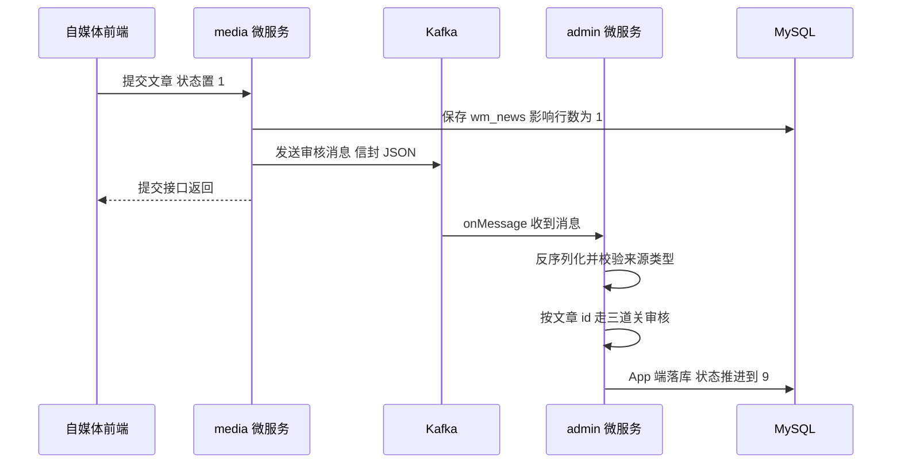

### 给消息起名字：topic 进配置

发消息前先定 topic 名。按封装的约定，topic 完整名以 single 结尾表示单消息通道，中段是业务名，名字不写死在代码里，统一配在 properties 文件中。环境相关的取值先登记在测试环境的配置里，构建时汇入 `kafka.properties`：

```properties
# 单通道消息：提交文章审核
kafka.topic.submit-article-auth=submit-article-auth
```

配置类那边加一个字段，宽松绑定把 `kafka.topic.submit-article-auth` 映射成 `submitArticleAuth`：

```java
@Data
@Configuration
@ConfigurationProperties(prefix = "kafka.topic")
@PropertySource("classpath:kafka.properties")
public class KafkaTopicConfig {
    String adminTest;           // 上一课测试消息用的字段
    String submitArticleAuth;   // 提交文章审核消息，对应上面那行配置
}
```

命名上有个细节值得对照着看。封装测试时用的 admin-test 消息配的是完整名 `headline.topic.admin-test.single`，这次业务消息在测试环境里键与值都取了 `submit-article-auth`，图的是联调时好认。上线前把值按命名约束补齐前缀与通道后缀即可，业务代码全程只认 KafkaTopicConfig 的字段，配置怎么改代码都不动，这正是名字进配置的意义。

### 消息实体：信封套数据

消息类分两层。外层是封装体系的抽象信封 KafkaMessage，内层才是这次的业务数据体，起名 SubmitArticleAuto，两个字段：

```java
public class SubmitArticleAuto {

    /** 文章来源：自媒体还是爬虫 */
    private ArticleType articleType;
    /** 文章 id，审核侧凭它查库 */
    private Integer articleId;

    public enum ArticleType { WMEDIA, CRAWLER }

    // getter 与 setter 省略
}
```

articleType 这个字段单看当前功能是多余的，自媒体文章没有第二种来源。多出来的原因是文章马上会有两个入口：自媒体用户发的，和爬虫从外部内容站抓的，两种文章都要过审核，审核入口又是同一个。消息通道共用一条，接收端拿 articleType 分流，爬虫链路接入时只需新增一个枚举值加一个分支，信封与通道都不用动。假若系统里永远只有自媒体一个来源，这个字段才真正可以删掉。

信封子类把数据体装进去，同时声明自己的消息名：

```java
public class SubmitArticleAuthMessage extends KafkaMessage<SubmitArticleAuto> {

    public SubmitArticleAuthMessage() {}

    public SubmitArticleAuthMessage(SubmitArticleAuto data) {
        super(data);
    }

    @Override
    public String getType() {
        return "submit-article-auth";
    }
}
```

无参与有参两个构造器分别对应「装好再填」与「构造即装」两种写法，泛型参数把 data 的类型钉死为 SubmitArticleAuto，取数据时不用强转。getType 返回的字符串与 topic 配置同源，都是提交文章审核这个业务名。信封基类里的 retry 与 time 两个元数据字段在失败重试那一环才显出价值，消息名与数据体是收发两端对账的凭据，这套设计在 Kafka 封装那一课逐行拆过，此处直接复用。

### 发送动作：三层封装各司其职

真正发送时自上而下经过三层。最底层是封装工具类 KafkaSender 的 `sendMesssage`，它把信封对象用 ObjectMapper 转成 JSON 字符串交给 KafkaTemplate，方法名三个 s 是资料原样，引用时保持一致；中间一层是 media 端的业务发送器，负责把 topic 常量、key 与消息对象凑齐；最上层是发布业务点，只管组装数据体然后调用。

业务发送器起名 AdminMessageSender，名字里的 Admin 指的是消息的去向：admin 端是审核方，这个类的职责就是替发布动作给审核方递消息：

```java
@Component
public class AdminMessageSender {

    @Autowired
    private KafkaSender kafkaSender;
    @Autowired
    private KafkaTopicConfig kafkaTopicConfig;

    /** 发送文章提交审核的消息 */
    public void sendSubmitArticleAuthMessage(SubmitArticleAuthMessage message) {
        kafkaSender.sendMesssage(kafkaTopicConfig.getSubmitArticleAuth(),
                UUID.randomUUID().toString(), message);
    }
}
```

topic 从配置类取，key 统一用 UUID。key 的取值决定了消息落在 topic 的哪个分区，随机 UUID 意味着审核消息在分区间均匀散开、多消费者并行处理，审核消息彼此独立没有顺序诉求，这样取正合适。

写完这层直接注入会报红：media 微服务的包扫描路径覆盖不到 common 工程里的 kafka 包，封装的那些 Bean 根本没进容器。补一个配置类把包扫进来：

```java
@Configuration
@ComponentScan("com.study.headline.common.kafka")
public class KafkaConfig {
}
```

类体是空的，它存在的意义就是一句话：让 media 微服务加载 Kafka 封装的全部 Bean。跨工程复用组件时，包扫描这一步是最常被漏掉的环节，报错信息往往只是 NoSuchBeanDefinitionException，与真正的病灶隔了好几层。

### 发布点改造：条件触发才发消息

发布文章的公共入口 saveNews 草稿与提交共用，方法只差一个状态常量。内部落库的私有方法按封面类型分支处理单图、多图与无图，落库动作完成之后才是这次要加的发送逻辑，两个条件缺一不可：

```java
private void saveNews(WmNews news, int countImageNum, Short type) {
    // 封面类型分支落库，略
    int temp = this.saveOrUpdateNews(news);   // 新增或更新，单行写入
    if (temp == 1 && WmMediaConstants.WM_NEWS_SUBMIT_STATUS == type) {
        // 只有提交状态且写库成功才触发审核消息
        SubmitArticleAuthMessage message = new SubmitArticleAuthMessage();
        SubmitArticleAuto submitArticleAuto = new SubmitArticleAuto();
        submitArticleAuto.setArticleId(news.getId());      // wm_news 主键
        submitArticleAuto.setArticleType(SubmitArticleAuto.ArticleType.WMEDIA);
        message.setData(submitArticleAuto);
        adminMessageSender.sendSubmitArticleAuthMessage(message);
    }
}
```

状态常量挡住草稿：存草稿不走审核，草稿消息发出去审核入口查到状态不在准入集合里也是空跑一趟，不如在源头不发。影响行数判断挡住写库失败：新增或更新单行写入，temp 等于 1 才说明文章确实存进去了，写库都没成功就发消息，消费端按 id 查库查不到东西，一条废消息白走全程还排进重试。两个条件合在一起，消息发出的那一刻，库里必然存在一条待审核的文章，消费侧的查库才有意义。

消息里装的 id 是 `wm_news` 的主键，不是 App 端的文章 id，此刻文章还没资格进 App 端。审核通过后的 App 端四表落库、检索索引同步与作者消息推送是审核链路的收尾动作，落库细节由本章的落库篇目专门展开，这里只锁定消息链路本身。

### 接收侧：实现监听接口触发审核

admin 端建一个监听器类，实现封装的 KafkaListener 接口。不走 @KafkaListener 注解的原因在封装那一课讲过：实现接口加返回 topic，容器启动时由注册工厂统一建容器完成注册，重试模板、错误处理器、并发度这些容器级参数全部收敛在一处，新增监听点两行事搞定。

```java
@Slf4j
@Component
public class AutoReviewArticleListener implements KafkaListener<String, String> {

    @Autowired
    private KafkaTopicConfig kafkaTopicConfig;
    @Autowired
    private ObjectMapper mapper;
    @Autowired
    private ReviewMediaArticleService reviewMediaArticleService;

    @Override
    public String topic() {
        return kafkaTopicConfig.getSubmitArticleAuth();
    }

    @Override
    public void onMessage(ConsumerRecord<String, String> consumerRecord,
                          Consumer<?, ?> consumer) {
        String value = consumerRecord.value();
        log.info("接收到的消息为：{}", value);
        try {
            SubmitArticleAuthMessage message =
                    mapper.readValue(value, SubmitArticleAuthMessage.class);
            if (message != null) {
                SubmitArticleAuto.ArticleType type =
                        message.getData().getArticleType();
                if (type == SubmitArticleAuto.ArticleType.WMEDIA) {
                    Integer articleId = message.getData().getArticleId();
                    if (articleId != null) {
                        reviewMediaArticleService.autoReviewArticleByMedia(articleId);
                    }
                }
            }
        } catch (Exception e) {
            log.error("自动审核文章错误: {}", value, e);
            throw new RuntimeException("消息处理错误", e);
        }
    }
}
```

onMessage 的结构是四个动作按序排开。记日志留痕，原始 JSON 打进控制台，排查问题时这是第一现场；反序列化还原信封，发送端 writeValueAsString 的逆操作，两端类型对得上才能还原；校验与分流，消息非空、来源类型是 WMEDIA、文章 id 非空三道小闸依次过，爬虫类型的消息在这版代码里直接穿过不做处理，分支留给 day08 之后的爬虫链路；最后把文章 id 交给审核服务，autoReviewArticleByMedia 内部查库、按状态分流、走三道关，监听器对审核一无所知，它只完成「消息到调用」的翻译。

### 异常抛出去，才有重试闭环

catch 块里先落日志再抛异常，这个组合是刻意的。手动提交位移加 ackOnError 为 false 的口径下，监听方法正常返回，容器就认为处理成功，位移照常往前推。catch 住异常只打日志不抛，等于对容器谎报军情：处理明明失败了，位移却推进了，这条消息就此消失，审核永远不会发生。

异常抛出去，接力棒才交到封装手上：重试模板在容器内原地重试五次，间隔按指数随机退避；五次耗尽后 RetryErrorHandler 接手，把消息 retry 加一、原样回滚到原 topic 重新排队，重试超过十次或消息存活超过一小时才抛弃并落日志。消息链路的可靠性不在监听器代码里，而在异常是否诚实地向外传播，这是接封装体系时最容易丢掉的一环。

### 端到端测试：一条消息的完整旅程

三个服务齐上：media 与 admin 的引导类 debug 启动，自媒体前端工程本地跑着。断点打在监听器的 onMessage 入口，然后从前端登录，新建一篇文章：标题 6666，正文写几个字，插图一张，封面选单图，点提交。

提交接口几乎立即返回，因为 media 端只做了落库加发消息；几乎同时，消费侧断点命中。调试器里能看到两个关键观察点：

| 观察点 | 位置 | 期望内容 |
|---|---|---|
| value 原始串 | onMessage 入口 | 信封 JSON，含 retry、time、type 与 data |
| 反序列化结果 | mapper.readValue 之后 | data 里 articleType 为 WMEDIA，articleId 为 7102 |
| App 端文章表 | 审核前后各查一次 | 审核前无此稿，审核后文章出现 |
| wm_news 状态 | 审核完成后查询 | 状态推进到 9 已发布，article_id 已回填 |

放行反序列化那一步，message 对象展开后 data 节点里 WMEDIA 与 7102 两个值都在，消息在传输与还原过程中没有失真。此时去数据库查 App 端文章表，这篇标题带 6666 的稿件还查不到，审核尚未执行：

```sql
-- 审核前：App 端文章表还没有这篇稿件
SELECT id, title, publish_time FROM ap_article WHERE title LIKE '6666%';
```

继续放行断点，监听器调审核服务，三道关跑完通过，App 端落库完成。再查一次，文章出现了，`wm_news` 里对应记录的状态变成已发布：

```sql
-- 审核通过落库后：文章进入 App 端文章表，稿件状态推进到已发布
SELECT id, title, publish_time FROM ap_article WHERE title LIKE '6666%';
SELECT id, status, article_id FROM wm_news WHERE id = 7102;
```

回到前端文章管理列表刷新，这条稿件的状态显示为「已发布」。整条链路没有一步人工干预：提交触发落库，落库触发消息，消息触发审核，审核触发发布，作者感知到的只有列表状态的变化。生产者与消费者的封装体系加上审核服务，到这里真正闭环。

## 常见误区

- **把 review 或 suggestion 折算成 pass 或 block。** 错例：只判断 pass 与非 pass，比如 `if (!"block".equals(suggestion))` 就当通过处理，疑似违规内容直接放行；或把「机器拿不准」当成「内容违规」直接判死。正解：suggestion 是三态，review 既不是通过也不是失败，而是疑似违规转人工；折算错方向都会造成误放或误伤，三态要分开处理，block 判失败，review 置 5 进人工复审队列，pass 才放行，判断权交还给人。
- **密钥进代码或进版本库。** 错例：把 AccessKey 写死在类里、提交到仓库，泄露等于把整个云账号交出去，任何人都能用你的额度调接口。正解：密钥放部署环境的 properties 属性文件加前缀注入，并加入忽略清单，代码与仓库里永远只有打码值，日志里也不打印。
- **只审正文不审图。** 错例：只遍历正文节点，文本过了图片没审，封面图里的违规内容直奔首页。正解：封面图与配图同样是风险面，两路都要送检，`wm_news.images` 拆开并入图片组一起送审；量大的站点可以按地址去重，避免正文图重复计费。
- **长文不分段直塞接口。** 错例：一整篇文章几千字甚至十几万字拼成一个 task 直接送审，超出单任务 10000 字符上限，接口直接报错。正解：按段落拆成多个 task 一次送审，每个 task 的 dataId 独立，失败能定位到段，任一段 block 即整篇失败，结论仍按取最严合并。
- **图片场景无脑拉满。** 错例是把文档里十几个场景全配上，计费次数翻着倍地涨。正解按业务风险挑两到四个场景，成本与覆盖拿平衡，后续要加场景只改一个列表。
- **把云审核调用塞进提交请求。** 错例是 Controller 里同步调接口，提交卡几秒，接口超时连文章都存不上。正解是落库加发消息后立即返回，审核在后台跑。
- **消息体塞整篇文章。** 错例：把标题、内容、图片列表全部装进消息，消息臃肿且有一致性风险，库一改消息就过期，重投后审到的还是旧版本。正解：只传文章 id 与来源类型，审核侧查库为准，库里永远是最新数据。
- **忘了待发布态。** 错例是审核通过一律立即发布，定时发布的文章提前见读者。正解是发布时间未到先置 8，到点再发布。
- **失败原因留空或被覆盖。** 错例：状态置 3 但原因留空，作者只看到失败看不到为什么；或文本与图片两道关卡各自失败各自写，后者覆盖前者，作者只看到一个原因。正解：结果合并后拼成一句完整文案，失败原因拼接完整后与状态一起回写。
- **insert 忘配主键回填。** 错例：`ap_article` 的 insert 裸写 SQL，落库成功但 `apArticle.getId()` 是 null，配置表与内容表的 `article_id` 全空，落成孤儿数据。正解：`useGeneratedKeys="true"` 加 `keyProperty="id"`，一行属性都不能少，或分片口径下 insert 前先取号 setId。
- **回写用全字段 update。** 错例是改个状态把整行重写，未参与审核的字段被旧值覆盖，并发下还会互相踩。正解是 `updateByPrimaryKeySelective` 动态更新，改什么写什么。
- **云审核异常当成通过。** 错例是 catch 里返回 pass 或吞掉异常继续走，接口抖动时违规内容放行。正解是异常路径统一返回 review 转人工，判断权交还给人。
- **查无则插不做并发防护。** 错例是两个请求同时查空同时插入，作者表出现两条同名记录。正解是按名称加唯一索引兜底，插入冲突时回查复用已有记录。
- **状态比较写反空指针。** 错例是 `wmNews.getStatus().equals(4)`，历史数据 status 为 null 时直接 NPE。正解是常量在前的 equals，常量永远不为 null。
- **把字面相似度当语义理解。** 错例是以为比值高就一定切题，标题堆满正文热词的标题党同样能拿高分。正解是认清 LCS 只能保证字面交集，语义错配靠人工复审或向量级相似度方案，自实现规则只做粗筛。
- **阈值按直觉设比例。** 错例是拍一个 0.3 或 0.5，短标题长正文的正常文章被批量拦截。正解是从「大于 0」起步，把误杀风险控制住，再按线上数据逐步收紧。
- **忘了剔除标点与空白。** 错例是原文直接送比，标点夹在重合片段中间把连续性打断，最长公共子串被截短，比值骤降。正解是 `removeSign` 先行，让比值只反映真实字符的交集。
- **调用点参数顺序随意。** 错例是有的地方 content 在前、有的地方 title 在前，算法虽然对称，口径一乱后来者读代码就要反复确认分子分母。正解是全工程约定 content 在前、title 在后。
- **取值键名凭约定硬写。** 错例是文本节点按 `text` 键取值，库里的结构实际统一用 `value`，取出来全是 null，文本审核空转。正解是解析前先查库确认真实结构，键名按数据现实写。
- **图片地址不经处理直接送审。** 错例：把文件 ID 当地址传给云接口，或稿件图片地址指向本机文件服务（`localhost`），云服务取不到图，结论要么为空要么报错，还以为是接口坏了。正解：补上文件服务器前缀还原成网络地址，地址必须公网可达；测试数据用公网可访问的地址，代码兜住空结论分支。
- **先插文章再补作者。** 错例是按代码书写顺序先写主表 insert，`author_id` 拿不到值，挂出一张无主文章。正解是按依赖排时序，作者就位再组装主表。
- **images 原样落库。** 错例是把文件 ID 逗号串直接存进 `ap_article.images`，App 端渲染时图全裂。正解是逐段拼上文件服务器前缀，前缀走配置注入。
- **分片表继续用自增回填。** 错例是分片上线后保留 `useGeneratedKeys`，路由找不到 id、各分片自增号互相冲突。正解是应用侧取号后再 insert，XML 摘掉回填属性。
- **频道反查不做判空。** 错例是 `channel.getName()` 裸调，频道被运营下线后审核一篇旧稿直接空指针。正解是判空后再取名称，或按业务决定是否中断发布。
- **压缩与解压不成对。** 错例是落库时 `gzip`、读取时直接 `setContent` 原样返回，前端拿到一串乱码。正解是读写两侧共用 `ZipUtils` 的成对方法，接口联调时用长文实测一遍编码可读性。
- **is_down 望文生义。** 错例是按「是否下载」把默认值写成 true，新文章刚发布就处于下架状态，详情接口不返回正文。正解是按表注释定语义，默认 false。
- **远程调用塞进事务。** 错例是把 ES 写入或云审核调用包进 `@Transactional` 方法，外部系统一抖，本地四表跟着回滚，连接还被长时间占用。正解是远程动作出事务，失败走日志告警与重试。
- **报 bean 找不到就怀疑业务代码。** 错例是 JestClient 注入失败后翻审核服务找问题，实际是 common 模块配置类不在扫描范围。正解是按「依赖在不在、扫描罩没罩住、代码对不对」的顺序排查，装配问题大多在前两步。
- **时间比较符方向写反。** 错例是「发布时间大于当前时间即落库」，未到点的文章被提前发布。正解是围绕「到点补发」的语义写条件，写完用一个未来时间用例反证。
- **测试数据不复原。** 错例是上一轮把状态改成 4 测完不管，下一轮想测自动审核却总是直落，排查半天代码。正解是每轮跑前执行复位 SQL，让用例之间互不残留。
- **调试期注掉的代码忘还原。** 错例是为测时间分支把云审核两段注释掉，提交后线上稿件跳过风险审核。正解是注掉的段落当场还原，提交前用通过场景的完整用例再跑一遍收尾。
- **写库失败仍发消息。** 错例是不看影响行数，落库异常被上层吞掉后消息照发，消费端按 id 查不到文章，废消息走完重试全程才被抛弃。正解是影响行数为 1 且状态为提交才发送，源头保证「消息必有对应数据」。
- **消费异常只打日志不抛出。** 错例是 catch 块里 log.error 完就正常返回，容器视同处理成功并提交位移，失败消息无声消失。正解是日志之后把异常抛出去，让重试模板与错误处理器接管，回滚重投的闭环才有入口。
- **把 topic 名硬编码进业务类。** 错例是发送与接收两边各写一个字符串常量，多环境切换或改名时两边漂移，消息发到错误通道。正解是名字进 properties，两端都从 KafkaTopicConfig 的字段取。
- **接收端不校验来源类型。** 错例是拿到消息直接当自媒体文章审核，等爬虫文章接入同一通道后，爬虫稿被当成自媒体稿处理，作者与来源全错。正解是按 articleType 分流，每种来源一条分支，未知类型直接跳过。

## 面试可能被问到的问题

1. 面试官追问：「为什么用云端内容安全服务，不自研审核？」
   答：识别能力需要词库、模型与规则持续迭代，自研成本高、冷启动效果差；云服务多维特征加多模型多标签持续更新，按量计费，结论结构化成三值加标签加概率，直接映射状态机。审核这种非核心但专业深的环节，交给云服务性价比最高。
2. 面试官追问：「pass、review、block 三个值分别怎么处理？」
   答：pass 走自动通过进入发布；block 判审核失败，作者可修改后重新提交；review 转人工复核队列，由运营给出最终结论。三值分支是审核主流程的骨架，文本与图片两路共用。
3. 面试官追问：「AccessKey 这类密钥在工程里怎么管理？」
   答：密钥放独立的属性文件，通过占位符注入，文件加入版本库忽略清单；不同环境用不同密钥，代码与仓库里只有打码占位。泄露过的密钥要立即在控制台禁用换新。
4. 面试官追问：「文本审核和图片审核结论不一致怎么办？」
   答：两路独立判定，任一路 block 即整篇失败，任一路 review 即转人工，结论取严格方向；通过必须是文本与图片全部 pass。一致性由合并规则保证，不靠接口之间协调。
5. 面试官追问：「云端审核服务不可用时审核链路怎么办？」
   答：调用失败按可重试异常处理，走消息回滚重新排队；持续不可用时降级，稿件停留在待审态或批量转人工，不放行未审内容。审核是质量关口，宁可堆积不可跳过。
6. 面试官追问：「文本审核和图片审核的返回值里，你们最关心哪个字段？为什么？」
   答：suggestion。code 只说明请求与任务处理是否成功，suggestion 才是审核结论。它有三个值：pass 放行、block 判违规、review 转人工。业务上按三态分流，block 回写失败原因，review 进人工队列，pass 走下一道审核。label 与 rate 是辅助信息，用于记录违规类别与置信度。
7. 面试官追问：「AccessKey 和 Secret 怎么管理？」
   答：只放服务端配置文件，通过 @ConfigurationProperties 加前缀注入，不进源码仓库也不打日志。调用接口时由 SDK 用密钥做签名，浏览器端永远接触不到。轮换密钥时只改配置文件重启即可，代码零改动。
8. 面试官追问：「同步审核和异步审核选型怎么考虑？」
   答：同步接口请求返回时结果就绪，写法简单，适合单张图片或小批量场景，代价是调用线程要等结果；异步接口先提交任务再轮询取结果，适合大批量与对延迟不敏感的场景。课程用同步的 ImageSyncScanRequest，一次请求带多个任务，单篇文章的图片量级完全够用。
9. 面试官追问：「图片审核的成本怎么控制？」
   答：计费口径是图片数乘场景数，一张图审四个场景记四次。控制手段有三个：场景按业务风险精选、封面图与正文图分级审核、上线前采购流量包锁定单价。选场景前先算账，避免上线后成本失控。
10. 面试官追问：「封装为什么要放 common 模块而不是审核服务里？」
   答：文本与图片审核不是审核链路的专属能力，社区举报、评论检测都可能复用。封装类无状态、只依赖配置，放公共模块谁依赖谁就能注入，密钥口径也只维护一份。放业务服务里则要跨服务复制或做 RPC，得不偿失。
11. 面试官追问：「为什么用 Kafka 传文章 id，而不是直接把文章内容放进消息？」
   答：消息里放 id，审核侧按 id 查库，拿到的永远是最新数据，不会出现消息内容与库不一致的问题；消息体小，传输与重投成本低；库是权威数据源，消息只承担触发职责。塞内容进消息的方案在文章被修改后会审到旧版本，排查起来也困难。
12. 面试官追问：「状态 8 和 9 的区别是什么，谁把 8 推进到 9？」
   答：8 是审核已通过但发布时间未到，9 是已完成 App 端落库正式发布。8 到 9 的推进由发布侧的定时任务完成，到点扫描待发布文章补发落库；审核入口对「状态 8 且发布时间已到」的消息也会直接走落库分支，两条路都收口在同一个落库方法上。
13. 面试官追问：「消息重投会不会导致重复审核或重复发布？」
   答：靠状态闸门兜底。审核入口只放行状态 1、4 与到点的 8，审核完成或失败后状态已离开这三种取值，重投的消息查库后直接返回；落库方法内部再按文章维度判断，已存在对应 article_id 的稿件不重复写 App 端表。幂等的锚点是状态加唯一关联，而不是消息本身。
14. 面试官追问：「自动审核链为什么把标题匹配度放在云审核之前？」
   答：匹配度是零成本的自实现规则，能在进云接口之前拦掉文不对题的稿件，省下按次计费的调用开销；它也兜住云审核的盲区，云服务只判断内容违不违规，判断不了标题是不是在讲这篇内容。粗筛在前、云审在后，失败成本逐级升高。
15. 面试官追问：「审核失败怎么让作者知道该改哪里？」
   答：失败时把各道关卡的原因拼成一句完整文案，与状态 3 一起回写到 reason 字段，同时按文章审核失败的消息类型给作者推送一条站内消息。作者在自媒体端既能看到列表里的失败状态，也能读到具体原因，修改重提的闭环才算立住。
16. 面试官追问：「审核为什么要放在 admin 端做，自媒体端自己审不行吗？」
   答：审核链路的终点是 App 端四表落库与人工复审，落库需要 App 端的数据访问能力，人工复审的操作者是管理后台的运营，两者都不属于自媒体端。自媒体端只承担创作与提交，提交后发消息即止；admin 端监听消息、跑审核、落库、回写，职责边界与两端的用户体系一致，服务也能独立扩容。
17. 面试官追问：「updateByPrimaryKeySelective 和全字段 update 各适合什么场景？」
   答：selective 版按字段判空动态拼列，适合「只改结论」的回写，避免把没动的列重写一遍；全字段版适合「整行替换」的编辑场景，字段语义上全部有新值。审核回写只动状态、原因、关联主键，用 selective 版最安全，也让 SQL 日志一眼能看出改了哪些列。
18. 面试官追问：「查无则插为什么不用先插后查，或者 upsert？」
   答：作者记录的复用率远高于新建率，先查一次在绝大多数请求里直接命中，省一次写操作与自增主键的消耗；查无则插的冲突窗口极小，配合名称唯一索引兜底即可。upsert 依赖数据库方言，手写 Mapper 的工程里可移植性差，查插组合足够清晰。
19. 面试官追问：「多场景审核结果怎么合并，为什么取最严？」
   答：一个任务多个场景各自出 suggestion，合并规则取最严：任一 block 整体判死，任一 review 整体转人工，全部 pass 才放行。审核的语义是风险控制，宁可多转人工也不能放行风险项，单向合并规则保证了结果不随遍历顺序变化。
20. 面试官追问：「审核落库四张表，怎么保证不留半成品？」
   答：四张表在一个事务里提交，任何一步抛异常整体回滚；insert 顺序按依赖排布，先作者与频道，再主表回填主键，再子表。主键回填失败或子表插入失败都会让事务失败，库里不会出现主表有子表无的稿件。落库之外还有 article_id 回写，它与四表同事务，两边数据才能对得上。
21. 面试官追问：「消息重复投递会不会把一篇文章发布两次？」
   答：不会。审核入口按状态分流，只有状态 1、4 与到点的 8 才有动作，审核完成或失败后状态已离开这些取值，重投消息查库后直接返回；App 端落库前再按 wm_news 的 article_id 判断一次，已有映射的稿件不重复插入。幂等的锚点是文章状态加唯一关联，消息的 at-least-once 语义由此兜住。
22. 面试官追问：「最长公共子串和最长公共子序列有什么区别？」
   答：子串要求字符连续，重合被打断就归零重来；子序列允许跳着匹配，只要相对顺序一致。求「标题词是否原样出现在正文里」用子串更贴合直觉；求「整体语序相似度」用子序列。两者都能用动态规划解，子串的转移方程只在字符相等时累加，子序列还要处理不相等时的状态继承。
23. 面试官追问：「阈值为什么敢定成大于 0 就通过？」
   答：因为短标题配长正文时公共片段占比天然极小，四五个字的标题在一万字正文里哪怕逐字出现，比值也只有万分之几，比例阈值必然误杀。把这道关的职责收窄为「拦住零交集的极端错配」，精判断交给云审核与人工，误杀与漏判的成本在各层之间重新分配。
24. 面试官追问：「这个自实现规则的局限在哪，怎么改进？」
   答：局限有三层：只看字面交集，理解不了同义改写与反讽；分母取总长度，长文稀释了标题占比；矩阵复杂度与两段长度之积成正比。改进路径按成本递增：先做分词后按词命中比例统计，再用关键词提取与加权，最后上向量相似度或语义模型。课程选择最朴素的一层，因为它零成本零依赖，且足够拦住极端错配。
25. 面试官追问：「这道关为什么放在云审核之前，放在之后行不行？」
   答：放在之前有两个收益：零成本的本地计算先拦掉一部分错配稿件，省下按次计费的云调用；极端错配的文章直接拒绝，响应也快。放在之后也能跑通，只是先把调用费用花了，且云审核的结论里没有任何与标题匹配相关的信息，顺序变化不会带来额外收益，所以前置是纯赚的安排。
26. 面试官追问：「标题与内容完全不匹配时，直接拒绝和转人工怎么选？」
   答：看误杀成本与人力成本。零交集是机器极有把握的判断，人工再看一眼的边际价值很低，直接拒绝加推送原因，作者修改重提即可；比值低但不为零的灰色地带机器没有把握，才值得转人工。课程在零交集处选直接拒绝，把人工名额留给云审核返回 review 的真正灰色场景，人力用在刀刃上。
27. 面试官追问：「文本和图片为什么要分开送审，不把整篇内容一起扔给文本接口？」
   答：文本反垃圾接口只吃纯文本，JSON 语法字符混进去会污染判定还浪费配额；图片是二进制内容，要走专用的图片同步接口，由云服务按地址取图识别。两者输入输出结构不同，分开送审各自拿 `suggestion`，业务侧再用统一的合并规则汇成一个决定。
28. 面试官追问：「多个场景多条审核结论，怎么合成一个最终结果？」
   答：按取最严合并。任何一条 block 整体判死，任何一条 review 整体转人工，全部 pass 才放行。审核是风险控制场景，宁可多转人工也不能放行风险项，单向规则还保证结果与遍历顺序无关，结论可复现。
29. 面试官追问：「review 为什么不直接判失败？」
   答：review 的语义是疑似违规，机器没有把握。直接判失败会误伤正常作者，直接放行会漏掉风险内容，两类错误的成本都不低；转人工用少量人力把判断权收回来，误判率由人兜底。折算方案只在人工成本完全不可承受时才考虑。
30. 面试官追问：「云审核接口调用失败怎么办，重试还是放行？」
   答：都不放行。调用抛异常走 review 转人工，让流程继续；响应里结论为空（比如图片拉取不到）按审核出现问题处理，回写原因让作者调整后重提。核心纪律是异常路径绝不落到 pass，接口抖动不能变成违规内容上线的通道。
31. 面试官追问：「封面图和正文里的同一张图会被送审两次，怎么优化？」
   答：图片组在送审前按地址去重，同一个地址只送一次，结论复用。云图片审核按次计费，热门作者选封面几乎都取自正文配图，去重能省下一半以上的图片调用量；实现上是一个 `Set` 的事，收益却直接体现在账单上。
32. 面试官追问：「作者为什么要先查再插，而不是直接插？」
   答：作者记录的复用率远高于新建率，绝大多数发文请求查一次就命中，先插会为每篇文章造一条重复作者。查无则插把冲突窗口压到「首次发文」这一个场景，配合名称唯一索引兜底，插入冲突时回查复用，既省写操作又不产生脏数据。
33. 面试官追问：「ap_author 里 user_id 和 wm_user_id 存的是同一个值，为什么留两个字段？」
   答：语义不同。wm_user_id 是自媒体侧的正式关联，永远指向 wm_user 主键；user_id 是留给 App 端用户体系的关联位，两端账号打通后改指 ap_user 主键。过渡期两者恰好同值，字段语义不因过渡赋值而合并，打通时只动 user_id 一列。
34. 面试官追问：「分片之后主键为什么必须应用侧生成，MyCat 的全局序列不行吗？」
   答：这张表按 id 取模分片，路由条件就是 id 本身，id 必须在 SQL 发出前定下来。自增回填是插完才知道 id，方向反了；全局序列只服务走 MyCat 路由且只依赖 id 列的插入。ZooKeeper 发号让应用先拿号再组装 SQL，与分片路由天然配合，代价是每次取号一次 ZK 写入，中低频的文章发布完全可接受。
35. 面试官追问：「channel_name 冗余在文章表里，频道改名了怎么办？」
   答：接受短暂不一致，列表页展示的旧名称会随文章更新周期收敛；要强一致就在频道改名时批量刷 `ap_article` 的冗余列。冗余的收益是列表页免联查，代价是改名要维护副本，这类字段按规约要求低频变更且短小，符合冗余前提。
36. 面试官追问：「images 为什么存文件 ID 拼前缀，而不是直接存完整 URL？」
   答：ID 是与存储位置解耦的稳定标识，换域名、换文件服务器、上 CDN 时只改配置前缀，存量数据一行不动；存完整 URL 则要把历史数据全部刷一遍。审核侧需要网络地址时现拼，App 端落库时拼好冗余，各取所需。
37. 面试官追问：「文章内容为什么拆独立表，塞主表一个 text 列不行吗？」
   答：主表服务列表与检索的高频查询，content 是最大的字段，塞在主表会让每次列表查询的 IO 成倍增长，缓存行也被大字段撑爆。拆开后主表保持短列，内容表只在详情接口点查时访问，读写模式各得其所，这是典型的按访问模式垂直拆分。
38. 面试官追问：「content 压缩存储的得失是什么？」
   答：得是存储减半以上，JSON 的结构字符压缩率很高；失是读侧多一次解压的 CPU，以及压缩后的内容不能再直接参与模糊检索。所以压缩只用在 MySQL 的存储层，进 ES 索引的正文要保持明文，ik 分词器需要可切词的原文。
39. 面试官追问：「四个开关为什么默认全开，让运营逐个打开不行吗？」
   答：默认全开保证新文章发布即具备完整的互动与分发能力，评论、转发是内容平台的核心增长动作，逐个打开会让一部分文章静默地失去传播路径。运营的干预应当是针对单篇的例外，而不是全员默认的流程。
40. 面试官追问：「跨库写不能放进一个事务，你们怎么保证一致性？」
   答：本地事务保核心四表，回写与通知放事务外靠最终一致：回写失败由消息重投触发状态机重入，入口按 article_id 判重，已有映射的稿件补齐回写而不重复落库；ES 失败走告警与重建脚本；每一步都有确定的恢复路径。分布式事务框架能做同样的事，但引入的复杂度远超这条链路的失败概率。
41. 面试官追问：「is_delete 已经有了，为什么还要 is_down，不直接删？」
   答：两者粒度与可逆性不同。is_delete 是删除标记，语义上文章就此下线；is_down 是下架开关，运营可随时重新上架，数据与关联关系都不动。审核链路、详情接口、列表过滤对两个标记的处理也不同，混用一个字段会让业务规则互相打架。
42. 面试官追问：「文章发布后 MySQL 与 ES 怎么保持一致？」
   答：同步链路是发布动作里紧随落库的一次索引写入，文档 id 用文章主键保证幂等覆盖；写入失败只记日志不回滚，因为 MySQL 是权威存储、ES 是可重建副本，失败靠告警与重建脚本兜底。规模上来后可以演进为发消息异步同步或监听 binlog，一致性语义不变，只是把同步写换成最终一致。
43. 面试官追问：「refresh(true) 做了什么，什么场景该开？」
   答：ES 的写入默认近实时，文档先进内存缓冲，等后台 refresh 把段变成可搜索才可见；显式 refresh 是把这次写入立即刷成可搜索的段。发布链路里读者希望刚发布的文章立刻能搜到，发布又是低频动作，值得开；高频批量导入开了会带来明显写放大，默认策略更合适。
44. 面试官追问：「文档 id 为什么用业务主键，让 ES 自动生成不行吗？」
   答：自动生成意味着每次同步都是新文档，重投消息重同步一次，索引里就多一份重复内容；用业务主键则同一 id 的写入是覆盖更新，天然幂等。它还让按文章主键的点查、删除、重建都变成确定性操作，副本与权威数据之间始终有稳定映射。
45. 面试官追问：「为什么需要 8 待发布这个状态，直接到点再审核不行吗？」
   答：审核结论与发布时机是两个维度，混在一步就要在到点那一刻重新审一遍，风险结论可能已经变化，作者对审核结果的预期也被推迟。拆开后，风险维度在提交时闭环，时间维度独立由发布任务推进，8 这个状态就是两个维度的交接地，到点补发路径与人工通过路径共用同一个落库出口，口径不分叉。
46. 面试官追问：「全链路测试的用例怎么设计，真实调云接口还是 mock？」
   答：状态与发布时间组成矩阵，每个出口至少一个用例，数据每轮复位保证用例独立。云审核走真实接口跑主干用例，结论的三态语义、响应解析、计费路径都能被覆盖；单测层级要隔离外部依赖时再 mock 封装层的返回，分层各自把关。空结论与异常分支是必测项，它们不在正常主干上，最容易在联调时暴露。
47. 面试官追问：「站内信为什么落库而不是调推送？」
   答：落库的消息与用户会话解耦，作者不在线也不会丢，打开消息中心随时可见，未读红点靠已读标记驱动；推送是一次性的通道动作，失败即失联。产品上通知要求可靠送达，推送可以叠加在落库之上做即时提醒，但不能替代落库这条底座。
48. 面试官追问：「发布文章为什么不直接同步调审核服务，要走 Kafka？」
   答：同步调用把发布与审核捆在一起，云审核耗时以秒计，用户提交要盯着等；跨服务同步调用还让 admin 的抖动直接打穿到发布。走消息队列后提交只花落库加发消息的时间，两端独立部署扩容，审核侧故障时消息留在 broker 里，恢复后接着消费，可靠性也是天然的。
49. 面试官追问：「消息体为什么只放文章 id 和来源类型？」
   答：库是权威数据源，消息只承担触发职责。审核侧按 id 查库拿到的永远是最新版本，文章改了内容也不受影响；消息体小，传输与重投成本低；来源类型让同一通道服务多个内容入口，爬虫链路接入时只加分支不动通道。
50. 面试官追问：「消费失败的消息最终会怎样？」
   答：监听器把异常向外抛，容器里的重试模板原地重试五次，间隔指数随机退避；耗尽后错误处理器把消息 retry 加一回滚到原 topic 重新排队，重试超过十次或存活超过一小时就抛弃并落日志。放弃的依据是信封里的 retry 与 time 两个元数据，防止死循环。
51. 面试官追问：「消息的 key 用 UUID 随机生成，不考虑顺序问题吗？」
   答：key 决定分区路由，同一个 key 的消息才保证有序。审核消息彼此独立，没有「先到的消息必须先处理完」的诉求，随机 UUID 让消息均匀散在分区里，多消费者并行消费，吞吐更高。假若业务要求同一篇文章的消息严格有序，把 key 换成文章 id 即可，封装不用动。
52. 面试官追问：「怎么保证一篇文章不会被重复审核或重复发布？」
   答：幂等锚在状态上而不是消息上。审核入口只放行待审核等几种状态，文章审完或失败后状态已离开准入集合，消息重投查库后直接返回；发布落库前再按文章维度判断是否已有对应记录。消息可能重复到达，但状态闸门保证同一条数据只被处理一次。
53. 面试官追问：「media 端注入 KafkaSender 报 NoSuchBeanDefinitionException，你怎么排查？」
   答：先确认 Bean 的提供方与使用方的包路径。封装类在 common 工程的 kafka 包下，media 的启动类扫描的是自己的根包，覆盖不到 common，Bean 根本没注册。补一个 @Configuration 加 @ComponentScan 指向 common 的 kafka 包即可。跨模块复用组件时，包扫描与自动配置的覆盖范围是第一排查项，报错位置往往离病灶很远。

## 配套资料

- 代码：`materials/code/05/头条day07/`。该日资料包目前仅含 Kafka 封装工具类九个真实文件（KafkaSender、KafkaConsumerConfig、KafkaListener、KafkaTopicConfig、KafkaMessage 等），审核链路的消息收发两端可直接复用这套封装；内容安全封装与测试类、审核 Mapper、XML 与 Service、匹配度工具类、作者与文章落库、索引同步与通知、消息实体与监听器等业务代码均未随包提供，文中代码按画面线与口播抄录整理并按本课写法补全为可编译示例，包名统一改写为 `com.study.headline`；引用路径截至 `头条dayNN/` 层级，内层目录冠以项目原名，正文统一以「头条类资讯项目」指代。
- 说明（各部分代码口径差异）：内容安全部分（第1、2、6部分）的接口说明、标签表格与调用示例按画面线抄录并按官方 SDK 文档写法补全，密钥一律打码，SDK 版本号按主流稳定版补全，content 取值键名按画面线与测试数据实际结构统一为 `value`，图片前缀拼接为按工程口径补全的一步；审核全链路（第3、4部分）的审核流程、状态字典与落库逻辑未随包提供、按画面线整理，录屏中发布时间分支的条件按语义整理并已在文中注明，`ap_article` 的 insert 列清单按画面线与建表规约补全；匹配度粗筛（第5部分）的 `Compute` 工具类与审核调用代码按主流写法补全，演示数据与阈值判定按口播整理；作者与文章落库（第7部分）按画面线与口播抄录整理，作者 `type` 的取值按录屏对照字典注释整理为 2，`user_id` 的过渡赋值按画面线保留并已注明语义；内容与配置落库（第8部分）的 `is_down` 语义与默认值按录屏对照表注释整理（录屏先误说成下载，当场已纠正）；收官测试（第9部分）的审核测试类、索引同步与通知代码未随包提供，发布时间分支的比较方向与图片空结论分支的落码按语义整理并已在文中注明，索引文档实体的字段口径沿用搜索模块建好的 `EsIndexEntity`；消息队列接入（第10部分）的消息实体 `SubmitArticleAuto`、`SubmitArticleAuthMessage`、业务发送器 `AdminMessageSender`、监听器 `AutoReviewArticleListener` 与发布点改造未随资料包提供，源码包名为机构前缀，正文统一改写为 `com.study.headline.common.kafka`。
- 代码：`materials/code/05/头条day01/`，内层资料目录含数据库规范设计说明书与项目原型，`wm_news` 加列、`ap_article` 系列表的字段口径、`wm_news.content` 的存储形态、冗余字段条款与 `ap_author` 字段语义可对照核对；`is_xxx` 命名与 `tinyint(1)` 类型规约出自该说明书的建表规约章节。
- 代码：`materials/code/05/头条day02/`，mycat 配置四件套（schema.xml、rule.xml 等），可对照 `ap_article` 的分片与取模规则、主键发号的前提；ZooKeeper 发号组件（Sequences、ZkSequence、ZookeeperClient）的封装口径见 day03 课程实现。
- 环境：课程集群 node01~node03，MySQL root/123456；阿里云内容安全为云端服务，开通与密钥申请需在控制台完成，服务按次计费，调试前确认开通状态与流量包，密钥在配置文件中打码管理，测试机需可访问外网；Kafka 部署在集群节点上，本地调试服务指向集群监听地址，media 与 admin 的 `kafka.hosts` 按所在环境指向真实 broker 地址；Elasticsearch 与 Kibana 装在本机开发环境（`localhost:9200`），用于索引核对与查询验证。
